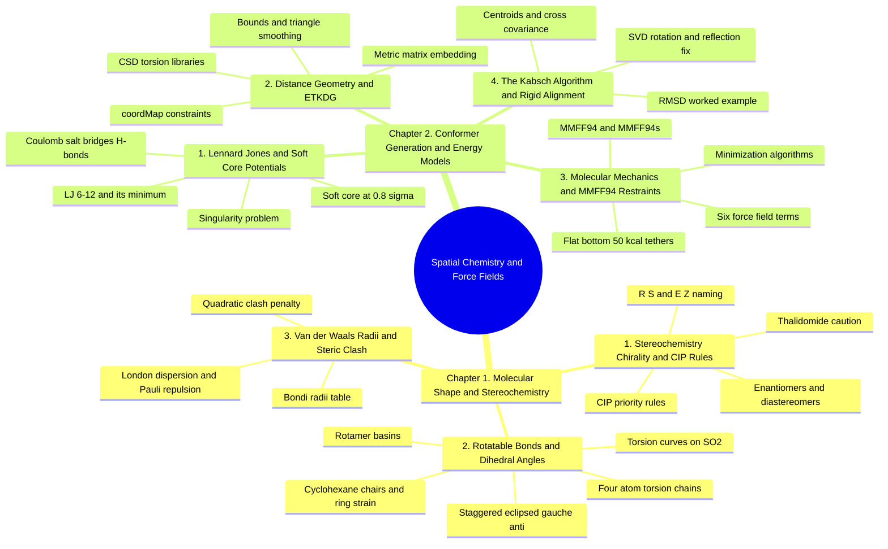

---
tags:
  - moc
  - domain/spatial-chemistry
  - 3dsyntree
module: "03. Spatial Chemistry and Force Fields"
type: moc
---

# 0. Spatial Chemistry and Force Fields MOC

> [!abstract] Module Mission
> This module covers the 3D geometry of small molecules and the classical physics used to score and fix it: stereochemistry and chirality, torsion angles and rotamers, van der Waals contact and clash, and the conformer-generation stack — ETKDG embedding, soft-core Lennard-Jones contact energies, MMFF94 restrained relaxation, and Kabsch rigid alignment. For 3D-SynTree this is the module that explains *how a molecule gets physically sound 3D coordinates inside a protein pocket*, the machinery behind every torsion decision the policy makes.

Navigation: [[0. Master Vault Index]] · [[2. Prerequisite Knowledge Graph]] · [[3. Study Tracks and Curriculum]]

## Module Mind Map

## Chapter 1. Molecular Shape and Stereochemistry

| Note | Focus | Required Depth | Key Prerequisites |
| --- | --- | --- | --- |
| [[1. Stereochemistry Chirality and CIP Rules]] | Chiral centers, enantiomers vs diastereomers vs meso, atropisomerism, full CIP priority rules with tie-breaking and multiple bonds, $(R)/(S)$ and $(E)/(Z)$ assignment, retention/inversion/racemization | Essential | [[3. Molecular Geometry and Hybridization]] |
| [[2. Rotatable Bonds and Dihedral Angles]] | The 4-atom dihedral definition, Newman projections, staggered/eclipsed/gauche/anti, torsional energy curves on the circle, rotamer basins, cyclohexane chairs and ring strain | Essential | [[3. Molecular Geometry and Hybridization]] · [[2. Resonance Conjugation and the Amide Planarity Lock]] |
| [[3. Van der Waals Radii and Steric Clash]] | Bondi radii, London dispersion vs Pauli repulsion, contact distances, the quadratic clash-loss formula | Essential | [[1. Atomic Structure and Electrons]] |

## Chapter 2. Conformer Generation and Energy Models

| Note | Focus | Required Depth | Key Prerequisites |
| --- | --- | --- | --- |
| [[1. Lennard Jones and Soft Core Potentials]] | The classical non-covalent interaction zoo (Coulomb, dielectrics, salt bridges, H-bond geometry, $\pi$-contacts), the LJ 6-12 potential and its minimum at $2^{1/6}\sigma$, the $r \to 0$ singularity, and the $0.8\sigma$ soft-core switch | Supporting | [[2. Chemical Bonds and Electronegativity]] · [[3. Van der Waals Radii and Steric Clash]] |
| [[2. Distance Geometry and ETKDG]] | Distance bounds and triangle-inequality smoothing, metric matrix embedding, CSD-derived torsion knowledge, chirality constraints, and coordMap scaffold pinning | Supporting | [[3. Molecular Geometry and Hybridization]] · [[1. Stereochemistry Chirality and CIP Rules]] |
| [[3. Molecular Mechanics and MMFF94 Restraints]] | Born-Oppenheimer, atom typing, all six force-field terms with equations, MMFF94/MMFF94s vs UFF/AMBER/CHARMM/OPLS, minimizers, flat-bottom harmonic restraints at $50\text{ kcal/mol/Å}^2$ | Essential | [[1. Lennard Jones and Soft Core Potentials]] · [[2. Distance Geometry and ETKDG]] |
| [[4. The Kabsch Algorithm and Rigid Alignment]] | Centroids, the full SVD derivation with the reflection fix, RMSD, and a worked numeric example | Essential | None — self-contained basic linear algebra |

## Learning Path Through This Module

1. [[1. Stereochemistry Chirality and CIP Rules]] — establish what "same molecule, different 3D arrangement" means, why mirror forms matter biologically, and how chirality is named and guarded.
2. [[2. Rotatable Bonds and Dihedral Angles]] — the one geometric variable the whole system actually predicts: the junction torsion, its energy landscape, and its circular topology.
3. [[3. Van der Waals Radii and Steric Clash]] — the hard-sphere contact model and the clash penalty, the first "physical sanity" quantity a generated pose must respect.
4. [[1. Lennard Jones and Soft Core Potentials]] — upgrade the hard-sphere picture to the smooth LJ 6-12 curve, tour the other non-covalent interactions, and see why training forces a soft-core switch at $0.8\sigma$.
5. [[2. Distance Geometry and ETKDG]] — how a flat molecular graph becomes physically plausible 3D coordinates, with torsion statistics from crystallography and the scaffold pinned by coordMap.
6. [[3. Molecular Mechanics and MMFF94 Restraints]] — the force field that relaxes the newly formed junction, and the flat-bottom tethers that stop it from dragging the ligand out of the pocket.
7. [[4. The Kabsch Algorithm and Rigid Alignment]] — the closed-form rigid transform that puts every re-embedded product back into the pocket frame before scoring.

## Why This Module Matters for 3D-SynTree

3D-SynTree's central design choice is to *avoid* predicting all $3N$ coordinates of a new molecule. Instead, each assembly step embeds the incoming synthon with ETKDG (internal geometry locked, scaffold atoms pinned by coordMap), realigns it onto the anchored scaffold with the Kabsch algorithm, and then asks the policy exactly one geometric question: which of the 36 torsion bins should the junction dihedral occupy? Every concept in this module is a load-bearing part of that loop — chirality integrity decides *what* is being built, dihedral physics decides *what is being chosen*, clash and contact potentials decide *how the choice is scored*, and MMFF94 restraints decide *how the geometry is cleaned up afterward*. The soft-core Lennard-Jones term and the steric clash loss are the physical core of the terminal reward, so understanding them is understanding why some poses earn reward and others do not. For the system-level picture of where this loop sits, see [[1. 3D-SynTree System Overview]].

## Gate Check

> [!question] Before moving on, can you...
> - Assign CIP priorities (including a multiple-bond tie-break) and read off $(R)$ or $(S)$ from a drawing with priority 4 pointing at you?
> - Explain why predicting one junction dihedral on $SO(2)$ replaces searching $3N$ coordinates, and why amide junctions offer no torsion choice at all?
> - Compute the clash penalty for a ligand carbon $2.1\text{ Å}$ from a protein carbon, from memory of the tolerance and the quadratic form?
> - State where the Lennard-Jones minimum sits in units of $\sigma$, why $V \to \infty$ as $r \to 0$ derails ML training, and what the $0.8\sigma$ soft-core switch does about it?
> - Walk through the five Kabsch steps — centering, covariance, SVD, determinant fix, translation — and say what breaks if the determinant fix is skipped?

## Primary Reading

Riniker, S., & Landrum, G. A. (2015). *Better Informed Distance Geometry: Using Conformation Libraries to Improve Molecular Conformer Generation*. **Journal of Chemical Information and Modeling**, 55(12), 2562–2574.
