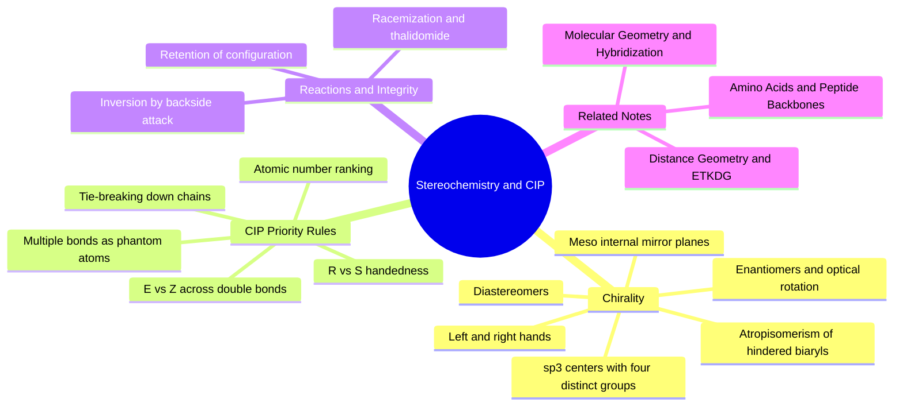

---
tags:
  - domain/spatial-chemistry
  - depth/essential
  - 3dsyntree
  - topic/stereochemistry
  - topic/chirality
module: "03. Spatial Chemistry and Force Fields"
chapter: "Chapter 1. Molecular Shape and Stereochemistry"
type: concept
---

# 1. Stereochemistry Chirality and CIP Rules

> [!abstract] Core Idea
> A molecule is chiral when it cannot be superimposed on its own mirror image, exactly like your left and right hands. Because biological receptors are themselves one-handed, the two mirror forms of a drug can have completely different biological effects — so chemistry needs an unambiguous naming system for each form (the CIP rules), and any 3D molecular generator needs hard checks that it never silently flips one form into the other.

Navigation: [[0. Spatial Chemistry and Force Fields MOC]] · [[0. Master Vault Index]]

## 1. What It Is

Stereochemistry is the branch of chemistry that studies the three-dimensional arrangement of atoms in molecules. It is separate from the question of connectivity (which atom is bonded to which): two molecules can have exactly the same atoms and exactly the same bond graph and still be different chemical species because their bonds point in different directions in space. Such species are called **stereoisomers**.

The central concept of this note is **chirality**: an object is chiral if its mirror image cannot be *superimposed* on the original. "Superimposable" means that using rotations and translations only — never a reflection, never a deformation — one object can be placed exactly on top of the other so that every part coincides. Your hands are the canonical example: the left hand is the mirror image of the right, yet no rotation in space turns one into the other. A molecule with this property is a **chiral molecule**, and the two mirror-related species form a pair of **enantiomers** (Greek *enantios*, "opposite").

In drug-like molecules the most common origin of chirality is a **stereocenter**: a tetrahedral $sp^3$ carbon bonded to **four different substituents**. An $sp^3$ carbon forms four single ($\sigma$) bonds pointing to the corners of a tetrahedron (see [[3. Molecular Geometry and Hybridization]]). If any two of the four attached groups are identical, the mirror image can always be rotated onto the original and the center is achiral.

## 2. Why It Exists

Nature is one-handed exactly where it matters. Proteins — and therefore every receptor, enzyme, and transporter a drug will ever touch — are assembled almost exclusively from L-amino acids, so every binding pocket is an intricate chiral shape: a left-handed glove. An enantiomer pair shares every scalar physical property (formula, mass, melting point, solubility in ordinary solvents) except two things: they rotate the plane of plane-polarized light in opposite directions (optical activity), and they interact differently with other chiral objects such as a protein pocket.

The tragic textbook case is **thalidomide**, a late-1950s sedative prescribed for morning sickness: one enantiomer is the useful sedative, while its mirror image interferes with fetal limb development and caused thousands of severe birth defects. As explained in Section 3.7, the body also interconverts the two forms, which makes stereochemical care even more urgent, not less.

The engineering consequence: any system that *builds* molecules in 3D must track and preserve stereochemistry. A generator that silently flips an $(R)$ center to $(S)$ has, without changing a single atom, produced a different compound — one that may simply not fit the target pocket.

## 3. How It Works

### 3.1 Chiral centers, enantiomers, and optical activity

A carbon bonded to four *different* groups (say H, F, Cl, Br) exists as exactly two spatial arrangements related by reflection. These are the two enantiomers. They are distinct molecules: no rotation superimposes them, and no bond needs to be broken to tell them apart — only a mirror operation converts one into the other.

| Property | Enantiomer pair |
| --- | --- |
| Molecular formula, mass, connectivity | Identical |
| Melting point, boiling point, density | Identical (in achiral surroundings) |
| Rotation of plane-polarized light | Equal magnitude, opposite sign |
| Behavior in a chiral binding pocket | Can be drastically different |

The rotation of polarized light is measured in a polarimeter; a compound that rotates light clockwise is labeled $+$ (dextrorotatory) and counter-clockwise $-$ (levorotatory). A 50:50 mixture of the two enantiomers is a **racemate** and is optically inactive because the two rotations cancel.

### 3.2 Diastereomers and meso compounds

With two or more stereocenters, a new relationship appears. Stereoisomers that are *not* mirror images of each other are **diastereomers**. Consider tartaric acid, which has two stereocenters: the $(2R,3R)$ and $(2S,3S)$ forms are an enantiomer pair, but each is a diastereomer of the $(2R,3S)$ form. Diastereomers differ in ordinary physical properties (melting point, solubility, NMR spectra), so they can be separated by ordinary methods — unlike enantiomers, which require a chiral environment to separate.

The $(2R,3S)$ tartaric acid is also **meso**: it contains an internal mirror plane, so despite having two stereocenters it is achiral overall. Its mirror image is identical to itself.

> [!warning] Students often miss this
> Counting stereocenters does **not** give the number of stereoisomers by simple powers of two when symmetry is present. Meso compounds "collapse" what looked like a pair of enantiomers into a single achiral molecule. Always check for an internal mirror plane before predicting an enantiomeric pair.

### 3.3 Atropisomerism — chirality without a stereocenter

Chirality can also arise when rotation about a single bond is physically blocked. Two aromatic rings joined by a single bond, each ring bearing bulky groups flanking the junction, cannot rotate past each other. The two stable twist senses of such a **hindered biaryl** are non-superimposable mirror images called **atropisomers** (Greek *atropos*, "not turning"). This is the same bond-rotation physics described in [[2. Rotatable Bonds and Dihedral Angles]], but with a rotational barrier high enough that the two forms are separable, stable compounds. Atropisomerism is an advanced topic here, flagged because biaryl motifs are extremely common in drug discovery (and are the signature of the "flat grease" problem discussed in [[2. Fsp3 Saturation and the Flat Grease Trap]]). Planar and helical chirality exist as well and are deliberately out of scope for this vault.

### 3.4 The CIP priority rules

The **Cahn–Ingold–Prelog (CIP)** system gives every stereocenter an unambiguous name. First assign priorities $1 > 2 > 3 > 4$ to the four substituents on the stereocenter:

1. **Direct atoms: rank by atomic number $Z$.** Higher $Z$ gets higher priority (Br over Cl over F over O over N over C over H). Isotopes of the same element are ranked by mass ($^2$H over $^1$H).
2. **Tie-breaking down chains.** If two directly attached atoms tie (two carbons, say), move one step outward on each path and compare the sets of atoms attached to those two atoms, each list sorted by decreasing $Z$. Compare the lists position by position; the first position where they differ decides. A path simply ends if you run out of atoms — a phantom atom of atomic number 0, so longer paths do not automatically win.
3. **Multiple bonds count as duplicate (phantom) atoms.** A carbonyl carbon C=O is treated as if it were bonded to O twice plus its real neighbors. So the carbon of a COOH group counts as $\{\text{O}, \text{O}, \text{O}\}$, while the carbon of a CH$_2$OH group counts as $\{\text{O}, \text{H}, \text{H}\}$.

> [!example] Tie-break micro-example
> On the stereocenter of lactic acid, CH$_3$–CH(OH)–COOH, the four direct atoms are O, C, C, H. O wins outright and H loses outright. The tie between the two carbons is broken by rule 2: COOH's carbon carries $\{\text{O},\text{O},\text{O}\}$ (rule 3), CH$_3$'s carbon carries $\{\text{H},\text{H},\text{H}\}$. Oxygen beats hydrogen at the first comparison, so COOH outranks CH$_3$. Final order: OH $>$ COOH $>$ CH$_3$ $>$ H.

### 3.5 Assigning $(R)$ and $(S)$

With priorities set, orient the molecule so that the bond to priority 4 points *away* from you (into the page). Now trace the path $1 \to 2 \to 3$ as seen on the page:

- **Clockwise** = $(R)$ (*rectus*, Latin for right).
- **Counter-clockwise** = $(S)$ (*sinister*, Latin for left).

> [!example] Worked example 1 — bromochlorofluoromethane
> Priorities by rule 1 alone: Br (Z = 35) $>$ Cl (17) $>$ F (9) $>$ H (1). Picture the molecule with the H pointing directly away from you, Br at the top, Cl at the lower right, F at the lower left. Trace Br $\to$ Cl $\to$ F: top $\to$ lower right $\to$ lower left is a **clockwise** circuit, so the molecule is $(R)$-bromochlorofluoromethane. The mirror drawing (F and Cl swapped) is the $(S)$ enantiomer.

> [!example] Worked example 2 — lactic acid
> From the micro-example above the order is OH $>$ COOH $>$ CH$_3$ $>$ H. View with H pointing away, OH at the top, COOH at the lower right, CH$_3$ at the lower left. OH $\to$ COOH $\to$ CH$_3$ runs clockwise: this drawing is $(R)$-lactic acid. The lactic acid your muscles actually produce is the $(S)$ enantiomer — biology consistently picks one hand.

> [!warning] The reversal trap
> If priority 4 points *toward* you (out of the page), the readout is inverted: clockwise means $(S)$ and counter-clockwise means $(R)$. Alternatively, swap any two substituents twice (a double swap changes nothing physically) to maneuver H away. Single swaps, by contrast, always flip the label — a quick way to generate the enantiomer on paper.

### 3.6 $(E)$ vs $(Z)$ across rigid frameworks

A double bond (or any bond locked by conjugation) cannot rotate freely without destroying the $\pi$ overlap, so substituents sit on one side or the other *permanently* — these are isolable stereoisomers, not interchangeable conformers. Apply the same CIP priorities to the two groups on each double-bond carbon. If the two highest-priority groups are on the **same side**, the descriptor is $(Z)$ (*zusammen*, together); if on **opposite sides**, $(E)$ (*entgegen*, against). The older *cis*/*trans* labels only work when each carbon carries a pair of identical groups (as in cis- vs trans-2-butene) and are ambiguous otherwise, so $(E)/(Z)$ is the safe vocabulary.

### 3.7 Retention, inversion, and racemization during reactions

When a reaction happens *at* a stereocenter, the configuration can end up preserved or destroyed:

- **Retention**: the center keeps its configuration through the reaction (front-side attack, or a double inversion via two sequential steps).
- **Inversion**: the classic case is the SN2 substitution, where the incoming nucleophile attacks from the side exactly opposite the leaving group, physically pushing the tetrahedron inside-out like an umbrella in a storm (Walden inversion). One clean step, one guaranteed flip.
- **Racemization**: in an SN1 substitution, the leaving group departs first, leaving a flat (planar) carbocation; the incoming nucleophile can then attack either face with equal probability, producing a 50:50 mixture of both configurations — the stereochemical information is erased.

Thalidomide racemizes *in the human body*: under physiological conditions the stereocenter's hydrogen can be exchanged, passing through a planar intermediate and converting each enantiomer into the other. This is why administering only the "good" enantiomer was not a fix, and why stereochemical integrity must be treated as a property to be preserved, not a one-time label.

## 4. What It Consists Of

| Term | Meaning |
| --- | --- |
| Stereocenter | An atom (typically $sp^3$ carbon with 4 distinct groups) whose permutation changes the molecule's identity |
| Enantiomers | Non-superimposable mirror-image stereoisomers; opposite optical rotation |
| Diastereomers | Stereoisomers that are not mirror images; different physical properties |
| Meso compound | Molecule with stereocenters but an internal mirror plane, hence achiral |
| Atropisomers | Mirror-image forms created by blocked rotation (e.g. hindered biaryls) |
| CIP rules | Priority ranking by atomic number, chain tie-breaking, phantom atoms for multiple bonds |
| $(R)$ / $(S)$ | Rectus (clockwise, 4 away) / Sinister (counter-clockwise, 4 away) |
| $(E)$ / $(Z)$ | Opposite-sides / same-side arrangement across a rigid bond |
| Racemate | 50:50 mixture of both enantiomers, optically inactive |
| Retention / Inversion | Reaction at a stereocenter that keeps / flips its configuration |
| Racemization | Loss of stereochemical purity via a planar intermediate |

## 5. What You Must Understand

- **3D generation must maintain stereochemical integrity.** Generating an $(R)$-enantiomer that flips to $(S)$ during 3D embedding produces a different molecule that will likely be inactive in the target pocket — the mirror simply does not fit a one-handed receptor.
- $(R)/(S)$ labels and $+/-$ optical rotation signs are **independent naming systems**. There is no rule that $(R)$ rotates light clockwise; each enantiomer pair must be measured. Confusing these two is the single most common exam error.
- Meso compounds: stereocenters present does not mean chiral — check for internal symmetry.
- The "4 away" rule and the reversal trap when priority 4 faces the viewer.
- Chirality is a property of 3D *arrangement*, not of composition: 2D molecular graphs alone under-determine it, which is why parity must be stored explicitly and re-verified after any 3D operation.

> [!tip] Memory hooks
> *Rectus* = *right* = clockwise (with 4 away). *Sinister* = *left* = counter-clockwise. A left and right hand are mirror images — and so are two enantiomers, no matter how different their effects on the body.

## 6. Prerequisites

- [[3. Molecular Geometry and Hybridization]] — you need tetrahedral $sp^3$ geometry and VSEPR reasoning to picture why four distinct groups create handedness.

## 7. Project Connection

- In `ConformerEngine.embed_product()` (`syntree/chemistry/conformer.py`), stereochemistry is re-perceived from the freshly generated 3D coordinates in a clean-and-force mode after embedding, and chirality enforcement is switched on so the embedder must honor the parity that was requested. If an embedding flips a center, the mismatch is caught rather than silently accepted.
- Issue #24 [MODEL-04] makes chirality an explicit, discrete decision: the hierarchical action includes a chiral parity choice ($R$ or $S$) for each new stereocenter, standardized alongside the other discrete action heads.
- Atoms are tracked across reactions with isotope labels (core atoms 1000+i, synthon atoms 2000+j), so each atom — including every stereocenter — keeps its identity through every chemical transformation.

## 8. Required Depth

**Essential** — every molecule the system builds may contain stereocenters, and a single silent flip invalidates the design for its target, so stereochemical integrity checks are on the critical path of conformer generation.

## 9. Further Dependencies

- [[2. Distance Geometry and ETKDG]] — the embedder must satisfy chirality volume constraints so that requested parities come out of the 3D construction.
- [[1. Amino Acids and Peptide Backbones]] — proteins are homochiral chains of L-amino acids, which is precisely why pockets can tell two enantiomers apart.

## Concept Mind Map

## Cross-Domain Links

- [[AI/05. Geometric Deep Learning and Lie Groups/Chapter 1. Continuous Symmetry Groups/2. Orthogonal and Euclidean Groups O(3) SO(3) E(3) SE(3)|2. Orthogonal and Euclidean Groups O(3) SO(3) E(3) SE(3)]] (AI vault) — chirality is preserved because the network is equivariant only to proper rotations with $\det(\mathbf{R}) = +1$, never to reflections.
