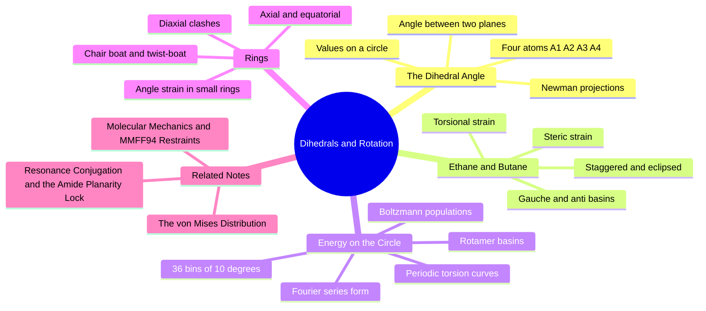

---
tags:
  - domain/spatial-chemistry
  - depth/essential
  - 3dsyntree
  - topic/torsion
  - topic/conformations
module: "03. Spatial Chemistry and Force Fields"
chapter: "Chapter 1. Molecular Shape and Stereochemistry"
type: concept
---

# 2. Rotatable Bonds and Dihedral Angles

> [!abstract] Core Idea
> Rotation about a single chemical bond is the main way a molecule changes shape without breaking anything, and the entire state of that rotation is captured by one number — the dihedral angle — that lives on a circle. Predicting one dihedral angle per new bond reduces an intractable search over all $3N$ atomic coordinates to a one-dimensional circular problem.

Navigation: [[0. Spatial Chemistry and Force Fields MOC]] · [[0. Master Vault Index]]

## 1. What It Is

A **dihedral angle** (also called a torsion angle, written $\phi$) is defined by **four sequentially bonded atoms** $A_1 - A_2 - A_3 - A_4$: it is the angle between the plane containing $A_1, A_2, A_3$ and the plane containing $A_2, A_3, A_4$. These two planes share the central bond $A_2 - A_3$, so $\phi$ measures how far the outer fragments have been twisted about that bond. The angle takes values on a circle — conventionally $[-180^\circ, 180^\circ)$ or $[0^\circ, 360^\circ)$ — because $-180^\circ$ and $+180^\circ$ are the same physical arrangement.

A **rotatable bond** is a single ($\sigma$) bond about which this twist can change at room temperature. A $\sigma$ bond has cylindrically symmetric electron density (an orbital overlap along the bond axis), so rotating the two fragments does not weaken the bond. Double bonds and resonance-locked bonds are *not* rotatable: rotating them would destroy the sideways $\pi$ overlap. The mathematical home of a dihedral is the circle group $SO(2)$ — the group of rotations of a plane — which is why torsion variables deserve circular statistics rather than plain averages (see [[1. Statistics on Riemannian Manifolds SO2]]).

## 2. Why It Exists

Rotation about $\sigma$ bonds gives molecules their conformational freedom: a flexible drug wiggles through solvent and then locks into the single binding-competent shape inside a protein pocket. The alternative degrees of freedom — breaking and re-forming bonds — cost tens of kcal/mol; bond rotation costs almost nothing for simple bonds, and a prohibitive $18\text{-}22\text{ kcal/mol}$ for amide bonds, whose partial double-bond character locks them planar (the resonance story is in [[2. Resonance Conjugation and the Amide Planarity Lock]]).

The engineering reason this concept exists is dimensionality. A new molecular fragment of $N$ atoms brings $3N$ Cartesian coordinates of freedom — hopeless to search directly. 3D-SynTree instead **locks the fragment's internal geometry** (bond lengths, angles, ring shapes) and predicts **only the dihedral angle of the newly formed bond**. The search collapses from $3N$ continuous dimensions to one circular variable, $\phi \in [0^\circ, 360^\circ)$, which can be discretized or modeled with a circular distribution.

## 3. How It Works

### 3.1 The four-atom definition and Newman projections

To read or set $\phi$ for $A_1 - A_2 - A_3 - A_4$, sight down the central bond from $A_2$ toward $A_3$. The **Newman projection** is the standard drawing: the front carbon ($A_2$) is a dot at the center, the rear carbon ($A_3$) is a circle around it, and the three substituents on each are drawn at $120^\circ$ spacing. The dihedral $\phi$ is the angle you must rotate the projection of the front substituent $A_1$ (about the viewing axis) to bring it onto the projection of the rear substituent $A_4$; by the IUPAC sign convention a clockwise rotation of the front atom gives a positive $\phi$. A **sawhorse projection** (viewing the bond from an oblique angle) shows the same information and is easier for beginners to interpret in 3D.

Two extreme families of arrangements repeat around the circle:

- **Eclipsed**: front and rear substituents line up ($\phi = 0^\circ, 120^\circ, 240^\circ$) — the substituents are as close as the geometry allows.
- **Staggered**: front substituents sit exactly between rear ones ($\phi = 60^\circ, 180^\circ, 300^\circ$) — substituents are maximally separated.

### 3.2 Ethane and butane: the two textbook rotors

**Ethane** (H$_3$C–CH$_3$) has a three-fold symmetric torsional energy curve: eclipsed maxima at $0^\circ, 120^\circ, 240^\circ$ lie about $2.9\text{ kcal/mol}$ above the staggered minima at $60^\circ, 180^\circ, 300^\circ$. The barrier comes from **torsional strain**, the mutual repulsion of electron pairs in aligned $\sigma$ bonds as they pass each other.

**Butane** (H$_3$C–CH$_2$–CH$_2$–CH$_3$), looking down the central C–C bond, replaces two of ethane's hydrogens with bulky methyl groups, and the curve becomes asymmetric:

| $\phi$ (about C2–C3) | Name | Relative energy |
| --- | --- | --- |
| $180^\circ$ | **anti** (staggered) | $0$ (global minimum) |
| $+60^\circ$ and $-60^\circ$ | **gauche** (staggered) | $\approx +0.9\text{ kcal/mol}$ |
| $120^\circ$ and $240^\circ$ | eclipsed (H–CH$_3$) | $\approx +3.5\text{ kcal/mol}$ |
| $0^\circ$ | eclipsed (CH$_3$–CH$_3$, *syn*) | $\approx +5.0\text{ kcal/mol}$ |

Two distinct forces are at work: torsional strain (eclipsed electron pairs, as in ethane) and **steric strain** (bulky groups crowding each other at short distance — the same physics quantified in [[3. Van der Waals Radii and Steric Clash]]). The $0^\circ$ syn eclipsed state is worst because two methyl groups are squeezed together.

### 3.3 Torsional energy curves on SO(2)

Because $\phi$ lives on a circle, the torsional energy $E(\phi)$ must be a **periodic function**: $E(\phi + 360^\circ) = E(\phi)$, with no discontinuity at the $\pm 180^\circ$ wrap. Force fields model it with a truncated Fourier series,

$$E_{\text{tor}}(\phi) = \sum_{n} V_n \left[ 1 + \cos(n\phi - \gamma) \right],$$

where $n$ is the periodicity (3 for the three-fold ethane barrier), $V_n$ the barrier height, and $\gamma$ a phase. Ethane is a pure $n=3$ curve; butane mixes $n = 1, 2, 3$ terms to break the symmetry between the anti and gauche wells.

### 3.4 Rotamer basins

Each local minimum of $E(\phi)$, together with the region that drains into it, is a **rotamer basin** — a discrete conformational energy well such as *anti* or *gauche$^+$*. At thermal equilibrium the probability of occupying a basin follows the Boltzmann factor, $\text{population} \propto e^{-E/k_{\text{B}}T}$, so for butane near room temperature ($k_{\text{B}}T \approx 0.6\text{ kcal/mol}$) anti dominates but the gauche basins stay populated. This discrete-basin picture is exactly what makes a **categorical action space** sensible: 3D-SynTree chooses among 36 torsion bins of $10^\circ$ each rather than regressing a raw continuous angle (the design trade-offs are discussed in [[1. Categorical Binned vs Continuous Torsion Space]]).

### 3.5 Rings: when rotation is impossible

Rings deserve special treatment because closing a loop of bonds removes rotation freedom entirely — you cannot twist one bond of a ring without dragging the others.

- **Angle strain (Baeyer strain).** A carbon "wants" $109.5^\circ$ between its bonds. Cyclopropane's three carbons are locked at $60^\circ$ internal angles and cyclobutane's at $90^\circ$, so both rings are badly strained; small rings are also chemically reactive for this reason.
- **Cyclohexane solves the puzzle** by puckering out of the plane into the **chair**, whose C–C–C angles are almost exactly $109.5^\circ$, making it essentially strain-free. The **boat** is a saddle point about $6.9\text{ kcal/mol}$ above the chair (flagpole hydrogens clash across the bow), and the **twist-boat** is a shallow local minimum about $5.5\text{ kcal/mol}$ up.
- **Axial vs equatorial.** In a chair, each carbon has one bond pointing vertically (axial) and one pointing outward around the ring's belt (equatorial). A **ring flip** (barrier $\approx 11\text{ kcal/mol}$) interchanges every axial and equatorial position. A bulky substituent strongly prefers equatorial, because an axial substituent suffers **1,3-diaxial** steric clashes with the axial hydrogens two carbons away (methyl's axial penalty, its A-value, is $\approx 1.7\text{ kcal/mol}$).
- **Ring strain energies**: cyclopropane $\approx 27.5$, cyclobutane $\approx 26.3$, cyclopentane $\approx 6.3$, cyclohexane $\approx 0\text{ kcal/mol}$ — small rings carry substantial stored strain that shapes both reactivity and binding thermodynamics.

> [!example] Counting rotatable bonds
> In day-to-day cheminformatics, a "rotatable bond" means a single bond between two non-terminal heavy atoms, excluding ring bonds and amide-like locked junctions. Benzene's ring bonds are excluded (rigid), an N-acyl amide C–N bond is excluded (locked planar), but a biaryl Ar–Ar bond usually counts — it is rotatable, just slow. This count is a standard flexibility descriptor in drug design.

## 4. What It Consists Of

- **4-atom dihedral chain** $A_1 - A_2 - A_3 - A_4$ — the atom quartet that defines one torsion.
- **Newman projection** — view down the central bond; front carbon as dot, rear as circle.
- **Staggered / eclipsed** — substituents offset vs aligned when viewed down the bond.
- **Gauche / anti** — staggered conformers at $\pm 60^\circ$ (gauche) and $180^\circ$ (anti).
- **Torsional strain** — repulsion between eclipsed bonding electron pairs.
- **Steric hindrance** — repulsion between bulky groups squeezed too close.
- **Torsional energy profile** — the periodic curve $E(\phi)$ on the circle $SO(2)$.
- **Rotamer basin** — a local well of that curve; a discrete conformational state.
- **Chair / boat / twist-boat** — the cyclohexane conformations.
- **Axial / equatorial** — the two substituent positions on a chair; **1,3-diaxial** clashes penalize axial bulk.

## 5. What You Must Understand

- The core reduction: **lock internal fragment geometry, predict only the junction dihedral.** One new bond per assembly step means exactly one new torsion decision per step — a 1D circular problem instead of a $3N$-dimensional continuous one.
- **Amide and ester junctions are planarity-locked** to $0^\circ$ or $180^\circ$ (no torsion choice is offered there) because their resonance makes rotation cost $18\text{-}22\text{ kcal/mol}$.
- $\phi$ is **periodic**: $-180^\circ$ and $+179^\circ$ are neighbors, not far apart. Never average or regress dihedrals with ordinary linear statistics — use circular statistics ([[2. The von Mises Distribution]]).
- Gauche is *not* always the worse choice: in a binding pocket, a gauche rotamer that makes a key contact can beat the anti rotamer that is preferred in solution.
- Ring bonds are not rotatable; a ring flip is a collective motion, not a single torsion.

> [!warning] Students often miss this
> A dihedral is defined by *four* atoms, not two. The bond alone does not determine the angle — you must also say which neighbor on each side you are sighting. Different choices of $A_1$ and $A_4$ give angles related by fixed offsets, so a pipeline must fix a canonical atom-quartet convention or the supervision signal is noise.

## 6. Prerequisites

- [[3. Molecular Geometry and Hybridization]] — $\sigma$ vs $\pi$ bonding and tetrahedral angles explain why single bonds rotate and double bonds do not.
- [[2. Resonance Conjugation and the Amide Planarity Lock]] — why amide C–N junctions are frozen planar and are excluded from the torsion action space.

## 7. Project Connection

- Supervision for the policy comes from `target_dihedral` in `syntree/data/fragmenter.py`, extracted with `ConformerEngine.get_dihedral()` (`syntree/chemistry/conformer.py`) — the measured torsion of the junction bond in the reference structure.
- The prediction head is `ContinuousTorsionHead` in `syntree/models/torsion_head.py`, which outputs a circular distribution (parameters $[\cos\mu, \sin\mu, \log\kappa]$ converted to an angle with `torch.atan2`); the chosen angle is written into the molecule with `rdMolTransforms.SetDihedralDeg`.
- The deployed action space is categorical: 36 bins of $10^\circ$, with a sub-bin $\pm 5^\circ$ geometric refinement (Issue #42) that fine-tunes the chosen bin against the soft-core clash potential, as covered in [[2. Sub Bin Pocket Conditioned Dihedral Refinement]].

## 8. Required Depth

**Essential** — the dihedral angle is the single geometric variable the policy actually predicts at every assembly step; everything else in this module exists to protect or evaluate that one choice.

## 9. Further Dependencies

- [[1. Statistics on Riemannian Manifolds SO2]] — torsion lives on a circle, so its loss functions and averaging rules come from circular statistics.
- [[2. The von Mises Distribution]] — the circular normal distribution used by the continuous torsion head.

## Concept Mind Map

## Cross-Domain Links

- [[AI/07. Directional Statistics and Torsion Manifolds/Chapter 1. Riemannian Geometry of the Circle/1. The Topology of SO(2) and the Seam Discontinuity|1. The Topology of SO(2) and the Seam Discontinuity]] (AI vault) — torsion angles live on the circle $S^1$ where $-\pi \equiv +\pi$; the seam discontinuity must be handled explicitly.
- [[AI/07. Directional Statistics and Torsion Manifolds/Chapter 2. Torsion Prediction and Optimization/3. Categorical Dihedral Discretization vs Continuous Heads|3. Categorical Dihedral Discretization vs Continuous Heads]] (AI vault) — every rotatable bond becomes a categorical head predicting a dihedral bin.
