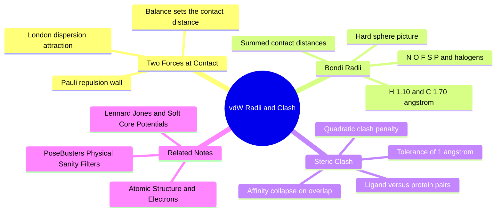

---
tags:
  - domain/spatial-chemistry
  - depth/essential
  - 3dsyntree
  - topic/steric-clash
  - topic/van-der-waals
module: "03. Spatial Chemistry and Force Fields"
chapter: "Chapter 1. Molecular Shape and Stereochemistry"
type: concept
---

# 3. Van der Waals Radii and Steric Clash

> [!abstract] Core Idea
> Every atom behaves, for contact purposes, like a hard sphere with a characteristic van der Waals radius. When two non-bonded atoms are pushed closer than the sum of their radii (with a small tolerance), their electron clouds overlap and a steep Pauli repulsion takes over — a steric clash that can wipe out a molecule's binding affinity.

Navigation: [[0. Spatial Chemistry and Force Fields MOC]] · [[0. Master Vault Index]]

## 1. What It Is

The **van der Waals radius** $r_{\text{vdw}}$ of an atom is the effective radius of the volume its electron cloud occupies, modeled as an impenetrable sphere. The picture is a simplification — electron clouds are diffuse probability clouds, not billiard balls — but it is remarkably useful: two non-bonded atoms (atoms not directly bonded to each other) placed at a center-to-center distance $d = r_i + r_j$ are exactly "touching," and pushing them closer costs energy fast.

A **steric clash** is the condition in which the distance between two non-bonded atoms drops significantly below the sum of their van der Waals radii, meaning their modeled spheres overlap. Physically, the electron clouds are being forced to occupy the same space, which the Pauli exclusion principle forbids; the energetic penalty grows steeply with the overlap. In this vault's pipeline, a clash between a ligand atom and a protein atom is scored by a dedicated quadratic penalty loss.

## 2. Why It Exists

Atoms are mostly empty space (a tiny nucleus in a cloud of electrons), yet everyday matter does not interpenetrate. The reason is the **Pauli exclusion principle** (see [[1. Atomic Structure and Electrons]]): no two electrons can occupy the same quantum state, so when the filled electron shells of two atoms start to overlap, the electrons must be rearranged into higher-energy states. The macroscopic consequence is a steeply rising repulsive force — the reason you cannot push your hand through a table.

Counteracting the repulsion, a weak attraction always exists between neutral atoms: **London dispersion** (fluctuating dipoles, covered in Section 3.1). The balance of dispersion attraction and Pauli repulsion sets a preferred contact distance — which is exactly what van der Waals radii measure, extracted statistically from the packing distances observed in molecular crystals.

The engineering reason this concept exists: an AI system that places a ligand atom *inside* the van der Waals sphere of a protein atom has proposed a physically impossible structure. Real binding pockets cannot be occupied that way, so a clash must be detectable and penalized — as a hard sanity filter, and as a smooth, differentiable loss for training.

## 3. How It Works

### 3.1 London dispersion — the always-on attraction

Electrons are in constant quantum motion, so at any instant a neutral atom has a flickering dipole moment (a slight imbalance of negative charge). That instantaneous dipole induces a dipole in a neighboring atom, and the two attract. Averaged over the flickering, the interaction energy between two neutral, non-bonded atoms falls off as the sixth power of distance:

$$E_{\text{dispersion}}(r) \propto -\frac{1}{r^{6}}.$$

Dispersion is weak — typically a fraction of a $\text{kcal/mol}$ per contact — but a drug in a pocket makes dozens of contacts, so the total is a major contributor to binding. It is also purely quantum-mechanical in origin (no classical explanation exists) and always attractive, between any pair of atoms.

### 3.2 Pauli repulsion — the hard wall

As two closed-shell atoms approach, their filled orbitals begin to overlap. Pauli forbids the overlapping electrons from sharing states, forcing some into higher-energy (antibonding) combinations; the energy therefore rises extremely steeply as the clouds interpenetrate. A $r^{-12}$ power law (or an exponential form) is the standard empirical fit: shrink the distance by only $3\%$ and the penalty already grows by about $45\%$; at $5\%$ it has nearly doubled. This is why atoms behave as nearly hard spheres at the precision that matters for molecular packing. The full Lennard-Jones function that marries this $r^{-12}$ wall with the $r^{-6}$ dispersion well is the subject of [[1. Lennard Jones and Soft Core Potentials]].

### 3.3 The Bondi radii table

The standard reference values are due to A. Bondi (1964), derived from crystal-packing statistics and other physical measurements. For hydrogen, Bondi's original value of $1.20\text{ Å}$ was later refined to about $1.10\text{ Å}$, the value used in modern work:

| Element | $r_{\text{vdw}}$ (Å) |
| --- | --- |
| H | 1.10 |
| C | 1.70 |
| N | 1.55 |
| O | 1.52 |
| F | 1.47 |
| P | 1.80 |
| S | 1.80 |
| Cl | 1.75 |
| Br | 1.85 |
| I | 1.98 |

The **contact distance** between atoms $i$ and $j$ is the sum $r_i + r_j$: two carbons "touch" at $3.40\text{ Å}$, a carbon and an oxygen at $3.22\text{ Å}$, and so on. Observe the pattern: everything is packed within a narrow band around $1.5\text{-}2.0\text{ Å}$, which is why protein interiors are so densely packed — there is very little "small" to be.

### 3.4 Clash detection and the energy penalty

Overlap *begins* below the contact distance $r_i + r_j$, but real ligand–protein crystal structures routinely show contacts slightly shorter than the Bondi sums — the hard-sphere radii are deliberately conservative, hydrogen positions are uncertain, and tight polar contacts (hydrogen bonds) pull heteroatoms closer. The pipeline therefore grants a tolerance before declaring a clash: a total allowance of $1.0\text{ Å}$ subtracted from the summed radii (roughly $0.5\text{ Å}$ contributed by each atom). A clash is flagged when

$$d_{ij} < r_i + r_j - 1.0\text{ Å},$$

and the penalty grows with the *square* of the violation depth:

$$\mathcal{L}_{\text{clash}} = \sum_{i \in \text{lig}} \sum_{j \in \text{poc}} \max\left(0, \; (r_i + r_j - 1.0) - d_{ij}\right)^2.$$

Only ligand–protein pairs are summed (intramolecular geometry is handled by the force field, see [[3. Molecular Mechanics and MMFF94 Restraints]]). The quadratic form gives zero gradient for compliant pairs and a smooth, increasing penalty for violations.

> [!example] Worked clash calculations
> Take a ligand carbon at various distances from a protein carbon. The threshold is $r_i + r_j - 1.0 = 1.70 + 1.70 - 1.0 = 2.40\text{ Å}$.
> - $d = 3.1\text{ Å}$: no violation (a snug but legal contact) — penalty $0$.
> - $d = 2.2\text{ Å}$: violation $2.40 - 2.20 = 0.20\text{ Å}$ — penalty $0.20^2 = 0.04$.
> - $d = 1.9\text{ Å}$: violation $0.50\text{ Å}$ — penalty $0.25$, a severe clash.
> Now a ligand nitrogen against a protein oxygen: threshold $1.55 + 1.52 - 1.0 = 2.07\text{ Å}$. A hydrogen-bonded N···O contact at $2.8\text{ Å}$ (typical H-bond geometry, see [[2. Pharmacophores and Interaction Hotspots]]) is far outside penalty territory; even $2.3\text{ Å}$ is not penalized; $1.9\text{ Å}$ yields $0.17^2 \approx 0.029$.

### 3.5 Why a clash kills binding

The true Pauli penalty is not gentle: overlapping two closed shells by half an ångström costs tens of $\text{kcal/mol}$, and overlapping a full ångström costs hundreds — more than any realistic binding free energy. A pose with one genuine clash is therefore not "slightly worse" than a clean pose; it is physically unrealizable. This is why clash appears both as a *reward* penalty during training and as a *hard* physical-sanity criterion at benchmarking time (PoseBusters rejects clashed poses outright — see [[1. PoseBusters Physical Sanity Filters]]).

## 4. What It Consists Of

- **Bondi radii table** — per-element van der Waals radii in the $1.1\text{-}2.0\text{ Å}$ range.
- **Contact distance** — the sum $r_i + r_j$ defining "touching" spheres.
- **Overlap tolerance** — the $1.0\text{ Å}$ allowance (about $0.5\text{ Å}$ per atom) before a violation counts.
- **Steric clash** — overlap of non-bonded spheres below the tolerated distance.
- **Clash loss** — the quadratic sum-over-pairs penalty above; zero until violated, then growing smoothly.
- **Dispersion vs. Pauli** — the $r^{-6}$ attraction and $r^{-12}$ repulsion whose balance the radii encode.

## 5. What You Must Understand

- **If an AI places a ligand atom inside the van der Waals radius of a protein atom, the physical binding affinity drops to zero** — massive Pauli repulsion overwhelms every favorable contact the molecule makes. One real clash disqualifies a pose.
- The tolerance exists because Bondi sums are conservative; do not confuse "shorter than $r_i + r_j$" (common, fine) with "clash" (deeper than the $1.0\text{ Å}$ allowance).
- Radii are element-level constants — they do not know about hybridization, charge state, or context. The hard-sphere model is a first approximation, not a physical law.

> [!warning] Students often miss this
> The clash loss counts only *inter*molecular (ligand–protein) pairs. Intramolecular contacts (within one molecule) are policed by the force field's own non-bonded terms during relaxation, so they must not be double-counted here.

> [!tip] Memory hook
> "Sum of radii, minus one, squared if you're under." A carbon pair is fine down to $2.40\text{ Å}$; below that the penalty is the square of every tenth of an ångström of violation.

## 6. Prerequisites

- [[1. Atomic Structure and Electrons]] — electron shells, orbitals, and the Pauli exclusion principle that creates the repulsive wall.

## 7. Project Connection

- `VDW_RADII` in `syntree/chemistry/conformer.py` is the per-element radius table used for clash scoring.
- `compute_steric_clash_loss()` in the same module implements exactly the quadratic ligand-versus-protein penalty derived in Section 3.4.
- The loss feeds the steric clash term of the terminal reward (`S_clash` inside `ThreeDReward`, `syntree/engine/rl.py`), teaching the policy to keep proposed torsions clash-free.

## 8. Required Depth

**Essential** — clash is the single most common physical failure mode of generated 3D structures, and the clash loss is a direct training signal for the policy's torsion and parity decisions.

## 9. Further Dependencies

- [[1. Lennard Jones and Soft Core Potentials]] — replaces the binary hard-sphere picture with a smooth, differentiable potential that also *rewards* snug contacts.

## Concept Mind Map

