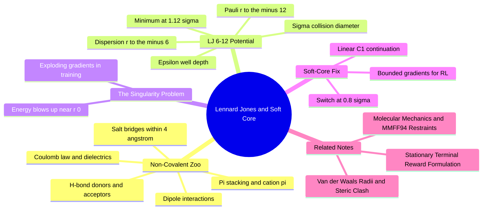

---
tags:
  - domain/spatial-chemistry
  - depth/supporting
  - 3dsyntree
  - topic/noncovalent-interactions
  - topic/potentials
module: "03. Spatial Chemistry and Force Fields"
chapter: "Chapter 2. Conformer Generation and Energy Models"
type: concept
---

# 1. Lennard Jones and Soft Core Potentials

> [!abstract] Core Idea
> The Lennard-Jones 6-12 potential packs the two universal non-bonded forces — dispersion attraction ($r^{-6}$) and Pauli repulsion ($r^{-12}$) — into one smooth two-parameter curve. Its infinite wall at $r \to 0$ is poison for machine learning, so the repulsive branch is spliced below $0.8\sigma$ with a soft-core continuation that keeps gradients finite.

Navigation: [[0. Spatial Chemistry and Force Fields MOC]] · [[0. Master Vault Index]]

## 1. What It Is

The **Lennard-Jones (LJ) 6-12 potential** models the interaction energy between two non-bonded atoms as a function of their separation $r$:

$$V_{\text{LJ}}(r) = 4\epsilon \left[ \left( \frac{\sigma}{r} \right)^{12} - \left( \frac{\sigma}{r} \right)^{6} \right].$$

Two parameters define it: $\epsilon$ (the **well depth**, the depth of the attractive basin, in $\text{kcal/mol}$) and $\sigma$ (the **collision diameter**, the distance at which the potential crosses zero, in Å). The LJ curve is the workhorse term for van der Waals contacts inside every major force field (see [[3. Molecular Mechanics and MMFF94 Restraints]]), and a soft-core variant of it serves as the differentiable contact-energy surrogate in this project's reward. This note also surveys the surrounding family of classical non-covalent interactions — electrostatics, hydrogen bonds, and aromatic contacts — that a pocket-aware system must reward alongside bare dispersion.

## 2. Why It Exists

A docking-style reward needs to judge a proposed 3D pose numerically: snug van der Waals contact should earn energy credit, and collisions should lose it. Quantum mechanics could compute all of this exactly but costs hours per pose; the LJ form costs one line of arithmetic per atom pair and captures the essential shape of the interaction — a weak attraction that pulls atoms together and a steep wall that stops them from interpenetrating. The catch is the $r^{-12}$ term's singularity at zero distance, which is catastrophic for gradient-based learning; the **soft-core** modification exists precisely to remove that singularity while preserving the physics elsewhere.

## 3. How It Works

### 3.1 The classical non-covalent interaction zoo

Before the LJ potential itself, the interaction types it must live alongside:

- **Electrostatics (Coulomb's law).** Two partial charges $q_1, q_2$ at distance $r$ interact with
  $$V_{\text{elec}}(r) = \frac{1}{4\pi\varepsilon_0}\,\frac{q_1 q_2}{\varepsilon_r\, r},$$
  where $\varepsilon_r$ is the (relative) **dielectric permittivity** of the medium: $1$ in vacuum, about $80$ in water, and only about $2\text{-}4$ in a protein's oily interior. Coulomb energy decays slowly ($r^{-1}$) and dominates whenever formal charges are present.
- **Salt bridges.** The flagship charge-charge contact: a protonated Lys or Arg guanidinium (positive) against a deprotonated Asp or Glu carboxylate (negative). A salt bridge is counted when the closest heteroatom pair is within $r \le 4.0\text{ Å}$.
- **Hydrogen bonds.** A **donor** (HBD) is a nitrogen, oxygen, or sulfur carrying an acidic hydrogen; an **acceptor** (HBA) is a heteroatom with an accessible lone pair. The geometric signature is a donor-to-acceptor heavy-atom distance of $\le 3.5\text{ Å}$ and near-linearity, $180^\circ \pm 30^\circ$, along donor–hydrogen···acceptor. A hydrogen bond is partly electrostatic and partly covalent, which is why it is strong ($2\text{-}5\text{ kcal/mol}$) and directional — LJ alone cannot capture its geometry.
- **Dipole–dipole interactions** (supporting): two fixed molecular dipoles interact as $r^{-3}$; when the partners rotate freely, the thermal average decays as $r^{-6}$. This is why polar groups behave like mild dispersion sources at a distance.
- **Weak hydrogen bonds and halogen bonds** (supporting): $\text{C}-\text{H}\cdots\text{O}$ contacts and the linear halogen-bond motif (an iodine or bromine's positive "sigma hole" toward a lone pair) are weaker cousins of the H-bond but recur in real binding sites.
- **Aromatic and $\pi$-interactions.** A benzene ring has an aromatic **quadrupole**: negative electrostatic potential above and below the ring face, positive at its hydrogen rim. This produces two favorable aromatic–aromatic geometries — offset **face-to-face $\pi$-stacking** and edge-to-face **T-shaped** contact — and the **cation–$\pi$ interaction**, in which a positively charged amine sits on a ring face. All are ubiquitous in pockets lined with tyrosine, tryptophan, and phenylalanine.
- Solvation and desolvation energetics (water cages, stripping water from polar atoms) are deliberately deferred to the thermodynamics module ([[1. Protein Ligand Binding Thermodynamics]]).

### 3.2 Building the LJ potential: why 6 and why 12

The attractive branch is fixed by physics: London dispersion between two neutral atoms is an induced-dipole/induced-dipole effect whose leading energy term is exactly $-C_6/r^{6}$ (the quantum second-order perturbation result). The repulsive branch only needs to be steep; nature is closer to an exponential, but $r^{-12}$ has two pragmatic advantages: it is very steep (overlap by $10\%$ and the penalty already explodes), and it is the *square* of $r^{-6}$, so the whole potential evaluates with a single $r^{-6}$ computation:

$$V_{\text{LJ}}(r) = 4\epsilon\left[ \left(\tfrac{\sigma}{r}\right)^{6}\right]^2 - 4\epsilon\left(\tfrac{\sigma}{r}\right)^{6}.$$

The curve's landmarks fall out of the algebra:

- **Zero crossing** at $r = \sigma$ (the collision diameter): the potential is exactly zero here — beyond $\sigma$ the pair attracts, closer than $\sigma$ it repels.
- **Minimum**: set $\mathrm{d}V/\mathrm{d}r = 0$, which gives $2(\sigma/r)^6 = 1$, i.e.
  $$r_{\min} = 2^{1/6}\,\sigma \approx 1.122\,\sigma, \qquad V(r_{\min}) = -\epsilon.$$
  The minimum lies just 12% beyond $\sigma$ — the well is narrow and the wall is close, which is what makes packing "snug but unforgiving."

The connection to the previous note: $r_{\min}/2$ per atom reproduces the Bondi contact distances — for carbon, $\sigma \approx 3.4\text{ Å}$ gives $r_{\min} \approx 3.8\text{ Å}$, i.e. roughly $1.9\text{ Å}$ per carbon, matching the $1.70\text{ Å}$ Bondi radius plus a little squeeze (see [[3. Van der Waals Radii and Steric Clash]]).

> [!example] LJ by the numbers (carbon–carbon: $\epsilon = 0.10\text{ kcal/mol}$, $\sigma = 3.40\text{ Å}$)
> - $r = 3.82\text{ Å} \approx 2^{1/6}\sigma$: $V = -0.10\text{ kcal/mol}$ — the bottom of the well.
> - $r = 3.40\text{ Å} = \sigma$: $V = 0$ — the zero crossing.
> - $r = 3.06\text{ Å} = 0.9\sigma$: $(1/0.9)^{6} = 1.88$ and $(1/0.9)^{12} = 3.54$, so $V = 4(0.10)(3.54 - 1.88) \approx +0.66\text{ kcal/mol}$.
> - $r = 2.72\text{ Å} = 0.8\sigma$: $(1.25)^{6} = 3.81$ and $(1.25)^{12} = 14.55$, so $V = 4(0.10)(14.55 - 3.81) \approx +4.29\text{ kcal/mol}$ — the switch point.

### 3.3 The singularity problem

As $r \to 0$, $(\sigma/r)^{12} \to +\infty$. Continue the carbon example: at $r = 0.4\sigma$, $(2.5)^{12} \approx 59{,}605$, so $V \approx 4\epsilon \times 59{,}361 \approx 23{,}700\text{ kcal/mol}$ — an absurd number, hundreds of times larger than any real chemical energy scale, produced by a mere factor-2.5 overlap.

For physics simulations this rarely matters (repulsion prevents atoms from ever getting there). For **machine learning it is poison**: an early training step that places two atoms nearly on top of each other produces a loss in the tens of thousands and a gradient $\mathrm{d}V/\mathrm{d}r \propto r^{-13}$ that is even more extreme — gradients explode, one optimizer step destabilizes the whole policy, and training collapses. The failure is worst exactly when the policy is young and bad.

### 3.4 The soft-core solution

The fix is surgical: keep the honest LJ curve for $r \ge r_{\text{switch}} = 0.8\sigma$, and replace the branch below the switch with a **bounded continuation** — here, a linear wall whose value and slope are matched to the true LJ curve at $r_{\text{switch}}$ (a $C^1$-continuous splice). The result:

- At and beyond the switch, energies and gradients are exactly the classical LJ values.
- Below the switch, the penalty keeps growing as atoms close in, but **linearly** — the gradient is a finite constant instead of infinity.
- $V(0)$ is a large but finite number, and the gradient never explodes.

Why $0.8\sigma$ specifically? It is deep enough inside the overlap region that every physically meaningful repulsion is still scored at full LJ steepness ($+4.29\text{ kcal/mol}$ and climbing at the switch, in the carbon example), yet far enough from the pathological region that the untouched LJ branch never sees the numbers that destroy training. Other soft-core formulations exist — polynomial splices and flat-bottomed shifted wells used in free-energy calculations — but the linearized wall is the minimal change that keeps the curve monotone and the gradient bounded.

### 3.5 From potential to reward

With the soft-core wall in place, the potential can safely serve as a **contact-energy reward**: poses that pull ligand atoms into snug van der Waals contact (near $2^{1/6}\sigma$) collect $-\epsilon$-scale credits, poses that ram atoms together pay a large-but-finite penalty, and no single bad pose can blow up the loss landscape that the GFlowNet is learning to navigate.

## 4. What It Consists Of

| Component | Role |
| --- | --- |
| $\epsilon$ (well depth) | How strongly the atom pair attracts at the optimal distance |
| $\sigma$ (collision diameter) | Zero-crossing distance; proxy for combined van der Waals size |
| $r_{\min} = 2^{1/6}\sigma$ | Location of the energy minimum, $V = -\epsilon$ |
| Attractive branch $-4\epsilon(\sigma/r)^6$ | London dispersion |
| Repulsive branch $+4\epsilon(\sigma/r)^{12}$ | Pauli repulsion wall |
| Soft-core switch $0.8\sigma$ | Distance below which the wall is linearized |
| Coulomb term and dielectric $\varepsilon_r$ | Charge–charge interactions, screened by the medium |
| Salt-bridge cutoff $4.0\text{ Å}$, H-bond geometry ($\le 3.5\text{ Å}$, $180^\circ \pm 30^\circ$) | Contact classes recognized alongside LJ |
| $\pi$-stacking, cation–$\pi$ | Aromatic contact modes scored as key interactions |

## 5. What You Must Understand

- **Soft-core potentials reward molecules that establish close van der Waals contact in the binding pocket, while penalizing collisions with bounded gradients rather than infinite spikes.** The boundedness is not a numerical nicety — without it, reward-based training of the torsion policy is not stable.
- LJ is a *pair potential for heavy-atom contact* — it does not know about directionality (H-bonds), charge screening (dielectric), or aromatic geometry. Those need their own terms, which is why the reward has separate contact, clash, and key-interaction components.
- $\epsilon$ and $\sigma$ vary by atom pair; force fields derive mixed-pair values from per-element parameters by combination rules, so "the LJ parameters of carbon" is a parameterization choice, not a constant of nature.

> [!warning] Students often miss this
> The minimum of LJ is at $2^{1/6}\sigma$, *not* at $\sigma$. At $\sigma$ the potential is exactly zero — atoms neither attract nor repel there. If you conflate the two, every estimate of optimal contact distance comes out $\sim 12\%$ too short.

> [!tip] Memory hook
> "Twelve repels, six attracts; the well sits at one-point-one-two sigma; and at eighty percent of sigma, the wall gets softened so training survives."

## 6. Prerequisites

- [[2. Chemical Bonds and Electronegativity]] — partial charges and electronegativity differences underpin the electrostatic and H-bond terms.
- [[3. Van der Waals Radii and Steric Clash]] — the hard-sphere picture whose smooth replacement is the LJ curve.

## 7. Project Connection

- `compute_lennard_jones_energy()` in `syntree/chemistry/conformer.py` implements the linearized, $C^1$-continuous soft-core Lennard-Jones form, with `LJ_REPULSIVE_SWITCH = 0.8` controlling where the honest LJ branch ends.
- The same module's clash loss and this contact energy together feed the terminal reward: the soft-core contact term is `S_contact` inside `ThreeDReward` (`syntree/engine/rl.py`), alongside the key-interaction bonus that counts salt bridges and hydrogen bonds.
- Issue #42's sub-bin torsion refinement runs a golden-section search *on this soft-core potential*, precisely because its bounded gradients make a local line search well-behaved (see [[2. Sub Bin Pocket Conditioned Dihedral Refinement]]).

## 8. Required Depth

**Supporting** — the derivation details are background, but the intuition (why the well sits at $2^{1/6}\sigma$, and why a 0.8-sigma soft-core switch is mandatory for stable training) is needed to reason about the reward design.

## 9. Further Dependencies

- [[1. Protein Ligand Binding Thermodynamics]] — places these contact energies inside the full binding free-energy budget, including desolvation.
- [[3. Stationary Terminal Reward Formulation]] — the LJ-based contact term is one of the fixed components of the stationary reward.

## Concept Mind Map

## Cross-Domain Links

- [[AI/05. Geometric Deep Learning and Lie Groups/Chapter 2. Equivariant Tensor Field Representations/3. Non-Singular Vector Norms and Directional Regularization|3. Non-Singular Vector Norms and Directional Regularization]] (AI vault) — soft-core splices remove the $r \to 0$ singularity of Lennard-Jones just as non-singular norms keep directional unit vectors finite.
