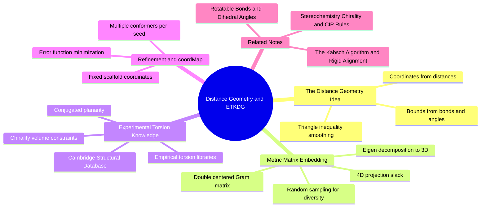

---
tags:
  - domain/spatial-chemistry
  - depth/supporting
  - 3dsyntree
  - topic/conformers
  - topic/distance-geometry
module: "03. Spatial Chemistry and Force Fields"
chapter: "Chapter 2. Conformer Generation and Energy Models"
type: concept
---

# 2. Distance Geometry and ETKDG

> [!abstract] Core Idea
> Distance geometry turns a flat 2D molecular graph into 3D coordinates by first deciding every pairwise atomic distance (within physically derived bounds) and then finding a point cloud that realizes them. ETKDG upgrades this classical machinery with experimental torsion-angle statistics mined from crystal structures, producing realistic conformers whose internal geometry can be trusted before any model makes decisions about it.

Navigation: [[0. Spatial Chemistry and Force Fields MOC]] · [[0. Master Vault Index]]

## 1. What It Is

**ETKDG** (Experimental Torsion Knowledge Distance Geometry) is an algorithmic pipeline, implemented in RDKit, that builds physically plausible 3D molecular coordinates from nothing but a 2D molecular graph (atoms, bonds, and stereochemistry flags). It belongs to the **distance geometry** family of methods: instead of guessing Cartesian coordinates directly, the algorithm works in "distance space" — deciding how far apart every pair of atoms should be — and only then converts those distances into $(x, y, z)$ positions.

The pipeline in one breath: derive upper and lower bounds on every interatomic distance from bond lengths and angles, tighten those bounds with the triangle inequality, sample distances inside the bounds, embed the resulting distance matrix into 3D space by linear algebra, then refine the coordinates against an error function that includes *experimentally observed torsion preferences* from the Cambridge Structural Database. The output is one conformer (or many, with different random seeds) with correct bond lengths, sensible ring shapes, honored chirality, and statistically typical rotamers.

## 2. Why It Exists

A 2D graph — a SMILES string, for instance — carries no coordinates at all, yet everything downstream in structure-based design needs them. Solving for coordinates the naive way is a coupled constraint-satisfaction nightmare: one molecule with $N$ atoms has thousands of pairwise distances that must all be satisfied simultaneously, and getting one ring wrong forces errors everywhere. Quantum or force-field methods can *refine* geometry but need a starting geometry to refine.

Distance geometry solves the chicken-and-egg problem by exploiting a mathematical fact: a complete, consistent set of pairwise distances determines a point configuration up to a global rotation and translation (which is exactly the freedom we are happy to leave open — the frame gets fixed later by alignment, see [[4. The Kabsch Algorithm and Rigid Alignment]]). So the pipeline manufactures a consistent distance set first, and coordinates follow by construction.

## 3. How It Works

### 3.1 The distance geometry problem

The abstract problem: given some or all pairwise distances $d_{ij}$ between $N$ points, find positions $\mathbf{x}_i \in \mathbb{R}^3$ with $\|\mathbf{x}_i - \mathbf{x}_j\| = d_{ij}$. This is how GPS works (a phone's position is fixed by its distances to satellites), and molecules are the same problem at ångström scale.

For a molecule we rarely know exact distances — we know *intervals*. Directly bonded pairs (1–2 pairs) have known bond lengths; atoms sharing a central atom (1–3 pairs) have distances fixed by the bond angle; and everything further out is merely bounded. So the input is a **bounds matrix**: for every pair $(i, j)$, an interval $[l_{ij}, u_{ij}]$ of allowed distances.

### 3.2 Distance bounds and triangle-inequality smoothing

Raw bounds are loose: the allowed range for two atoms across the molecule can span many ångströms. The bounds are therefore **smoothed** with the triangle inequality — for any atoms $i, j, k$:

$$d_{ij} \le d_{ik} + d_{kj} \qquad \text{and} \qquad d_{ij} \ge |d_{ik} - d_{kj}|.$$

Applied to the bounds, the upper limit $u_{ij}$ can never exceed $u_{ik} + u_{kj}$, and the lower limit $l_{ij}$ can never fall below analogous difference combinations. Iterating these inequalities over all atom triples tightens the matrix until no bound improves further — a step that propagates local chemical knowledge (rings, rigid units) across the whole molecule and guarantees the remaining intervals are jointly realizable.

### 3.3 Metric matrix embedding

Next, distances are **sampled** uniformly inside each smoothed interval (the random element that lets different seeds produce different, diverse conformers). The chosen distance matrix $D$ is converted into coordinates by linear algebra: with $J = I - \tfrac{1}{N}\mathbf{1}\mathbf{1}^T$ the centering matrix, the **double-centered Gram matrix**

$$B = -\tfrac{1}{2}\,J D^2 J$$

is the matrix of inner products of the (centered) coordinates. Its eigendecomposition delivers the coordinates directly: the three eigenvectors with the largest eigenvalues are the $x$, $y$, $z$ axes. Because sampled distances are noisy, the embedding is first performed in a higher-dimensional space (four dimensions) and then projected down to 3D — the extra dimension gives the noisy constraint system room to fold without forcing atoms through each other, which dramatically reduces chirality and self-intersection errors.

### 3.4 Experimental torsion knowledge — the "ET" in ETKDG

Pure distance geometry only knows about *bounds*; it has no opinion about which rotamer is chemically common. ETKDG adds the missing ingredient: **empirical torsion-angle distributions extracted from the Cambridge Structural Database (CSD)**, a collection of hundreds of thousands of small-molecule X-ray crystal structures (the experimental underpinnings of such databases are covered in [[3. X-Ray Crystallography and PDB Artifacts]]). For each chemical torsion context — the local bonding pattern around a rotatable bond, in the spirit of [[2. Rotatable Bonds and Dihedral Angles]] — the CSD supplies the observed histogram of dihedral angles. ETKDG uses these **torsion libraries** to bias 1–4 distance bounds and the refinement error function toward the statistically preferred rotamer basins, which is why its conformers "look like real molecules" instead of random tangles.

Two further constraint families ride along:

- **Chirality constraints**: each specified stereocenter contributes a *signed volume* constraint — the scalar triple product of the three bonds must keep the correct sign, so an $(R)$ center cannot silently come out $(S)$ (see [[1. Stereochemistry Chirality and CIP Rules]]).
- **Planarity constraints**: conjugated and aromatic systems are held flat, so amide junctions embed at $0^\circ$ or $180^\circ$ as chemistry demands.

### 3.5 Refinement

The raw embedding approximately satisfies the constraints. A **minimization** stage then drives down a composite error function — distance-bound violations, chirality and planarity violations, and torsion-preference penalties — using a conjugate-gradient-type method (the same family of optimizers discussed in [[3. Molecular Mechanics and MMFF94 Restraints]]), often followed by a brief force-field cleanup. The result is a conformer with essentially exact bond lengths and no constraint violations.

### 3.6 coordMap constraints — embedding onto a fixed scaffold

Ordinarily ETKDG is free to place the whole molecule anywhere. The **coordMap** option instead hands the embedder a dictionary of atom-to-coordinate assignments: "these atoms must land exactly here." Everything else in the molecule is then embedded *around* the fixed atoms. This is the key to stepwise molecular growth: the anchored scaffold's coordinates are pinned, so the newly added fragment is generated in a frame consistent with the existing structure instead of floating in space and needing a full re-alignment.

## 4. What It Consists Of

| Component | Role |
| --- | --- |
| Bounds matrix | Allowed distance interval $[l_{ij}, u_{ij}]$ per atom pair |
| Triangle-inequality smoothing | Iterative tightening of bounds until globally consistent |
| Metric matrix embedding | Double-centering plus eigendecomposition: distances to coordinates |
| Higher-dimensional (4D) projection | Slack dimension that prevents folded, self-intersecting embeddings |
| CSD torsion libraries | Experimental dihedral statistics that bias rotamer choice |
| Chirality volume constraints | Signed-volume conditions preserving $R$/$S$ configuration |
| Planarity constraints | Flatness for conjugated and aromatic fragments |
| Conjugate-gradient refinement | Local minimization of the composite error function |
| coordMap | Fixed coordinates for designated atoms (scaffold pinning) |

## 5. What You Must Understand

- **ETKDG embeds the incoming synthon's internal coordinates, ensuring correct bond lengths, angles, ring geometry, and chirality *before* the policy predicts the junction dihedral.** The torsion decision is made on a fragment whose internal shape is already physically sound.
- ETKDG is stochastic: different random seeds give different conformers. It samples the conformational distribution; it does not find "the" answer. Diversity of conformers is a feature, not an imperfection.
- An embedding honors stereochemistry only because chirality constraints are imposed explicitly — without them, a center can come out either way, which would silently change the molecule's identity (the failure mode of [[1. Stereochemistry Chirality and CIP Rules]]).
- Embedding quality is about *internal* geometry. Where the fragment sits in space is arbitrary until an alignment step fixes the frame.

> [!warning] Students often miss this
> Distance geometry does not search for the global energy minimum — it constructs *a* geometry satisfying distance and torsion statistics. If you need energetically relaxed structures, you must run force-field minimization afterward; the two stages are complementary, not redundant.

## 6. Prerequisites

- [[3. Molecular Geometry and Hybridization]] — bond lengths, bond angles, and hybridization give distance geometry its raw material.
- [[1. Stereochemistry Chirality and CIP Rules]] — chirality must be specified in the graph so volume constraints can enforce it in 3D.

## 7. Project Connection

- `ConformerEngine.embed_product()` (`syntree/chemistry/conformer.py`) performs the product embedding with ETKDGv3 under `coordMap` constraints: the locked scaffold atoms (identified by their isotope labels, core offset 1000+i) are pinned to their existing coordinates while the new synthon's atoms (offset 2000+j) are embedded around them.
- The embedded product is subsequently realigned and relaxed by the two tools covered in the neighboring notes: `_kabsch()` for the rigid re-fit onto the reference frame, and `_relax_with_harmonic_restraints()` for junction relaxation.

## 8. Required Depth

**Supporting** — the full embedding mathematics is background; what matters operationally is what ETKDG guarantees (sound internal geometry, honored chirality, pinned scaffold) and what it leaves open (the junction torsion, decided by the policy).

## 9. Further Dependencies

- [[3. Molecular Mechanics and MMFF94 Restraints]] — the refinement and relaxation machinery that cleans up embedding output.

## Concept Mind Map

