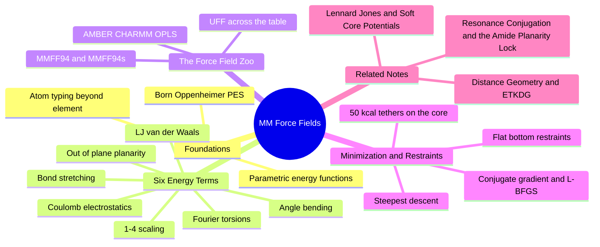

---
tags:
  - domain/spatial-chemistry
  - depth/essential
  - 3dsyntree
  - topic/force-fields
  - topic/mmff94
module: "03. Spatial Chemistry and Force Fields"
chapter: "Chapter 2. Conformer Generation and Energy Models"
type: concept
---

# 3. Molecular Mechanics and MMFF94 Restraints

> [!abstract] Core Idea
> A molecular mechanics force field scores a 3D molecule with a handful of cheap classical terms — springs for bonds and angles, a Fourier series for torsions, and non-bonded attractions and repulsions. MMFF94 is the small-molecule force field of choice here, and its minimizer is wrapped in flat-bottom harmonic restraints (50 $\text{kcal/mol/Å}^2$ tethers) so a new junction can relax without dragging the rest of the ligand out of the pocket.

Navigation: [[0. Spatial Chemistry and Force Fields MOC]] · [[0. Master Vault Index]]

## 1. What It Is

**Molecular mechanics (MM)** is a classical-physics model of a molecule's potential energy. Instead of solving the Schrödinger equation for all electrons, MM treats the molecule as a mechanical toy: atoms are balls, bonds are springs, angles are hinged springs, torsions are rotating rods with preferred settings, and non-bonded atoms push and pull each other through van der Waals and electrostatic terms. The total energy is a sum of simple analytic functions:

$$E_{\text{total}} = E_{\text{str}} + E_{\text{ang}} + E_{\text{tor}} + E_{\text{oop}} + E_{\text{vdW}} + E_{\text{elec}}.$$

**MMFF94** — the Merck Molecular Force Field, 1994 — is a particular parameterization of this formula, fitted to a large body of experimental and quantum data for small organic molecules (the drug-like regime). A **restrained minimization** is a minimization run with extra penalty terms that tether selected atoms to reference positions, which is how 3D-SynTree relaxes a newly formed junction while holding the rest of the ligand in place.

## 2. Why It Exists

Quantum mechanics is exact but astronomically expensive — a protein–ligand system is far beyond routine quantum treatment. The **Born–Oppenheimer approximation** (Section 3.1) justifies the shortcut: because nuclei are thousands of times heavier than electrons, electrons rearrange essentially instantly as nuclei move, so the nuclei slide over a fixed potential-energy surface (PES). A force field is nothing but a **parametric fit to that PES** — not derived from first principles per molecule, but fitted once, offline, across thousands of molecules, and then applied to new ones in microseconds.

The specific job in this project: when a new synthon is attached, the freshly formed junction bond is *approximately* right — embedders leave minor strain, slightly stretched bonds, or off-nominal angles. A short MMFF94 minimization relaxes exactly that local imperfection into physical bond geometry. The catch, and the reason this note is titled "restraints," is that an *unrestrained* minimizer is free to improve the energy by moving anything — including yanking the whole ligand out of its binding pose. Hence the tethers.

## 3. How It Works

### 3.1 Born–Oppenheimer and the force-field concept

Electrons are light and fast; nuclei are heavy and slow. The **Born–Oppenheimer approximation** decouples the two motions: for any frozen nuclear arrangement, solve the electrons, and record the energy as a function of nuclear positions — the PES. Force fields approximate the PES as a sum of terms, each describing one localized distortion (stretch a bond, bend an angle, twist a torsion) plus pair interactions. The gradient $-\nabla E$ is the force on every atom, which is what minimizers follow.

### 3.2 Atom typing

Which parameters apply to a given atom depends on more than its element. **Atom typing** classifies every atom by element, hybridization, formal charge, bonded neighbors, and sometimes aromaticity — so an $sp^3$ carbon, a carbonyl carbon, and an aromatic carbon are three different *types*, each with its own stiffness constants, equilibrium lengths, and van der Waals parameters. Get the typing wrong and every downstream number is wrong; this is why typing is the first step of any MM calculation.

### 3.3 The six energy terms

**Bond stretching** — a harmonic spring along each bond, with equilibrium length $r_0$ and stiffness $k_b$:

$$E_{\text{str}} = \frac{1}{2} k_b (r - r_0)^2.$$

**Angle bending** — the same idea for the angle $\theta$ between two bonds sharing an atom:

$$E_{\text{ang}} = \frac{1}{2} k_\theta (\theta - \theta_0)^2.$$

Both are Taylor-expansion first approximations: fine near equilibrium, inaccurate for extreme distortions (real bonds break; springs never do).

**Torsional rotation** — the periodic energy of a dihedral $\phi$ (the variable of [[2. Rotatable Bonds and Dihedral Angles]]), written as a truncated Fourier series:

$$E_{\text{tor}} = \sum_{n} V_n \left[ 1 + \cos(n\phi - \gamma) \right].$$

**Out-of-plane (improper torsion / inversion)** — a term keeping $sp^2$ centers flat. A carbonyl carbon or an amide nitrogen is supposed to be planar; the out-of-plane term is a penalty for pyramidalling. This is the term that enforces amide planarity in the force field, complementing the resonance argument of [[2. Resonance Conjugation and the Amide Planarity Lock]].

**Van der Waals** — the Lennard-Jones 6–12 pair potential between non-bonded atoms (full treatment in [[1. Lennard Jones and Soft Core Potentials]]).

**Electrostatics** — Coulomb's law between atom-centered partial charges $q_i$, screened by a dielectric constant.

**1–4 scaling.** Two atoms separated by exactly three bonds (a "1–4 pair") are *also* the endpoints of a torsion, so both the torsion term and the non-bonded terms describe their interaction. To avoid double counting, force fields scale the non-bonded 1–4 interactions by a factor (commonly between 0.5 and 1, chosen per force field). MMFF94 applies its own tuned 1–4 scale factors as part of its parameter set.

### 3.4 The force-field zoo

| Force field | Scope and character |
| --- | --- |
| **MMFF94** | Small organic molecules; fitted to experiment plus quantum data; the default for ligand work in RDKit |
| **MMFF94s** | The "static" variant: enforces planar (depyramidalized) nitrogen at amide-like sites, matching crystallographic geometry better than MMFF94, which permits slight pyramids |
| **UFF** | Universal Force Field: rule-based parameters for the whole periodic table; works on exotic species but is noticeably less accurate for fine geometry |
| **AMBER, CHARMM, OPLS** | Biomolecular families parameterized for proteins, nucleic acids, and lipids, normally paired with explicit water models; the standard choices when simulating the *protein*, not the ligand |

### 3.5 Minimization algorithms

Minimization walks downhill on $E$ using its gradient (the force). The standard ladder, in increasing sophistication:

- **Steepest descent** — step straight downhill along $-\nabla E$. Robust and cheap per step, but zig-zags in narrow valleys and converges slowly near the minimum. Excellent for the first brutal phase.
- **Conjugate gradient** — remembers the previous search direction and refuses to undo progress, converging far faster in elongated valleys.
- **L-BFGS** — a low-memory quasi-Newton method that builds a curvature approximation from the step history; converges fastest, at slightly more cost per step.

All are **local** optimizers: they find the nearest valley, not the global minimum. That is exactly right for our purpose — we want to *fix small local imperfections*, not rediscover a different conformer.

### 3.6 Flat-bottom harmonic position restraints

The restraint that makes relaxation safe adds, for each tethered atom, an energy that is **zero inside a tolerance window** and quadratic beyond it:

$$E_{\text{restraint}} = \frac{1}{2} k \cdot \max\left(0, \; \|\mathbf{x} - \mathbf{x}_0\| - r_{\text{tol}}\right)^2,$$

where $\mathbf{x}_0$ is the atom's reference position and $r_{\text{tol}}$ the allowed displacement window. The "flat bottom" is crucial: within tolerance, the atom moves freely — the minimizer can make genuine local adjustments without fighting the spring — but the moment it strays past $r_{\text{tol}}$, the spring stiffens quadratically. In this project's relaxation, the spring constant for core (scaffold) atoms is $k = 50\text{ kcal/mol/Å}^2$, while the newly formed junction atoms are left completely unrestrained.

> [!example] How stiff is 50 kcal per mol per square angstrom
> An atom pushed $0.3\text{ Å}$ beyond its window feels $\tfrac{1}{2}(50)(0.3)^2 = 2.25\text{ kcal/mol}$ of penalty; at $0.5\text{ Å}$, $6.25\text{ kcal/mol}$; at $1.0\text{ Å}$, $25\text{ kcal/mol}$ — already comparable to an entire hydrogen bond's worth of binding energy. No local strain relief is worth that much, so the scaffold effectively cannot drift, while the free junction atoms relax to ideal MMFF94 bond geometry.

An alternative, blunter tool is the **fixed-atom (rigid) constraint**: selected atoms are simply frozen. It is even safer but cannot absorb legitimate small adjustments of the anchored fragment; flat-bottom restraints give the same protection with a little healthy slack.

### 3.7 Scaffold-restrained junction relaxation in one pass

Putting it together, one relaxation step of the pipeline: embed the product with the scaffold pinned (see [[2. Distance Geometry and ETKDG]]), realign it to the pocket frame (see [[4. The Kabsch Algorithm and Rigid Alignment]]), then run MMFF94 minimization in which every core atom carries a $50\text{ kcal/mol/Å}^2$ flat-bottom tether and the junction atoms carry none. The output: physically clean junction geometry, scaffold still docked.

## 4. What It Consists Of

| Piece | Meaning |
| --- | --- |
| Atom type | Element + environment class selecting the parameter set |
| $E_{\text{str}}, E_{\text{ang}}$ | Harmonic springs for bonds and angles |
| $E_{\text{tor}}$ | Fourier-series torsional profile |
| $E_{\text{oop}}$ | Out-of-plane term enforcing $sp^2$ planarity |
| $E_{\text{vdW}}, E_{\text{elec}}$ | Lennard-Jones plus Coulomb non-bonded terms |
| 1–4 scaling | Reduced non-bonded weight for torsion endpoints |
| Minimizer | Steepest descent, conjugate gradient, or L-BFGS local optimizer |
| Flat-bottom restraint | Zero-inside-window, quadratic-outside position penalty |
| Tether constant $k$ | $50\text{ kcal/mol/Å}^2$ for core atoms in this project |

## 5. What You Must Understand

- **Unconstrained force-field minimization can pull a ligand out of its protein binding pose** — the minimizer only knows energy, not that the pocket is where the molecule belongs. Scaffold-restrained MMFF94 holds the core firmly in place while relaxing the newly attached synthon to physical bond geometry.
- Force fields never break bonds (springs, not scissors), inherit typing errors, and are local minimizers — they polish geometry; they do not redesign it.
- The flat bottom matters: a *pure* harmonic restraint (no window) fights the minimizer even for sub-ångström adjustments, wasting relaxation quality inside the tolerance zone.
- Units awareness: $k$ is in $\text{kcal/mol/Å}^2$, so penalties scale with the *square* of displacement — small excursions are cheap, ångström-scale excursions are not.

> [!warning] Students often miss this
> MMFF94 versus MMFF94s is not "better vs. worse" but "which question are you asking." MMFF94 lets amide nitrogens pyramid slightly (real solution behavior); MMFF94s forces planarity (crystal-structure-like geometry). For generating ligand poses compared against crystallographic references, the s-variant is usually the safer match.

## 6. Prerequisites

- [[1. Lennard Jones and Soft Core Potentials]] — the van der Waals term of the force field, derived there in full.
- [[2. Distance Geometry and ETKDG]] — supplies the embedded geometry that the minimizer refines.

## 7. Project Connection

- `_relax_with_harmonic_restraints()` in `syntree/chemistry/conformer.py` runs the MMFF relaxation with $50\text{ kcal/mol/Å}^2$ flat-bottom tethers applied to the core (scaffold) atoms while the junction atoms relax freely — the exact scheme of Section 3.6.
- The same `ConformerEngine` gates which junctions are allowed to rotate: conjugated (amide-like) junctions are held planar at $0^\circ$/$180^\circ$ via `is_conjugated_junction()` and set with `apply_junction_torsion()`; only freely rotatable junctions offer a torsion choice to the policy.

## 8. Required Depth

**Essential** — every single assembly step ends with a restrained MMFF94 relaxation; understanding why restraints are mandatory (and what they cost numerically) is prerequisite to reasoning about pose fidelity in the whole pipeline.

## 9. Further Dependencies

- [[1. PoseBusters Physical Sanity Filters]] — the physical sanity checks (bond lengths, planarity, clashes) that relaxed structures must pass at benchmarking time.

## Concept Mind Map

