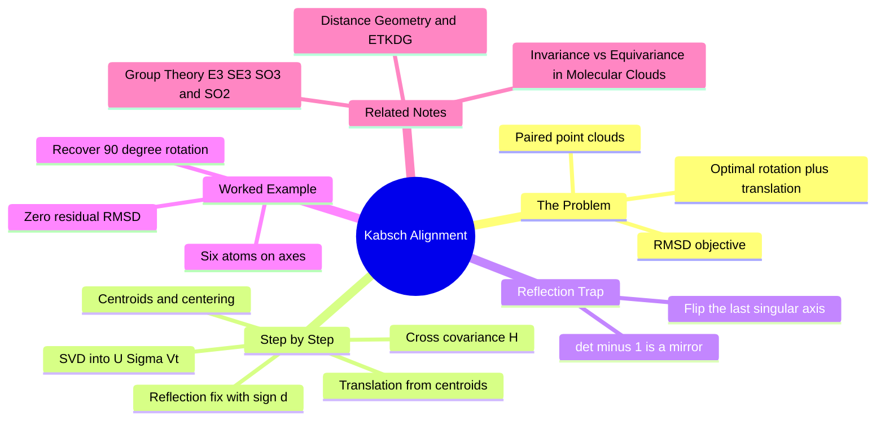

---
tags:
  - domain/spatial-chemistry
  - depth/essential
  - 3dsyntree
  - topic/alignment
  - topic/linear-algebra
module: "03. Spatial Chemistry and Force Fields"
chapter: "Chapter 2. Conformer Generation and Energy Models"
type: concept
---

# 4. The Kabsch Algorithm and Rigid Alignment

> [!abstract] Core Idea
> Given two sets of paired points — one molecular geometry floating in an arbitrary frame, one reference geometry — the Kabsch algorithm computes the single best rigid motion (rotation plus translation) that superimposes the first onto the second, by a chain of centroids, a covariance matrix, and one singular value decomposition. It moves a re-embedded scaffold back into the protein's pocket frame without distorting a single internal distance.

Navigation: [[0. Spatial Chemistry and Force Fields MOC]] · [[0. Master Vault Index]]

## 1. What It Is

The **Kabsch algorithm** computes the optimal translation vector $\mathbf{t}$ and rotation matrix $\mathbf{R} \in SO(3)$ that minimize the root-mean-square deviation between two *paired* point sets: a source set $P = \{\mathbf{p}_1, \dots, \mathbf{p}_N\}$ and a target set $Q = \{\mathbf{q}_1, \dots, \mathbf{q}_N\}$, where the pairing $(\mathbf{p}_i \leftrightarrow \mathbf{q}_i)$ is known in advance. "Optimal" means minimizing

$$\text{RMSD} = \sqrt{\frac{1}{N} \sum_{i=1}^{N} \left\| \mathbf{q}_i - (\mathbf{R}\,\mathbf{p}_i + \mathbf{t}) \right\|^2},$$

the root-mean-square deviation — the typical remaining atom-by-atom distance after alignment. The rotation is constrained to $SO(3)$, the group of proper rotations (orthogonal matrices with determinant $+1$): rigid alignment must preserve handedness, because a mirrored molecule is a different molecule.

The problem this solves is called rigid **alignment** (or the orthogonal Procrustes problem, after the Greek innkeeper who "fitted" guests to his bed — by stretching, which we forbid).

## 2. Why It Exists

When a conformer engine embeds a molecular fragment, the coordinates come out in an arbitrary orientation and position — wherever the embedding math happened to put them. But the anchored scaffold of the ligand already has meaningful coordinates in the protein binding pocket's reference frame. To keep growing the molecule in place, the freshly embedded copy must be **re-aligned onto the locked scaffold**.

Two constraints make this a well-defined problem. First, the transformation must be **rigid** — rotation and translation only, never scaling or shearing — because altering internal distances would change bond lengths and angles, i.e., change the molecule. Second, the atom correspondence must be known: which new atom corresponds to which old atom. In this project that correspondence is automatic, because atoms carry stable isotope labels across reactions (core atoms 1000+i, synthon atoms 2000+j), so "the same atom" is identifiable before and after every operation.

## 3. How It Works

The algorithm has five steps. The key insight: translation and rotation separate — handle translation first (by centering), then solve a pure rotation problem with one matrix factorization.

### 3.1 Step 1 — Centroids and centering

Compute the centroids (arithmetic mean positions) of both clouds:

$$\boldsymbol{\mu}_P = \frac{1}{N}\sum_i \mathbf{p}_i, \qquad \boldsymbol{\mu}_Q = \frac{1}{N}\sum_i \mathbf{q}_i,$$

and subtract them from every point:

$$\mathbf{P}_0 = \mathbf{P} - \boldsymbol{\mu}_P, \qquad \mathbf{Q}_0 = \mathbf{Q} - \boldsymbol{\mu}_Q.$$

Why this is legal: at the optimum, the transformed source centroid must coincide with the target centroid (otherwise shifting everything by the residual difference would strictly reduce every term of the RMSD). So the optimal translation is recovered *after* the rotation is known, and the rotation can be solved on centered coordinates alone — centering makes the problem translation-free.

### 3.2 Step 2 — The cross-covariance matrix

Form the $3 \times 3$ **cross-covariance matrix** that summarizes how the two centered clouds co-vary (with points stored as rows, $\mathbf{H} = \mathbf{P}_0^T \mathbf{Q}_0$, i.e. $H_{ab} = \sum_i p_{0i,a}\, q_{0i,b}$). Substituting the centered points into the RMSD and expanding the square, the objective becomes

$$\sum_i \left\| \tilde{\mathbf{q}}_i - \mathbf{R}\,\tilde{\mathbf{p}}_i \right\|^2 = \text{const} - 2\,\mathrm{trace}(\mathbf{R}\,\mathbf{H}),$$

so minimizing RMSD is **maximizing** $\mathrm{trace}(\mathbf{R}\mathbf{H})$ — a problem about one $3\times 3$ matrix, whatever the size of the molecule.

### 3.3 Step 3 — Singular value decomposition

Compute the SVD of the covariance matrix:

$$\mathbf{H} = \mathbf{U}\,\boldsymbol{\Sigma}\,\mathbf{V}^T,$$

with $\boldsymbol{\Sigma} = \mathrm{diag}(\sigma_1, \sigma_2, \sigma_3)$ the singular values ($\sigma_1 \ge \sigma_2 \ge \sigma_3 \ge 0$) and $\mathbf{U}, \mathbf{V}$ orthogonal. By the von Neumann trace inequality, $\mathrm{trace}(\mathbf{R}\mathbf{H})$ is maximized over all orthogonal $\mathbf{R}$ by the choice

$$\mathbf{R} = \mathbf{V}\,\mathbf{U}^T.$$

Intuition: SVD factors the correlation between the two clouds into pure rotations ($\mathbf{U}$, $\mathbf{V}$) and stretchings ($\boldsymbol{\Sigma}$); to match cloud shapes we keep the rotations and discard the stretching. The maximal trace equals $\sigma_1 + \sigma_2 + \sigma_3$, and the best achievable RMSD follows from it — perfect matches use up all three singular values.

### 3.4 Step 4 — The reflection fix

$\mathbf{R} = \mathbf{V}\mathbf{U}^T$ is orthogonal but might have $\det(\mathbf{R}) = -1$: an improper transformation, a mirror image (one axis flipped). That can happen when the point cloud is nearly planar or when noise pushes the third direction over. A mirror is *not* an allowed rigid motion — it would turn a right hand into a left hand and a valid molecule into its enantiomer (the disaster case of [[1. Stereochemistry Chirality and CIP Rules]]). The fix is to flip the sign of the smallest singular direction:

$$\mathbf{R} = \mathbf{V} \begin{pmatrix} 1 & 0 & 0 \\ 0 & 1 & 0 \\ 0 & 0 & d \end{pmatrix} \mathbf{U}^T, \qquad d = \mathrm{sign}\!\left(\det(\mathbf{V}\mathbf{U}^T)\right).$$

When $\det(\mathbf{V}\mathbf{U}^T) = -1$, the correction costs $\sigma_3$ of the trace (the optimum for *proper* rotations becomes $\sigma_1 + \sigma_2 - \sigma_3$), which is the least damaging place to absorb the correction — the smallest singular direction is the direction along which the data is least informative.

### 3.5 Step 5 — Translation

With $\mathbf{R}$ fixed, the translation that maps the (rotated) source centroid onto the target centroid is

$$\mathbf{t} = \boldsymbol{\mu}_Q - \mathbf{R}\,\boldsymbol{\mu}_P.$$

Apply $\mathbf{x} \mapsto \mathbf{R}\mathbf{x} + \mathbf{t}$ to every source point, and the alignment is done.

### 3.6 Worked numeric example

> [!example] Recovering a 90° rotation
> Source cloud (six atoms on the coordinate axes, centroid at the origin):
> $P$ = $(1,0,0),\; (-1,0,0),\; (0,2,0),\; (0,-2,0),\; (0,0,3),\; (0,0,-3)$.
> Target cloud: the same atoms rotated by $90^\circ$ about the $z$-axis and translated by $(10, -5, 2)$:
> $Q$ = $(0,1,0)+\mathbf{c},\; (0,-1,0)+\mathbf{c},\; (-2,0,0)+\mathbf{c},\; (2,0,0)+\mathbf{c},\; (0,0,3)+\mathbf{c},\; (0,0,-3)+\mathbf{c}$, with $\mathbf{c} = (10,-5,2)$.
>
> **Centroids.** $\boldsymbol{\mu}_P = (0,0,0)$ and $\boldsymbol{\mu}_Q = (10,-5,2)$; after centering, $Q_0$ is exactly the rotated axis points. (Note how the translation becomes invisible to every subsequent step — it lives only in the centroids.)
>
> **Covariance.** $H_{ab} = \sum_i \tilde p_{i,a} \tilde q_{i,b}$ over the six pairs gives
> $$\mathbf{H} = \begin{pmatrix} 0 & 2 & 0 \\ -8 & 0 & 0 \\ 0 & 0 & 18 \end{pmatrix}.$$
> (Sample entry: $H_{12} = 1\cdot 1 + (-1)(-1) + 0 + 0 + 0 + 0 = 2$.)
>
> **SVD.** $\mathbf{H}^T\mathbf{H} = \mathrm{diag}(64, 4, 324)$, so the singular values are $\sigma = (18, 8, 2)$, ordered largest first, with matching orthogonal factors
> $$\mathbf{V} = \begin{pmatrix} 0 & 1 & 0 \\ 0 & 0 & 1 \\ 1 & 0 & 0 \end{pmatrix}, \qquad \mathbf{U} = \begin{pmatrix} 0 & 0 & 1 \\ 0 & -1 & 0 \\ 1 & 0 & 0 \end{pmatrix}.$$
>
> **Determinant check.** $\det(\mathbf{V}\mathbf{U}^T) = +1$, so $d = +1$ and no reflection correction is needed.
>
> **Rotation.** $\mathbf{R} = \mathbf{V}\mathbf{U}^T = \begin{pmatrix} 0 & -1 & 0 \\ 1 & 0 & 0 \\ 0 & 0 & 1 \end{pmatrix}$ — exactly the $90^\circ$ $z$-rotation, recovered blind from the data.
>
> **Translation.** $\mathbf{t} = \boldsymbol{\mu}_Q - \mathbf{R}\boldsymbol{\mu}_P = (10,-5,2) - (0,0,0) = (10,-5,2)$.
>
> **Check.** $\mathbf{R}(1,0,0) + \mathbf{t} = (10,-4,2) = (0,1,0) + \mathbf{c}$, and likewise for every other atom: $\text{RMSD} = 0$. The trace identity confirms it: $\sum_i\|\tilde{\mathbf{p}}_i\|^2 = \sum_i\|\tilde{\mathbf{q}}_i\|^2 = 2(1^2 + 2^2 + 3^2) = 28$, which exactly equals $\mathrm{trace}(\mathbf{R}\mathbf{H}) = \sigma_1 + \sigma_2 + \sigma_3 = 28$, so the residual formula gives $\text{RMSD}^2 = \tfrac{1}{6}(28 + 28 - 2\cdot 28) = 0$.

### 3.7 What can go wrong

- **Unstable rotation for degenerate clouds.** If the points are nearly coplanar or collinear (think: a flat aromatic scaffold), the smallest singular direction is weakly determined and the rotation about the normal can be noisy; more atom pairs stabilize it.
- **Wrong correspondence.** Kabsch assumes the pairing is correct. A single mis-paired atom drags the optimum; here the isotope labels make the pairing exact.
- **RMSD is not symmetry-aware.** Kabsch aligns the labels you give it; a symmetric molecule (say, a benzene with interchangeable positions) may need alternative labelings tried to find the best fit.
- **Rigid only.** If the source geometry genuinely differs from the target (conformational change), Kabsch reports a large RMSD; it will not — and must not — bend the molecule to hide it.

## 4. What It Consists Of

| Component | Role |
| --- | --- |
| Centroid subtraction | Removes translation from the problem |
| Cross-covariance $\mathbf{H}$ | $3 \times 3$ summary of inter-cloud correlation |
| SVD $\mathbf{H} = \mathbf{U}\boldsymbol{\Sigma}\mathbf{V}^T$ | Factors correlation into rotations and stretches |
| Determinant fix $d = \mathrm{sign}(\det(\mathbf{V}\mathbf{U}^T))$ | Rejects mirror solutions, keeps the rotation proper |
| Translation $\mathbf{t} = \boldsymbol{\mu}_Q - \mathbf{R}\boldsymbol{\mu}_P$ | Re-attaches the rotation to the absolute frames |
| RMSD | The residual misfit the whole procedure minimizes |

## 5. What You Must Understand

- **Alignment back into the pocket coordinate space happens without distorting internal bond lengths or angles** — rigid motions preserve all pairwise distances, so the embedded fragment's chemistry is untouched; only its position and orientation change.
- The two-stage separation (center, rotate, translate back) is what makes the algorithm exact and non-iterative — no gradient descent, no local minima, one closed-form answer.
- The reflection fix is not a cosmetic detail: without it, near-degenerate (nearly planar) clouds can silently produce a mirrored (enantiomeric) alignment — a molecule that is chemically *wrong*, not merely misaligned.
- Invariance connection: RMSD after optimal alignment is invariant under any rigid motion of either input — precisely the invariance demanded of geometric models in [[2. Invariance vs Equivariance in Molecular Clouds]].

> [!tip] Memory hook
> "Center, correlate, decompose, fix the mirror, translate back." Five steps, one SVD, zero iterations.

## 6. Prerequisites

- None formal — the note is self-contained given basic linear algebra (matrix multiplication, transposes, and a willingness to accept what an SVD computes). The closest companions are [[2. Distance Geometry and ETKDG]], which produces the clouds to be aligned, and [[3. Molecular Mechanics and MMFF94 Restraints]], which runs right after alignment in the same pipeline.

## 7. Project Connection

- `_kabsch()` in `syntree/chemistry/conformer.py` realigns every newly embedded product onto the locked scaffold reference frame before junction relaxation, using the isotope-labeled core atoms (offset 1000+i) as the atom correspondences.
- This is the bridge that lets the engine embed fragments in any convenient frame (the embedding stage of [[2. Distance Geometry and ETKDG]]) yet keep the assembled molecule anchored in the pocket — a rigid-motion necessity tied to the symmetry groups of [[1. Group Theory E3 SE3 SO3 and SO2]].

## 8. Required Depth

**Essential** — every assembly step depends on a correct, reflection-safe rigid alignment; a subtle bug here (a mirrored fit) would corrupt every downstream reward computed in the pocket frame.

## 9. Further Dependencies

- [[1. Group Theory E3 SE3 SO3 and SO2]] — the formal home of rotations, translations, and why $SO(3)$ (proper rotations only) is the right constraint set for alignment.

## Concept Mind Map

## Cross-Domain Links

- [[AI/05. Geometric Deep Learning and Lie Groups/Chapter 1. Continuous Symmetry Groups/3. Group Actions on Coordinate and Feature Manifolds|3. Group Actions on Coordinate and Feature Manifolds]] (AI vault) — the closed-form SVD superposition is the canonical $\mathrm{SE}(3)$ group action on molecular coordinates.
