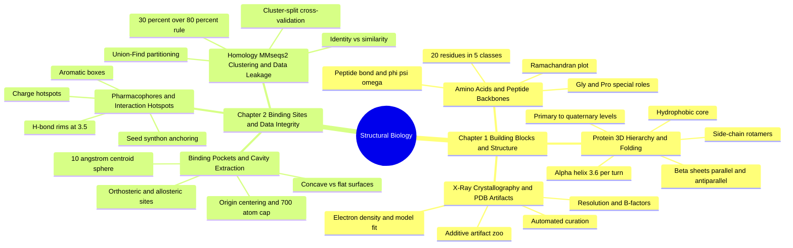

---
tags:
  - moc
  - domain/structural-biology
  - 3dsyntree
module: "04. Structural Biology and Protein Targets"
type: moc
---

# 0. Structural Biology and Protein Targets MOC

> [!abstract] Module Mission
> This module takes you from the 20 amino-acid building blocks, through protein folding and the crystallographic structures we read them from, into the binding pockets that drugs target and the integrity checks that keep structural data honest. Everything 3D-SynTree ever "sees" of a protein is a curated, centered pocket cloud — this module explains where that cloud comes from and why it can (or cannot) be trusted.

Navigation: [[0. Master Vault Index]] · [[2. Prerequisite Knowledge Graph]] · [[3. Study Tracks and Curriculum]]

## Module Mind Map

## Chapter 1. Protein Building Blocks and Structure

| Note | Focus | Required Depth | Key Prerequisites |
| --- | --- | --- | --- |
| [[1. Amino Acids and Peptide Backbones]] | The 20 residue chemistries, the peptide bond, and backbone torsion angles | Essential | [[1. Organic Functional Groups]] |
| [[2. Protein 3D Hierarchy and Folding]] | Primary through quaternary structure, folding forces, and side-chain dynamics | Essential | [[1. Amino Acids and Peptide Backbones]] |
| [[3. X-Ray Crystallography and PDB Artifacts]] | How 3D structures are solved, and what hides inside raw PDB files | Supporting | [[2. Protein 3D Hierarchy and Folding]] |

## Chapter 2. Binding Sites and Data Integrity

| Note | Focus | Required Depth | Key Prerequisites |
| --- | --- | --- | --- |
| [[1. Binding Pockets and Cavity Extraction]] | Pocket anatomy and the 10 Å centroid extraction pipeline | Essential | [[2. Protein 3D Hierarchy and Folding]] |
| [[2. Pharmacophores and Interaction Hotspots]] | Charge, hydrogen-bond, and hydrophobic hotspots; seed anchoring | Supporting | [[1. Binding Pockets and Cavity Extraction]] |
| [[3. Homology MMseqs2 Clustering and Data Leakage]] | Sequence clustering and leakage-proof train and test splits | Essential | [[1. Amino Acids and Peptide Backbones]] |

## Learning Path Through This Module

The path follows the module's prerequisite chain — sequence, then fold, then pocket, then pocket chemistry, then data provenance, then data integrity. Note that it crosses between the two chapter folders, because curation and splitting logically follow the pocket concepts.

1. [[1. Amino Acids and Peptide Backbones]] — learn the 20-letter alphabet and the side-chain classes; every later concept is phrased in this language.
2. [[2. Protein 3D Hierarchy and Folding]] — watch the chain fold into helices, sheets, and a globular tertiary structure whose clefts become binding sites.
3. [[1. Binding Pockets and Cavity Extraction]] — define the pocket anatomically and learn the 10 Å centroid-sphere extraction, the 100-atom minimum, the 700-atom cap, and origin centering.
4. [[2. Pharmacophores and Interaction Hotspots]] — discover that pockets are unevenly sticky, and learn the charge, hydrogen-bond, and hydrophobic hotspots that anchor the first synthon.
5. [[3. X-Ray Crystallography and PDB Artifacts]] — go upstream to the experiment that produced these structures, and meet the salts, cryoprotectants, waters, and disordered loops that curation must strip or register.
6. [[3. Homology MMseqs2 Clustering and Data Leakage]] — go downstream to the sequence clustering that guarantees the benchmark tests folds the model has never seen.

## Why This Module Matters for 3D-SynTree

3D-SynTree never sees a whole protein. Its entire protein-side world is the extracted pocket cloud: all protein atoms within $10\text{ Å}$ of the co-crystallized ligand's centroid, centered at the origin, kept between 100 and 700 heavy atoms — the construction defined in [[1. Binding Pockets and Cavity Extraction]] and bounded in code by `max_pocket_atoms = 700`. That cloud is only as good as the crystallographic data underneath it, which is why additive stripping, B-factor-aware trust, and resolution filtering from [[3. X-Ray Crystallography and PDB Artifacts]] run before extraction. Inside the pocket, the hotspot logic of [[2. Pharmacophores and Interaction Hotspots]] decides where the first synthon anchors and which salt bridges and hydrogen bonds earn reward bonuses. Finally, the sequence clustering of [[3. Homology MMseqs2 Clustering and Data Leakage]] protects the claim that the system generalizes: 100 held-out targets at less than 30% identity, none of whose homologs ever touched training. The module is, in effect, the data contract for the whole system — see [[1. 3D-SynTree System Overview]] for how the pocket feeds the encoder.

## Gate Check

> [!question] Before moving on, can you...
> - Name the five side-chain classes and say which residues are charged at pH 7.4 — and why cysteine is the chirality exception.
> - Explain what makes an alpha helix (3.6 residues per turn, $i \to i+4$ hydrogen bonds) and distinguish parallel from antiparallel beta sheets.
> - Describe exactly what enters a 10 Å pocket extraction, and what the 100-atom minimum and the 700-atom cap each protect against.
> - List three artifact categories found in raw PDB files and explain why glycerol in the active site is not a ligand.
> - State the 30% identity over 80% coverage rule, and explain why union-find connected components are needed to close transitive leakage.

## Primary Reading

Francoeur, P. G., et al. (2020). *Three-Dimensional Convolutional Neural Networks and a Cross-Docked Dataset for Structure-Based Drug Design*. **Journal of Chemical Information and Modeling**, 60(9), 4200–4215.

This is the module's archetypal exercise in structural-data curation: the paper assembles a large cross-docked set of protein–ligand complexes, curated and pocket-extracted from crystallographic data — the same curation, extraction, and integrity concerns this module teaches, at production scale.
