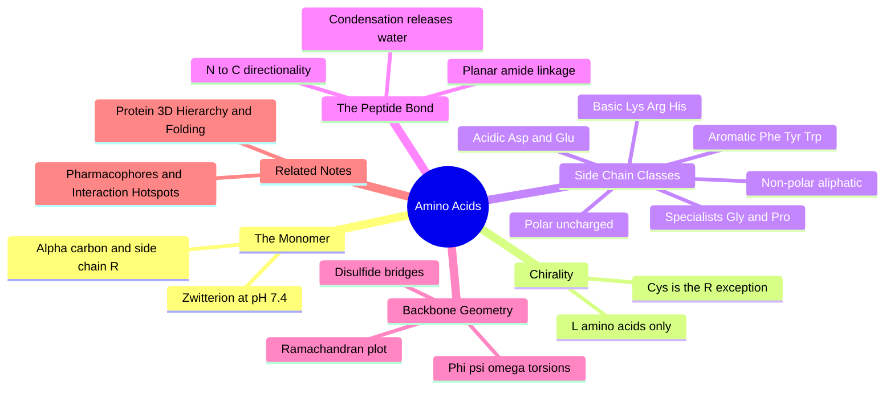

---
tags:
  - domain/structural-biology
  - depth/essential
  - 3dsyntree
  - topic/amino-acids
module: "04. Structural Biology and Protein Targets"
chapter: "Chapter 1. Protein Building Blocks and Structure"
type: concept
---

# 1. Amino Acids and Peptide Backbones

> [!abstract] Core Idea
> Every protein on Earth is one long chain assembled from just 20 chemically distinct amino-acid building blocks joined head-to-tail by amide "peptide" bonds. The side-chain chemistry of those 20 blocks — charged, polar, hydrophobic, or aromatic — decides how a protein folds and exactly which small-molecule functional groups its binding pocket can grip.

Navigation: [[0. Structural Biology and Protein Targets MOC]] · [[0. Master Vault Index]]

## 1. What It Is

A **protein** is a polymer — a giant molecule built by repeating a small monomer unit many times over. The monomer of proteins is the **amino acid**, and biology standardizes on exactly 20 kinds (the standard, or proteinogenic, amino acids). Each shares an identical central scaffold:

$$\text{H}_2\text{N}-\text{C}_\alpha\text{H}(\text{R})-\text{COOH}$$

Four groups hang off the central **alpha carbon** $\text{C}_\alpha$ (the "alpha" carbon is simply the carbon adjacent to the carboxyl carbon):

- an **amino group** $-\text{NH}_2$,
- a **carboxyl group** $-\text{COOH}$,
- a single hydrogen atom, and
- the **side chain** $\text{R}$ — the only part that differs among the 20 amino acids.

Once amino acids are chained together, each unit is called a **residue**, and consecutive residues are connected by **peptide bonds** — amide linkages formed between the carboxyl of one residue and the amino of the next. A short chain is a peptide or polypeptide; long chains are proteins. In water at physiological pH a free amino acid is a **zwitterion** ("hybrid ion"): the amino group picks up a proton to become $-\text{NH}_3^+$ while the carboxyl loses one to become $-\text{COO}^-$, so the molecule carries a positive and a negative charge at the same time while staying net-neutral.

## 2. Why It Exists

Nearly all cellular machinery — enzymes (biological catalysts), receptors (molecular sensors), transporters, antibodies, and structural scaffolds — is built from these 20 blocks. Their sequence, written in a 20-letter alphabet, determines the 3D shape, and the shape determines function. For drug design the statement narrows to something you can act on: **the side chains lining a binding pocket are the chemical "hands" that grab a ligand**, so which of the 20 chemistries faces into a pocket decides which ligand functional groups can bind there, and how strongly.

## 3. How It Works

### 3.1 The shared backbone and the zwitterion

Every residue in every protein carries the same repeating backbone atoms, $-\text{N}-\text{C}_\alpha-\text{C}(=\text{O})-$, over and over. The zwitterion picture matters mainly for free amino acids: once polymerized, the charged amino and carboxyl groups of each monomer are consumed into neutral amide bonds, leaving only the two chain **termini** charged. Permanent, interesting charge chemistry survives only in **side chains** — one reason pocket chemistry is side-chain chemistry. Which side chains are actually charged at pH 7.4 is a question of acid–base equilibria, covered in [[3. Acids Bases and pH 7.4 Ionization]].

### 3.2 Chirality: life builds with the L mirror only

A carbon carrying four *different* substituents is a **chiral center**: it comes in two mirror-image arrangements that cannot be rotated into each other, like left and right hands. Since $\text{C}_\alpha$ carries amino, carboxyl, hydrogen, and side chain, 19 of the 20 amino acids are chiral (glycine's side chain is a second hydrogen, so it is achiral). Natural proteins use **exclusively the L form** of every residue — in the CIP priority-ranking nomenclature of [[1. Stereochemistry Chirality and CIP Rules]], that is the $S$ configuration at $\text{C}_\alpha$ for 19 of them.

> [!warning] The famous exception: cysteine
> Cysteine's side chain contains sulfur, which outranks the other substituents in CIP priority and flips the assignment: L-cysteine is $R$, not $S$. Every other standard L-amino acid is $S$. Mirror-image D-amino acids do occur in nature (bacterial cell walls, some peptide toxins) but never in ordinary proteins.

### 3.3 The 20 side chains, grouped by class

The 20 side chains sort into a handful of physicochemical classes. Learn the classes first, individual residues second:

| Amino acid | Code (3 / 1) | Class | Side-chain chemistry |
| --- | --- | --- | --- |
| Glycine | Gly / G | non-polar aliphatic | a single hydrogen — zero bulk |
| Alanine | Ala / A | non-polar aliphatic | methyl group |
| Valine | Val / V | non-polar aliphatic | branched isopropyl |
| Leucine | Leu / L | non-polar aliphatic | branched isobutyl |
| Isoleucine | Ile / I | non-polar aliphatic | branched chain, extra chiral carbon |
| Methionine | Met / M | non-polar aliphatic | flexible sulfur-containing chain |
| Proline | Pro / P | non-polar aliphatic | ring bonded back to backbone N |
| Phenylalanine | Phe / F | aromatic | benzyl ring |
| Tyrosine | Tyr / Y | aromatic | phenol ring — can hydrogen bond |
| Tryptophan | Trp / W | aromatic | bulky indole with an N–H donor |
| Serine | Ser / S | polar uncharged | hydroxyl group |
| Threonine | Thr / T | polar uncharged | hydroxyl plus methyl |
| Cysteine | Cys / C | polar uncharged | thiol — forms disulfides |
| Asparagine | Asn / N | polar uncharged | amide group |
| Glutamine | Gln / Q | polar uncharged | amide, one carbon longer |
| Aspartate | Asp / D | negatively charged | carboxylate, $-1$ at pH 7.4 |
| Glutamate | Glu / E | negatively charged | carboxylate, $-1$ at pH 7.4 |
| Lysine | Lys / K | positively charged | terminal amine, $+1$ |
| Arginine | Arg / R | positively charged | guanidinium, $+1$ |
| Histidine | His / H | positively charged | imidazole, borderline pKa |

**Non-polar aliphatic** residues (Gly, Ala, Val, Leu, Ile, Met, Pro) are oily and water-avoiding; they pack into protein interiors. **Aromatic** residues (Phe, Tyr, Trp) are bulky rings; Tyr and Trp carry one polar atom each and can also hydrogen bond. **Polar uncharged** residues (Ser, Thr, Cys, Asn, Gln) carry hydroxyl, thiol, or amide groups — hydrogen-bond donors and acceptors without net charge. **Negatively charged (acidic)** residues (Asp, Glu) end in carboxylates that are reliably $-1$ at pH 7.4. **Positively charged (basic)** residues (Lys, Arg, His) end in amine-type groups: Lys and Arg are reliably $+1$, while His sits on the borderline with pKa $\approx 6$, so at pH 7.4 it is only partly protonated — which makes it a classic catalytic switch residue.

> [!note] Why one-letter codes exist
> Three-letter codes (Lys) are for prose; one-letter codes (K) exist so a 400-residue protein fits into a compact string. Sequence files, structural databases, and the clustering computations of [[3. Homology MMseqs2 Clustering and Data Leakage]] all compare these single-letter strings position by position.

### 3.4 Glycine and proline: the two structural specialists

**Glycine** has zero side-chain bulk, so its backbone can adopt torsion angles that are sterically forbidden for everyone else — it is the residue of choice in tight turns and crowded active sites, at the price of extra local flexibility. **Proline** is the opposite: its side chain loops around and bonds covalently to the backbone nitrogen, welding the ring shut. That lock freezes one torsion angle, removes the N–H hydrogen (proline cannot donate a backbone hydrogen bond), and makes proline a helix breaker — it kinks or terminates $\alpha$-helices.

> [!example] Reading real pocket chemistry — the kinase DFG motif
> A famous three-residue motif in kinases is Asp–Phe–Gly ("DFG"). Translated: Asp contributes a carboxylate ($-1$) that coordinates a magnesium ion and grips basic ligand groups; Phe contributes an aromatic, hydrophobic wall; Gly provides the flexibility that lets the motif flip between active and inactive shapes. A medicinal chemist reading "DFG" instantly knows the local interaction possibilities — that is exactly the skill this note builds.

### 3.5 Building the chain: condensation and the peptide bond

Residues are joined by **condensation polymerization**: the carboxyl of residue $i$ reacts with the amino of residue $i+1$, releasing one water molecule per bond and leaving the **peptide bond** — the new $\text{C}(=\text{O})-\text{N}$ amide linkage. Chains are always written and read from the free-amino end (**N-terminus**, residue 1) toward the free-carboxyl end (**C-terminus**); the N-to-C direction is as fixed a convention as reading text left to right.

Because the peptide bond is an amide, its C and N share electrons through resonance: the bond has partial double-bond character, is locked planar, and resists rotation with an $18\text{-}22\text{ kcal/mol}$ barrier — the full story lives in [[2. Resonance Conjugation and the Amide Planarity Lock]]. Consequence: a protein chain can only rotate around the bonds on either side of $\text{C}_\alpha$, never through the peptide bond itself.

### 3.6 Backbone torsions: phi, psi, omega

A **torsion (dihedral) angle** measures rotation about a central bond as the angle between the two flanking groups — the same geometric object that later becomes a design action in [[2. Rotatable Bonds and Dihedral Angles]]. Three of them describe each residue:

- $\phi$ (phi): rotation about the N–$\text{C}_\alpha$ bond, defined by the atom sequence $\text{C}-\text{N}-\text{C}_\alpha-\text{C}$,
- $\psi$ (psi): rotation about the $\text{C}_\alpha-\text{C}$ bond, defined by $\text{N}-\text{C}_\alpha-\text{C}-\text{N}$,
- $\omega$ (omega): the peptide bond itself, $\text{C}_\alpha-\text{C}-\text{N}-\text{C}_\alpha$, locked near $180^\circ$ (the trans arrangement).

Since $\omega$ is effectively frozen, the entire 3D path of a protein backbone is encoded by the list of $(\phi, \psi)$ pairs — a 300-residue protein is geometrically summarized by about 600 numbers.

### 3.7 The Ramachandran plot: which torsions are allowed

Scatter every residue's $(\phi, \psi)$ on a plane and most of the plane is empty, because most angle combinations make atoms collide. The **Ramachandran plot** maps the sterically allowed islands:

- the right-handed $\alpha$-helix basin near $(\phi, \psi) \approx (-57^\circ, -47^\circ)$,
- the extended $\beta$-strand basin near $(\phi, \psi) \approx (-120^\circ, +130^\circ)$,
- a small left-handed-helix basin, rare except for glycine.

Two practical uses: validating newly solved structures (a model whose residues fall outside the islands is suspect) and remembering that glycine can wander anywhere on the map because it has no side chain to collide with anything.

### 3.8 Disulfide bridges

Two cysteine side chains can be **oxidized** — each thiol sheds its hydrogen — to form a covalent **disulfide bridge**, $\text{Cys}-\text{S}-\text{S}-\text{Cys}$. Disulfides staple distant parts of a chain (or two separate chains) together and stabilize proteins that operate in oxidizing environments outside the cell, such as insulin and antibodies. In structural files they are recognized as two cysteine sulfur atoms sitting about $2.05\text{ Å}$ apart — a fact curation code uses so that a legitimate disulfide is not misread as a steric clash, a distinction that returns in [[3. X-Ray Crystallography and PDB Artifacts]].

## 4. What It Consists Of

- **$\text{C}_\alpha$ carbon** — the tetrahedral hub carrying backbone, hydrogen, and side chain.
- **Peptide bond** — the planar, resonance-locked amide linkage between residues.
- **Carbonyl oxygen** ($\text{C}=\text{O}$) — the backbone hydrogen-bond acceptor.
- **Amide nitrogen** ($\text{N}-\text{H}$) — the backbone hydrogen-bond donor.
- **Side chain R** — the variable group encoding all 20 chemistries.
- **N-terminus and C-terminus** — the two charged chain ends that fix reading direction.
- **One- and three-letter codes** — the compact nomenclature for residues in sequences.
- **Backbone torsions $\phi$, $\psi$, $\omega$** — the only rotational degrees of freedom of the chain.
- **Disulfide bridge** — the covalent Cys–Cys cross-link.

## 5. What You Must Understand

The sentence the whole module rests on: **the chemical makeup of the side chains lining a pocket determines which ligand functional groups can bind there** — acidic pockets grip amines, basic pockets grip carboxylates, aromatic walls stack against rings, and polar rims trade hydrogen bonds.

> [!warning] The code trap everyone falls into
> D is aspartate but N is asparagine; E is glutamate but Q is glutamine. The charged ones (D, E, K, R) are the ones that form salt bridges — mixing up D with N silently turns a charged interaction into a neutral one.

> [!tip] Memory hooks
> Charged at pH 7.4: "DE is negative, KR is positive." Helix behavior: "Gly bends, Pro breaks." Chirality: "all L; cysteine flips the R/S label because sulfur cheats the priority order."

> [!note] A subtlety worth keeping
> "L" and "D" are historical labels from sugar chemistry, not shorthand for a direction of rotation — always verify configuration with CIP rules rather than trusting the letter.

## 6. Prerequisites

- [[1. Organic Functional Groups]] — you must recognize amines, carboxylic acids, amides, thiols, and aromatic rings on sight, because side chains are built from exactly these.
- [[3. Acids Bases and pH 7.4 Ionization]] — predicts which side chains carry a charge at physiological pH, the basis of every charge-based interaction.

## 7. Project Connection

- `extract_protein_sequence()` in `syntree/data/curation.py` parses the residues of a raw structural file into exactly this one-letter alphabet, producing the sequence strings used downstream.
- `PocketHotspotFeaturizer` in `syntree/chemistry/hotspots.py` performs direct residue-level interaction checks — it must know that Asp and Glu carry $-1$, Lys and Arg $+1$, and that Phe, Tyr, and Trp offer aromatic contact surfaces.
- `assign_pocket_formal_charges()` in `syntree/data/featurizer.py` applies PDB2PQR-style protonation rules (Asp/Glu $-1$, Arg/Lys $+1$) so every pocket atom carries a formal charge the encoder can consume.

## 8. Required Depth

**Essential** — folding, pockets, hotspots, and sequence clustering are all stated in the language of these 20 residues; nothing else in the vault can be read without this alphabet.

## 9. Further Dependencies

- [[2. Protein 3D Hierarchy and Folding]] — the residue chain you just learned to read is the object that folds into 3D structure.
- [[2. Pharmacophores and Interaction Hotspots]] — residue classes become the charge, hydrogen-bond, and hydrophobic hotspots that anchor ligands.

## Concept Mind Map

