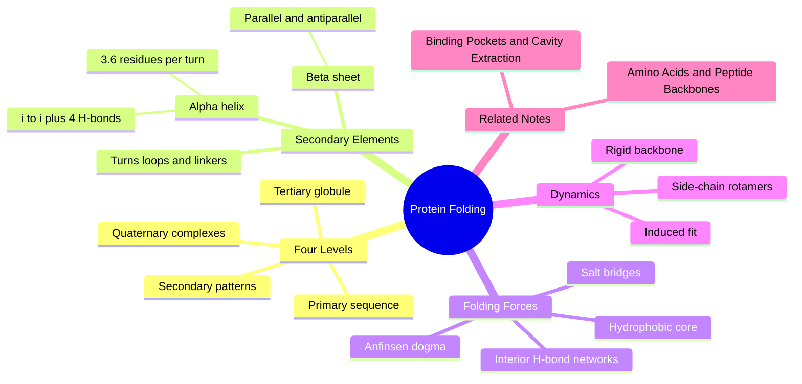

---
tags:
  - domain/structural-biology
  - depth/essential
  - 3dsyntree
  - topic/protein-structure
module: "04. Structural Biology and Protein Targets"
chapter: "Chapter 1. Protein Building Blocks and Structure"
type: concept
---

# 2. Protein 3D Hierarchy and Folding

> [!abstract] Core Idea
> A protein's linear residue chain spontaneously folds into a precise 3D shape through four levels of organization — sequence, local helices and sheets, the whole-chain fold, and multi-chain assemblies. Only the folded shape has binding pockets: folding is the step that brings sequence-distant residues together and carves the cavities that drugs target.

Navigation: [[0. Structural Biology and Protein Targets MOC]] · [[0. Master Vault Index]]

## 1. What It Is

Structural biologists describe every protein at four levels of organization:

- **Primary structure ($1^\circ$)** — the linear amino-acid sequence: the ordered list of residues from N-terminus to C-terminus.
- **Secondary structure ($2^\circ$)** — local, regular, repeating conformations of the chain, chiefly the $\alpha$-helix and the $\beta$-sheet, stabilized by **backbone hydrogen bonds**: attractive contacts in which the N–H of one residue bridges to the C=O oxygen of another.
- **Tertiary structure ($3^\circ$)** — the complete 3D fold of one whole polypeptide chain into a compact, globular shape.
- **Quaternary structure ($4^\circ$)** — the spatial arrangement of several folded chains (subunits) into one functional complex, built either from identical copies (homomers) or from different proteins (heteromers).

A **polypeptide chain** is simply the covalently linked residue string; "folded" means it has collapsed onto itself into one specific, reproducible 3D arrangement.

## 2. Why It Exists

A stretched-out chain has no activity: it aligns no catalytic groups, exposes no shaped cavity, and binds nothing specifically. Catalysis and binding exist only after the chain folds into a particular 3D arrangement — pockets, ridges, and precisely placed chemical groups appear only at the tertiary level. Folding converts a 1D string of amino acids into a 3D machine, and every drug-binding site is a product of that conversion.

## 3. How It Works

### 3.1 Primary structure: the sequence string

The primary structure is the residue list — for example Met–Glu–His–Leu — plus any disulfide connectivity, since a Cys–Cys cross-link is covalent and therefore also part of the chain's chemical connectivity. Everything else in this note emerges from this string: the sequence alone carries the information that determines the final fold (the deep reason is Anfinsen's dogma, Section 3.5).

### 3.2 Secondary structure: periodic backbone hydrogen bonding

Every residue's backbone donates one N–H and accepts with one C=O (proline excepted — its ring-constrained nitrogen carries no hydrogen). A **hydrogen bond** is a mostly electrostatic attraction between a polar X–H bond and a lone-pair-bearing atom such as oxygen or nitrogen; it is roughly 20 times weaker than a covalent bond but strong in numbers. When consecutive residues repeat the same $(\phi, \psi)$ torsion pair, donors and acceptors line up into periodic hydrogen-bond lattices — the two classic lattices:

**The $\alpha$-helix.** A right-handed coil with **3.6 residues per turn**: each residue twists the chain by $100^\circ$, so a full $360^\circ$ turn takes 3.6 steps and advances the axis by $5.4\text{ Å}$ (the pitch). Its defining hydrogen bonds run intra-chain, **from residue $i$ to residue $i+4$**: the carbonyl oxygen of residue $i$ accepts the amide N–H of residue $i+4$. Side chains bristle outward, making the helix a chemical cylinder; residues three to four apart in sequence end up on the same face of that cylinder.

**The $\beta$-sheet.** Here the chain is fully extended ($\phi \approx -120^\circ$, $\psi \approx +130^\circ$), and several extended **strands** lie side by side. Hydrogen bonds run **between strands** rather than within one. Strands are **parallel** when they all point N-to-C in the same direction and **antiparallel** when they alternate; antiparallel hydrogen bonds are nearly straight and slightly stronger, parallel ones are skewed. The sheet ripples into a pleated surface, with side chains alternating above and below the sheet plane.

**Turns, hairpins, and linkers.** Not everything is periodic. **$\beta$-turns** are tight four-residue U-turns, rich in glycine and often containing proline, that let the chain reverse direction; **hairpin loops** connect adjacent $\beta$-strands; **flexible linkers** join whole domains. Loops look irregular but are not random — they are the most sequence-variable parts of proteins and frequently form the rims of binding pockets.

### 3.3 Tertiary structure: packing into the globular fold

Helices, sheets, and loops then pack against one another through side-chain interactions, crumpling the chain into a compact globule a few tens of Å across. A **domain** is a compact sub-unit of the chain that folds, and often functions, semi-independently — a kinase, for instance, has a small N-lobe and a larger C-lobe, and their interface forms the ATP-binding pocket. The key geometric fact of the whole module: **residues hundreds of positions apart in sequence become immediate 3D neighbors after folding** (worked example below).

### 3.4 Quaternary structure: assemblies of chains

Many proteins work as complexes of several folded chains: a homodimer is two identical chains bound together; hemoglobin is a heterotetramer of two $\alpha$ and two $\beta$ chains. Quaternary assemblies matter to drug design because protein–protein interfaces can form or occlude binding pockets — a pocket that exists only in the assembly is invisible in the isolated chain.

### 3.5 The forces that fold the chain

- **The hydrophobic effect — the main driver.** Oily side chains (Leu, Ile, Val, Phe, and friends) bury into a dry **hydrophobic core**, away from water. The counterintuitive part: the driving force is mostly *water's* entropy. Water molecules forced to stand in ordered cages around oily surfaces are released to roam free when those surfaces stick together. The hydrophobic effect is an aggregation tendency, not a bond.
- **Interior hydrogen-bond networks and salt bridges.** Buried polar groups that find no partners would destabilize the fold, so in the core side chains satisfy each other with hydrogen bonds and with **salt bridges** — close contacts between a $+1$ Lys or Arg side chain and a $-1$ Asp or Glu side chain (ionization states as covered in [[3. Acids Bases and pH 7.4 Ionization]]).
- **Disulfide bridges.** Covalent Cys–Cys staples that lock distant parts of the chain together, mostly in proteins that work outside the cell.
- **van der Waals packing.** The finished core is packed nearly like a crystal — few voids, little clash — under the same atomic size rules as [[3. Van der Waals Radii and Steric Clash]], with the weak attractions between touching atoms described by the Lennard-Jones energy of [[1. Lennard Jones and Soft Core Potentials]].
- **Anfinsen's dogma.** In classic experiments in the late 1950s and 1960s — work honored with the 1972 Nobel Prize in Chemistry — Christian Anfinsen showed that a fully denatured (unfolded) ribonuclease chain refolds spontaneously into its active structure in a test tube. Conclusion: **the primary sequence alone encodes the native fold**, which is the free-energy minimum of the chain. This is why "sequence determines structure" is a well-posed computational problem at all.

### 3.6 Rigid backbone, flexible side chains: rotamers

A folded protein is not a statue. Helices behave like fairly rigid rods and sheets like planks, but **side chains** constantly rotate about their own single bonds — the $\chi$ (chi) torsions such as $\chi_1 = \text{N}-\text{C}_\alpha-\text{C}_\beta-\text{C}_\gamma$, the same dihedral geometry as [[2. Rotatable Bonds and Dihedral Angles]]. Each side chain prefers a handful of staggered conformations, called **rotamers**, and flickers among them. Two consequences for drug design: a crystallographic pocket is one snapshot, not the whole truth; and side chains can rotate to admit a ligand — **induced fit** — so a pocket may reshape itself around a binder.

> [!example] A pocket from three sequence-distant places
> Take Thr30 on helix $\alpha 1$, Tyr95 on $\beta$-strand 3, and Asp122 in a surface loop. In the linear sequence they are 65 and 27 residues apart — strangers. In the folded kinase they all sit within about $6\text{ Å}$ of one another and jointly wall in the ATP pocket: Tyr's aromatic face stacks against ligand rings, Thr's hydroxyl offers a hydrogen bond, Asp's carboxylate grips basic groups and a magnesium ion. Pocket chemistry is 3D adjacency, not sequence adjacency — which is why structure-based systems represent proteins as atoms in space rather than as strings.

## 4. What It Consists Of

- **$\alpha$-helix** — 3.6 residues per turn, intra-chain $i \to i+4$ backbone hydrogen bonds.
- **$\beta$-strand and $\beta$-sheet** — extended strands, parallel or antiparallel, cross-linked by inter-strand hydrogen bonds.
- **$\beta$-turn, hairpin loop, flexible linker** — non-repetitive connectors, richest in Gly and Pro.
- **Domain** — a compact, semi-independent folding sub-unit of the chain.
- **Hydrophobic core** — the buried, water-free interior of packed non-polar side chains.
- **Salt bridge and H-bond network** — the electrostatic stitches that stabilize the interior.
- **Rotamer** — one of the preferred staggered conformations of a side chain.
- **Subunit and interface** — one chain of a multi-chain complex, and the surface where two chains touch.

## 5. What You Must Understand

**Binding pockets are irregular 3D clefts created by tertiary folding, which brings amino acids that are far apart in the linear sequence into close spatial proximity.** If you internalize one sentence from this note, make it that one.

> [!warning] Secondary structure is a backbone-only concept
> Helices and sheets are defined purely by backbone N–H···O=C hydrogen bonds — side chains play no part in the definition. The same helix can be oily on one face (buried in the core) and polar on the other (facing solvent).

> [!warning] The hydrophobic effect is water's story
> It is driven by the entropy of released water, not by any attraction between oily side chains — and it is not identical to the water displacement that helps a lipophilic ligand bind a pocket, though the two ideas rhyme.

> [!tip] Memory hook for the helix
> "3.6 per turn, glue every 4th" — 3.6 residues complete one full turn, and each residue hydrogen-bonds to the one four positions further along.

> [!note] Folding is not a single pathway
> Chains fold through many routes down a funnel-shaped energy landscape; Anfinsen's dogma fixes the destination (the free-energy minimum), not the route taken.

## 6. Prerequisites

- [[1. Amino Acids and Peptide Backbones]] — supplies the residue alphabet, the backbone geometry, and the torsion angles that this note folds into 3D.

## 7. Project Connection

- Protein structures are ingested from raw structural files by `scripts/preprocess_multidataset.py`, which reads the deposited tertiary coordinates — the end product of this folding hierarchy — and passes curated complexes onward.
- The protein side of the model, `BipartitePaiNN` in `syntree/models/bipartite.py`, receives the pocket atom positions and atomic numbers (`pocket_pos`, `pocket_z`) and builds a 3D radius graph: atoms within a $5.0\text{ Å}$ cutoff (`CosineCutoff` in `syntree/models/equivariant.py`) exchange messages. The network therefore learns 3D adjacency directly — mirroring how evolution builds pockets from sequence-distant residues. The architecture is detailed in [[2. Bipartite Heterogeneous Protein Ligand Graphs]].

## 8. Required Depth

**Essential** — the pocket extractor, the encoder's radius graph, and every downstream interaction concept consume the output of exactly this folding hierarchy.

## 9. Further Dependencies

- [[1. Binding Pockets and Cavity Extraction]] — pockets are the clefts this folding produces, and the next note defines how they are cut out of the structure as atom clouds.

## Concept Mind Map

