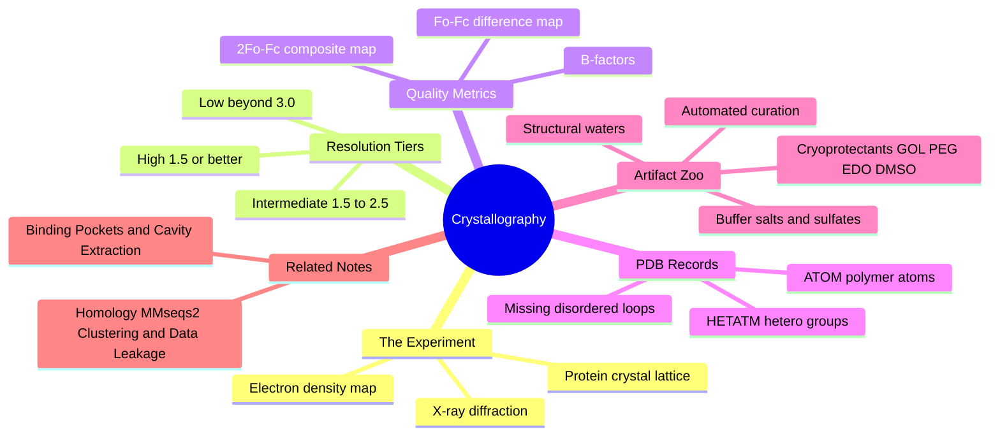

---
tags:
  - domain/structural-biology
  - depth/supporting
  - 3dsyntree
  - topic/pdb-curation
module: "04. Structural Biology and Protein Targets"
chapter: "Chapter 1. Protein Building Blocks and Structure"
type: concept
---

# 3. X-Ray Crystallography and PDB Artifacts

> [!abstract] Core Idea
> Almost every 3D protein structure used in drug design was reconstructed by shining X-rays through a protein crystal and fitting atomic coordinates into the resulting electron-density map. The deposited files also contain non-biological leftovers — buffer salts, glycerol, precipitants — plus disordered regions and coordinate errors that any serious pipeline must recognize and scrub out.

Navigation: [[0. Structural Biology and Protein Targets MOC]] · [[0. Master Vault Index]]

## 1. What It Is

**Macromolecular X-ray crystallography** is the primary experimental method for resolving atomic 3D structures of proteins: a **crystal** (an ordered lattice containing trillions of identical protein copies) is illuminated with X-rays; the electrons in the crystal **diffract** (scatter) the beam into a pattern of spots; and from that pattern a 3D **electron density map** is computed, into which an atomic model is fitted. The **Protein Data Bank (PDB)** is the public archive where solved structures are deposited as text files of atom records. **Artifacts** are everything in those files that is not part of the biological system — crystallization additives, solvent molecules — or not fully reliable: disordered stretches with missing coordinates, low-resolution guesses, and alternative conformations.

## 2. Why It Exists

Structure-based design stands entirely on experimental structures. If you do not know how the data was generated, you cannot distinguish a real ligand from a glycerol molecule sitting in the same pocket, or a precisely located atom from one whose position is essentially a guess. Every pocket that a design system ever sees is inherited from a PDB entry, so understanding the experiment — and its failure modes — is what allows noise, coordinate errors, and non-biological molecules to be filtered out before training.

## 3. How It Works

### 3.1 From crystal to coordinates

The experiment, in conceptual steps:

1. **Purify** many milligrams of one protein.
2. **Crystallize** it: the protein is slowly driven out of a supersaturated solution by precipitants (salts, polyethylene glycol) until trillions of identical molecules lock into a repeating 3D lattice.
3. **Cryo-protect and freeze** the crystal in liquid nitrogen, with an added **cryoprotectant** to stop ice from forming; this limits radiation damage during exposure.
4. **Collect diffraction**: the crystal is rotated in an X-ray beam whose wavelength is about $1\text{ Å}$ — comparable to atomic spacings, which is precisely why X-rays can resolve atoms. Electrons scatter the beam, and a detector records a pattern of diffraction spots.
5. **Convert spots to amplitudes**: spot intensities give the observed structure-factor amplitudes $F_o$; the phases must be estimated computationally (the classical "phase problem").
6. **Compute the electron density** $\rho(x, y, z)$ — a 3D cloud showing where the electrons are — by Fourier synthesis of amplitudes and phases.
7. **Build the model**: an atomic model (the coordinates) is fitted into the density, residue by residue.
8. **Refine and deposit**: coordinates are adjusted until the diffraction calculated from the model, $F_c$, matches the observed $F_o$, and the result is deposited in the PDB with its data.

The crucial mental model: **a deposited structure is a model fitted into a cloudy map, not a photograph of atoms.**

### 3.2 The other two structure methods, briefly

**Cryogenic electron microscopy (cryo-EM)** images many identical frozen-hydrated protein particles in an electron microscope and merges their images into a density map — no crystal needed, and it excels for large assemblies, typically reaching $2\text{-}4\text{ Å}$ today. **Nuclear magnetic resonance (NMR) spectroscopy** determines structures of small proteins in solution from magnetic interactions between atom nuclei; an NMR entry is an ensemble of models rather than a single coordinate set. Both methods feed the same archives; their entries inherit the same curation questions.

### 3.3 Resolution — the quality dial

**Resolution** is the smallest separation of detail the diffraction data can distinguish. It is the single most quoted number about a structure:

| Tier | Resolution | What you can trust |
| --- | --- | --- |
| High | $\le 1.5\text{ Å}$ | individual atoms; alternative side-chain conformers visible; even hydrogens sometimes |
| Intermediate | $1.5\text{-}2.5\text{ Å}$ | confident backbone and most side chains; ordered waters visible |
| Low | $> 3.0\text{ Å}$ | backbone trace; side-chain identities and orientations doubtful |

Structures between $2.5$ and $3.0\text{ Å}$ sit in a gray zone — backbone still traceable, but side-chain orientations increasingly shaky, which is exactly where ligand-contact analysis starts to wobble. One caveat: resolution describes the *dataset*; local model quality still varies residue by residue — which is what B-factors (next) record. The project's data pipeline keeps structures resolved at $2.5\text{ Å}$ or better for exactly this reason.

### 3.4 Electron density maps: $2F_o - F_c$ and $F_o - F_c$

Two maps are computed against the current model:

- The **$2F_o - F_c$ composite map** ("two-fo-minus-fc") is the everyday "where the atoms are" map: a blend of observed and calculated data. A well-fitted atom sits centered inside its blob of $2F_o - F_c$ density.
- The **$F_o - F_c$ difference map** shows what the data has that the model lacks (a positive peak — drawn green in software — meaning unexplained density: an unmodeled ligand, water, or additive) and where the model claims mass the data does not support (a negative, red peak — a wrongly placed atom or rotamer).

> [!example] Reading difference density in an active site
> You refine a structure and see a strong positive $F_o - F_c$ blob sitting in the known active site, shaped like a three-carbon chain with a fork. The model has nothing there. That is almost certainly a bound **glycerol** molecule from the cryoprotectant — or a weakly occupied ligand. Fitting it as glycerol explains the density; leaving it out means the next reader of the file will wonder what belongs there. Either way, the blob is chemistry in the pocket, and the curation decision (keep or strip) has to be made explicitly.

### 3.5 The B-factor: how much to trust each atom

Every atom in a PDB entry carries a **temperature factor** (B-factor, or Debye–Waller factor):

$$B = 8\pi^2 \langle u^2 \rangle$$

where $\langle u^2 \rangle$ is the mean-square displacement of the atom around its modeled position. Low B ($5\text{-}20\text{ Å}^2$) means the atom sits still and its coordinate is precise — typical of protein core atoms. High B ($60\text{-}100+\text{ Å}^2$) means the atom is smeared over space by vibration or static disorder — typical of surface loops, side-chain tips, and most waters; such coordinates are close to educated guesses. When judging whether a pocket-lining side chain can be trusted, read its B-factor before anything else.

### 3.6 RSCC and RSR: per-residue model-versus-map agreement

Two finer, per-residue quality metrics exist. The **real-space correlation coefficient (RSCC)** measures how well each residue's model correlates with the density map on a 0-to-1 scale — above roughly 0.8 is considered good. The **real-space R-factor (RSR)** is the complementary disagreement measure. These matter enormously for **ligands**: a deposited ligand pose with poor RSCC may be a modeling fantasy, so structure-curation pipelines for drug design check ligand fit before trusting a co-crystal.

### 3.7 ATOM versus HETATM records

A PDB file is a list of atom lines. **ATOM records** hold atoms of the standard polymer residues — the amino-acid chain itself. **HETATM records** ("hetero atom") hold everything else: the bound ligand, cofactors, metal ions, waters (residue name HOH), and every crystallization additive. Two traps follow. First, **the drug-like ligand is itself a HETATM** — a pipeline that blindly strips all HETATM records deletes the very molecule the pocket is defined by. Second, a pipeline that keeps all HETATM records poisons the pocket with buffer components. Classification must be chemical, not positional.

### 3.8 The artifact zoo: buffers, salts, and cryoprotectants

Crystals grow in cocktail solutions, and the components of those cocktails routinely appear in the final structure — preferentially **inside concave pockets**, because pockets are exactly where small molecules like to sit:

- **Crystallization buffers and salts**: sulfate ($\text{SO}_4^{2-}$), phosphate ($\text{PO}_4^{3-}$), acetate, formate, chloride. Sulfate and phosphate in particular are charged, pocket-shaped, and love sitting in basic active sites — convincingly mimicking a ligand's acidic group.
- **Cryoprotectants and solvents**: glycerol (GOL), ethylene glycol (EDO), polyethylene glycol fragments (PEG), and DMSO (a common soaking solvent for ligands). A DMSO molecule in the pocket is solvent, not biology.

These are the molecules most likely to be mistaken for substrates by an unwary reader — and by an unwary extraction pipeline.

### 3.9 Structural waters

PDB files are full of HOH records. A minority are **ordered, coordinated waters** — pinned by two or more hydrogen bonds, sometimes catalytic (participating directly in the reaction) or forming bridges between protein and ligand; these are real biology and can even be exploited in design. The majority are **disordered bulk solvent** — molecules of the surrounding medium with high B-factors and arbitrary positions. The discriminator, again, is B-factor plus coordination chemistry. Heavy-atom pipelines that ignore waters entirely must at least know they are dropping the coordinated ones.

### 3.10 Automated artifact curation

A structural-data pipeline therefore runs an explicit curation protocol:

1. Parse the file, separating polymer ATOM records from HETATM records.
2. Classify HETATM groups: keep the cognate ligand and essential cofactors/metals; strip a known list of additive residue names (GOL, PEG, EDO, DMS, sulfate, and the like); decide a water policy.
3. Handle **alternative conformations** (alternate location indicators A/B on the same atom): keep the highest-occupancy or first-listed conformer so no atom is duplicated.
4. Record **missing residues**: disordered loops simply have no coordinates, so residue numbering jumps — a gap that silently breaks downstream graph construction if unhandled.
5. Apply the resolution filter ($\le 2.5\text{ Å}$) as the final quality gate.

> [!example] Curating one kinase structure end to end
> A $2.1\text{ Å}$ kinase entry contains: the protein (ATOM records), one ligand (HETATM), one GOL, two sulfates, 130 waters, an A/B alternate-conformation pair on Lys37, and residues 37–44 missing entirely because the activation loop is disordered. Curation: keep protein and ligand; strip GOL and sulfate; drop waters (heavy-atom representation); keep altloc A; log the 37–44 gap for the graph builder. What survives is a pocket containing biology, not buffer.

## 4. What It Consists Of

- **Resolution** — the fineness of detail the diffraction data supports, in Å.
- **$2F_o - F_c$ map** — the composite "where atoms are" density map.
- **$F_o - F_c$ map** — the difference map exposing missing or unsupported atoms.
- **B-factor** — per-atom positional smearing; the trust level of a coordinate.
- **RSCC and RSR** — per-residue real-space agreement metrics.
- **ATOM and HETATM records** — polymer versus hetero-group bookkeeping.
- **Alternate conformations** — multiple modeled positions for one atom.
- **Missing residues** — disordered stretches with no coordinates at all.
- **Additives** — buffer salts, cryoprotectants, and solvents from the crystal cocktail.
- **Structural waters** — ordered, coordinated waters versus bulk solvent.

## 5. What You Must Understand

**Raw PDB files are not pristine biological systems.** They contain crystallization artifacts that must be stripped out, and disordered loops with missing coordinates that break graph construction if ignored.

> [!warning] The ligand is a HETATM
> Never filter HETATM records wholesale — the co-crystallized ligand that defines the pocket is itself a hetero group. Classify by residue name, not by record type.

> [!warning] Additives love active sites
> Glycerol, sulfate, and PEG fragments are small molecules, and pockets are small-molecule traps — artifacts cluster exactly where your drug is supposed to bind, and they are shaped to look convincing.

> [!tip] Resolution tiers in one breath
> "1.5 or better sees atoms; 2.5 is the working standard; beyond 3.0 you see a silhouette." Then check B-factors for the residue you actually care about.

> [!note] Missing loops are not errors
> A gap in residue numbering means the region was too mobile to scatter coherently — the honest answer was to model nothing. Pipelines must expect and register gaps rather than crash on them.

## 6. Prerequisites

- [[3. Van der Waals Radii and Steric Clash]] — the atomic size rules that decide whether a fitted (or docked) coordinate arrangement makes physical sense.
- [[2. Protein 3D Hierarchy and Folding]] — the structural vocabulary of the objects being solved and deposited.

## 7. Project Connection

- The pocket standardization step, `standardize_pocket()` in `syntree/data/curation.py`, strips common crystallization additives (glycerol, PEG, ethylene glycol, DMSO, sulfates, and similar additive residue names) while preserving the biological polymer and the cognate ligand, and registers disordered gaps.
- `scripts/preprocess_multidataset.py` applies the structural quality gate, keeping structures resolved at $2.5\text{ Å}$ or better before handing clean complexes to [[1. Binding Pockets and Cavity Extraction]].
- Generated poses are later screened with geometric sanity rules that crystallographic poses implicitly satisfy — the checks described in [[1. PoseBusters Physical Sanity Filters]].

## 8. Required Depth

**Supporting** — the curation pipeline already strips crystallographic artifacts automatically; you need to recognize what a PDB file contains and why filtering matters, but not the full crystallographic theory behind every artifact.

## 9. Further Dependencies

- [[3. Homology MMseqs2 Clustering and Data Leakage]] — once structures are curated, their protein sequences are clustered to build leakage-proof train and test splits.
- [[2. SPR Kinetics and X-Ray Complex Confirmation]] — at the end of the discovery pipeline, the ultimate proof of a designed molecule is its own freshly solved co-crystal structure.

## Concept Mind Map

