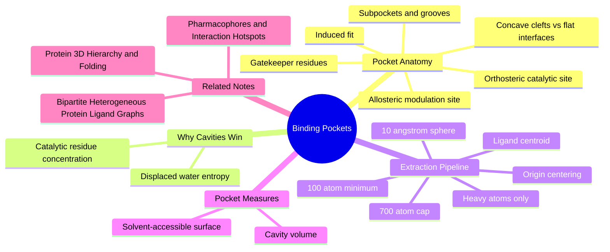

---
tags:
  - domain/structural-biology
  - depth/essential
  - 3dsyntree
  - topic/pocket-extraction
module: "04. Structural Biology and Protein Targets"
chapter: "Chapter 2. Binding Sites and Data Integrity"
type: concept
---

# 1. Binding Pockets and Cavity Extraction

> [!abstract] Core Idea
> A binding pocket is a concave cleft on a folded protein where a small molecule settles in and holds on through non-covalent interactions. Structure-based pipelines never feed whole proteins to their networks — they cut out the pocket as the sphere of protein atoms within $10\text{ Å}$ of the bound ligand's center, translate it to the origin, and cap it at 700 atoms.

Navigation: [[0. Structural Biology and Protein Targets MOC]] · [[0. Master Vault Index]]

## 1. What It Is

A **binding pocket** (binding site, or active site in enzymes) is a concave surface region of a protein where a **ligand** — a small molecule such as a drug candidate, a substrate (the molecule an enzyme chemically converts), or a cofactor (a helper molecule) — binds through **non-covalent interactions**: hydrogen bonds, salt bridges (contacts between opposite formal charges), and hydrophobic contact (greasy surfaces sticking together in water). **Cavity extraction** is the computational procedure that cuts the pocket out of an entire protein structure, producing a compact cloud of protein atoms that a neural network can actually consume.

## 2. Why It Exists

Two reasons, one chemical and one computational. Chemically, proteins concentrate their catalytic residues and minimize **entropic water penalties** inside concave pockets rather than on flat, solvent-exposed surfaces: a cavity buries most of the ligand's surface area, lets many contacts form at once, and releases ordered water molecules that had been immobilized inside the cleft — an entropy gain that flat surfaces cannot match. Computationally, whole proteins are enormous — often more than $30{,}000$ atoms — far beyond what a graph neural network can process for every design step, while a pocket is a few hundred atoms that contain almost everything relevant to ligand binding. Extraction is the bridge between those two scales.

## 3. How It Works

### 3.1 Surface topology: concave pockets versus flat interfaces

Protein surfaces come in two broad flavors. **Concave pockets** are craters and clefts — they bury ligand surface, concentrate their lining chemistry, and displace pocket water; this is where almost all druggable binding happens. **Flat, solvent-exposed interfaces** (for example many protein–protein contact surfaces) are shallow and diffuse; a small molecule touching them buries almost nothing and pays the full desolvation cost, which is why flat interfaces are historically hard drug targets. Two standard geometric descriptors quantify a cavity: the **solvent-accessible surface area (SASA)** — the area a rolling, water-sized probe sphere can reach — and the **cavity volume** $V_{\text{poc}}$ — the enclosed empty space available to a ligand.

### 3.2 Orthosteric and catalytic sites

The **orthosteric site** is the pocket where the protein's endogenous partner binds: the substrate in an enzyme (where it is also called the **active** or **catalytic** site, and where catalytic residues chemically transform it) or the natural messenger in a receptor. Drugs that bind the orthosteric site compete head-on with the natural molecule — potent, but the orthosteric site is usually conserved across a protein family, so competition there often costs selectivity.

### 3.3 Allosteric pockets

An **allosteric site** is any binding pocket outside the orthosteric one. Ligand binding there modulates the protein's shape or dynamics at a distance — stabilizing an inactive conformation, for example — rather than directly blocking the natural partner. Because allosteric sites face weaker evolutionary pressure to stay conserved, they often offer better selectivity within a protein family, at the cost of being harder to find.

### 3.4 Subpockets and binding grooves

A real pocket is rarely one smooth bowl. It divides into **subpockets**: deep hydrophobic recesses that bury lipophilic ligand groups and do most of the affinity work, and **polar rims** — the open, solvent-facing collar lined with hydrogen-bonding groups. A classic design strategy anchors a strong group in the deep subpocket and decorates outward across the rim. **Binding grooves** are extended channels rather than bowls — a protease's substrate groove, for instance — where the ligand threads along the protein surface.

### 3.5 Gatekeeper residues and induced fit

A **gatekeeper residue** sits at the neck of a subpocket and controls access to it purely by its size: in kinases, a small threonine at the gatekeeper position leaves a back pocket open to inhibitors, while a bulky methionine blocks it — one residue decides which chemistry fits. Separately, **induced fit** is the observation that protein and ligand reshape each other during binding: side chains rotate to new rotamers, loops close over the ligand. A crystal structure is one frozen snapshot of this negotiation, so pocket extraction remembers a single geometry even though binding samples several.

### 3.6 Centroid-based spherical extraction

Given a co-crystal structure (a protein solved *with* a ligand bound), the pocket is defined by the ligand's position:

1. Compute the **ligand centroid** $\mathbf{c}_L$ — the mean of the ligand's heavy-atom coordinates.
2. Keep every protein atom within the Euclidean radius $10.0\text{ Å}$ of that centroid:

$$\text{keep atom } i \iff \lVert \mathbf{x}_i - \mathbf{c}_L \rVert \le 10.0\text{ Å}$$

The rationale: the atoms that matter for binding are those the ligand can touch or nearly touch. A sphere around the ligand captures the pocket walls — and anything shaping the pocket's chemical environment — without needing geometric cavity-detection algorithms.

### 3.7 Minimum pocket size: the 100-atom filter

Extracted pockets must contain **at least 100 protein heavy atoms**. A pocket below that threshold is a surface dimple, not a pocket — it lacks the context a model needs to reason about binding. Real extracted pockets typically land in the $200\text{-}800$ atom range.

### 3.8 Origin centering for translation invariance

The kept atoms are then translated so the pocket sits at the origin $(0, 0, 0)$: the ligand centroid is subtracted from every coordinate. The physical chemistry of binding does not depend on where in the crystal's coordinate frame the protein happens to sit, so the representation should not either — this is **translation invariance**, half of the broader invariance story told in [[2. Invariance vs Equivariance in Molecular Clouds]]. Rotation is *not* normalized away the same way; it is handled by the equivariant encoder, a rigid-frame concern related to [[4. The Kabsch Algorithm and Rigid Alignment]].

### 3.9 Heavy-atom representation

The pocket is stored as **heavy atoms** only — every atom except hydrogen. X-ray structures rarely resolve hydrogen at all (a hydrogen atom holds a single electron, nearly invisible in diffraction), so models are built from carbon, nitrogen, oxygen, sulfur, and occasional metals. Non-polar hydrogens are simply dropped; protonation states and formal charges are assigned by rule rather than read from coordinates.

### 3.10 The 700-atom cap

Some pockets — large, shallow, or with the ligand near the protein edge — would extract to enormous atom sets, and whole proteins exceed $30{,}000$ atoms, which would blow up GPU memory (out-of-memory spikes during training). The pipeline therefore enforces a hard **cap of 700 pocket atoms**: pockets above the cap are trimmed to the atoms nearest the ligand. The full operating window is worth memorizing: $10\text{ Å}$ radius, minimum 100 atoms, cap 700, typically $200\text{-}800$.

> [!example] Extracting one pocket end to end
> A $2.1\text{ Å}$ co-crystal holds a 3,912-atom protein and a 34-heavy-atom ligand whose centroid sits at $(18.2, -7.5, 42.9)$. The extractor computes distances from that centroid: 468 protein atoms fall inside $10.0\text{ Å}$ — comfortably inside the 100-to-700 window, so no trimming fires. Every kept atom is shifted by $(-18.2, +7.5, -42.9)$, putting the old ligand centroid at the origin. The output is a 468-point heavy-atom cloud with element labels — precisely the protein-side input from which [[2. Bipartite Heterogeneous Protein Ligand Graphs]] builds the model's pocket graph.

## 4. What It Consists Of

- **Pocket boundary atoms** — the lining residues that define the cleft walls.
- **Cavity volume** ($V_{\text{poc}}$) — the enclosed empty space a ligand can occupy.
- **Solvent-accessible surface area (SASA)** — the water-probe-reachable area of the pocket.
- **Subpocket** — a distinct recess within the pocket (deep hydrophobic, or polar rim).
- **Orthosteric site** — the pocket where the endogenous partner binds.
- **Allosteric site** — a non-orthosteric pocket that modulates the protein remotely.
- **Gatekeeper residue** — the size-defining residue at a subpocket entrance.
- **Ligand centroid** — the mean ligand coordinate that anchors extraction.
- **Extraction sphere** — the $10\text{ Å}$ radius selection rule.
- **Atom-count window** — the 100-atom minimum and 700-atom cap.
- **Heavy-atom cloud** — the final, hydrogen-free, origin-centered representation.

## 5. What You Must Understand

**3D-SynTree does not process whole proteins** — they often contain more than $30{,}000$ atoms and exceed GPU memory. It operates on extracted, origin-centered $10\text{ Å}$ binding pockets of roughly $200\text{-}800$ atoms.

> [!warning] The pocket is ligand-defined
> The same protein yields different extracted pockets depending on where the co-crystallized ligand sits. There is no ligand-independent "the pocket" in this pipeline — extraction presupposes a reference complex, which is why the curation of [[3. X-Ray Crystallography and PDB Artifacts]] happens first.

> [!warning] The radius is a compromise
> Too small a radius cuts off pocket-defining residues and loses chemistry; too large a radius drags in irrelevant bulk and slams into the 700-atom cap. $10\text{ Å}$ is the chosen balance.

> [!tip] Numbers to memorize
> $10\text{ Å}$ extraction radius · at least 100 atoms · 700-atom cap · $200\text{-}800$ typical · $5.0\text{ Å}$ message-passing cutoff — so even atoms near the sphere's edge still influence the ligand neighborhood through relayed messages.

> [!note] Centering kills translation, not rotation
> Origin-centering removes *where* the pocket is; it deliberately leaves *how it is oriented* to the equivariant network, which must treat all rotations of the same pocket as the same molecule.

## 6. Prerequisites

- [[2. Protein 3D Hierarchy and Folding]] — tertiary folding is what creates pocket-shaped clefts and brings sequence-distant residues to the pocket wall.

## 7. Project Connection

- `extract_protein_pocket()` in `syntree/data/multidataset.py` and `standardize_pocket()` in `syntree/data/curation.py` perform the sphere cut, the additive stripping, and the coordinate centering described above.
- `MolecularFeaturizer.featurize_pocket()` in `syntree/data/featurizer.py` converts the extracted atoms into `pocket_z` atomic numbers plus coordinates — the tensor form of the cloud.
- The training loop enforces `max_pocket_atoms = 700` in `syntree/engine/trainer.py` specifically to prevent CUDA out-of-memory spikes on oversized pockets.
- `BipartitePaiNN` in `syntree/models/bipartite.py` consumes `pocket_pos` and `pocket_z` as the protein side of its joint graph.

## 8. Required Depth

**Essential** — the extracted pocket cloud is the protein-side input to every downstream component: the encoder, the hotspot featurizer, and the reward evaluation all operate inside it.

## 9. Further Dependencies

- [[2. Pharmacophores and Interaction Hotspots]] — the extracted pocket gets annotated with the interaction hotspots that anchor synthesis.
- [[2. Bipartite Heterogeneous Protein Ligand Graphs]] — the pocket cloud becomes the protein side of the encoder's joint protein–ligand graph.

## Concept Mind Map

## Cross-Domain Links

- [[AI/04. Graph Neural Networks and Message Passing/Chapter 2. Message Passing Paradigms/3. Computational Complexity of Spatial Radius Graphs|3. Computational Complexity of Spatial Radius Graphs]] (AI vault) — slicing per-pocket sub-graphs reduces $O(N_{\text{total}}^2)$ distance-matrix memory to $O(\sum_b N_b^2)$.
