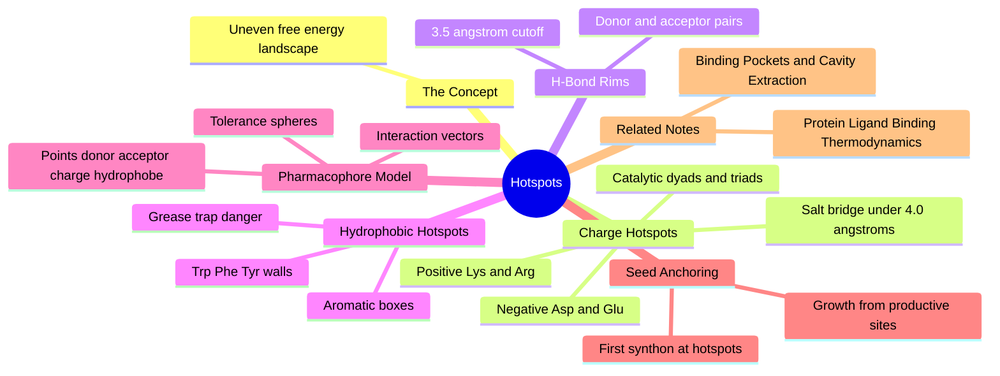

---
tags:
  - domain/structural-biology
  - depth/supporting
  - 3dsyntree
  - topic/pharmacophores
module: "04. Structural Biology and Protein Targets"
chapter: "Chapter 2. Binding Sites and Data Integrity"
type: concept
---

# 2. Pharmacophores and Interaction Hotspots

> [!abstract] Core Idea
> A binding pocket is not uniformly sticky: a few residues — the hotspots — contribute most of the binding free energy. A pharmacophore is the abstract summary of those favorable interactions (charges, hydrogen bonds, hydrophobic and aromatic surfaces) together with their positions and directions, used to anchor the first synthon in a pocket and to reward genuinely productive interactions.

Navigation: [[0. Structural Biology and Protein Targets MOC]] · [[0. Master Vault Index]]

## 1. What It Is

A **pharmacophore** is an ensemble of steric, electrostatic, and hydrogen-bonding features in a binding pocket that together govern **molecular recognition** — the specific, selective binding of a particular ligand. Crucially, a pharmacophore is an abstraction: not "a lysine at position 59" but "a positive charge at this location." An **interaction hotspot** is a pocket residue or small cluster of residues whose contribution to the **binding free energy** ($\Delta G$, the energy currency of binding strength) is disproportionately large. A hotspot is where affinity is won; the pharmacophore is the checklist of what a ligand must provide to exploit it.

## 2. Why It Exists

Not all pocket surface area contributes equally to binding. If every lining atom contributed equally, designing a ligand would be a pure volume-filling exercise. In reality, experiments such as alanine scanning (mutating each candidate residue to the minimal alanine and measuring the affinity drop) and fragment-soaking studies show that a handful of residues dominate $\Delta G$ while the rest barely matter. Two practical consequences for a generative system: design effort should concentrate on satisfying hotspots, and a molecule's quality can be scored by whether it actually forms the key interactions those hotspots offer.

## 3. How It Works

### 3.1 The energy hotspot concept

Binding free energy is non-uniformly distributed across pocket residues. A **hotspot** is a residue (or cluster) whose removal or whose satisfied interaction moves affinity far more than the pocket average — typically because it offers a strong, directional interaction to a ligand group that would otherwise pay a desolvation cost without compensation. Hotspot chemistry comes in three recurring flavors, mapped one-to-one onto the residue classes of [[1. Amino Acids and Peptide Backbones]].

### 3.2 Positive charge hotspots: catalytic Lys and Arg

At pH 7.4, lysine and arginine side chains carry $+1$. A pocket position where a Lys or Arg side chain points into the cavity is an invitation for an **anionic ligand group** — a carboxylate or a bioisostere of one. The interaction formed is a **salt bridge** (an ion pair), with the standard geometric criterion: nearest nitrogen-to-oxygen heavy-atom distance $\le 4.0\text{ Å}$. Arginine's guanidinium cap is planar and can donate multiple hydrogen bonds at once, making it both sticky and directional.

### 3.3 Negative charge hotspots: catalytic Asp and Glu dyads and triads

Aspartate and glutamate side chains carry $-1$ and invite **cationic ligand groups** — protonated amines, amidines, guanidines — again forming salt bridges under the same $4.0\text{ Å}$ criterion. In enzyme active sites, acidic residues often work in coordinated sets: **catalytic dyads** (two cooperating Asp residues, as in aspartyl proteases) and **catalytic triads** (the Ser protease arrangement where an Asp aligns a His, which activates a Ser). An ion-pairing ligand group near such a set is among the strongest single interactions a small molecule can make, which is why the reward function treats them as key interactions.

### 3.4 Hydrogen-bond donor and acceptor rims

Pocket rims — the open collar around the deep cavity — are usually lined with polar residues and backbone groups that can donate or accept hydrogen bonds. The geometric criterion for a hydrogen bond is stricter than for a salt bridge: **donor-to-acceptor heavy-atom distance $\le 3.5\text{ Å}$**, ideally with a near-linear donor–hydrogen···acceptor angle. The canonical example is the kinase **hinge**: a stretch of backbone whose N–H and C=O both face the ATP pocket; almost every kinase inhibitor earns at least one hinge hydrogen bond, mimicking the adenine of ATP.

### 3.5 Hydrophobic hotspots: aromatic boxes

Clusters of non-polar and aromatic side chains — tryptophan, phenylalanine, tyrosine, plus leucine and isoleucine — form **hydrophobic enclosures**. The most celebrated arrangement is the **aromatic box**: two or more aromatic rings positioned as facing walls that sandwich a planar or greasy ligand group, stacking ring-on-ring. Hydrophobic boxes reward lipophilic fragments with large affinity per atom — and that is exactly their danger: a generator that overfills aromatic boxes drifts toward flat, greasy, poorly soluble molecules, the failure mode countered by the saturation constraints of [[2. Fsp3 Saturation and the Flat Grease Trap]].

### 3.6 Pharmacophore points, interaction vectors, tolerance spheres

The pharmacophore formalism abstracts these interactions into a geometric model:

- **Pharmacophore points** — typed features at positions in space: hydrogen-bond **donor**, hydrogen-bond **acceptor**, **positive charge**, **negative charge**, **hydrophobe**, and **aromatic ring**.
- **Interaction vectors** — for directional features (especially hydrogen bonds), an arrow from the protein feature toward the ideal position and orientation of the matching ligand group, not just a point.
- **Tolerance spheres** — each point carries a small radius (commonly around $1\text{-}1.5\text{ Å}$) within which a ligand feature still counts as a match; this softens the matching so that thermal wiggle and coordinate noise do not destroy otherwise good interactions.

A pocket pharmacophore is therefore a sparse constellation: "negative charge here (tolerance $1.2\text{ Å}$), H-bond acceptor there pointing this way, hydrophobe in the corner."

### 3.7 Interaction geometry summary

| Interaction | Typical protein partner | Ligand answer | Heavy-atom criterion |
| --- | --- | --- | --- |
| Hydrogen bond | Ser, Thr, Tyr, Asn, Gln, backbone N–H / C=O | donor or acceptor group | distance $\le 3.5\text{ Å}$, near-linear angle |
| Salt bridge | Lys, Arg ($+1$) or Asp, Glu ($-1$) | carboxylate, or protonated amine | distance $\le 4.0\text{ Å}$ |
| Hydrophobic contact | Leu, Ile, Val, Ala, Phe, Tyr, Trp | alkyl or aryl group | surface contact, no strict cutoff |
| Aromatic stacking | Phe, Tyr, Trp rings | aromatic ring | roughly parallel or T-shaped ring arrangement |

### 3.8 Seed fragment anchoring: matching the first synthon to hotspot chemistry

A generative assembler must start somewhere, and starting in empty solvent is fatal: a molecule grown away from the protein never forms contacts and never earns binding reward. **Seed anchoring** therefore places the first synthon (the initial building block) so that it satisfies the strongest available hotspot: a carboxylate-bearing synthon against a Lys/Arg hotspot, an aromatic synthon into the aromatic box, a donor–acceptor pair aligned onto a rim hydrogen bond. Growth then proceeds from a productive interaction site outward, and every subsequent reaction extends a molecule that already holds on. The same pharmacophore abstraction is used on the catalog side to pre-encode synthon chemistry, as described in [[2. Pharm3D Pharmacophore Descriptors]].

> [!example] Reading a hotspot map and choosing a seed
> A pocket inventory reads: Lys59 with its terminal nitrogen aimed into the cavity; Asp102's carboxylate at the rim; a Trp41–Phe77 aromatic box in the far corner. Three legal seeds: (1) an acid-bearing synthon with a carboxylate oxygen placed within $4.0\text{ Å}$ of Lys59's nitrogen — a salt bridge; (2) an aminophenyl synthon with its amine within $3.5\text{ Å}$ of Asp102's oxygen and its ring sandwiched between Trp41 and Phe77; (3) any rigid hydrophobic synthon alone in the aromatic box. Seed 2 earns two hotspots at once and would be the strongest anchor — exactly the judgment the hotspot featurizer automates.

## 4. What It Consists Of

- **Pharmacophore points** — typed interaction features: donor, acceptor, positive charge, negative charge, hydrophobe, aromatic ring.
- **Interaction vectors** — directional arrows defining the ideal orientation of a matching ligand group.
- **Tolerance spheres** — position slack around each point, so matches survive coordinate noise.
- **Charge hotspots** — Lys/Arg (positive) and Asp/Glu (negative), including catalytic dyads and triads.
- **Hydrogen-bond rims** — donor/acceptor groups ringing the cavity mouth, hinge-style.
- **Hydrophobic aromatic boxes** — stacked aromatic walls that reward lipophilic fragments.
- **Seed anchoring** — placing the first synthon on the strongest hotspot chemistry.
- **Key interactions** — the salt bridges and catalytic hydrogen bonds a finished molecule is scored on.

## 5. What You Must Understand

**The seeding algorithm uses pocket hotspots to anchor the first synthon, ensuring growth starts from productive interaction sites rather than empty solvent.** Without hotspot anchoring, the first assembly steps build in a vacuum and the molecule must be lucky ever to find the protein.

> [!warning] The 3.5 Å rule is a heavy-atom distance
> The hydrogen-bond cutoff $\le 3.5\text{ Å}$ measures donor-to-acceptor atom separation (N···O), not hydrogen-to-acceptor — and hydrogens are not even represented in the heavy-atom pocket, so the check is made purely between heavy atoms.

> [!warning] Hotspots are not the whole pocket
> A molecule that only fills the aromatic box while ignoring charge and hydrogen-bond hotspots tends to be flat, greasy, and weak in every downstream drug-likeness and pharmacokinetics sense.

> [!tip] Geometry to memorize
> Hydrogen bond: $\le 3.5\text{ Å}$. Salt bridge: $\le 4.0\text{ Å}$. The salt bridge gets the looser budget because the interaction is charge-assisted and acts over a longer range.

> [!note] One pharmacophore, many chemistries
> Pharmacophore features are abstractions: a carboxylate, a tetrazole, and a sulfonamide-type anion all satisfy the same "negative charge" point. This is why pharmacophore reasoning transfers across chemical series that share no atoms.

## 6. Prerequisites

- [[3. Acids Bases and pH 7.4 Ionization]] — determines which residues and ligand groups are actually charged at physiological pH.
- [[1. Amino Acids and Peptide Backbones]] — the residue chemistry that makes Lys basic and Asp acidic.
- [[1. Binding Pockets and Cavity Extraction]] — hotspots are annotated on the extracted pocket cloud.

## 7. Project Connection

- `PocketHotspotFeaturizer` in `syntree/chemistry/hotspots.py` detects charge, hydrogen-bond, and hydrophobic hotspots on the extracted pocket and produces the features used for seed anchoring.
- `count_key_interactions()` in `syntree/engine/rl.py` — inside the terminal reward's key-interaction term — tallies salt bridges within $4.0\text{ Å}$ and hydrogen bonds within $3.5\text{ Å}$ to catalytic residues and pays a bonus for them.
- `compute_pharm3d_descriptor()` in `syntree/chemistry/synthon_encoder.py` pre-encodes pharmacophore-type chemistry for catalog synthons, enabling hotspot-matched retrieval of seed candidates.

## 8. Required Depth

**Supporting** — hotspots guide seeding and shape the reward, but the geometric encoder learns protein–ligand interactions end-to-end; you need the concepts and the geometry cutoffs, not the full experimental hotspot literature.

## 9. Further Dependencies

- [[1. Protein Ligand Binding Thermodynamics]] — hotspots are the pocket locations where binding free energy concentrates.
- [[3. Stationary Terminal Reward Formulation]] — the key-interaction bonus is one term of the stationary terminal reward.

## Concept Mind Map

## Cross-Domain Links

- [[AI/03. Attention Mechanisms and Transformer Decoders/Chapter 2. Modern Decoder Architectures/3. Contextual Query Formation from Handle States|3. Contextual Query Formation from Handle States]] (AI vault) — handle-centered queries attend to exactly the key interactions encoded by pharmacophore hotspots.
