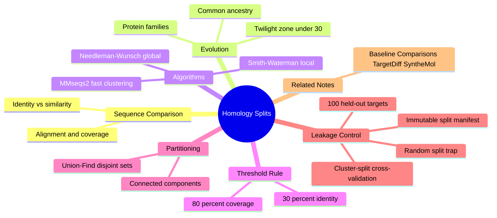

---
tags:
  - domain/structural-biology
  - depth/essential
  - 3dsyntree
  - topic/data-leakage
module: "04. Structural Biology and Protein Targets"
chapter: "Chapter 2. Binding Sites and Data Integrity"
type: concept
---

# 3. Homology MMseqs2 Clustering and Data Leakage

> [!abstract] Core Idea
> Proteins that share recent evolutionary ancestry have near-identical sequences — and near-identical binding pockets. If such homologs appear in both the training and the test set, the model is graded on questions it has already seen: data leakage. MMseqs2 clusters proteins at 30% sequence identity over 80% coverage, and a union-find pass forces every cluster of relatives into a single split, making leakage structurally impossible.

Navigation: [[0. Structural Biology and Protein Targets MOC]] · [[0. Master Vault Index]]

## 1. What It Is

**Sequence homology** is evolutionary relatedness: two proteins are homologous if they descend from a common ancestral protein, and the evidence is measurable similarity between their amino-acid sequences (strings over the same 20-letter alphabet of [[1. Amino Acids and Peptide Backbones]]). **Sequence clustering** is the act of grouping proteins so that members of one group are similar by a stated threshold. **Data leakage** — an ML term — is any flow of test-set information into training that makes evaluation dishonest; here, the leaking channel is near-duplicate proteins appearing on both sides of a train/test split.

## 2. Why It Exists

Randomly splitting protein–ligand complexes into train and test sets causes massive data leakage. Protein families are huge and redundant — the human genome encodes more than 500 kinases built on one conserved fold, with many sharing nearly identical pockets. A model trained on 400 of them has effectively memorized the binding site of the 401st; benchmark scores inflate, and performance collapses only when the model finally meets a genuinely novel target. For an ML reader, the analogy is exact: near-duplicate images split across train and test in an image classifier, yielding accuracy numbers that mean nothing. Proving a generative chemistry model works therefore requires **sequence-clustered splits** — and the overall system context for that requirement is sketched in [[1. 3D-SynTree System Overview]].

## 3. How It Works

### 3.1 Sequence identity versus sequence similarity

To compare two protein sequences you first **align** them (line them up with gaps where insertions or deletions happened during evolution). Then:

- **Identity** = the percentage of aligned positions holding *exactly the same* amino acid.
- **Similarity** = the percentage of positions holding *chemically conservative* substitutions — Leu for Ile, or Lys for Arg — where the side chain class survives even though the letter differs.

Identity is the stricter, cleaner metric and the one used for clustering thresholds; similarity matrices (such as BLOSUM) are the scoring machinery underneath alignments.

### 3.2 Homology and divergent evolution

Homologs descend from a shared ancestor and diverge as mutations accumulate. Sequence drifts fast; **structure and function drift slowly** — which is the trap: two proteins at 80% identity are essentially the same target with the same pocket, and even below 30% identity, homologs usually retain related folds and related binding sites. Protein families (kinases, GPCRs, proteases) share conserved catalytic machinery precisely because evolution had to keep the chemistry working. The region below roughly 25–30% identity is called the **twilight zone**, where homology becomes hard to prove from sequence alone — the reason the 30% threshold below sits at that boundary.

### 3.3 Sequence alignment algorithms: dynamic programming, briefly

Optimal alignment is solved exactly by **dynamic programming** — building the best alignment from best sub-alignments. The two classics are **Needleman–Wunsch** (global: align the sequences end to end) and **Smith–Waterman** (local: find the best matching subsegment), both costing $O(n \cdot m)$ time for sequences of lengths $n$ and $m$. That exactness is too slow for all-against-all comparisons over large databases, so practical tools prefilter aggressively before aligning — which is where MMseqs2 comes in.

### 3.4 MMseqs2: high-throughput sequence clustering

**MMseqs2** ("many-against-many sequence searching") is a software suite engineered for exactly this scale: it combines a fast k-mer-based prefilter (hashing short exact word matches, much like spotting shared phrases) with a fast approximate alignment stage and a cascade that merges results. It runs orders of magnitude faster than standard search tools while retaining near-equal sensitivity, so all-against-all clustering of an entire structural dataset's protein chains — thousands of them — is feasible. The protein sequences it clusters are exactly the one-letter strings produced by `extract_protein_sequence()` in `syntree/data/curation.py`.

### 3.5 The threshold rule: 30% identity over 80% coverage

Two sequences land in the same cluster when the alignment shows **at least 30% identical residues over at least 80% coverage** — meaning the aligned stretch must span 80% of the (shorter) sequence's length. Both clauses matter. Identity without coverage would let a single short conserved domain (say, a 60-residue catalytic core inside two otherwise unrelated 500-residue proteins) merge unrelated whole chains. Coverage ensures the similarity describes most of the protein, not one shared widget. And 30% sits deliberately at the edge of the twilight zone: above it, detected similarity almost always reflects real homology. The benchmark protocol goes even further, holding out targets at **less than 30% identity** to anything in training — 100 held-out targets chosen for genuine novelty.

### 3.6 Union-Find: transitive partitioning

Here is the subtle failure a threshold alone cannot fix: similarity is **not transitive**. Protein A and B may share 35% identity, B and C may share 35%, while A and C share only 20% — below threshold. If A lands in training and C in test, information still leaks through their relative B. The fix treats clustering as a **graph** problem: every protein is a node; every above-threshold pair is an edge; the final clusters are the **connected components** of that graph. These components are computed with **Union-Find (disjoint-set)** — a data structure in which each element points to a representative root, `union` merges two elements' trees, and `find` (with path compression) resolves any element to its root in near-constant amortized time. Components grow transitively: A–B and B–C chain together A, B, and C, no matter what the direct A-versus-C number says.

### 3.7 Cluster-split cross-validation: zero leakage between splits

The final protocol assigns **whole clusters** — never individual proteins — to the training, validation, or test partition. Any two proteins in the same connected component are guaranteed to sit on the same side of every split, which makes homology leakage structurally impossible rather than merely unlikely. The assignment is written into an immutable split manifest so that every experiment, baseline comparison, and ablation uses byte-identical splits — reproducibility insurance for the benchmark in [[3. Baseline Comparisons TargetDiff SyntheMol]].

> [!example] Why union-find matters — a worked leak
> Kinase X and kinase Y align at 45% identity over 92% coverage: edge. Kinase Y and kinase Z: 35% over 85%: edge. X versus Z directly: 22% — below threshold, no direct edge. A naive pairwise check would happily put X in training and Z in test. Union-find merges X, Y, and Z into one connected component, so all three land on the same side of the split. The leak through the middleman Y is closed — this exact transitive chaining is what the data pipeline's split builder enforces.

## 4. What It Consists Of

- **Percent sequence identity** — fraction of exactly-matching aligned positions.
- **Alignment coverage** — fraction of the sequence spanned by the alignment.
- **Sequence alignment** — the gapped letter-to-letter correspondence between two sequences.
- **Homolog and protein family** — evolutionarily related proteins; a family of them.
- **MMseqs2 cluster** — a set of proteins linked by the threshold rule, found at database scale.
- **Union-Find / disjoint set** — the data structure that merges transitively related proteins.
- **Connected component** — the final, leakage-proof cluster unit.
- **Split manifest** — the immutable record of which cluster went to which partition.
- **Data leakage** — test information contaminating training, measured here as shared homology.

## 5. What You Must Understand

**Proving an AI model can design drugs requires testing it on structural folds it has never seen during training — and that requires sequence-clustered splits.** A benchmark number without a clustering statement behind it is uninterpretable.

> [!warning] Random splits leak silently
> Nothing crashes, no error prints — the metrics just quietly climb. The only defense is asking, of any dataset, "how were the splits constructed?" before trusting a number.

> [!warning] Identity is not transitive, but clusters must be
> Pairwise threshold checks leak through middleman proteins; only connected-component (union-find) partitioning closes every chain of similarity.

> [!tip] Memory hook
> "30 over 80" — 30% identity across at least 80% coverage — and the benchmark goes one step stricter, holding out targets below 30% identity to anything trained on.

> [!note] The molecular parallel
> Sequences are to proteins what molecular graphs are to ligands: the same leakage logic reappears on the chemistry side as similarity-based splitting, with the Tanimoto coefficient playing the role that percent identity plays here — see [[3. Tanimoto Similarity and Diversity]].

## 6. Prerequisites

- [[1. Amino Acids and Peptide Backbones]] — sequences are strings over the 20-residue alphabet, and side-chain chemistry is what makes some substitutions conservative rather than random.

## 7. Project Connection

- `extract_protein_sequence()` in `syntree/data/curation.py` produces the one-letter protein sequences from curated structures — the raw strings handed to the clusterer.
- `scripts/preprocess_multidataset.py` builds the training dataset and runs the sequence-clustering stage over those chains, writing an immutable cluster-based split manifest so training and benchmark complexes never share homologous proteins.
- `scripts/run_comparative_benchmark.py` evaluates the trained system on the held-out cluster set — 100 targets at less than 30% MMseqs2 sequence identity. The objects being split are the extracted pockets of [[1. Binding Pockets and Cavity Extraction]].

## 8. Required Depth

**Essential** — without leakage-proof splits, every benchmark number the project produces would be uninterpretable, and the comparative claims built on those numbers would collapse.

## 9. Further Dependencies

- [[3. Baseline Comparisons TargetDiff SyntheMol]] — fair comparison against generative baselines depends entirely on these cluster-split protocols being applied to every method equally.

## Concept Mind Map

## Cross-Domain Links

- [[AI/09. Training Dynamics, Optimization, and Curriculum Learning/Chapter 2. Curriculum Strategies/1. Physical Difficulty Quantification in Structural Pockets|1. Physical Difficulty Quantification in Structural Pockets]] (AI vault) — leakage-proof $<30\%$ identity splits feed the pocket difficulty model used by the curriculum.
