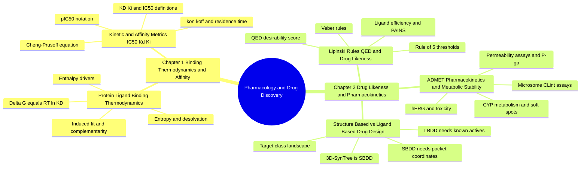

---
tags:
  - moc
  - domain/pharmacology
  - 3dsyntree
module: "05. Pharmacology and Drug Discovery"
type: moc
---

# 0. Pharmacology and Drug Discovery MOC

> [!abstract] Module Mission
> This module turns "the molecule binds" into numbers and consequences. Chapter 1 builds the physical accounting of binding — free energy, enthalpy, entropy — and the potency metrics ($K_D$, $K_i$, $\text{IC}_{50}$, binding rates) that measure it. Chapter 2 covers everything that decides whether a binder survives the journey through the human body — drug-likeness rules, ADMET, and the two design paradigms that organize all of discovery. Together they are the scoring logic that 3D-SynTree's reward function approximates and the biological yardstick its generated molecules are judged by.

Navigation: [[0. Master Vault Index]] · [[2. Prerequisite Knowledge Graph]] · [[3. Study Tracks and Curriculum]]

## Module Mind Map

## Chapter 1. Binding Thermodynamics and Affinity Metrics

| Note | Focus | Required Depth | Key Prerequisites |
| --- | --- | --- | --- |
| [[1. Protein Ligand Binding Thermodynamics]] | The $\Delta G = \Delta H - T\Delta S = RT \ln K_D$ ledger that decides whether and how tightly a ligand binds, and the recognition theories behind complementarity | Essential | [[2. Chemical Bonds and Electronegativity]], [[1. Lennard Jones and Soft Core Potentials]] |
| [[2. Kinetic and Affinity Metrics IC50 Kd Ki]] | The measured potency numbers $K_D$, $K_i$, $\text{IC}_{50}$, the Cheng–Prusoff bridge, and the rates $k_{\text{on}}/k_{\text{off}}$ with residence time | Essential | [[1. Protein Ligand Binding Thermodynamics]] |

## Chapter 2. Drug Likeness and Pharmacokinetics

| Note | Focus | Required Depth | Key Prerequisites |
| --- | --- | --- | --- |
| [[1. Lipinski Rules QED and Drug Likeness]] | Rule of 5 and Veber thresholds, QED desirability scoring, SAR/SPR, bioisosteres, ligand efficiency, lead-likeness, PAINS | Essential | [[1. Organic Functional Groups]], [[2. Fsp3 Saturation and the Flat Grease Trap]] |
| [[2. ADMET Pharmacokinetics and Metabolic Stability]] | What the body does to a drug: membranes and permeability assays, plasma protein binding, CYP metabolism and soft spots, excretion, hERG and liver toxicity | Supporting | [[2. Fsp3 Saturation and the Flat Grease Trap]], [[1. Lipinski Rules QED and Drug Likeness]] |
| [[3. Structure Based vs Ligand Based Drug Design]] | The two design paradigms, the druggable target classes, and why 3D-SynTree is a structure-based, pocket-conditioned generator | Essential | [[1. Binding Pockets and Cavity Extraction]], [[1. Protein Ligand Binding Thermodynamics]] |

## Learning Path Through This Module

1. [[1. Protein Ligand Binding Thermodynamics]] — start with the physical law of binding: why the pocket wants (or refuses) your molecule, priced in kcal/mol.
2. [[2. Kinetic and Affinity Metrics IC50 Kd Ki]] — translate free energy into the laboratory numbers ($K_D$, $K_i$, $\text{IC}_{50}$, rates) that label training data and rank compounds.
3. [[1. Lipinski Rules QED and Drug Likeness]] — learn the physicochemical guardrails separating a potent binder from an actual oral drug, and the QED score that turns them into one number.
4. [[2. ADMET Pharmacokinetics and Metabolic Stability]] — follow the molecule through membranes, blood proteins, the liver's CYP enzymes, and the kidney, and meet the toxicity gates.
5. [[3. Structure Based vs Ligand Based Drug Design]] — close with the map of design paradigms and target classes that positions 3D-SynTree as structure-based; its only hard prerequisite is note 1, so it can also be read early as a bridge into the AI modules.

## Why This Module Matters for 3D-SynTree

3D-SynTree never touches a test tube during training — it optimizes a computational reward — so the fidelity of that reward's mapping onto real pharmacology decides whether generated molecules are gold or glitter. The terminal reward assembled in `ThreeDReward` (`syntree/engine/rl.py`) is essentially this module implemented in code: the GNINA/Vina docking term is a kcal/mol surrogate for the binding free energy of [[1. Protein Ligand Binding Thermodynamics]], the key-interaction term rewards the enthalpic hot-spot contacts of that same note, and the `QED.qed(mol)` plus Fsp3 weighting encode the drug-likeness and ADMET priors of Chapter 2. The PDBbind training labels (`affinity_uM` and `affinity_type` in `syntree/data/curation.py`) are the measured potency numbers of [[2. Kinetic and Affinity Metrics IC50 Kd Ki]] — with all the caveats about heterogeneous assay semantics that note teaches. And the module's final note explains the system's identity: a structure-based, synthesis-constrained generator whose every action is conditioned on pocket coordinates. For the full architecture, see [[1. 3D-SynTree System Overview]].

## Gate Check

> [!question] Before moving on, can you...
> - Convert a $K_D$ of $10\ \text{nM}$ into a binding free energy at 298 K, and explain why every 10-fold potency improvement is worth only about 1.36 kcal/mol?
> - Explain why a docking score is only a surrogate for affinity, and name the thermodynamic contributions a docking score essentially ignores?
> - Distinguish $K_D$, $K_i$, and $\text{IC}_{50}$, and use the Cheng–Prusoff equation to say when an $\text{IC}_{50}$ overstates or understates true affinity?
> - State all four Lipinski thresholds and both Veber rules, and say which biological barrier each property guards?
> - Walk a swallowed drug from the intestinal lumen to its intracellular target, naming one barrier or clearance mechanism at each step (lipid bilayer, P-gp, first-pass CYP3A4, plasma protein binding)?
> - Say precisely why 3D-SynTree is classified as structure-based drug design, and what input it requires that a ligand-based method would not?

## Primary Reading

Bickerton, G. R., et al. (2012). *Quantifying the Chemical Beauty of Drugs*. **Nature Chemistry**, 4(2), 90–98.
