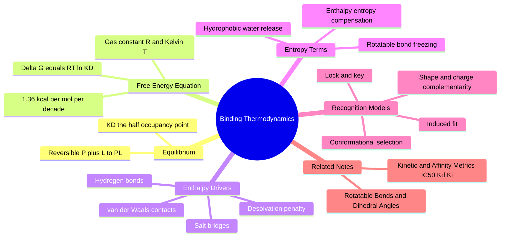

---
tags:
  - domain/pharmacology
  - depth/essential
  - 3dsyntree
  - topic/binding-thermodynamics
module: "05. Pharmacology and Drug Discovery"
chapter: "Chapter 1. Binding Thermodynamics and Affinity Metrics"
type: concept
---

# 1. Protein Ligand Binding Thermodynamics

> [!abstract] Core Idea
> A molecule becomes a drug candidate only if, when it collides with its protein target in water, the resulting complex sits lower on the free-energy hillside than the two separated partners. Whether binding happens, and how tightly, is dictated by one ledger — $\Delta G_{\text{bind}} = \Delta H_{\text{bind}} - T\Delta S_{\text{bind}} = RT \ln K_D$ — a permanent tug-of-war between interaction heat (enthalpy) and molecular disorder (entropy).

Navigation: [[0. Pharmacology and Drug Discovery MOC]] · [[0. Master Vault Index]]

## 1. What It Is

Protein–ligand binding thermodynamics is the branch of physical chemistry that predicts **whether a small molecule (the *ligand*) will spontaneously stick to a specific protein** in the water-filled environment of a cell, and how much energy is released or consumed when it does.

Every technical word in that sentence deserves a definition:

- **Protein** — a large chain molecule folded into a precise 3D shape, with crevices (binding pockets) whose chemical surface decides which visitors can dock there (see [[1. Binding Pockets and Cavity Extraction]]).
- **Ligand** — here, a drug-like small molecule (roughly 20–70 atoms) that binds reversibly to that pocket.
- **Thermodynamics** — the physics of energy and its transformations; it tells us the *destination* of a process (will it happen?) while saying nothing about its *speed* (rates are the subject of the next note).
- **Gibbs free energy ($G$)** — the "spontaneity currency" of chemistry at constant temperature and pressure. Nature rolls toward lower $G$, exactly like a ball rolling downhill.

The central object is the **standard Gibbs free energy of binding**:

$$\Delta G^\circ_{\text{bind}} = \Delta H_{\text{bind}} - T\Delta S_{\text{bind}} = -RT \ln K_a = RT \ln K_D$$

A negative $\Delta G^\circ_{\text{bind}}$ means binding is favorable; the more negative, the tighter the grip.

## 2. Why It Exists

A drug floating in the bloodstream does not "choose" its target. Molecules simply collide billions of times per second, and every collision outcome is arbitrated by the second law of thermodynamics: a process occurs spontaneously only if the total free energy of the system decreases. If the bound complex has *higher* free energy than the free protein plus free ligand in water, the pair simply bounces apart — no matter how beautiful the designed hydrogen bonds look on paper.

The subtlety, and the reason this field exists, is that binding happens **in water, not in a vacuum**. The unbound state is not "protein + ligand"; it is "protein + ligand + all the water molecules coating both surfaces." To bind, a ligand must push that ordered water aside, pay an energy price to strip its own solvation shell, and freeze some of its own motions. A naive count of hydrogen bonds therefore tells you almost nothing: every interaction the ligand forms with the protein is an interaction it *no longer forms with water*. Thermodynamics exists to keep this full ledger honest.

## 3. How It Works

### 3.1 The Equilibrium Binding State

Binding is written as a reversible reaction:

$$P + L \underset{k_{\text{off}}}{\overset{k_{\text{on}}}{\rightleftharpoons}} PL$$

where $P$ is free protein, $L$ is free ligand, and $PL$ is the complex. Given enough time the concentrations stop changing — the state called **chemical equilibrium**. Equilibrium does not mean the reaction stopped; it means the forward and backward rates exactly cancel. The ratio of species at equilibrium defines the **dissociation constant**:

$$K_D = \frac{[P][L]}{[PL]}$$

with concentrations in mol per liter (M). $K_D$ has units of concentration and a beautifully concrete meaning: **it is the free ligand concentration at which exactly half of the protein molecules are occupied.** Feed $[L] = K_D$ into the occupancy equation $f_{\text{bound}} = \frac{[L]}{K_D + [L]}$ and you get $f_{\text{bound}} = 0.5$.

### 3.2 The Gibbs Free Energy Equation, With a Worked Example

Thermodynamics links that equilibrium ratio to energy:

$$\Delta G^\circ_{\text{bind}} = RT \ln K_D$$

Two constants appear, and both must become muscle memory:

- **$R$ — the gas constant**, $1.987 \times 10^{-3}\ \text{kcal}\cdot\text{mol}^{-1}\cdot\text{K}^{-1}$ (about 2 cal per mol per kelvin). It converts between molecular energies (heat) and bulk measurements of temperature.
- **$T$ — absolute temperature in kelvin** (K, equal to °C + 273.15). Bench chemistry conventionally uses $T = 298\ \text{K}$; a human body is $310\ \text{K}$.

The $^\circ$ in $\Delta G^\circ$ means *standard state*: all values are referenced to 1 M concentrations, which is why $K_D$ appears inside a logarithm.

> [!example] Converting a $K_D$ into kcal per mol
> Suppose an inhibitor binds a kinase with $K_D = 10\ \text{nM}$. First convert to molar units: $10\ \text{nM} = 10^{-8}\ \text{M}$. Then:
> $$\Delta G^\circ_{\text{bind}} = RT \ln K_D = (1.987 \times 10^{-3})(298)\ln(10^{-8})\ \text{kcal/mol}$$
> Step by step: $RT = 0.592\ \text{kcal/mol}$, and $\ln(10^{-8}) = -8 \times \ln 10 = -8 \times 2.303 = -18.42$.
> $$\Delta G^\circ_{\text{bind}} = 0.592 \times (-18.42) = -10.9\ \text{kcal/mol}$$
> The complex sits 10.9 kcal/mol below the separated partners. For scale, one hydrogen bond is worth roughly 1–3 kcal/mol — an entire drug's affinity is only a handful of good interactions, after all penalties are paid.

| $K_D$ | $\Delta G^\circ$ at 298 K | Verdict |
| --- | --- | --- |
| $1\ \text{mM}$ | $-4.1\ \text{kcal/mol}$ | fragment-level, very weak |
| $1\ \mu\text{M}$ | $-8.2\ \text{kcal/mol}$ | screening hit |
| $10\ \text{nM}$ | $-10.9\ \text{kcal/mol}$ | potent, optimized drug |
| $1\ \text{pM}$ | $-16.4\ \text{kcal/mol}$ | exceptionally tight |

> [!tip] The decade rule
> At 298 K, $RT \ln 10 = 1.36\ \text{kcal/mol}$. **Every 10-fold improvement in affinity is worth only about 1.36 kcal/mol.** Turning a 1 µM hit into a 1 nM drug — a 1000-fold jump — requires finding just 4.1 extra kcal/mol. This is why potency optimization is a brutal hunt for small energies, and why a single unpaid rotatable-bond penalty can erase three cycles of chemistry.

### 3.3 Enthalpic Drivers — Making Stronger Interactions Than Water

The **enthalpy change** $\Delta H_{\text{bind}}$ is the heat released ($\Delta H < 0$, favorable) or absorbed when the complex forms. Favorable enthalpy comes from replacing weak, water-mediated contacts with strong, direct ones:

1. **Hydrogen bonds** — a polar donor (N–H, O–H) sharing its hydrogen with an electronegative acceptor (N, O); strongest when short and linear (distance ≤ 3.5 Å).
2. **Salt bridges** — a full ionic contact between oppositely charged groups, for example a protonated amine $-\text{NH}_3^+$ against a carboxylate $-\text{COO}^-$; effective up to about 4.0 Å.
3. **van der Waals (dispersion) contacts** — the universal, weak (roughly 0.1–0.5 kcal/mol each) attraction between any two atoms touching at their optimal distance; meaningless individually, decisive in the hundreds (see [[1. Lennard Jones and Soft Core Potentials]]).

The crucial fine print is the **desolvation penalty**: every hydrogen bond the ligand "gains" with the protein is one it "loses" with water, and the same accounting applies to the pocket side. Enthalpic profit comes only from interactions that are *directionally better and geometrically more precise* than the water contacts they replace — which is why a well-placed hydrogen bond helps and a floppy, badly oriented one actively hurts.

### 3.4 Entropic Drivers — The Hydrophobic Effect

The **entropy term** $-T\Delta S_{\text{bind}}$ rewards any process that increases the number of microscopic arrangements available to the *whole system* (ligand + protein + all surrounding water). The dominant favorable case is **desolvation of hydrophobic surfaces**: water molecules forced to cage around an oily, non-polar surface are locked into an ordered shell. When a hydrophobic ligand face glues onto a hydrophobic pocket wall, both shells melt back into free-flowing bulk water. Ligand and protein individually lose freedom, but the *water* — and there are vastly more water molecules than anything else — gains so much freedom that total $\Delta S > 0$. This is the hydrophobic effect: greasy pockets are easy to fill, and lipophilicity is the cheapest source of affinity in optimization.

### 3.5 Entropic Penalties — Conformational Freezing

Binding also *costs* entropy, in two big installments:

- **Loss of translational and rotational freedom** — a fixed tax every ligand pays on binding (several kcal/mol, largely similar across ligands, so it mostly cancels in comparisons within a series).
- **Conformational freezing** — a flexible molecule in solution samples thousands of conformers by rotating its single bonds; in the pocket exactly *one* pose is used, so every rotatable bond locks stiff (see [[2. Rotatable Bonds and Dihedral Angles]]). Each frozen bond costs roughly 0.5–1.5 kcal/mol, meaning an unoptimized 10-rotatable-bond lead can throw away more free energy than its best hydrogen bond delivers.

Medicinal chemists fight this penalty by **pre-organizing** ligands: rigid rings, macrocycles, or saturated spiro/bicyclic frameworks that already hold the binding groups at the right angles *before* binding, so the molecule pays its freezing cost while being synthesized rather than while binding (the saturation strategy behind [[2. Fsp3 Saturation and the Flat Grease Trap]]).

### 3.6 Enthalpy–Entropy Compensation

In practice, when chemists add a new polar interaction they usually also add a bond that must freeze; when they rigidify to save entropy they often lose a contact's ideal geometry. Gains in $\Delta H$ therefore tend to be cancelled by losses in $-T\Delta S$ — the phenomenon of **enthalpy–entropy compensation (EEC)** — leaving $\Delta G$ stubbornly unchanged across a chemical series. Isothermal titration calorimetry (ITC), which measures $\Delta H$ and $K_D$ simultaneously (so $\Delta S = (\Delta H - \Delta G)/T$ follows), is the standard tool for exposing the split. For an AI system this is a sobering lesson: *a reward that counts contacts but ignores flexibility is blind to half of the free-energy ledger.*

### 3.7 Molecular Recognition Theories — How Molecules Find Each Other

How does a ligand actually "fit" a protein? Three successive theories, all partially true:

| Theory | Idea | Limitation |
| --- | --- | --- |
| Fischer's **lock and key** (1894) | Rigid pocket plus rigid ligand with exactly complementary shapes | Real proteins and ligands are flexible |
| Koshland's **induced fit** (1958) | Ligand docks loosely, then *induces* the protein to close around it | The protein does not always move |
| **Conformational selection** | The protein constantly samples many shapes; the ligand captures and stabilizes a rare pre-existing one | Blends into induced fit in practice |

All three agree on the endpoint: **steric shape complementarity** (the ligand must fill the pocket's volume without clashing into its walls — pure volume exclusion) and **electrostatic complementarity** (positive ligand features must face negative protein features, donors face acceptors, oily faces face oily walls). A molecule that is perfectly complementary in *shape* but wrong in *charge placement* still will not bind. Modern structure-based design runs on this principle: the interaction hotspots of a pocket (see [[2. Pharmacophores and Interaction Hotspots]]) are precisely the places where complementarity pays best.

## 4. What It Consists Of

- **$\Delta G^\circ_{\text{bind}}$** — the standard binding free energy; the single number deciding spontaneity and strength.
- **$\Delta H_{\text{bind}}$** — enthalpy; the heat term, dominated by hydrogen bonds, salt bridges, and dispersion contacts.
- **$\Delta S_{\text{bind}}$** — entropy; disorder of ligand + protein + water, split into favorable water release and unfavorable freezing.
- **$T$** — absolute temperature in kelvin, the exchange rate between entropy and energy.
- **$R$** — the gas constant, $1.987 \times 10^{-3}\ \text{kcal}\cdot\text{mol}^{-1}\cdot\text{K}^{-1}$.
- **$K_a$ / $K_D$** — association and dissociation constants; the equilibrium ratios translated into energy by $RT \ln$.
- **Desolvation penalty** — the cost of stripping bound water off ligand and pocket before contact.
- **Conformational freezing** — the entropy cost of locking rotatable bonds into a single pose.
- **Hydrophobic effect** — entropy gained by releasing ordered water from non-polar surfaces.
- **ITC (isothermal titration calorimetry)** — the bench experiment that measures $\Delta H$ and $K_D$ together in one titration.

## 5. What You Must Understand

> [!warning] Counting hydrogen bonds is not thermodynamics
> A new hydrogen bond is only a *net* win if it is stronger and better aimed than the water contacts it replaces, *and* if the bond did not have to be frozen into place. Students routinely predict affinity gains that never materialize because desolvation and freezing penalties cancel the interaction energy.

> [!warning] Docking scores are enthalpy-flavored estimates
> Docking programs output kcal/mol numbers that look like $\Delta G$ but are computed from contact and clash energies alone — they contain **no explicit solvent entropy and no conformational entropy**. Treat them as a ranking heuristic, never as a measured binding free energy (developed further in [[2. Kinetic and Affinity Metrics IC50 Kd Ki]]).

> [!tip] Sign sanity
> Favorable binding means $\Delta G^\circ < 0$. Since good ligands have $K_D \ll 1\ \text{M}$, $\ln K_D$ is negative and $RT \ln K_D$ comes out negative — the equation carries its own sign. If you ever compute a positive $\Delta G$ for a binder, you forgot the natural log or the molar units.

> [!note] Flexibility is a debt
> Every rotatable bond in a lead is borrowed money: you may spend it later to reach a subpocket, but at binding time the interest (0.5–1.5 kcal/mol per bond) is collected in full. 3D-SynTree's deliberate use of *small step counts and rigid, sp3-rich synthons* is exactly this insight turned into design policy.

## 6. Prerequisites

- [[2. Chemical Bonds and Electronegativity]] — hydrogen bonds, dipoles, and partial charges are the currency of the enthalpy term.
- [[1. Lennard Jones and Soft Core Potentials]] — the attraction–repulsion curve underlying van der Waals contacts and steric clash.
- [[2. Rotatable Bonds and Dihedral Angles]] — the exact bonds whose freezing defines the conformational entropy penalty.

## 7. Project Connection

3D-SynTree cannot afford a true $\Delta G$ computation inside a generative loop — no solvent entropy and no exhaustive conformer integration is tractable there — so its terminal reward in `syntree/engine/rl.py` (`ThreeDReward`) is a *thermodynamics-shaped proxy*: `S_dock` (a GNINA/Vina kcal/mol score standing in for binding free energy), `S_contact` (soft-core Lennard-Jones contact energy rewarding steric complementarity), `S_clash` (the penalty side of the same physics), and `S_key` (via `count_key_interactions()`, a bonus for salt bridges within 4.0 Å and hydrogen bonds within 3.5 Å of pocket residues — the enthalpic hot spots). These are summed and exponentiated against the reward temperature `T_reward` with a floor of `R_min = 1e-4`. The entropy half of the ledger is encoded *structurally* rather than energetically: the Fsp3-weighted drug-likeness term inside `S_props` pushes the policy toward saturated, three-dimensional scaffolds, and the small number of assembly steps (every added synthon must earn its place) keeps molecules compact — both directly reduce the conformational-freezing penalty this note describes. When candidates reach the wet-lab cascade, ITC closes the loop by measuring the *real* $\Delta H$ and $K_D$ (see [[2. SPR Kinetics and X-Ray Complex Confirmation]] for the complementary kinetic readout), testing whether the proxy taught the policy true thermodynamics.

## 8. Required Depth

**Essential** — the spec marks this note as required depth, because every downstream affinity metric, every docking surrogate, and every reward design decision in 3D-SynTree is unintelligible without the $\Delta G = \Delta H - T\Delta S$ ledger.

## 9. Further Dependencies

- [[2. Kinetic and Affinity Metrics IC50 Kd Ki]] — converts the free-energy landscape into the measured numbers ($K_D$, $K_i$, $\text{IC}_{50}$, $k_{\text{on}}/k_{\text{off}}$) that label training data and validate candidates.

## Concept Mind Map

## Cross-Domain Links

- [[AI/08. Generative Modeling, MDPs, and GFlowNets/Chapter 2. Generative Flow Networks/4. Stationary Terminal Rewards vs Batch-Relative Drift|4. Stationary Terminal Rewards vs Batch-Relative Drift]] (AI vault) — $\Delta G = RT \ln K_D$ is an intrinsic, stationary property of the complex - the physical basis for stationary terminal rewards.
