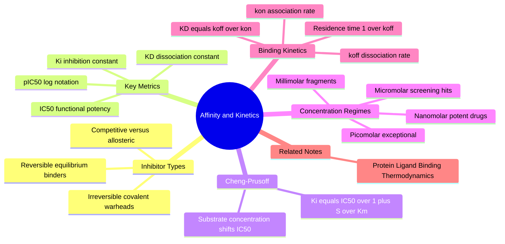

---
tags:
  - domain/pharmacology
  - depth/essential
  - 3dsyntree
  - topic/affinity-metrics
module: "05. Pharmacology and Drug Discovery"
chapter: "Chapter 1. Binding Thermodynamics and Affinity Metrics"
type: concept
---

# 2. Kinetic and Affinity Metrics IC50 Kd Ki

> [!abstract] Core Idea
> Pharmacology needs numbers, not adjectives. This note defines the standard yardsticks of potency — the dissociation constant $K_D$, the inhibition constant $K_i$, and the half-maximal inhibitory concentration $\text{IC}_{50}$ — plus the rates $k_{\text{on}}$ and $k_{\text{off}}$ that control how fast a drug finds and leaves its target. Together they are the language in which binding quality is measured, reported, and fed into machine-learning datasets.

Navigation: [[0. Pharmacology and Drug Discovery MOC]] · [[0. Master Vault Index]]

## 1. What It Is

These are the **quantitative measurements of pharmacology**: standardized numbers describing how tightly a small molecule binds to a biological target ($K_D$), how strongly it inhibits an enzyme ($K_i$), how much of it is needed to halve a biological activity in a functional assay ($\text{IC}_{50}$), and how fast the drug–target complex forms and falls apart ($k_{\text{on}}$, $k_{\text{off}}$, residence time).

Definitions of the core nouns:

- **Target** — the protein a drug is designed to act on (an enzyme, receptor, or channel; classified in [[3. Structure Based vs Ligand Based Drug Design]]).
- **Enzyme** — a protein that catalyzes a chemical reaction, converting a reactant (**substrate**) into a product.
- **Inhibitor** — a molecule that blocks an enzyme's or receptor's function.
- **Assay** — a controlled laboratory experiment that converts a molecular event into a measurable signal (light absorbance, radioactivity, fluorescence).

## 2. Why It Exists

Chemists must compare molecules *numerically* across projects, laboratories, and decades. A sentence like "compound B feels stickier than compound A" is useless; a statement like "compound B has $K_D = 2\ \text{nM}$ while compound A has $K_D = 200\ \text{nM}$" is portable, testable, and machine-readable. These metrics also exist because the free energies of the previous note cannot be measured directly in routine screening — assays measure *activity* or *binding*, and metrics like $\text{IC}_{50}$ are what they actually output. Finally, kinetics exists as a separate axis because *how long* a drug stays bound often predicts in-vivo efficacy better than *how tightly* it binds at equilibrium.

## 3. How It Works

### 3.1 Reversible Versus Irreversible (Covalent) Inhibitors

- **Reversible inhibitors** bind purely through the non-covalent interactions of [[1. Protein Ligand Binding Thermodynamics]] — hydrogen bonds, salt bridges, hydrophobic contacts. Dilution or washout restores enzyme activity; the system obeys the equilibrium $E + I \rightleftharpoons EI$. The overwhelming majority of drugs work this way.
- **Irreversible (covalent) inhibitors** carry a reactive **warhead** (for example an acrylamide or sulfonyl fluoride) that forms a genuine covalent bond with a nucleophilic amino acid in the active site (typically serine or cysteine). Aspirin, which permanently acetylates a serine in the COX enzyme, is the classic example; modern targeted covalent inhibitors (like ibrutinib) first bind non-covalently for selectivity, *then* react. Activity returns only after the cell synthesizes new enzyme.

### 3.2 Competitive, Non-Competitive, and Allosteric Inhibition — and Michaelis–Menten in Brief

Enzyme speed is summarized by the **Michaelis–Menten equation**:

$$v_0 = \frac{V_{\max}[S]}{K_m + [S]}$$

where $v_0$ is the initial reaction velocity, $V_{\max}$ is the maximum rate achieved when the enzyme is saturated with substrate, and $K_m$ is the substrate concentration at which $v_0 = V_{\max}/2$ (an inverse proxy for how eagerly the enzyme grabs its substrate).

- **Competitive inhibition** — the inhibitor sits in the *active site* (the catalytic pocket where the substrate normally binds), so substrate and inhibitor compete for the same space. A high substrate concentration can outvote the inhibitor: apparent $K_m$ rises, $V_{\max}$ is unchanged.
- **Non-competitive / allosteric inhibition** — the inhibitor binds a different site (**allosteric** = "another site"), distorting the enzyme so it works poorly regardless of substrate concentration: $V_{\max}$ falls, $K_m$ roughly unchanged. Substrate cannot outcompete it.

### 3.3 The Dissociation Constant $K_D$ — the Thermodynamic Metric

As derived in the previous note, $K_D = \frac{[P][L]}{[PL]}$ is the ligand concentration at which half the target is occupied; smaller means tighter. Real drug discovery spans nine orders of magnitude:

| Regime | Value in M | p$K_D$ | $\Delta G^\circ$ at 298 K | Typical project stage |
| --- | --- | --- | --- | --- |
| Millimolar (mM) | $10^{-3}$ | 3 | $-4.1\ \text{kcal/mol}$ | fragment hits |
| Micromolar (µM) | $10^{-6}$ | 6 | $-8.2\ \text{kcal/mol}$ | screening hits, early leads |
| Nanomolar (nM) | $10^{-9}$ | 9 | $-12.3\ \text{kcal/mol}$ | optimized clinical drugs |
| Picomolar (pM) | $10^{-12}$ | 12 | $-16.4\ \text{kcal/mol}$ | exceptional, rare binders |

### 3.4 The Inhibition Constant $K_i$

$K_i$ is the **absolute, thermodynamic affinity of an inhibitor for its enzyme**, extracted from inhibition data by accounting for the competition with substrate. It is the enzyme-world counterpart of $K_D$: the concentration of free inhibitor at which half the enzyme molecules are inhibitor-bound. Its virtue is that it is a property of the *molecule–enzyme pair alone*, independent of any particular assay setup.

### 3.5 The Half-Maximal Inhibitory Concentration $\text{IC}_{50}$ and the Dose–Response Curve

$\text{IC}_{50}$ is the inhibitor concentration that reduces a measured biological activity to 50% of its uninhibited value in a *specific functional assay*. It is read off a **dose–response curve**: activity plotted against $\log_{10}$ of inhibitor concentration gives a sigmoid, fitted by the four-parameter logistic (Hill) equation:

$$\text{activity}(\%) = \text{bottom} + \frac{(\text{top} - \text{bottom})}{1 + \left(\frac{[I]}{\text{IC}_{50}}\right)^{h}}$$

where $h$ is the Hill slope (near 1 for simple one-site binding). $\text{IC}_{50}$ is wonderfully practical but **assay-dependent**: it shifts with substrate concentration, enzyme concentration, and the readout technology.

### 3.6 The Cheng–Prusoff Equation, With a Worked Example

The bridge from the practical $\text{IC}_{50}$ to the portable $K_i$ for a *competitive* inhibitor is the **Cheng–Prusoff equation**:

$$K_i = \frac{\text{IC}_{50}}{1 + [S]/K_m}$$

where $[S]$ is the substrate concentration used in the assay and $K_m$ is the Michaelis constant. (The same logic applied to binding competition assays reads $K_i = \text{IC}_{50}/(1 + [L]/K_D)$ with $[L]$ the tracer concentration.)

> [!example] Same molecule, different $\text{IC}_{50}$
> A screening assay runs at $[S] = 5\,K_m$ and reports $\text{IC}_{50} = 60\ \text{nM}$. Then:
> $$K_i = \frac{60\ \text{nM}}{1 + 5} = 10\ \text{nM}$$
> If the same inhibitor were re-tested at $[S] = K_m$, the assay would report $\text{IC}_{50} = 20\ \text{nM}$. The molecule did not change — the assay did. $K_i$ is the portable number; $\text{IC}_{50}$ is a lab-specific snapshot.

### 3.7 Logarithmic Notation: p$K_D$ and p$\text{IC}_{50}$

Because affinities span nine orders of magnitude, medicinal chemists use logarithmic scores:

$$pK_D = -\log_{10} K_D \qquad p\text{IC}_{50} = -\log_{10} \text{IC}_{50}$$

($K_D$ and $\text{IC}_{50}$ in M). Thus $50\ \text{nM} \rightarrow p\text{IC}_{50} = 7.3$, and $10\ \text{nM} \rightarrow 8.0$. Higher p-values mean *stronger* binding. The p-scale is linear in free energy — each p-unit is worth $1.36\ \text{kcal/mol}$ at 298 K — so p-changes average cleanly across a chemical series, which is why medchem tables (and efficiency metrics like LipE, covered in [[1. Lipinski Rules QED and Drug Likeness]]) are written in p-units.

### 3.8 Binding Kinetics: $k_{\text{on}}$, $k_{\text{off}}$, and Residence Time

Equilibrium constants are ratios of two rates:

- **$k_{\text{on}}$ (association rate constant)** — how quickly free ligand and free protein find each other, in $\text{M}^{-1}\text{s}^{-1}$. Diffusion sets a ceiling around $10^{8}$–$10^{9}\ \text{M}^{-1}\text{s}^{-1}$; typical drug-like values are $10^{5}$–$10^{6}\ \text{M}^{-1}\text{s}^{-1}$.
- **$k_{\text{off}}$ (dissociation rate constant)** — how quickly the complex falls apart, in $\text{s}^{-1}$, independent of concentration. Values range from about $1\ \text{s}^{-1}$ (blink and it is gone) down to $10^{-6}\ \text{s}^{-1}$ (effectively locked for days).

At equilibrium the forward and reverse fluxes are equal, $k_{\text{on}}[P][L] = k_{\text{off}}[PL]$, which immediately yields the kinetic derivation of the dissociation constant:

$$K_D = \frac{[P][L]}{[PL]} = \frac{k_{\text{off}}}{k_{\text{on}}}$$

The **drug–target residence time** is $t_R = 1/k_{\text{off}}$ — how long a single binding event lasts. Two inhibitors with identical $K_D$ can have wildly different residence times (one binds fast and leaves fast; the other binds slowly and stays), and the slow-off compound often shows better in-vivo efficacy because its target stays occupied even after blood levels drop.

> [!example] From $K_D$ and $k_{\text{on}}$ to residence time
> A binder has $k_{\text{on}} = 5 \times 10^{5}\ \text{M}^{-1}\text{s}^{-1}$ and $K_D = 20\ \text{nM}$. Then:
> $$k_{\text{off}} = k_{\text{on}} \times K_D = (5 \times 10^{5})(2 \times 10^{-8}\ \text{M}) = 10^{-2}\ \text{s}^{-1}$$
> $$t_R = 1/k_{\text{off}} = 100\ \text{s}$$
> A "slow-off" sibling with $k_{\text{off}} = 10^{-4}\ \text{s}^{-1}$ would stay bound $10{,}000\ \text{s} \approx 2.8$ hours per binding event. Surface plasmon resonance (SPR) is the standard experiment that measures $k_{\text{on}}$ and $k_{\text{off}}$ directly (see [[2. SPR Kinetics and X-Ray Complex Confirmation]]).

## 4. What It Consists Of

- **$k_{\text{on}}$ / $k_a$** — association rate constant, $\text{M}^{-1}\text{s}^{-1}$.
- **$k_{\text{off}}$ / $k_d$** — dissociation rate constant, $\text{s}^{-1}$.
- **$K_D$** — equilibrium dissociation constant, the half-occupancy concentration.
- **$K_i$** — inhibition constant; substrate-independent inhibitor affinity for an enzyme.
- **$\text{IC}_{50}$** — half-maximal inhibitory concentration in a given functional assay.
- **p$K_D$, p$\text{IC}_{50}$** — negative-logarithm scores, linear in free energy.
- **Dose–response curve and Hill slope** — the sigmoid measured in assays and fitted to extract $\text{IC}_{50}$.
- **Cheng–Prusoff equation** — the conversion from measured $\text{IC}_{50}$ to portable $K_i$.
- **Michaelis–Menten parameters** — $V_{\max}$ and $K_m$, the enzyme speed frame within which inhibition is classified.
- **Residence time $t_R = 1/k_{\text{off}}$** — the duration of a single binding event.

## 5. What You Must Understand

> [!warning] Docking scores are not affinities
> A GNINA/Vina score of $-10\ \text{kcal/mol}$ does **not** mean the molecule binds at $K_D \approx 50\ \text{nM}$. Docking scores are approximate surrogates for $\Delta G$ (built from contact and clash energies, blind to solvent and conformational entropy), and typical scoring errors of 2–3 kcal/mol would swamp the 1.36 kcal/mol that separates a 10-fold potency change. Real potency is established only by experimental assays — docking ranks, experiments decide.

> [!warning] $\text{IC}_{50}$ is a property of a molecule *and* an assay
> Comparing $\text{IC}_{50}$ values measured at different substrate concentrations (or with different readouts) is meaningless without Cheng–Prusoff correction. When mining data tables, always check what conditions produced the number.

> [!tip] p-unit arithmetic
> $p\text{IC}_{50}\ 7 = 100\ \text{nM}$, $p\text{IC}_{50}\ 8 = 10\ \text{nM}$; each p-unit is one order of magnitude and $1.36\ \text{kcal/mol}$. Moving a project from pIC50 6 to pIC50 8 means finding 2.7 kcal/mol — the difference between a hit and a clinical candidate.

> [!note] Two ways to tighten binding
> $K_D = k_{\text{off}}/k_{\text{on}}$ means affinity can be improved either by binding faster (raise $k_{\text{on}}$, hard — diffusion limits it) or by leaving slower (lower $k_{\text{off}}$, the usual medchem route: bury greasy surface, lock the pose, exploit slow conformational escape).

## 6. Prerequisites

- [[1. Protein Ligand Binding Thermodynamics]] — the $\Delta G \leftrightarrow K_D$ conversion and the enthalpy/entropy ledger are the physical foundation of every metric here.

## 7. Project Connection

The 3D-SynTree training corpus is the PDBbind set of protein–ligand complexes, curated in `syntree/data/curation.py`, where each complex carries its measured affinity as `affinity_uM` plus an `affinity_type` tag (because the source database mixes $K_D$, $K_i$, and $\text{IC}_{50}$ measurements — heterogeneous units and semantics that curation must respect rather than silently merge; the 20,000 training complexes inherit exactly the caveats of this note). At reward time, `ThreeDReward` in `syntree/engine/rl.py` scales the GNINA/Vina docking score `S_dock` into the terminal reward $R = \exp\left(\sum S_i / T_{\text{reward}}\right)$ with floor `R_min = 1e-4` — an explicit bet that a kcal/mol surrogate correlates with true affinity well enough to shape a generative policy, while the actual numbers of potency come later from the wet-lab cascade. That cascade — SPR for $k_{\text{on}}/k_{\text{off}}$, ITC for thermodynamics, and cellular dose–response assays for $\text{IC}_{50}$ — is where the proxy is finally audited.

## 8. Required Depth

**Essential** — the spec marks this note as required depth: these metrics are the labels of the project's training data, the interpretation frame of its docking reward, and the acceptance criteria of its wet-lab validation.

## 9. Further Dependencies

- [[1. Assay Cascade Strategy and nanoDSF]] — the assay ladder that measures potency and binding stability in the wet lab.
- [[2. SPR Kinetics and X-Ray Complex Confirmation]] — SPR yields the $k_{\text{on}}/k_{\text{off}}$/residence-time triad; X-ray confirms that the designed pose is the real pose.

## Concept Mind Map

## Cross-Domain Links

- [[AI/08. Generative Modeling, MDPs, and GFlowNets/Chapter 2. Generative Flow Networks/2. The Trajectory Balance Objective|2. The Trajectory Balance Objective]] (AI vault) — the flow-matching objective samples molecules proportional to scalar affinity rewards.
