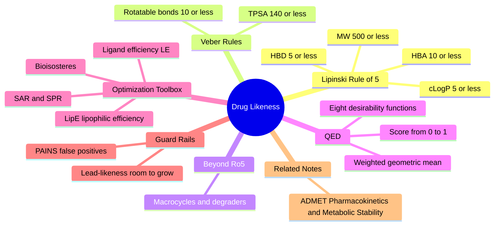

---
tags:
  - domain/pharmacology
  - depth/essential
  - 3dsyntree
  - topic/drug-likeness
module: "05. Pharmacology and Drug Discovery"
chapter: "Chapter 2. Drug Likeness and Pharmacokinetics"
type: concept
---

# 1. Lipinski Rules QED and Drug Likeness

> [!abstract] Core Idea
> Binding a protein is only half the job: a molecule must also survive the journey from a swallowed pill, through the gut wall, past the liver, and into the bloodstream and cells. Decades of attrition data condensed into a handful of physicochemical thresholds — Lipinski's Rule of 5, Veber's rules — and into QED, a continuous 0-to-1 "chemical beauty" score that turns all of them into a single number a reward function can use.

Navigation: [[0. Pharmacology and Drug Discovery MOC]] · [[0. Master Vault Index]]

## 1. What It Is

**Drug-likeness** is the set of empirical structural and physicochemical properties that make a small molecule *likely* to be an orally bioavailable human drug. **Oral bioavailability** means: swallowed, survives stomach acid, crosses the intestinal wall, escapes first-pass destruction by the liver, and reaches the bloodstream at useful concentrations.

The concept has three operational layers:

- **Rule-based filters** — Lipinski's Rule of 5 and Veber's rules: binary pass/fail thresholds on molecular properties.
- **A continuous score** — QED (Quantitative Estimate of Drug-likeness), which maps eight properties onto desirability functions and blends them into one score between 0.0 (undesirable) and 1.0 (favorable).
- **An optimization vocabulary** — SAR/SPR, bioisosteres, ligand efficiency, lead-likeness, and PAINS warnings: the working language of turning a potent binder into a developable drug.

## 2. Why It Exists

Many potent binders fail as drugs. They cannot cross the lipid membrane of the intestinal wall (too big, too polar), dissolve poorly in water or in the pill formulation, get devoured by liver enzymes within minutes, or bind blood proteins so avidly that none is free to reach the target. Historically the majority of clinical-candidate failures were of exactly this type — absorption, distribution, metabolism, toxicity — not target potency (the full machinery is the subject of [[2. ADMET Pharmacokinetics and Metabolic Stability]]).

Drug-likeness rules exist so that these expensive failures can be predicted from a *computed molecular structure, before anything is synthesized*. That makes them doubly important for generative AI: a model rewarded only for binding will happily produce enormous, greasy molecules that fill every pocket groove and are useless as drugs. Drug-likeness metrics are the guardrails that keep a generator inside the region of chemical space where oral drugs actually live.

## 3. How It Works

### 3.1 Lipinski's Rule of 5 (Ro5)

Lipinski and colleagues analyzed the World Drug Index — the corpus of orally active drugs — and found that their properties cluster inside four boundaries. Poor absorption or permeation is *likely* (not guaranteed) when a molecule exceeds **two or more** of them:

| Property | Definition | Ro5 threshold |
| --- | --- | --- |
| Molecular weight (MW) | sum of atomic masses in daltons (Da) | $\le 500\ \text{Da}$ |
| cLogP | computed octanol/water partition coefficient — how much the molecule prefers oily octanol to water | $\le 5$ |
| HBD — hydrogen bond donors | count of O–H and N–H groups able to donate a hydrogen bond | $\le 5$ |
| HBA — hydrogen bond acceptors | count of N and O atoms able to accept a hydrogen bond | $\le 10$ |

The name "Rule of *5*" is a mnemonic: the boundaries are 5–500–5–10, all multiples of five. Known exceptions: substrates of active uptake transporters (some antibiotics and peptides violate Ro5 yet absorb well because the body ferries them across membranes), and natural products. The rules describe *passive* oral absorption, nothing more.

### 3.2 Veber's Rules

Lipinski's list omits two properties that turned out to predict oral bioavailability even better in rat studies — **flexibility** and **polarity**:

- **Rotatable bond count ≤ 10.** A rotatable bond is a single, acyclic bond between two heavy (non-hydrogen) atoms (the geometric object itself is covered in [[2. Rotatable Bonds and Dihedral Angles]]). Each rotatable bond adds conformational entropy that must be paid at binding time (previous note) and multiplies the conformers a membrane must "average over."
- **Topological polar surface area (TPSA) $\le 140\ \text{Å}^2$.** TPSA is the summed van der Waals surface belonging to nitrogen, oxygen, and their attached hydrogens — a computed proxy for how many water molecules the molecule insists on dragging through a greasy membrane. Above roughly 140 Ų passive permeability collapses.

### 3.3 Beyond the Rule of 5 (bRo5)

A modern frontier deliberately works *outside* Ro5: macrocycles (large ring molecules such as cyclosporin, ~1200 Da, yet orally absorbed because they fold their polar groups inward into "chameleonic" conformations), and bivalent degraders (PROTACs, which link two binding heads with a long tether, well over 700 Da). This space survives by trading aromatic flatness for 3D shape and conformational adaptability — the same saturation principle that 3D-SynTree enforces (see [[2. Fsp3 Saturation and the Flat Grease Trap]]). bRo5 is a reminder that the rules are descriptive statistics of past oral drugs, not laws of nature.

### 3.4 QED — the Quantitative Estimate of Drug-likeness

Rules are blunt: a molecule is not "57% Lipinski-compliant." QED (Bickerton et al., 2012 — this module's primary reading) replaced the binary filter with a **desirability function** for each of eight properties: MW, cLogP, TPSA, rotatable bonds, aromatic ring count, HBD, HBA, and an ALERTS term (counts of unwanted substructures — the PAINS motifs of §3.9). For each property, a fitted curve $d_i(x) \in [0,1]$ scores how comfortably a value sits inside the distribution of marketed oral drugs. The overall score is a weighted geometric mean:

$$\text{QED} = \exp\left(\frac{1}{\sum_i w_i}\sum_i w_i \ln d_i\right)$$

producing a single continuous score from 0.0 to 1.0; the unweighted default is called QED classic. Continuity is the whole point for machine learning: QED is differentiable-ish with respect to chemical structure, so a generator can climb it — which is exactly why 3D-SynTree uses it as a reward component rather than a pass/fail filter.

### 3.5 SAR and SPR — the Optimization Maps

- **SAR (structure–activity relationship)** — the systematic mapping from structural changes to potency. Chemists modify one position of a molecule at a time, re-measure $\text{IC}_{50}$ (in p-units, per [[2. Kinetic and Affinity Metrics IC50 Kd Ki]]), and accumulate the map of which atoms actually earn binding.
- **SPR (structure–property relationship)** — the same exercise for developability properties: solubility, permeability, metabolic stability. Optimization is a multi-objective walk over both maps simultaneously, because the moves that help potency (adding grease) are often the moves that hurt properties.

### 3.6 Bioisosteres

A **bioisostere** is a chemical group substituted for another while *retaining* the binding role: similar size, shape, electron distribution, and polarity. Classical swaps include hydrogen for fluorine, and a carboxylic acid for a tetrazole (same acidity, longer-lived in vivo). Non-classical swaps replace whole frameworks: a phenyl ring by a pyridine (less lipophilic), or an amide by a 1,2,3-triazole — the product of the CuAAC click reaction, one of the certified reaction families in [[2. The 32 Certified Reaction Grammar]]. Bioisosteric thinking is how chemists fix a property (metabolic soft spot, pKa, logP, patent position) without demolishing the binding that was so hard to win.

### 3.7 Ligand Efficiency Metrics — Affinity per Atom and per LogP

Potency alone can be bought by brute force: add mass and grease until the pocket is stuffed. Efficiency metrics expose that trick:

- **Ligand efficiency** — free energy earned *per heavy atom*:
$$\text{LE} = \frac{-\Delta G^\circ_{\text{bind}}}{N_{\text{heavy}}}\ \left(\text{kcal per heavy atom}\right)$$
Good leads carry LE ≥ 0.3; fragments often reach 0.4+.
- **Lipophilic efficiency (LipE)** — potency that is *not* explained by grease:
$$\text{LipE} = p\text{IC}_{50} - \text{cLogP}$$
with ≥ 5 considered excellent for a developed compound.

> [!example] Two 10 nM binders are not equal
> Both molecules bind at $K_D = 10\ \text{nM}$, so both deliver $\Delta G^\circ = -10.9\ \text{kcal/mol}$. Molecule A has 30 heavy atoms → LE = 10.9/30 = **0.36**. Molecule B has 50 heavy atoms → LE = 10.9/50 = **0.22**. B achieved identical affinity by sheer bulk — it has no headroom left to grow during optimization, will likely violate Ro5, and is the signature of a "grease trap" binder. Likewise a 10 nM compound at cLogP 2 has LipE = 7.3 − 2 = **5.3** (excellent), while the same potency at cLogP 5 has LipE = **2.3** (affinity bought almost entirely with hydrophobicity — brittle, and a hERG liability).

### 3.8 Lead-Likeness versus Drug-Likeness

A **lead** is the starting hit of an optimization campaign; the **drug** is its endpoint. Optimization reliably adds mass and lipophilicity (50–150 Da is a typical creep), so a good lead is deliberately *smaller and simpler* than a drug — roughly MW 250–350, few rings, high ligand efficiency, room to grow. **Lead-likeness** therefore filters screening collections toward molecules that can *become* drugs. Start with a drug-sized molecule and optimization shoves you into bRo5 failure territory. Fragment-based discovery pushes this logic to the extreme: tiny fragments (MW ~150–250) that bind weakly (mM–µM) but with superb per-atom efficiency, then are grown into the pocket. 3D-SynTree mirrors this philosophy by assembling molecules stepwise from small synthons — the generator's molecules pass through lead-like sizes before ending drug-like, rather than being born at MW 600.

### 3.9 PAINS — Pan-Assay Interference Compounds

**PAINS** are substructure motifs that *appear* active in every assay while doing nothing useful: rhodanine and enone warheads that react covalently with proteins; catechols and quinones that redox-cycle; hydrophobic dyes that aggregate into colloidal particles which nonspecifically absorb proteins; fluorescent or colored scaffolds that interfere with optical readouts; metal chelators. The result is fake SAR — chemists spend months "optimizing" an artifact. The countermeasures: substructure alert lists (the ALERTS component inside QED), aggregation checks with detergent, and orthogonal assays before believing any hit. For generative AI this is a named failure mode: a policy rewarded on a single noisy score will discover and exploit whatever systematic bias the scorer has — PAINS are the classical chemical embodiment of reward hacking.

## 4. What It Consists Of

- **MW** — molecular weight in Da; size budget for passive diffusion.
- **cLogP** — computed lipophilicity; grease budget.
- **HBD / HBA** — hydrogen bond donor and acceptor counts; polarity budget.
- **Rotatable bonds** — flexibility count (Veber).
- **TPSA** — topological polar surface area in Ų (Veber).
- **Aromatic ring count** — flatness indicator (inside QED; the flatness problem itself is treated in [[2. Fsp3 Saturation and the Flat Grease Trap]]).
- **QED desirability functions** — eight fitted curves and their weights, geometrically averaged.
- **SAR / SPR** — structure–activity and structure–property maps.
- **Bioisosteres** — classical and non-classical group substitutions.
- **LE and LipE** — ligand efficiency and lipophilic efficiency formulas.
- **Lead-likeness** — the smaller-than-drug profile of optimizable starting points.
- **PAINS alerts** — substructure filters against assay-interference motifs.

## 5. What You Must Understand

> [!warning] Generative models cheat
> A model rewarded only for pocket-filling will build massive, high-molecular-weight molecules that score brilliantly on docking and are worthless as drugs. This is not hypothetical — it is the default behavior of unconstrained generators. Countermeasures used in practice: a minimum-mass floor at the low end, QED and efficiency terms in the reward, and hard property filters in the building-block catalog (see §7).

> [!warning] Ro5 says nothing about binding
> The rules filter for *oral absorption and permeability*, not for pharmacological action. A molecule can be a perfect Ro5 citizen and completely inert. Drug-likeness is necessary, never sufficient.

> [!tip] Memorize the numbers
> Lipinski: **500 / 5 / 5 / 10** (MW, cLogP, HBD, HBA; fail on two or more). Veber: **10 rotatable bonds, 140 Ų TPSA**. Efficiency: **LE ≥ 0.3 kcal per heavy atom, LipE ≥ 5**.

> [!note] Rules are population statistics
> Ro5 thresholds are roughly the 90th percentile of oral-drug properties, and bRo5 medicines (macrocycles, degraders) break them on purpose. Use the rules to *bias* search, not to forbid chemistry.

## 6. Prerequisites

- [[1. Organic Functional Groups]] — HBD/HBA, logP, and polarity are all defined by functional-group chemistry.
- [[2. Fsp3 Saturation and the Flat Grease Trap]] — the saturation half of drug-likeneness; the thermodynamic rationale of why flat greasy molecules fail lives there.

## 7. Project Connection

3D-SynTree enforces this note in three places. First, the environment: `MolecularAssemblyEnv` in `syntree/engine/environment.py` carries `terminal_cap_min_mw = 250.0` — a molecule may only be declared finished above ~250 Da, guaranteeing enough mass for real binding while the stepwise, synthon-by-synthon assembly keeps the upper end honest. Second, the reward: `S_props` inside `ThreeDReward` (`syntree/engine/rl.py`) adds `QED.qed(mol)` — the full eight-descriptor score of §3.4 — plus an Fsp3 weight `tanh(max(0, fsp3 - 0.42))` that pays only above the saturation threshold. Third, the search space itself: the synthon catalog built by `scripts/build_synthon_catalog.py` from the Enamine REAL space (see [[3. Enamine REAL Space and Catalogs]]) is pre-filtered, so the generator assembles molecules from building blocks that are individually drug-like rather than punishing violations after the fact. The whole design philosophy is: *constrain the space first, then reward within it* — the inverse of letting a policy discover PAINS on its own.

## 8. Required Depth

**Essential** — the spec marks this note as required depth: QED and the property floors are live components of the terminal reward, and drug-likeness is the reason the generator's outputs would be credible starting points for synthesis.

## 9. Further Dependencies

- [[2. ADMET Pharmacokinetics and Metabolic Stability]] — the biological machinery (membranes, transporters, CYP enzymes) that these simple property rules proxy for.
- [[1. PoseBusters Physical Sanity Filters]] — physical sanity is the first quality gate a generated molecule must pass; drug-likeness is the second.

## Concept Mind Map

