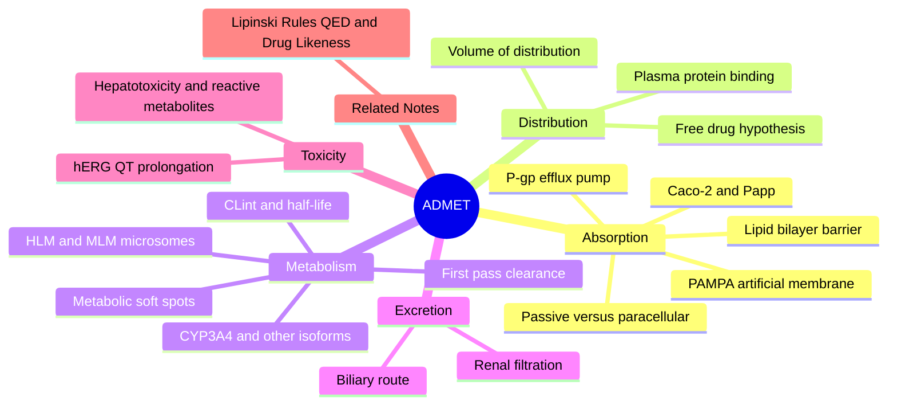

---
tags:
  - domain/pharmacology
  - depth/supporting
  - 3dsyntree
  - topic/admet
module: "05. Pharmacology and Drug Discovery"
chapter: "Chapter 2. Drug Likeness and Pharmacokinetics"
type: concept
---

# 2. ADMET Pharmacokinetics and Metabolic Stability

> [!abstract] Core Idea
> Pharmacodynamics asks what a drug does to the body; pharmacokinetics asks what the body does to the drug. ADMET — Absorption, Distribution, Metabolism, Excretion, Toxicity — tracks a swallowed molecule through the gut wall, the blood, the liver's CYP enzymes, and the kidneys, and names the classic ways it dies on the way. More than half of historical drug-candidate failures happened here, which is why simple properties like saturation (Fsp3) are engineered into drug-design systems from day one.

Navigation: [[0. Pharmacology and Drug Discovery MOC]] · [[0. Master Vault Index]]

## 1. What It Is

**Pharmacokinetics** is the study of how a drug's concentration in the body changes over time; **ADMET** is its organizing acronym:

- **A — Absorption**: crossing biological membranes into the bloodstream (gut wall → blood).
- **D — Distribution**: moving from blood into tissues and to the target organ.
- **M — Metabolism**: chemical alteration of the molecule, mainly by liver enzymes (chiefly the cytochrome P450 superfamily).
- **E — Excretion**: removal from the body via kidneys (urine) or liver/bile (feces).
- **T — Toxicity**: adverse reactions or cell damage, from off-target effects or reactive metabolites.

Its key quantitative companions are **clearance (CL)** — the volume of blood fully cleaned of drug per unit time, in mL/min; **half-life ($t_{1/2}$)** — the time for concentration to halve, $t_{1/2} = 0.693 \times V_d / \text{CL}$; **volume of distribution ($V_d$)** — the *apparent* volume a drug seems to occupy, dose divided by plasma concentration (large $V_d$ means the drug hides in tissues); and **bioavailability ($F$)** — the fraction of the swallowed dose that reaches systemic circulation unchanged.

## 2. Why It Exists

Historically, over 50% of drug candidates failed in the clinic for ADMET reasons rather than lack of efficacy: the molecule never reached its target at a useful concentration for long enough, or it poisoned something on the way. Because these failures were discovered late and expensively (in animals and humans), the entire industry rebuilt discovery to test ADMET *early*: cheap in-vitro assays (artificial membranes, cell layers, liver fractions) and computed property rules (the previous note) now predict the journey before synthesis. For a generative design system, encoding ADMET priors *into the search space* is cheaper than screening them afterwards — which is the entire logic of 3D-SynTree's saturation constraints (§7).

## 3. How It Works

### 3.1 Absorption — Crossing the Lipid Bilayer

**The lipid bilayer** is the universal wall of every mammalian cell: two layers of phospholipids, each molecule with a water-loving phosphate head and two oily fatty-acid tails, arranged head-outward so that the membrane presents a **hydrophobic core roughly 30 Å thick** to anything trying to pass. A dissolved drug crosses it by two routes:

- **Passive transcellular diffusion** — straight through the membrane's oily interior; requires the molecule to be lipophilic enough and preferably neutral at pH 7.4 (ionization state matters — see [[3. Acids Bases and pH 7.4 Ionization]]). This is the dominant route for small oral drugs.
- **Paracellular diffusion** — squeezing through water-filled gaps (tight junctions) between adjacent cells; only feasible for very small, polar molecules, and blocked by the intestinal wall's tight seals.

Two laboratory assays quantify this:

- **PAMPA (Parallel Artificial Membrane Permeability Assay)** — a synthetic phospholipid layer painted on a filter between two buffer chambers; measures *pure passive* permeability. Cheap, fast, no biology.
- **Caco-2 monolayer flux** — real human colon-cancer cells grown into a confluent single layer with tight junctions; drug is added on the apical side and sampled on the basolateral side. The **apparent permeability ($P_{\text{app}}$)** is the flux normalized by area and concentration (units $10^{-6}\ \text{cm/s}$; above ~10 is considered high permeability, below ~1 poor). Caco-2 includes real biology — notably transporters.
- **P-glycoprotein (P-gp / MDR1)** — an ATP-powered efflux pump in the gut wall, blood–brain barrier, liver, and kidney that grabs lipophilic, basic molecules *after* they enter the cell and throws them back out. P-gp substrates can have excellent passive permeability yet terrible oral exposure. The diagnostic signature is asymmetric Caco-2 flux (apical-to-basolateral much weaker than the reverse), and the assay cocktail usually includes a P-gp inhibitor arm to prove the mechanism.

### 3.2 Distribution — Plasma Protein Binding and the Free Drug Hypothesis

In blood, most drug molecules are not free: **human serum albumin (HSA)** — the most abundant plasma protein — reversibly binds acidic and lipophilic drugs, while **$\alpha_1$-acid glycoprotein** binds basic ones. The **plasma protein binding (PPB)** fraction can exceed 99% for greasy molecules. The governing principle is the **free drug hypothesis**: *only unbound drug ($f_u$ = fraction unbound) can cross membranes and engage the biological target* — bound drug is an inert reservoir in equilibrium with the free pool. Both efficacy and elimination are driven by free concentration. PPB is measured by **rapid equilibrium dialysis (RED)** — plasma separated from buffer by a membrane that only free drug crosses; after equilibration, comparing the two sides gives $f_u$. High PPB is not automatically bad, but in a series it signals excessive lipophilicity: the same grease that binds albumin binds CYP enzymes (metabolism) and the hERG channel (toxicity, §3.5).

### 3.3 Metabolism — First Pass, CYP Isoforms, and Soft Spots

Orally absorbed drug enters the portal vein and must pass through the liver **before** reaching the rest of the body — the **first-pass clearance**. The liver is the body's chemical incinerator:

- **Phase I metabolism — CYP functionalization.** The **cytochrome P450 (CYP)** enzymes are heme-containing monooxygenases anchored in the liver cell's endoplasmic reticulum. They insert one oxygen atom into the drug — hydroxylating C–H bonds, cleaving O-alkyl or N-alkyl groups (O-/N-dealkylation), or epoxidating double bonds — generally making the molecule more polar and easier to excrete. Five isoforms do most of the work: **CYP3A4** (the heavyweight — about half of all marketed-drug oxidation, present in both liver and gut wall, responsible for many drug–drug interactions), **CYP2D6** (genetically polymorphic — "poor metabolizer" patients overdose on standard doses), **CYP2C9** (famous for warfarin dosing), **CYP2C19** (clopidogrel activation), and **CYP1A2** (inducible by smoking).
- **Metabolic soft spots** are the predictable weak points CYP attacks: unhindered benzylic carbons (oxidized to alcohols, then conjugated out), exposed electron-rich aromatic rings (hydroxylation — precisely the flat aromatic systems of the flat-grease problem), labile ester bonds (hydrolyzed by esterases), and ether or amine groups (O-/N-dealkylation). Medicinal chemists block them with fluorine (same size as hydrogen, but C–F resists oxidation), steric shielding, or replacing the aromatic ring with a saturated analog.
- **In-vitro stability assays — HLM and MLM.** A candidate is incubated with **human liver microsomes (HLM)** — vesicles of liver endoplasmic reticulum containing the CYP enzymes — or mouse liver microsomes (**MLM**, for the preclinical species), with NADPH as the cofactor. The remaining parent compound is quantified by LC–mass spectrometry over time and fitted as first-order decay. From the depletion kinetics: $t_{1/2} = 0.693/k$, and the **intrinsic clearance $\text{CL}_{\text{int}}$** scales the rate per mg of microsomal protein. CLint is the standard early rank-ordering metric for metabolic stability; it feeds physiological models that predict human hepatic clearance.
- **Phase II metabolism — conjugation.** A second enzyme family attaches a large, polar handle onto the (often phase-I) product: **glucuronidation** (UDP-glucuronosyltransferases add glucuronic acid), **sulfation** (sulfotransferases), and **glutathione conjugation** (the cell's general detox of reactive electrophiles). Conjugates are actively exported into bile or urine. Phase II is usually detoxifying, with occasional exceptions (some acyl glucuronides are themselves reactive).

> [!example] Reading a microsome assay
> A candidate at 1 µM is incubated with HLM at 0.5 mg protein/mL plus NADPH; LC–MS shows the parent decaying with $t_{1/2} = 30\ \text{min}$. The first-order rate constant is $k = 0.693/30 = 0.023\ \text{min}^{-1}$. With incubation volume over protein mass of 2000 µL/mg: $\text{CL}_{\text{int}} = 0.693 \times 2000 / 30 \approx 46\ \mu\text{L}\cdot\text{min}^{-1}\cdot\text{mg}^{-1}$ protein. Rough field heuristics: below ~15 is very stable, above ~90 is rapidly cleared — this candidate sits in the middle, worth one more round of soft-spot blocking.

### 3.4 Excretion — Renal and Biliary Routes

The kidneys remove drug by **glomerular filtration** (blood is pressure-filtered; only *free* drug passes — protein-bound drug stays behind), **active tubular secretion** (organic anion/cation transporters pump drugs from blood into urine), and **passive reabsorption** (lipophilic, un-ionized drug leaks back into blood in the tubule). The alternative route is **biliary excretion**: liver transporters pump larger, amphipathic molecules into bile, then feces — sometimes followed by enterohepatic recycling (gut enzymes liberate the drug and it is reabsorbed, prolonging exposure).

### 3.5 Toxicity — hERG and the Liver

- **The hERG channel.** hERG (Kv11.1) is the potassium channel carrying the $I_{Kr}$ current that repolarizes heart muscle cells after each beat. Many lipophilic molecules with a basic amine (a *very* common drug motif) lodge in hERG and block it, delaying repolarization — visible on an ECG as **long QT**, and occasionally degenerating into the fatal arrhythmia *Torsades de Pointes*. hERG liability is the classic example of an off-target toxicity discovered late (terfenadine was withdrawn for it), now screened early with automated patch-clamp assays. Structural mitigation: lower lipophilicity, reduce basicity, increase polarity and 3D shape.
- **Hepatotoxicity.** The liver concentrates and metabolizes every oral drug, making it the most common site of organ toxicity (**drug-induced liver injury, DILI**). A major mechanism is **reactive metabolite formation**: phase I chemistry occasionally generates electrophilic intermediates (e.g. the quinone-imine from paracetamol's aromatic oxidation) that covalently modify liver proteins once glutathione is depleted. Structural-alert motifs (anilines, thiophenes, furans, quinones) are flagged early for exactly this reason.

## 4. What It Consists Of

- **Absorption**: lipid bilayer, passive transcellular vs paracellular routes, PAMPA, Caco-2/$P_{\text{app}}$, P-gp efflux.
- **Distribution**: plasma protein binding (HSA, $\alpha_1$-acid glycoprotein), free fraction $f_u$, free drug hypothesis, RED assay, volume of distribution $V_d$.
- **Metabolism**: first-pass clearance, CYP3A4/2D6/2C9/2C19/1A2, metabolic soft spots, HLM/MLM incubations, $\text{CL}_{\text{int}}$, $t_{1/2}$, phase II conjugations.
- **Excretion**: glomerular filtration, tubular secretion, biliary/fecal elimination.
- **Toxicity**: hERG/QT prolongation, hepatotoxicity and reactive metabolites.
- **Derived PK quantities**: clearance CL, half-life $t_{1/2}$, bioavailability $F$.

## 5. What You Must Understand

> [!warning] Lipophilicity is a double-edged sword
> The hydrophobic effect is the cheapest source of binding free energy ([[1. Protein Ligand Binding Thermodynamics]]), but every unit of logP simultaneously buys: higher albumin binding (less free drug), faster CYP metabolism (enzymes love greasy substrates), and higher hERG affinity (the channel's pharmacophore is greasy + basic). The medchem sweet spot is roughly cLogP 1–3 — affinity must be earned with *directed interactions and 3D shape*, not grease.

> [!warning] Microsomes are not a whole body
> HLM/MLM assays contain phase I CYP chemistry but largely miss phase II conjugation (glucuronidation only appears if the microsomes are supplemented with the cofactor UDP-glucuronic acid), cytosolic enzymes, and transporter-mediated uptake. A molecule can look stable in microsomes and still be cleared in vivo.

> [!tip] Why saturation (high Fsp3) helps ADMET
> Flat biaryl systems are CYP's favorite food — electron-rich aromatic rings are textbook metabolic soft spots. Replacing aromatic carbons with saturated sp3 centers (spirocycles, bicyclic rings) removes the soft spot, adds 3D volume that fills pockets without logP, and improves solubility. This is the pharmacokinetic rationale behind 3D-SynTree's saturation constraints — it is not aesthetics, it is ADMET survival.

> [!note] Free drug, not total drug
> Two candidates with identical total plasma levels can differ 100-fold in free concentration because of protein binding. Always ask for $f_u$ before comparing exposure across molecules — the target only ever sees the free pool (per [[2. Kinetic and Affinity Metrics IC50 Kd Ki]], potency itself is measured against free compound).

## 6. Prerequisites

- [[2. Fsp3 Saturation and the Flat Grease Trap]] — the structural side of the metabolism story: why flat aromatic frameworks are liabilities.
- [[1. Lipinski Rules QED and Drug Likeness]] — the property space (logP, TPSA, MW) whose ADMET consequences this note explains.

## 7. Project Connection

The biological rationale for 3D-SynTree's saturation policy lives in this note: the synthon catalog is assembled by `scripts/build_synthon_catalog.py` into the `SynthonCatalog` (`syntree/chemistry/catalog.py`), which enforces `min_fsp3 = 0.42` via FractionCSP3 filtering of the 50,000 Enamine REAL building blocks — deeply unsaturated, oxidation-prone synthons are simply absent from the action space, so the generator *cannot* assemble the flat biaryl chains whose soft spots §3.3 describes. At reward time, `S_props` in `ThreeDReward` (`syntree/engine/rl.py`) continues the pressure with the `QED.qed(mol)` term and the Fsp3 weight `tanh(max(0, fsp3 - 0.42))` above the 0.40 design constraint. In short: ADMET failure modes are pre-empted structurally (catalog) and economically (reward), not screened post hoc. When generated hits advance to the wet-lab cascade, microsomal stability (HLM/MLM) and broader ADMET profiling are part of the planned validation ladder (see [[1. Assay Cascade Strategy and nanoDSF]]), turning this note's assays into the project's acceptance criteria.

## 8. Required Depth

**Supporting** — this note supplies the *why* behind the project's saturation and drug-likeness constraints; the operational depth of assay protocols belongs to the wet-lab translation module, so the treatment here is mechanistic but not procedural.

## 9. Further Dependencies

- [[1. Assay Cascade Strategy and nanoDSF]] — the experimental ladder (including microsomal stability assays) on which predicted ADMET behavior is finally tested.

## Concept Mind Map

