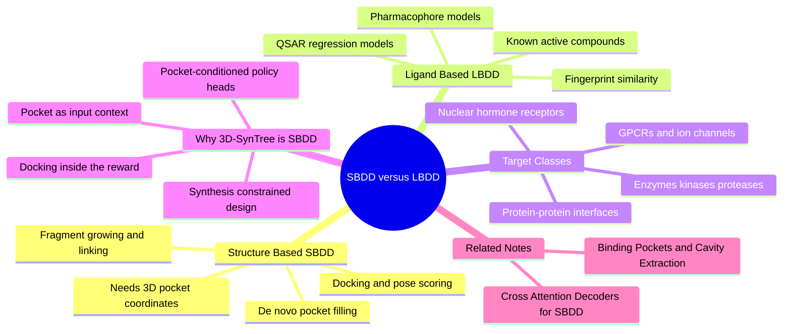

---
tags:
  - domain/pharmacology
  - depth/essential
  - 3dsyntree
  - topic/sbdd
module: "05. Pharmacology and Drug Discovery"
chapter: "Chapter 2. Drug Likeness and Pharmacokinetics"
type: concept
---

# 3. Structure Based vs Ligand Based Drug Design

> [!abstract] Core Idea
> There are exactly two sources of design information in drug discovery: the 3D structure of the target protein (structure-based design, SBDD) or the structures of molecules already known to bind it (ligand-based design, LBDD). 3D-SynTree is unambiguously an SBDD system: it cannot even run without atomic pocket coordinates, because every synthon choice, chirality assignment, and torsion angle it makes is conditioned on the protein's 3D environment.

Navigation: [[0. Pharmacology and Drug Discovery MOC]] · [[0. Master Vault Index]]

## 1. What It Is

- **Structure-based drug design (SBDD)** — designing molecules *from the target's explicit 3D atomic structure*. The protein binding pocket is known (from X-ray crystallography, cryo-EM, NMR, or a computational model), and candidate molecules are evaluated by how they physically fit and interact with that pocket: docking scores, contact energies, hydrogen bonds to particular residues.
- **Ligand-based drug design (LBDD)** — designing molecules *from known binders* when the protein structure is unavailable. Starting from a table of active and inactive molecules (with measured potencies), one builds statistical or geometric models relating chemical structure to activity, then searches for new molecules that the models predict to be better.

Both paradigms answer the same question — *what molecule should we make next?* — but from opposite ends of the information axis: the protein's shape versus the ligands' track record. **De novo design** (designing genuinely new molecules rather than searching libraries) can be done in either paradigm; 3D-SynTree is de novo SBDD with synthesis constraints.

## 2. Why It Exists

The paradigm split exists because the two information sources are rarely both available. A newly implicated disease target may have a solved structure but **no known ligands** — LBDD is impossible, and without SBDD one would be reduced to blind library screening. Conversely, medicinally important membrane proteins resisted crystallization for decades, leaving chemists with rich ligand datasets (**SAR tables**) but no structure — LBDD was the only option, and remains the workhorse of analog optimization inside a chemical series.

SBDD's distinctive promise is **design for genuinely novel targets without pre-existing small-molecule chemistry**: by optimizing shape and interaction complementarity directly against the pocket, it can propose unprecedented scaffolds rather than variations of known actives. That is precisely the situation an AI drug-design system targets — and why 3D-SynTree is built on the SBDD side (§3.5).

## 3. How It Works

### 3.1 Structure-Based Design in Practice

SBDD begins with the target's 3D coordinates and proceeds through:

1. **Pocket identification** — locating the druggable cavity (cavities near catalytic residues, or the site where a co-crystallized ligand sits; the operational pipeline is covered in [[1. Binding Pockets and Cavity Extraction]]).
2. **Pose evaluation** — for any candidate molecule, predicting its bound geometry (the **pose**) and scoring it: physical docking programs such as Vina or GNINA place the ligand in the pocket and evaluate interaction energies against the surrounding amino acids, using the thermodynamic vocabulary of [[1. Protein Ligand Binding Thermodynamics]].
3. **Design moves** — either **virtual screening** (docking millions of existing molecules), **fragment-based design** (soaking tiny fragments into the crystal, then growing or linking the ones that bind), or **de novo construction** (building molecules piece by piece inside the pocket, the 3D-SynTree strategy).

Everything operates in a shared **coordinate frame** — an origin plus axes in which every protein and ligand atom has $(x, y, z)$ coordinates, so that "this amide points at that lysine" is a computable statement. SBDD's core design principle is complementarity (the previous note's shape and electrostatic matching), with **induced-fit effects** handled by flexible side chains, protein ensembles, or multiple conformational states — because one crystal structure is one frozen snapshot of a flexible machine.

### 3.2 Ligand-Based Design in Practice

LBDD extracts patterns from known active/inactive molecules:

- **Similarity searching** — molecules similar to known actives are likely active; quantified with molecular fingerprints and the Tanimoto coefficient (see [[2. Morgan Circular Fingerprints]] and [[3. Tanimoto Similarity and Diversity]]).
- **Pharmacophore models** — the abstract 3D arrangement of interaction features (hydrogen bond donor/acceptor, positive charge, hydrophobe) shared by all actives; new molecules must be able to display the same arrangement (a pocket-independent summary of the binding hypothesis; see [[2. Pharm3D Pharmacophore Descriptors]]).
- **QSAR (quantitative structure–activity relationships)** — regression models from molecular descriptors to potency — cheminformatics' classical machine-learning problem.

LBDD's fundamental limit: it **interpolates within known chemistry**. It cannot propose a first-in-class scaffold for a pocket it has never "seen," and its models inherit every bias and gap of the underlying SAR data.

### 3.3 The Two Paradigms Compared

| Dimension | SBDD | LBDD |
| --- | --- | --- |
| Required input | 3D target structure (pocket coordinates) | Known active and inactive ligands |
| Novel target with no ligands | possible — the only rational route | impossible (nothing to learn from) |
| Typical outputs | docked poses, de novo molecules | analogs of known actives |
| Main failure mode | structure errors, scoring errors | sparse or biased SAR data |
| Relationship to 3D-SynTree | the paradigm it belongs to | borrowed where useful (synthon descriptors for retrieval) |

### 3.4 The Druggable Target Classes

Which proteins can be drugged, and how does the paradigm interact with target biology?

- **Recombinant enzymes** — kinases (which move phosphate from ATP to substrates), proteases (which cut proteins), phosphatases (which remove phosphate), polymerases (which build nucleic acids), transferases (which move chemical groups between molecules). "Recombinant" means their genes are expressed in production cells for research use. Enzymes are soluble, stable, and possess deep, evolved catalytic pockets with conserved catalytic residues — the classic SBDD success stories (HIV protease inhibitors; the kinase inhibitor imatinib were all designed from structures).
- **Membrane receptors — GPCRs and ion channels** — G-protein-coupled receptors (GPCRs) snake through the cell membrane seven times and constitute the largest single target family of marketed drugs (roughly a third). They are conformationally plastic (active and inactive states), historically brutal to crystallize, and rich in **allosteric** sites — pockets distant from the natural signaling site. Ion channels are membrane-spanning pores whose gates open and close; their binders are state-dependent (the hERG channel of the previous note is one).
- **Intracellular nuclear hormone receptors** — the targets of lipophilic hormones (estrogen, glucocorticoids): ligand-binding domains with large oily pockets that, when occupied, switch gene transcription on or off. Classic agonist/antagonist pharmacology (tamoxifen at the estrogen receptor).
- **Protein–protein interaction (PPI) interfaces** — the flat, expansive surfaces (thousands of Ų) where two proteins embrace. Long deemed "undruggable" because they lack deep pockets, they yield to structure-based fragment approaches that target **hot spots** — the few interface residues carrying most of the binding energy (the venetoclax story at BCL-2 proved it possible).

The pattern: deep, well-defined pockets favor SBDD; flat interfaces and conformationally plastic membrane proteins demand the most from structure quality and induced-fit handling.

### 3.5 Why 3D-SynTree Is an SBDD System

3D-SynTree's very first input requirement is a **pocket**: protein coordinates are preprocessed so that the binding site is extracted as a cavity of 10 Å radius around the co-crystallized ligand centroid, centered at the origin, capped at a few hundred pocket atoms (700 hard cap, 100 minimum). This pocket is not decoration — it is the *conditioning signal* for every decision the policy makes: which reactive handle to extend, which reaction family to apply, which synthon to insert, which chirality to set, and which torsion angle to choose (each a learned function of the pocket context). The reward is likewise structural: the docking term scores the finished molecule inside that same pocket, alongside contact, clash, and key-interaction energies. A ligand-based system would start from a list of known active SMILES; 3D-SynTree structurally *cannot run without pocket coordinates* — the definition of a structure-based method. Its modern twist is that the "scoring function" includes a geometric deep-learning encoder over the joint protein–ligand point cloud rather than a hand-written energy expression alone.

## 4. What It Consists Of

- **Protein binding site** — the cavity a design targets; its geometry and residue chemistry define the design problem.
- **Coordinate frame** — the shared origin and axes making pocket atoms, ligand atoms, and poses mutually comparable.
- **Docking** — placing and scoring candidate poses in the pocket (Vina/GNINA family).
- **Pose** — one predicted bound geometry of a ligand.
- **Lock-and-key complementarity** — the shape-matching ideal; **induced-fit effects** — the protein's and ligand's mutual adaptation on binding (the recognition theories introduced in the binding-thermodynamics note).
- **Fragment growing and linking** — building from weak-but-efficient fragments.
- **Pharmacophore** — the abstract interaction-pattern summary used by LBDD.
- **QSAR / similarity models** — the LBDD statistical toolkit.
- **Target classes** — enzymes, GPCRs, ion channels, nuclear receptors, PPI interfaces.

## 5. What You Must Understand

> [!warning] SBDD is only as good as its structure
> A design built on a distorted crystal structure, a wrong protonation state, or a missing ordered water molecule inherits the error silently. Structural data must be curated and sanity-checked before it conditions anything (see [[3. X-Ray Crystallography and PDB Artifacts]]).

> [!warning] Docking scores rank, they do not measure
> The pose may be right while the score is meaningless in absolute terms — the potency metrics of [[2. Kinetic and Affinity Metrics IC50 Kd Ki]] come from experiments, not from the kcal/mol printout.

> [!tip] The paradigm decision rule
> Structure available and trustworthy? SBDD (plus any ligand data you have). No structure but known actives? LBDD. Neither? Screening biology first — you cannot design your way out of having no information.

> [!note] One structure is one snapshot
> Proteins breathe through conformational selection and induced fit; a pocket solved with one ligand may present a slightly different face to the next. Ensemble methods and flexible docking exist precisely because the "lock" is soft.

## 6. Prerequisites

- [[1. Binding Pockets and Cavity Extraction]] — the pocket is the input object of the entire SBDD paradigm, and this project's first data-processing step.
- [[1. Protein Ligand Binding Thermodynamics]] — the physical model (complementarity, enthalpy, entropy) that docking and scoring functions attempt to approximate.

## 7. Project Connection

The SBDD identity is implemented end to end. Pocket preparation: `scripts/preprocess_multidataset.py` and `extract_protein_pocket()` in `syntree/data/multidataset.py` carve the 10 Å cavity around the co-crystallized ligand centroid; `MolecularFeaturizer.featurize_pocket()` in `syntree/data/featurizer.py` converts it into graph tensors — `pocket_z` atomic numbers, 3D positions, and formal charges assigned by `assign_pocket_formal_charges()` (PDB2PQR-style rules: Asp and Glu −1, Arg and Lys +1, aggregated into `pocket_charge`). Pocket encoding: `BipartitePaiNN` in `syntree/models/bipartite.py` processes the heterogeneous protein-atom and ligand-atom point cloud (receiving `pocket_pos`, `ligand_pos`, `pocket_z`, `ligand_z`), built on the equivariant message-passing machinery of [[1. PaiNN Polarizable Interaction Networks]] — geometric deep learning is what makes continuous spatial point clouds usable as neural input. Conditioning: `SynTreePolicy` in `syntree/models/policy.py` compresses the encoded pocket through its cross-attention into the `pocket_context` vector that conditions every action head — handle, reaction, synthon, chirality, torsion. And evaluation: the docking term of the reward scores finished molecules inside that same pocket. Remove the pocket and nothing remains to condition on — which is the cleanest one-sentence proof that the system is structure-based.

## 8. Required Depth

**Essential** — the spec marks this note as required depth: it defines the project's scientific paradigm, its input requirements, and the bridge from this pharmacology module into the geometric-deep-learning and MDP modules that follow.

## 9. Further Dependencies

- [[2. Bipartite Heterogeneous Protein Ligand Graphs]] — the neural architecture that consumes the pocket this note justifies.
- [[1. The Assembly MDP Formulation]] — how pocket-conditioned, synthesis-constrained design becomes a formal decision process.

## Concept Mind Map

