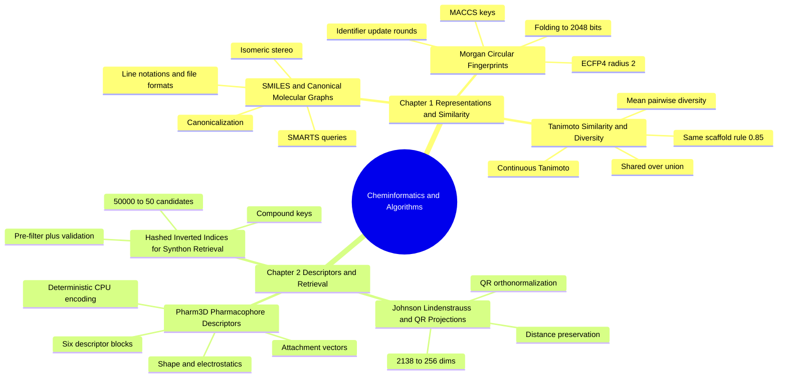

---
tags:
  - moc
  - domain/cheminformatics
  - 3dsyntree
module: "06. Cheminformatics and Algorithms"
type: moc
---

# 0. Cheminformatics and Algorithms MOC

> [!abstract] Module Mission
> This module covers how molecules become numbers a computer can store, compare, and retrieve: line notations and canonical graphs, hashed circular fingerprints, Tanimoto similarity and diversity, the Johnson–Lindenstrauss/QR machinery that compresses high-dimensional descriptors, the 2138-dimensional `pharm3d` synthon descriptor, and the hashed inverted index that makes catalog-scale retrieval instant. These are the data structures and metrics on which every synthon-selection decision in 3D-SynTree operates.

Navigation: [[0. Master Vault Index]] · [[2. Prerequisite Knowledge Graph]] · [[3. Study Tracks and Curriculum]]

## Module Mind Map

## Chapter 1. Molecular Representations and Similarity

| Note | Focus | Required Depth | Key Prerequisites |
| --- | --- | --- | --- |
| [[1. SMILES and Canonical Molecular Graphs]] | Line notations, connection-table formats, canonicalization, isomeric stereo, SMARTS and InChI | Essential | [[3. Molecular Geometry and Hybridization]], [[1. Organic Functional Groups]] |
| [[2. Morgan Circular Fingerprints]] | Circular neighborhood hashing into fixed 2048-bit vectors (ECFP4), folding and collisions | Supporting | [[1. SMILES and Canonical Molecular Graphs]] |
| [[3. Tanimoto Similarity and Diversity]] | The shared-over-union similarity metric, the 0.85 same-scaffold rule, and batch diversity | Essential | [[2. Morgan Circular Fingerprints]] |

## Chapter 2. High Dimensional Descriptors and Retrieval

| Note | Focus | Required Depth | Key Prerequisites |
| --- | --- | --- | --- |
| [[1. Johnson Lindenstrauss and QR Projections]] | Distance-preserving random compression of 2138 dims to 256 via orthonormalized maps | Supporting | Self-contained linear algebra; closest notes [[3. Tanimoto Similarity and Diversity]], [[2. Morgan Circular Fingerprints]] |
| [[2. Pharm3D Pharmacophore Descriptors]] | The deterministic 2138-dim synthon vector: Morgan block, 2D and 3D descriptors, electrostatics, attachment vectors | Essential | [[1. Johnson Lindenstrauss and QR Projections]], [[2. Chemical Bonds and Electronegativity]], [[2. Distance Geometry and ETKDG]] |
| [[3. Hashed Inverted Indices for Synthon Retrieval]] | Compound-key buckets cutting 50,000 synthons to ~50 candidates before exact validation | Supporting | [[2. The 32 Certified Reaction Grammar]], [[3. Enamine REAL Space and Catalogs]] |

## Learning Path Through This Module

1. [[1. SMILES and Canonical Molecular Graphs]] — molecules become serializable graphs; every later representation is computed on this substrate.
2. [[2. Morgan Circular Fingerprints]] — graphs become fixed 2048-bit vectors; meet hashing, radius, and bit collisions.
3. [[3. Tanimoto Similarity and Diversity]] — bit vectors become comparable; similarity thresholds, novelty, and mode-collapse detection.
4. [[1. Johnson Lindenstrauss and QR Projections]] — the mathematical license to shrink high-dimensional vectors to 256 dims without distorting distances.
5. [[2. Pharm3D Pharmacophore Descriptors]] — the actual 2138-dim synthon vector fusing 2D chemistry with 3D shape, electrostatics, and growth directions, compressed by the previous note.
6. [[3. Hashed Inverted Indices for Synthon Retrieval]] — constant-time candidate lookup over the 50,000-synthon catalog, closing the loop from representation to retrieval.

## Why This Module Matters for 3D-SynTree

3D-SynTree is, underneath the geometric deep learning, a cheminformatics engine. The 50,000-synthon Enamine REAL catalog is stored, deduplicated, and validated as canonical SMILES; the policy perceives each synthon through the `pharm3d` descriptor and its 256-dimensional projection; the fragmenter finds same-scaffold candidates with a Tanimoto pre-filter; trajectory extraction would be computationally impossible without the hashed inverted index. In short: Module 06 supplies the molecule-facing data structures that the pocket encoder of Module 07 and the assembly policy of Module 09 both stand on. If you want the full picture of how these pieces slot into the system, start from [[1. 3D-SynTree System Overview]].

## Gate Check

> [!question] Before moving on, can you...
> - Explain why infinitely many SMILES strings describe one molecule, and what canonicalization guarantees about string equality?
> - Trace one atom through two identifier-update rounds of a radius-2 Morgan fingerprint, and say where bit collisions enter the pipeline?
> - Compute the Tanimoto coefficient for two fingerprints sharing 10 bits out of a 16-bit union, and state what the $T \ge 0.85$ rule of thumb asserts and when it fails?
> - Say why a QR-orthonormalized random projection scaled by $\sqrt{D/d}$ preserves norms in expectation — and why the projection matrix must be frozen once and reused?
> - List the six blocks of `pharm3d` with one phrase each, and explain why the hashed inverted index may over-include candidates but never under-include them?

## Primary Reading

Rogers, D., & Hahn, M. (2010). *Extended-Connectivity Fingerprints*. **Journal of Chemical Information and Modeling**, 50(5), 742–754.
