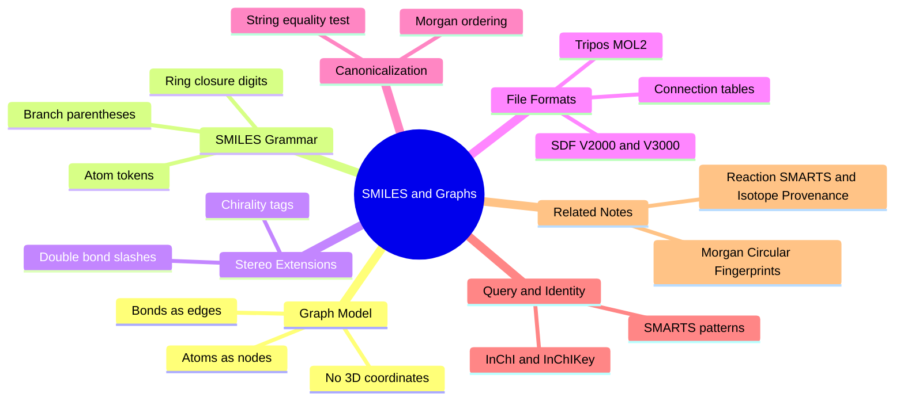

---
tags:
  - domain/cheminformatics
  - depth/essential
  - 3dsyntree
  - topic/smiles
  - topic/molecular-representations
module: "06. Cheminformatics and Algorithms"
chapter: "Chapter 1. Molecular Representations and Similarity"
type: concept
---

# 1. SMILES and Canonical Molecular Graphs

> [!abstract] Core Idea
> A molecule can be stored as a **graph** — atoms are nodes, bonds are edges — and SMILES is the compact ASCII text language that serializes that graph into a single line a computer can store, search, and compare. A canonicalization step guarantees that one molecule always maps to exactly one string, turning string equality into a molecule-identity test.

Navigation: [[0. Cheminformatics and Algorithms MOC]] · [[0. Master Vault Index]]

## 1. What It Is

A **molecular graph** is the mathematical object chemists use to describe what a molecule is *made of and how it is connected*. Its **nodes** (vertices) are atoms and its **edges** are covalent bonds (the strong electron-sharing bonds introduced in [[2. Chemical Bonds and Electronegativity]]). Every node carries attributes: element, formal charge, isotope, implicit hydrogen count, and an aromaticity flag. Every edge carries a bond order: single, double, triple, or aromatic.

**SMILES** (Simplified Molecular Input Line Entry System) is a **line notation** — a formal grammar for writing that entire graph as one short string of ordinary keyboard characters. Ethanol (two carbons, one oxygen, $\text{C}_2\text{H}_5\text{OH}$) is simply `CCO`. The same idea, with different trade-offs, appears in connection-table file formats (MOL, SDF, MOL2) and in the registry identifiers InChI and InChIKey.

## 2. Why It Exists

Computers store, transmit, and compare **text** far more easily than they handle hand-drawn chemical structures. Databases need one canonical string per molecule so that duplicates can be detected; scripts need a format that can be passed on a command line or stored in a spreadsheet cell; and two chemists using different tools need a loss-free way to exchange structures. SMILES exists because a molecular graph must become a *serializable, standardized, searchable* object.

The second reason is subtler: cheminformatics algorithms (fingerprints, similarity, reaction matching — all of Module 06) do not operate on drawings. They operate on parsed graphs. SMILES is the cheap, universal on-ramp from "a molecule someone drew" to "a graph object inside a program such as RDKit", the open-source cheminformatics toolkit used throughout 3D-SynTree.

## 3. How It Works

### 3.1 The SMILES grammar — atoms, bonds, branches, rings

The grammar has five moving parts:

1. **Atom tokens.** The "organic subset" elements B, C, N, O, P, S, F, Cl, Br, I are written as bare letters; all other elements and any atom with unusual charge or hydrogen count go in square brackets: `[Na+]`, `[NH4+]`, `[13C]`. Hydrogens attached to organic-subset atoms are **implicit** (a bare `C` in context carries exactly enough hydrogens to fill its valence).
2. **Bond tokens.** `-` single, `=` double, `#` triple, `:` aromatic. Single bonds between two consecutively written atoms are implied, which is why `CCO` needs no dashes.
3. **Branches.** Parentheses open a side-chain from the current atom and return to it afterwards: in `CC(=O)O` (acetic acid) the `(=O)` is a double-bonded oxygen hanging off the second carbon, and the string then continues from that same second carbon to the final `O`.
4. **Ring closures.** A digit marks "this atom bonds to the next atom carrying the same digit." The six aromatic carbons of benzene, `c1ccccc1`, form a chain that is then stitched into a cycle by the pair of `1`s. Lowercase letters denote **aromatic** atoms.
5. **Disconnection.** A dot `.` separates pieces that are in the same sample but not covalently bonded, e.g. `[Na+].[Cl-]` for sodium chloride.

> [!example] Reading ethanol and aspirin
> Ethanol is `CCO`: carbon — carbon — oxygen in a straight chain, hydrogens implicit.
>
> Aspirin is `CC(=O)Oc1ccccc1C(=O)O`:
>
> | Token(s) | Meaning |
> | --- | --- |
> | `C` | the methyl carbon of the acetyl group |
> | `C(=O)` | the carbonyl carbon, with a double-bond O in a branch |
> | `O` | the ester oxygen bridging onto the ring |
> | `c1ccccc1` | the benzene ring, closed by the matching `1`…`1` pair |
> | `C(=O)O` | a carboxylic acid on the ring carbon adjacent to the ester — the ortho position that makes this aspirin |
>
> Branch parentheses, ring-closure digits, and implicit single bonds together let one linear string encode an arbitrarily branched, cyclic graph.

### 3.2 Connection tables — MOL, SDF V2000/V3000, and MOL2

Before SMILES, chemistry software stored graphs as **connection tables**: a literal two-part table listing every atom (with its attributes) and every bond (with its order). The classic MDL **MOL format (V2000)** has a header, a counts line, an **atom block** (one line per atom: x, y, z drawing coordinates, element symbol, mass difference, charge), a **bond block** (one line per bond: first atom, second atom, bond type, stereo flag), and an `M  END` terminator. V2000 fields are fixed-width three-digit counters, capping a record at 999 atoms and 999 bonds. **V3000** replaces the blocks with free-format `M V30` tag records that lift the 999 limit — needed for big biomolecules, unnecessary for small drug-like synthons.

An **SDF** (structural data file) is simply a stream of many MOL records, each followed by named data fields (price, ID, activity) and a `$$$$` record separator — the standard way to ship a whole compound catalog in one file. **Tripos MOL2** is a rival format from molecular-modeling software: it organizes the file into sections such as the atom section and bond section, and types atoms with **SYBYL codes** like `C.3` (sp3 carbon) or `N.am` (amide nitrogen) — hybridization-aware labels that docking tools consume directly.

| Format | Style | Carries | Typical use |
| --- | --- | --- | --- |
| SMILES | one-line grammar | graph + stereo | exchange, databases, ML |
| MOL V2000 | atom/bond blocks | graph + 2D drawing coords | single structures |
| MOL V3000 | free-format records | same, no size cap | large molecules |
| SDF | many MOL records + data fields | catalog shipping | screening decks, catalogs |
| MOL2 | sections + SYBYL types | graph + typed atoms | docking, modeling |

### 3.3 Canonical SMILES — Morgan and Weininger ordering

One molecule has *infinitely many* valid SMILES: you may start at any atom, traverse in any order, and place branches in different spots (`OCC`, `CCO`, `C(O)C` are all ethanol). For databases you need the reverse guarantee: **one molecule → one string**. A **canonicalization algorithm** (the Morgan / Weininger ordering lineage, as implemented in RDKit) does this in three stages:

1. **Initial invariants.** Every atom gets a starting rank from properties that do not depend on spelling: element, degree (number of neighbors), charge, hydrogen count, ring membership.
2. **Iterative refinement.** Each atom's rank is updated by hashing it together with the ranks of its neighbors, then re-sorting. After each round, an atom's rank encodes its entire neighborhood out to one more bond — the same circular-refinement idea that powers [[2. Morgan Circular Fingerprints]]. Ranks stabilize when every symmetry-distinct atom has a distinct rank.
3. **Deterministic emission.** The string is written by starting from the highest-ranked atom and following a fixed tie-breaking traversal, so the output depends only on the graph, never on input spelling.

The payoff: comparing two canonical strings is a full **graph isomorphism test** ("are these two molecules identical?") done in one string comparison.

### 3.4 Isomeric SMILES — chirality `@`/`@@` and double-bond geometry `/` and `\`

Plain SMILES records connectivity only. **Isomeric SMILES** adds stereochemistry. A tetrahedral (chiral) center is tagged `@` or `@@` inside the brackets: `C[C@H](N)C(=O)O` encodes one enantiomer of alanine; flipping the symbol to `@@` gives its non-superimposable mirror image (how R/S is assigned is covered in [[1. Stereochemistry Chirality and CIP Rules]]). The tag is *local*: it means "the neighbors, listed in the order they appear in this string, wind clockwise (`@`) or counter-clockwise (`@@`) when viewed from the previous atom." The same enantiomer may therefore need `@` in one spelling and `@@` in another.

Double-bond geometry uses directional single bonds: in `F/C=C/F` the two fluorines sit on opposite sides (trans / E), while in `F/C=C\F` they sit on the same side (cis / Z).

### 3.5 SMARTS — a query language over graphs

**SMARTS** (SMILES Arbitrary Target Specification) extends the grammar from *describing one molecule* to *describing a pattern that many molecules may match*. `[C,N]` means "carbon or nitrogen," `[#6;r6]` means "any carbon in a six-membered ring," `~` means "any bond." Matching a SMARTS against a molecule is a **subgraph isomorphism search** — the engine asks "does this pattern appear inside this graph?" This is how chemists search a database for "everything containing a benzene ring with an electron-withdrawing group on it." **Reaction SMARTS** additionally uses the `>>` arrow between a reactant pattern and a product pattern, with atom-mapping numbers tracking which atoms become which — the machinery of [[3. Reaction SMARTS and Isotope Provenance]].

### 3.6 InChI and InChIKey — brief

**InChI** (International Chemical Identifier) is a *layered* identifier built by a fixed standard algorithm: formula layer, then connectivity, then hydrogens, then charge, then stereo. Because the layers are ordered from coarse to fine, two molecules agreeing on early layers are chemically related. The **InChIKey** is its 27-character hashed form: a 14-character block encoding the molecular skeleton, a second block encoding the remaining stereochemical layers, and a final check character. Two structures with identical first blocks share the same skeleton, making InChIKeys ideal for cross-database deduplication (e.g., checking a generated molecule against a registry of known compounds).

## 4. What It Consists Of

- **Atom tokens** — bare organic-subset symbols or bracketed `[element H count charge]` forms.
- **Bond tokens** — `-`, `=`, `#`, `:`, plus implicit single bonds.
- **Branch parentheses** — side-chains that return to their branching atom.
- **Ring-closure digits** — paired markers that stitch chains into cycles.
- **Aromatic flags** — lowercase atoms and `c1ccccc1` aromatic rings.
- **Chirality tags** — `@`/`@@` inside brackets, defined relative to neighbor order.
- **Directional bond marks** — `/` and `\` setting double-bond E/Z geometry.
- **Dot operator** — separating disconnected fragments of one sample.
- **SMARTS extensions** — atom/bond wildcards, logical operators, and the `>>` reaction arrow.
- **InChI layers / InChIKey blocks** — standardized, hash-friendly identifiers.

## 5. What You Must Understand

> [!warning] A 2D graph contains no geometry
> A molecular graph records *which* atom is bonded to *which* — it contains no 3D spatial information; $x, y, z$ coordinates are absent. Conformers, shapes, and binding poses require a separate 3D construction step such as distance geometry (see [[2. Distance Geometry and ETKDG]]). Treating a SMILES-derived molecule as if it "has a shape" is a classic beginner error.

> [!warning] Stereo loss is silent
> Drop an `@` and the parsed molecule is simply *unspecified* at that center — no error, no warning. Code that forgets isomeric SMILES will happily equate a drug with its inactive mirror image.

> [!tip] Memory hooks
> Same canonical SMILES → same molecule, guaranteed. Ring closures come in *pairs* of digits, like brackets. The Morgan-style refinement in canonicalization pre-figures circular fingerprints: ranks grow outward one bond per round.

> [!note] MOL coordinates are for drawing, not for docking
> The x, y, z in a MOL atom block are 2D depiction (sketching) coordinates with z = 0 unless a real 3D conformer was exported; never mistake them for a binding pose.

## 6. Prerequisites

- [[3. Molecular Geometry and Hybridization]] — why atoms have fixed valences and bond orders, which the graph edges and implicit hydrogens encode.
- [[1. Organic Functional Groups]] — recognizing the ester, acid, and aromatic patterns that SMILES strings spell out letter by letter.

## 7. Project Connection

3D-SynTree lives on canonical SMILES as its molecule identity layer. The function `canonical_smiles()` in `syntree/data/fragmenter.py` produces the canonical string for any molecule; **replay validation** of a synthetic route succeeds only when the canonical string of the molecule built by forward-applying reactions equals the canonical string of the observed product — a one-line graph isomorphism proof. The `SynthonCatalog` in `syntree/chemistry/catalog.py` keeps its 50,000 catalog entries in a DataFrame keyed by canonical SMILES, so duplicate synthons collapse automatically. Reactive handles on any molecule are detected by SMARTS matching through `HANDLE_SMARTS` (the ten handle classes) in `syntree/chemistry/reactions.py`.

## 8. Required Depth

**Essential** — every downstream representation in this module (fingerprints, descriptors, index keys) is computed from the molecular graph that SMILES delivers.

## 9. Further Dependencies

- [[2. Morgan Circular Fingerprints]] — hashing circular neighborhoods of this graph into a fixed bit vector.

## Concept Mind Map

