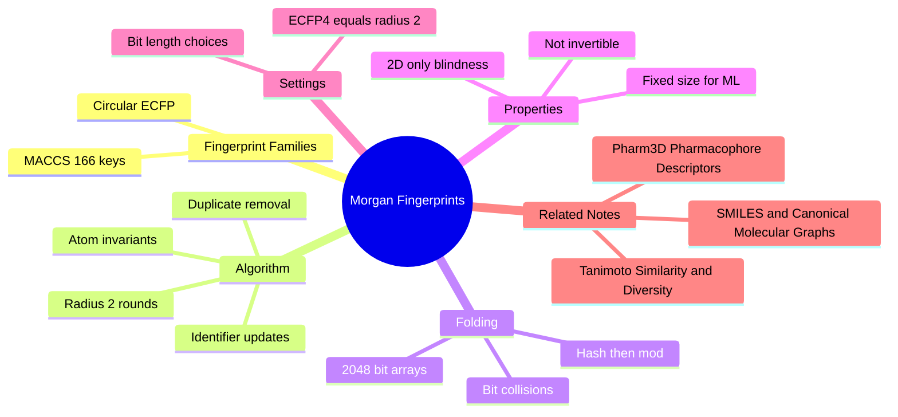

---
tags:
  - domain/cheminformatics
  - depth/supporting
  - 3dsyntree
  - topic/fingerprints
module: "06. Cheminformatics and Algorithms"
chapter: "Chapter 1. Molecular Representations and Similarity"
type: concept
---

# 2. Morgan Circular Fingerprints

> [!abstract] Core Idea
> A **fingerprint** converts a variable-sized molecular graph into a fixed-length bit vector (almost always 2048 bits) by hashing each atom's local neighborhood out to a fixed radius. The Morgan fingerprint at radius 2 (industry name **ECFP4**) is the workhorse: cheap, deterministic, and directly comparable with a similarity coefficient.

Navigation: [[0. Cheminformatics and Algorithms MOC]] · [[0. Master Vault Index]]

## 1. What It Is

A **molecular fingerprint** is a function from a molecule to a fixed-length binary vector where each bit is a yes/no answer to "does this molecule contain a certain substructure?" Two families dominate:

- **Keyed fingerprints**: a human-curated list of substructure questions. The classic is the 166-bit **MACCS keys** — 166 predefined structural patterns ("is there a ring of size 6?", "is there an S–S bond?"). Every bit has a fixed, documented meaning.
- **Circular (hashed) fingerprints**: no fixed list. Instead, the algorithm *generates* a substructure description for every atom at every radius up to $R$, and **hashes** each description into a big bit array. The Morgan fingerprint with $R = 2$ is equivalent to the **Extended-Connectivity Fingerprint ECFP4** (the 4 is the *diameter* in bonds — radius 2 — a naming trap worth memorizing early).

The output is a bit vector of length $B$, typically $B = 2048$: one bit per molecule, regardless of whether the molecule has 5 atoms or 50.

## 2. Why It Exists

Machine learning models consume **fixed-size numeric vectors**. A molecular graph is variable-sized, discrete, and irregular — 5 atoms in one molecule, 63 in the next — so it cannot be fed to a classical model (or stored in a fixed-width database column) without an encoding layer. The fingerprint is that layer: a one-pass, deterministic function $\text{molecule} \mapsto \{0,1\}^{2048}$.

The second need is **similarity search**: "find me everything in the catalog similar to this compound." Comparing graphs directly requires expensive isomorphism machinery; comparing bit vectors is microsecond arithmetic (the Tanimoto coefficient of the next note). Fingerprints make million-compound searches feasible — they are the index cards of chemical space.

## 3. How It Works

### 3.1 Step 1 — initial atom invariants

Every atom starts with an integer identifier computed from **atom invariants**: properties computable from the atom alone, independent of how the molecule is spelled — element, number of heavy-atom neighbors (degree), explicit hydrogen count, formal charge, and (optionally) ring membership and isotope. Two identical atoms in identical environments must get identical starting identifiers; that is what "invariant" means here. Deliberately omitted: any numbering, any coordinate, any 3D information. The fingerprint is 2D from birth.

### 3.2 Step 2 — iterative identifier updates (the "extended connectivity" part)

For $R$ iterations (with $R = 2$ for ECFP4), each atom's identifier is replaced by a hash of itself **plus the identifiers of its immediate neighbors and the bonds joining them**:

$$
I_k(a) = H\Big(I_{k-1}(a),\ \big\{\!\big(I_{k-1}(n),\ \text{bond}(a,n)\big)\ :\ n \in \text{neighbors}(a)\big\}\Big)
$$

where $H$ is a hash function mixing the values into one integer. After iteration $k$, atom $a$'s identifier encodes its entire circular neighborhood out to radius $k$ bonds. The neighbor multiset is sorted before hashing, so the result is invariant to atom ordering.

> [!example] Two update rounds on ethanol, seen from the oxygen
> Ethanol is `CCO`.
> - **Round 0 (radius 0):** the oxygen's identifier is hashed from its invariants — element O, degree 1, two implicit hydrogens, neutral charge. Call it $I_0(\mathrm{O})$. It says only "I am a hydroxyl oxygen."
> - **Round 1 (radius 1):** hash $I_0(\mathrm{O})$ together with the neighboring carbon's $I_0$ and the single bond. The new $I_1(\mathrm{O})$ says "a hydroxyl oxygen singly bonded to a carbon of exactly this type."
> - **Round 2 (radius 2):** hash $I_1(\mathrm{O})$ with the neighbor's *round-1* identifier — which has meanwhile absorbed the methyl carbon. $I_2(\mathrm{O})$ now says "an OH attached to CH2 attached to CH3": the whole ethanol, viewed from the oxygen.
>
> The same growth happens at every atom in parallel. A propanol oxygen would reach a *different* $I_2$ than ethanol's, because its round-2 neighborhood differs — that is the discrimination power.

### 3.3 Step 3 — collect, then fold into the bit array

Every identifier generated at every radius, for every atom, is collected (duplicates removed — symmetry-equivalent atoms generate identical identifiers). Each identifier is hashed to a large integer $h$, then mapped onto the array by **modulo folding**:

$$
\text{bit index} = h \bmod B, \qquad B = 2048
$$

and that bit is set to 1. A drug-like molecule typically generates a few dozen distinct identifiers, so a few dozen bits light up out of 2048.

### 3.4 Bit collisions — the price of folding

Two unrelated substructures can hash to the same index: a **bit collision**. With $k$ identifiers spread over $B$ bits, the expected number of colliding pairs is roughly $k^2 / 2B$ (the birthday-paradox estimate). For $k \approx 60$ identifiers and $B = 2048$, that is about one collision per molecule — tolerable noise that slightly inflates apparent similarity. Folding to $B = 1024$ doubles the collision rate; 4096 halves it. Collisions also mean the map is **not invertible**: you cannot decode a bit vector back into a molecule, and a single bit has no guaranteed clean meaning.

> [!example] Collision arithmetic
> A molecule setting $k = 64$ bits in a $B = 2048$ array has $\frac{64 \cdot 63}{2} = 2016$ identifier pairs, each colliding with probability $\frac{1}{2048}$ — about one expected collision. In a 1024-bit array the expectation doubles to two; some genuinely different substructures now share bits, and similarity scores get mushier.

### 3.5 MACCS keys in one paragraph

The 166-bit MACCS keys predate ECFP and encode 166 hand-designed structural questions. Advantage: every bit is interpretable and identical across software. Disadvantage: only 166 questions exist, so fine distinctions (is this ethyl or propyl?) vanish. ECFP's unlimited generated vocabulary captures such gradations at radius cost — which is why 3D-SynTree, like most modern toolkits, standardizes on the circular type, keeping MACCS-style keyed thinking only as a mental reference point.

### 3.6 What the fingerprint sees and cannot see

The Morgan fingerprint captures **2D circular connectivity**: elements, bond orders, and how neighborhoods nest. It is completely blind to **3D shape** — conformers, spatial extension, stereochemical orientation, and electrostatics leave no trace. A compact molecule and its fully stretched-out conformer have *identical* fingerprints. Restoring 3D awareness requires engineered descriptors — the reason [[2. Pharm3D Pharmacophore Descriptors]] exists.

## 4. What It Consists Of

- **Radius $R$** — how many bonds out each neighborhood extends; $R = 2$ gives ECFP4.
- **Bit length $B$** — the folded array size; 2048 standard, 1024 aggressive, 4096 conservative.
- **Atom invariants** — the seed descriptors (element, degree, charge, H count).
- **Hash function** — the deterministic mixing function producing integer identifiers.
- **Folding rule** — $h \bmod B$ mapping identifiers to bits.
- **Bit collisions** — unrelated identifiers sharing a bit; the unavoidable folding error.
- **Identifier set** — the pre-folding multiset of all substructure codes (ECFP "counts" before binarization).

## 5. What You Must Understand

> [!warning] ECFP4 is radius 2, not radius 4
> The trailing number in ECFP names is the *diameter*. ECFP4 = diameter 4 = radius 2. "Morgan fingerprint, radius 2" and "ECFP4" are the same object — 3D-SynTree uses exactly this setting with 2048 bits.

> [!warning] Fingerprints are settings-dependent
> Two vectors are comparable only if produced with identical radius, bit length, invariants, and folding. Comparing a 1024-bit vector to a 2048-bit one (or ECFP4 to ECFP6) is meaningless yet fails silently — always recompute under one fixed configuration.

> [!tip] Memory hooks
> "Circular" = neighborhoods grow in circles, one bond per round. Round $k$ identifier = the atom's autobiography including all relatives within $k$ bonds. Fold = hash then mod, and mod = where collisions are born.

> [!note] Sparsity is normal
> A 2048-bit vector with only ~60 bits set is expected, not a bug. Blank bits carry no information; similarity lives entirely in the overlap of the lit bits.

## 6. Prerequisites

- [[1. SMILES and Canonical Molecular Graphs]] — the fingerprint is computed on the parsed molecular graph; you need to know what atoms, bonds, and neighborhoods are.

## 7. Project Connection

The Morgan radius-2, 2048-bit fingerprint is 3D-SynTree's baseline molecule encoding. The legacy embedding engine `encode_catalog_morgan2d()` in `syntree/chemistry/synthon_encoder.py` embeds the whole synthon catalog this way. In `syntree/data/fragmenter.py`, the fingerprint is what makes bulk similarity search instant: `DataStructs.BulkTanimotoSimilarity` compares one query fingerprint against the entire catalog in one call, feeding the $T \ge 0.85$ same-scaffold pre-filter detailed in [[3. Tanimoto Similarity and Diversity]]. The same 2048-bit vector, unit-normalized, also forms the first and largest block of the 2138-dimensional `pharm3d` descriptor built by `encode_catalog_pharm3d()`.

## 8. Required Depth

**Supporting** — the algorithm itself is background machinery; what must stick is what the bit vector is, how ECFP4 relates to radius 2, and why collisions make it approximate.

## 9. Further Dependencies

- [[3. Tanimoto Similarity and Diversity]] — the similarity metric defined on these bit vectors.
- [[2. Pharm3D Pharmacophore Descriptors]] — the normalized Morgan block is the first component of the 2138-dim synthon descriptor.

## Concept Mind Map

