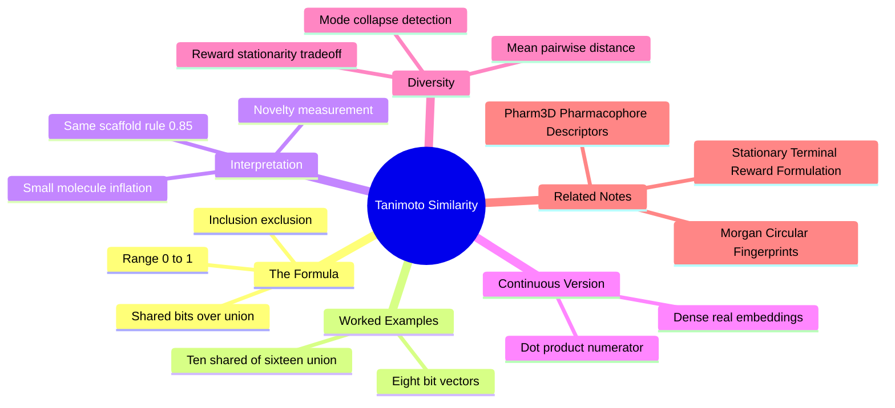

---
tags:
  - domain/cheminformatics
  - depth/essential
  - 3dsyntree
  - topic/similarity-metrics
module: "06. Cheminformatics and Algorithms"
chapter: "Chapter 1. Molecular Representations and Similarity"
type: concept
---

# 3. Tanimoto Similarity and Diversity

> [!abstract] Core Idea
> Once two molecules are bit vectors, their chemical similarity becomes the **overlap of their set bits divided by their union** — the Tanimoto coefficient. It powers same-scaffold detection ($T \ge 0.85$), novelty measurement, and the diversity metrics that keep generative policies from collapsing onto one repeated scaffold.

Navigation: [[0. Cheminformatics and Algorithms MOC]] · [[0. Master Vault Index]]

## 1. What It Is

The **Tanimoto coefficient** (also called the Jaccard index) is the standard similarity measure between two binary fingerprint vectors $A, B \in \{0,1\}^B$ (from [[2. Morgan Circular Fingerprints]]):

$$
T(A, B) = \frac{|A \cap B|}{|A \cup B|} = \frac{N_{AB}}{N_A + N_B - N_{AB}}
$$

Here $N_A$ and $N_B$ are the numbers of set bits in each vector, and $N_{AB}$ is the number of bits set in **both**. The two forms are equal because $|A \cup B| = N_A + N_B - N_{AB}$ (inclusion–exclusion: adding the sizes double-counts the shared bits, so subtract them once). The result lies in $[0, 1]$: $T = 0$ means no shared substructures at all; $T = 1$ means identical fingerprints.

The **Tanimoto distance** is $1 - T$. The **mean pairwise Tanimoto distance** over a set of molecules is the standard **diversity** metric of a generated batch.

## 2. Why It Exists

Cheminformatics constantly needs to answer "how similar are these two molecules?" — for nearest-neighbor search in a catalog, for clustering, and for judging whether a generative model produces anything new. Raw bit-vector measures like Euclidean distance behave poorly on sparse binary fingerprints: two molecules sharing nothing still have ~2048 minus a few dozen matching zeros, so naive agreement is inflated. Tanimoto corrects by counting only *present* features — shared ones over the union of both — ignoring the uninformative sea of zeros.

The second driver is **mode collapse** in generative chemistry: a policy that repeatedly emits the same comfortable scaffold has learned nothing about chemical space. A cheap, well-calibrated similarity metric turns "is this batch diverse?" into arithmetic. The same metric quantifies **novelty** — a designed molecule with $T = 0.95$ to a known ligand is an incremental tweak; $T = 0.4$ is new territory.

## 3. How It Works

### 3.1 Computing the coefficient — worked examples

> [!example] A tiny 8-bit example
> Take $A = 11001010$ and $B = 11000011$ (bit 1 = leftmost).
> Bits set: $A$ has $N_A = 4$, $B$ has $N_B = 3$. Shared bits (positions 1 and 2): $N_{AB} = 2$.
> $$T = \frac{2}{4 + 3 - 2} = \frac{2}{5} = 0.4$$
> Two of every five substructure features present in either molecule are common — moderate similarity.

> [!example] A realistic fingerprint-scale example
> A query molecule sets 12 bits; a catalog synthon sets 14; they share 10.
> $$T = \frac{10}{12 + 14 - 10} = \frac{10}{16} = 0.625$$
> High, but below the 0.85 same-scaffold zone — a related-but-different structure.

### 3.2 Mathematical properties (and one honest flaw)

$T$ is symmetric ($T(A,B) = T(B,A)$), identical molecules score exactly 1, and it handles vectors of different bit counts gracefully (a small molecule setting few bits against a large one). The flaw: $1 - T$ is a *dissimilarity score*, not a true **metric** — it can violate the triangle inequality ($d(A,C) \le d(A,B) + d(B,C)$). This matters if you feed the distance into algorithms that assume a metric (some indexing trees, some clustering proofs); for ranking and thresholds — the uses here — the violation is harmless.

### 3.3 The $T \ge 0.85$ same-scaffold rule of thumb

Empirically, with ECFP4-style circular fingerprints, molecule pairs scoring $T \ge 0.85$ almost always share the same core chemical **scaffold** — the central ring-and-chain skeleton with only peripheral decoration differing. Such pairs frequently bind the same biological target with similar affinity, because they present nearly the same functional groups. The rule is a heuristic, not a law: very small molecules score inflated similarities (few bits → a couple of shared bits dominate the union), and unusual fingerprints can reach 0.85 with different cores. In 3D-SynTree the threshold is applied one-directionally — *find synthons at least this similar* — as a pre-filter, described under Project Connection.

### 3.4 Continuous Tanimoto for real-valued vectors

The same fraction generalizes from bit sets to non-negative **real vectors** $\mathbf{x}, \mathbf{y} \in \mathbb{R}_{\ge 0}^d$ by replacing counting with inner products:

$$
T(\mathbf{x}, \mathbf{y}) = \frac{\mathbf{x} \cdot \mathbf{y}}{\|\mathbf{x}\|^2 + \|\mathbf{y}\|^2 - \mathbf{x} \cdot \mathbf{y}}
$$

For $0/1$ vectors this reduces exactly to the binary formula (dot products count shared bits). The value again lies in $[0, 1]$ for non-negative inputs. This is the right tool for **dense** descriptors — for instance the 256-dimensional projected synthon embeddings of [[2. Pharm3D Pharmacophore Descriptors]], whose coordinates are real-valued magnitudes, not bits. It is *not* a cosine similarity: it additionally penalizes mismatched vector norms, which is desirable when magnitude carries meaning.

### 3.5 Diversity — mean pairwise distance and mode collapse

For a batch of molecules $\mathcal{M}_1, \dots, \mathcal{M}_n$, diversity is measured as the **mean pairwise Tanimoto distance**:

$$
\text{Diversity} = \frac{2}{n(n-1)} \sum_{i < j} \big(1 - T(\mathcal{M}_i, \mathcal{M}_j)\big)
$$

Low diversity means the batch is a crowd of near-clones — the generative failure mode called **mode collapse**, where a policy exploits one rewarding scaffold forever. For per-molecule diagnosis, the project uses the leave-one-out average:

$$
R_{\text{div}}(\mathcal{M}_i) = \frac{1}{|\mathcal{B}| - 1} \sum_{j \ne i} \left(1 - T(\mathcal{M}_i, \mathcal{M}_j)\right)
$$

A molecule scoring high here is the odd one out (valuable novelty); a batch where every $R_{\text{div}}$ is near zero has collapsed. Collapse has a chemical face too: unconstrained models drift toward flat, greasy biaryl repeats — the pathology dissected in [[2. Fsp3 Saturation and the Flat Grease Trap]] — so diversity monitoring doubles as a pharmacokinetic early-warning system.

> [!note] Diversity left the reward — for a deep reason
> An older design added a batch-relative diversity bonus to the terminal reward, making a molecule's reward depend on *which other molecules happened to share the batch*. That breaks the Markov property and makes the reward non-stationary from the sampler's perspective. The bonus was therefore removed from the reward and kept as a pure evaluation diagnostic — the full argument is the subject of [[3. Stationary Terminal Reward Formulation]].

## 4. What It Consists Of

- **Shared bits $N_{AB}$** — the intersection; the numerator.
- **Bit counts $N_A, N_B$** — per-vector set-bit totals; with $N_{AB}$ they give the union.
- **Tanimoto distance $1 - T$** — the companion dissimilarity score (not a strict metric).
- **The 0.85 threshold** — empirical same-scaffold rule for circular fingerprints.
- **Continuous Tanimoto** — the inner-product generalization for real-valued vectors.
- **Mean pairwise distance / $R_{\text{div}}$** — batch-level and per-molecule diversity diagnostics.

## 5. What You Must Understand

> [!warning] Similarity is fingerprint-relative
> $T$ compares *fingerprints*, not molecules. Change the fingerprint (MACCS vs ECFP4, 1024 vs 2048 bits, radius 2 vs 3) and the same molecule pair changes score. Always quote the fingerprint alongside any threshold — "$T \ge 0.85$ on ECFP4, 2048 bits" is a statement; "$T \ge 0.85$" alone is not.

> [!warning] Small molecules inflate scores
> Two tiny fragments sharing three bits out of three and four total can hit $T = 0.75$ while being chemically unrelated. The union is small, so little evidence is needed for a big ratio. Trust high thresholds only for drug-sized molecules.

> [!tip] Memory hooks
> Tanimoto = "shared over union" — the Venn diagram is the whole formula. $0.85$ = "same scaffold, different outfit." Diversity = average $1 - T$ across all pairs; near zero means the model is photocopying.

## 6. Prerequisites

- [[2. Morgan Circular Fingerprints]] — Tanimoto is defined on the bit vectors that fingerprints produce; bit counts and collisions come from there.

## 7. Project Connection

In `syntree/data/fragmenter.py`, `DataStructs.BulkTanimotoSimilarity` runs the query fingerprint against every catalog fingerprint in one vectorized call, and the $T \ge 0.85$ rule selects candidate synthons sharing the query's scaffold before any expensive exact processing. Per-molecule batch diversity is computed by `ThreeDReward.batch_diversity()` in `syntree/engine/rl.py` using the leave-one-out mean of $1 - T$ shown above — an evaluation-time diagnostic of mode collapse; per the stationarity requirement it no longer enters the terminal reward itself (see [[3. Stationary Terminal Reward Formulation]]).

## 8. Required Depth

**Essential** — the $T \ge 0.85$ pre-filter and the diversity diagnostic are live components of the training and evaluation loop, and every similarity number in the project flows through this coefficient.

## 9. Further Dependencies

- [[3. Stationary Terminal Reward Formulation]] — why the diversity term was evicted from the reward while surviving as a metric.

## Concept Mind Map

