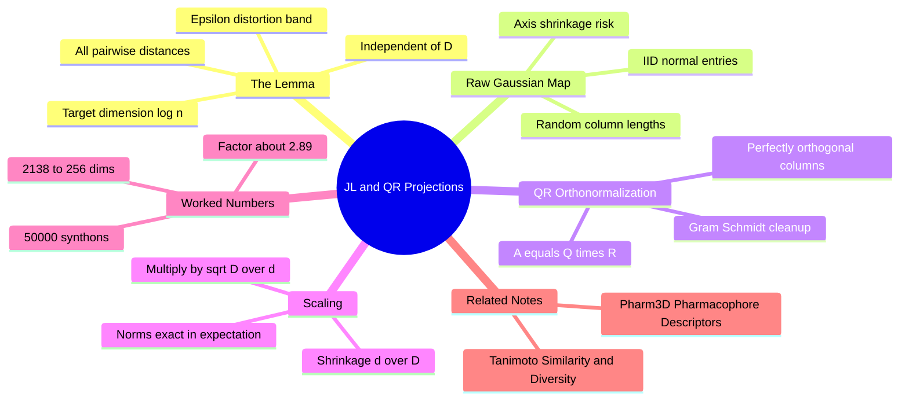

---
tags:
  - domain/cheminformatics
  - depth/supporting
  - 3dsyntree
  - topic/dimensionality-reduction
module: "06. Cheminformatics and Algorithms"
chapter: "Chapter 2. High Dimensional Descriptors and Retrieval"
type: concept
---

# 1. Johnson Lindenstrauss and QR Projections

> [!abstract] Core Idea
> The Johnson–Lindenstrauss lemma guarantees that you can squash a cloud of high-dimensional points into a few hundred dimensions with a **random** linear map while keeping *all pairwise distances* within a factor $1 \pm \epsilon$. Orthonormalizing the random map's columns with QR decomposition makes the guarantee tight and the norm preservation exact in expectation — this is how 3D-SynTree compresses 2138-dimensional synthon descriptors to 256.

Navigation: [[0. Cheminformatics and Algorithms MOC]] · [[0. Master Vault Index]]

## 1. What It Is

The **Johnson–Lindenstrauss (JL) lemma** is a theorem about random dimensionality reduction. Given $n$ points in $\mathbb{R}^D$ and an error tolerance $\epsilon \in (0,1)$, it states that there exists a linear map $f : \mathbb{R}^D \to \mathbb{R}^m$ with target dimension as small as

$$
m \;\ge\; O\!\left(\frac{\log n}{\epsilon^2}\right)
$$

such that **every** pairwise distance is preserved within a multiplicative factor:

$$
(1-\epsilon)\,\|\mathbf{x} - \mathbf{y}\|_2^2 \;\le\; \|f(\mathbf{x}) - f(\mathbf{y})\|_2^2 \;\le\; (1+\epsilon)\,\|\mathbf{x} - \mathbf{y}\|_2^2
$$

Read that bound carefully: the target dimension depends on $\log n$ and $\epsilon$ — **not on the original dimension $D$**. That is the shock of the lemma: a million points from a 100,000-dimensional space can live in a few hundred dimensions with barely distorted geometry.

In practice $f$ is a **random projection**: multiply by a random matrix, then fix a scaling. 3D-SynTree's variant draws a random Gaussian matrix, orthonormalizes it with **QR decomposition** ($\mathbf{A} = \mathbf{Q}\mathbf{R}$), keeps $\mathbf{Q}$, and scales by $\sqrt{D/d}$ — mapping the 2138-dimensional `pharm3d` descriptor to a 256-dimensional catalog embedding.

## 2. Why It Exists

The 2138-dimensional descriptor of [[2. Pharm3D Pharmacophore Descriptors]] is **sparse and redundant**: 2048 of its coordinates are fingerprint bits with only ~dozens lit, and several of its remaining blocks encode overlapping notions of size and shape. Feeding such a vector straight into neural layers is wasteful — every extra dimension multiplies weight-matrix size, slows attention, and adds GPU memory pressure — while carrying almost no extra information.

Classical alternatives are unattractive here. PCA is data-dependent (must be refit when the catalog changes, and fits variance, not distance preservation), and learned encoders (autoencoders) need training and become one more thing to go wrong. The JL route is **blind, cheap, and provably safe**: a random matrix is generated once, the geometry (all pairwise distances that similarity search and nearest-neighbor retrieval depend on — see [[3. Tanimoto Similarity and Diversity]]) survives within known tolerance, and the result is small and dense: $2138 \to 256$, roughly an 8-fold compression.

## 3. How It Works

### 3.1 Why $\log n$ suffices — the intuition

There are $\binom{n}{2} \sim n^2$ pairwise distances to protect, which sounds like it needs many dimensions. But the proof only needs each distance to survive **individually with high probability**: project a *single* difference vector $\mathbf{u}$ onto a random $d$-dimensional subspace and its squared length concentrates sharply around its expected value (a chi-squared-type law — the squared length is a sum of $d$ independent contributions). Concentration in dimension $d$ beats the $n^2$ union bound as long as $d$ grows like $\log n$. No structure of the data is used — that is why the map can be random and why the bound is distribution-free.

### 3.2 The raw Gaussian projection and its flaw

Start naive: draw $\mathbf{A} \in \mathbb{R}^{D \times d}$ with entries i.i.d. from a standard Gaussian $\mathcal{N}(0,1)$, and map $\mathbf{x} \mapsto \mathbf{x}\mathbf{A}$. Each projected coordinate is a Gaussian whose variance equals $\|\mathbf{x}\|^2$, so with the right scaling the norm is right **on average**. The flaw is per-direction variance: the $d$ columns of $\mathbf{A}$ are random vectors that are only *approximately* orthogonal and have random lengths (chi-distributed norms). Directions aligned with longer columns get systematically amplified; directions near the span of correlated columns get squeezed — **axis shrinkage**, and in unlucky draws **subspace collapse** where two columns nearly coincide and a whole direction of the data is crushed. The expected norms hold, but the spread around them is wider than necessary.

### 3.3 QR orthonormalization — $\mathbf{A} = \mathbf{Q}\mathbf{R}$

**QR decomposition** factors any matrix $\mathbf{A}$ with independent columns into $\mathbf{A} = \mathbf{Q}\mathbf{R}$, where $\mathbf{Q}$ has the same shape as $\mathbf{A}$ with **orthonormal columns** ($\mathbf{Q}^\top \mathbf{Q} = \mathbf{I}$: every column unit length, every pair perpendicular) and $\mathbf{R}$ is upper-triangular. Geometrically, QR performs Gram–Schmidt on the columns of $\mathbf{A}$: each column is stripped of its components along the previous ones and renormalized. Keeping $\mathbf{Q}$ gives a uniformly-sampled random $d$-dimensional subspace with a perfectly orthonormal basis — no long columns, no correlated pairs, no collapse.

### 3.4 The $\sqrt{D/d}$ scaling and norm preservation in expectation

An orthonormal $\mathbf{Q}$ is a partial isometry: it can only shrink or preserve, never amplify. For any fixed $\mathbf{x}$,

$$
\mathbb{E}\big[\|\mathbf{x}\mathbf{Q}\|_2^2\big] = \mathbf{x}\,\mathbb{E}[\mathbf{Q}\mathbf{Q}^\top]\,\mathbf{x}^\top = \frac{d}{D}\,\|\mathbf{x}\|_2^2
$$

The middle step holds because a random orthonormal basis is orientation-symmetric, so $\mathbb{E}[\mathbf{Q}\mathbf{Q}^\top] = \tfrac{d}{D}\mathbf{I}$: each coordinate direction of $\mathbf{x}$ contributes a fraction $d/D$ of its energy on average. The projection therefore shrinks norms by the factor $d/D$ **exactly in expectation** — a deterministic-looking shrinkage that is trivially corrected by multiplying by

$$
\sqrt{\frac{D}{d}} \qquad \Longrightarrow \qquad \mathbb{E}\big[\|\mathbf{x}\,\mathbf{Q}\|_2^2\big]\cdot\frac{D}{d} = \|\mathbf{x}\|_2^2
$$

Because the map is linear, applying it to differences $\mathbf{x} - \mathbf{y}$ preserves **distances** in the same sense — which is precisely the JL property. Orthonormality buys tightness: the residual randomness is only *which* subspace was drawn, not column-length noise on top of it, so distance distortions concentrate closer to the $(1 \pm \epsilon)$ bound than with raw $\mathbf{A}$.

> [!example] The 2138 to 256 numbers
> With $D = 2138$ and $d = 256$: the shrinkage factor is $d/D = 256/2138 \approx 0.1197$, so the correction multiplier is $\sqrt{2138/256} = \sqrt{8.35} \approx 2.89$. Every synthon descriptor is multiplied by the same frozen matrix $\sqrt{8.35}\,\mathbf{Q}$, and norms come out right on average — a 46-atom synthon's descriptor and a 25-atom one's both land in a 256-dimensional space where their separation means what it meant before, within JL tolerance.
>
> Sanity check against the lemma: with $n = 50{,}000$ synthons, $\log n \approx 10.8$. One standard bound (for $\epsilon \in (0,1)$, $m \gtrsim 2\log n / (\epsilon^2/2 - \epsilon^3/3)$) asks for $m \approx 260$ at $\epsilon = 0.5$ — the same order as 256. So 256 dimensions is squarely in the JL regime for 50,000 points: expected worst-case distance errors of tens of percent, typically far less, in exchange for an 8-fold smaller vector.

### 3.5 Why not PCA or a learned projection?

PCA finds the directions of *maximum variance* in the data — an optimal rank-$d$ approximation in the least-squares sense, but with three costs: it must be computed from the data (an SVD of the catalog), it offers no per-pair distance guarantee (it happily sacrifices distances along low-variance directions that a few outlier molecules may need), and it must be refit when the catalog changes. A random orthonormal projection is generated once, guarantees the JL bound for *all* pairs, and treats every direction evenhandedly. Learned projections could squeeze better, but add a training dependency to the data pipeline — exactly what a deterministic, CPU-side catalog encoder wants to avoid.

## 4. What It Consists Of

- **The JL lemma** — the existence theorem with the $m \ge O(\log n / \epsilon^2)$ target dimension.
- **Distance distortion bound $\epsilon$** — the guaranteed relative error on every pairwise distance.
- **Random Gaussian matrix** — the i.i.d. $\mathcal{N}(0,1)$ starting matrix $\mathbf{A}$.
- **QR decomposition $\mathbf{A} = \mathbf{Q}\mathbf{R}$** — Gram–Schmidt producing orthonormal columns $\mathbf{Q}$.
- **Scaling factor $\sqrt{D/d}$** — corrects the expected $d/D$ shrinkage to exact norm preservation.
- **Frozen projection matrix** — the single saved $\sqrt{D/d}\,\mathbf{Q}$ reused for every vector, catalog and query alike.

## 5. What You Must Understand

> [!warning] Freeze the matrix — or distances silently break
> The guarantee covers vectors passed through the *same* random map. If the catalog is embedded with one draw of $\mathbf{Q}$ and a query with another, the two live in unrelated subspaces and every comparison is garbage — with no error message. Build once, save, load, reuse.

> [!warning] Distances survive, meaning does not
> Individual projected coordinates have no interpretation. "Dimension 37 of the embedding" is a random mixture of 2138 descriptor coordinates; only geometry (distances, neighborhoods) is preserved, not semantics. Interpretability must come from the pre-projection descriptor.

> [!tip] Memory hooks
> JL: "log n points' worth of geometry, not D." QR: "clean the random columns into a perfect grid before using them." Scaling: "shrink by d over D, multiply back by square root of D over d." Orthonormal beats raw Gaussian because randomness should decide *which* subspace, not *how crooked* it is.

## 6. Prerequisites

- Linear algebra (matrix multiplication, orthonormality, QR) — external to the vault; this note is self-contained and develops the needed facts inline from zero.
- [[2. Morgan Circular Fingerprints]] — the 2048 fingerprint coordinates that make up the bulk of the 2138-dim vector being compressed.
- [[3. Tanimoto Similarity and Diversity]] — the distance- and similarity-based retrieval that the projection must not distort.

## 7. Project Connection

`build_projection()` in `syntree/chemistry/synthon_encoder.py` constructs exactly this map: a random Gaussian draw, QR orthonormalization, the $\sqrt{D/d}$ scaling, projecting 2138 → 256 dimensions. The catalog encoder `encode_catalog_pharm3d()` runs every synthon's `pharm3d` descriptor through the same frozen matrix, and `scripts/build_synthon_catalog.py` persists the result as a 256-dimensional embedding catalog on disk. The compressed vectors are what the policy retrieves and attends over at training time — small enough to keep synthon selection fast and memory-light, geometrically faithful enough that "nearest synthon" still means what it said in 2138 dimensions.

## 8. Required Depth

**Supporting** — the proof machinery is background; what must stick is the guarantee (all pairwise distances survive within $1 \pm \epsilon$), the $\log n$ scaling, and why the QR-orthonormalized, $\sqrt{D/d}$-scaled map is the disciplined way to build one.

## 9. Further Dependencies

- [[2. Pharm3D Pharmacophore Descriptors]] — defines the 2138-dimensional vector whose 256-dimensional projection this note supplies.

## Concept Mind Map

## Cross-Domain Links

- [[AI/02. Representation Learning and Latent Metric Spaces/Chapter 2. Dimensionality Reduction and Random Projections/1. The Johnson-Lindenstrauss Lemma|1. The Johnson-Lindenstrauss Lemma]] (AI vault) — the lemma justifies compressing 2138-D `pharm3d` descriptors to 256-D with $\sqrt{D/d}$ scale preservation.
- [[AI/02. Representation Learning and Latent Metric Spaces/Chapter 2. Dimensionality Reduction and Random Projections/2. QR Decomposition and Orthonormal Projection Operators|2. QR Decomposition and Orthonormal Projection Operators]] (AI vault) — QR factorization implements the orthonormal projection that preserves pairwise metric structure.
