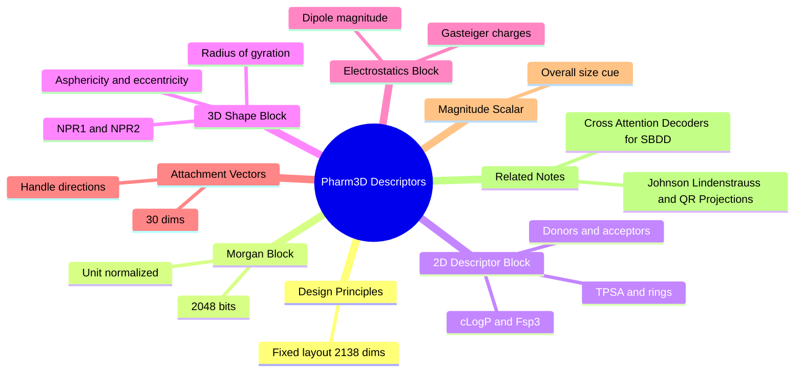

---
tags:
  - domain/cheminformatics
  - depth/essential
  - 3dsyntree
  - topic/molecular-descriptors
  - topic/pharmacophore
module: "06. Cheminformatics and Algorithms"
chapter: "Chapter 2. High Dimensional Descriptors and Retrieval"
type: concept
---

# 2. Pharm3D Pharmacophore Descriptors

> [!abstract] Core Idea
> **`pharm3d`** is a deterministic 2138-dimensional feature vector describing a synthon: a unit-normalized Morgan fingerprint (what chemistry it is), engineered 2D drug-likeness descriptors (how it behaves), 3D shape descriptors (how much space it fills), electrostatics (how its charge is distributed), attachment vectors (which way it can grow), and one magnitude scalar. It gives the policy pocket-relevant structure information without any neural backbone — plain CPU arithmetic, same answer every time.

Navigation: [[0. Cheminformatics and Algorithms MOC]] · [[0. Master Vault Index]]

## 1. What It Is

A **descriptor** is any number computable from a molecule's structure: a molecular weight, a ring count, a charge. A **pharmacophore** is the abstract set of interaction features — hydrogen-bond donors and acceptors, charges, aromatic rings, hydrophobic patches — that lets a molecule bind a biological target (the concept is developed in [[2. Pharmacophores and Interaction Hotspots]]). The **`pharm3d` descriptor** merges the two ideas into one fixed-layout vector: a compact, computable pharmacophore-style description of a single synthon (a purchasable building block — see [[1. Building Blocks and Synthons]] for what synthons are).

The vector concatenates six blocks — normalized fingerprint, 2D descriptors, 3D shape, electrostatics, directional attachment vectors, and a magnitude scalar — into the 2138-dimensional layout frozen inside the encoder. It is **deterministic**: no random seeds, no GPU nondeterminism, no trained networks in the pipeline; the same synthon always yields exactly the same vector.

## 2. Why It Exists

A pure 2D fingerprint such as [[2. Morgan Circular Fingerprints]] answers "what chemistry is this?" but is blind to shape, charge placement, and direction. A binding pocket, however, is a 3D object with 3D opinions: a hydrophobic tunnel, a charged floor, a corridor open only to the east. For the policy to pick synthons that *physically fit*, its synthon representations must speak the pocket's language — geometry and electrostatics — so the cross-attention decoder can match pocket context against synthon shape.

The alternative — running a heavy neural encoder over every catalog entry — would add a training dependency and GPU cost to what should be a one-time data preparation step. `pharm3d` buys 3D awareness with closed-form, CPU-side arithmetic: moments of inertia, partial-charge summations, centroid-to-handle directions. The result is then compressed by the distance-preserving projection covered next in this chapter into a 256-dimensional catalog embedding.

## 3. How It Works

### 3.1 Block 1 — unit-normalized Morgan fingerprint (2048 dims)

The ECFP4 (radius-2, 2048-bit) fingerprint of the previous notes, scaled to unit **Euclidean norm** (the vector divided by its own length, so its squared entries sum to 1). Normalization equalizes molecules by construction: a 40-atom synthon sets more bits than a 12-atom one, and without normalization the big molecules would dominate every dot product merely by being big. After normalization this block contributes the same total energy for every syntron, and *what* the bits say — the chemical identity — is all that remains. Absolute size information is deliberately re-injected later, once, in the magnitude scalar.

### 3.2 Block 2 — engineered 2D descriptors (47 dims)

Forty-seven hand-designed numbers summarizing constitution and drug-likeness, drawn from the standard descriptor toolbox:

- **1D descriptors** — whole-molecule counts and totals: atom counts by element (including halogen content, which influences both lipophilicity and metabolic liability) and molecular weight.
- **Topological polar surface area (TPSA)** — the summed tabulated surface contributions of the polar atoms (N, O, and their hydrogens), in $\text{Å}^2$. It approximates how much polar, hydrogen-bonding surface the molecule exposes; values beyond roughly 140 $\text{Å}^2$ bode poorly for passive membrane crossing.
- **Rotatable bond count** — flexible single, non-ring, non-terminal bonds (amide C–N excluded, being rotationally locked per [[2. Rotatable Bonds and Dihedral Angles]]). A proxy for entropic flexibility.
- **Ring descriptors** — total ring count and aromatic ring count; aromaticity drives flat, lipophilic stacking behavior.
- **cLogP** — the *computed* octanol–water partition coefficient, the standard lipophilicity gauge: how much the molecule prefers oily versus aqueous environments.
- **$Fsp^3$** — the fraction of $sp^3$-hybridized carbons among all carbons, i.e. the molecule's saturation index, central to [[2. Fsp3 Saturation and the Flat Grease Trap]]; 3D-SynTree filters its catalog at 0.42 and designs at a 0.40 floor.
- **Hydrogen-bond donor and acceptor counts (HBD/HBA)** — donors are O–H and N–H groups; acceptors are N and O atoms with free lone pairs. These are the classic Lipinski counting rules.

### 3.3 Block 3 — engineered 3D shape descriptors (6 dims)

Six numbers describing the synthon's conformer (built by the ETKDG embedder of [[2. Distance Geometry and ETKDG]]). First compute the three **principal moments of inertia** $I_1 \le I_2 \le I_3$ — the eigenvalues of the mass-distribution (inertia) tensor, i.e. the resistance to rotation about the three principal axes. Then:

- **Radius of gyration** $R_{\text{gyr}}$ — the mass-weighted root-mean-square distance of atoms from the molecule's centroid: $\sqrt{\sum_i m_i \|\mathbf{r}_i - \mathbf{r}_c\|^2 / \sum_i m_i}$. The single best "how big does it actually get" number.
- **Asphericity** — deviation from a perfect sphere; 0 for an ideally spherical mass distribution, larger as the shape flattens or elongates.
- **Eccentricity** — degree of one-axis dominance; 0 for a sphere, approaching 1 for a thin rod.
- **NPR1 and NPR2** — the **normalized principal moments**: $NPR1 = I_1/I_3$ and $NPR2 = I_2/I_3$, both in $(0, 1]$. Together they locate the molecule in the **triangular shape space**: a perfect sphere sits at $(1, 1)$, a prolate rod at $(0, 1)$, an oblate flat disc at $(0.5, 0.5)$, and every real molecule is a point inside this triangle (the constraint $NPR1 + NPR2 \ge 1$ forms its lower edge). Two numbers summarize the entire family of possible silhouettes.
- **Inertial shape factor** — a further single summary derived from the three moments, near 1 for spherical mass distributions and dropping as the shape stretches.

> [!example] Reading NPR in plain English
> A small round piperidine fragment lands near $(0.8, 0.9)$ — nearly spherical. A linear three-ring chain lands near $(0.2, 0.95)$ — rod-like: tiny $I_1$ (spin about its own axis almost freely), large $I_3$. A flat aromatic disc lands near $(0.5, 0.55)$ — oblate. A pocket wall that is a narrow slot *wants* thin prolate synthons; a flat hydrophobic patch *wants* oblate ones. NPR1/NPR2 give the policy exactly that vocabulary.

### 3.4 Block 4 — electrostatic features (5 dims)

Five numbers summarizing where charge sits. **Gasteiger partial charges** are computed by the partial-equalization-of-electronegativity method: atoms with higher electronegativity (from [[2. Chemical Bonds and Electronegativity]]) pull electron density from bonded partners, and the transfers are iterated a few rounds until the residual differences equilibrate. Each atom receives a fractional charge $q_i \in (-1, 1)$ — cheap, deterministic, and connectivity-only. The block summarizes the distribution of the $q_i$ across the molecule (center, spread, and extremes) plus the **dipole magnitude** — the length of the vector $\boldsymbol{\mu} = \sum_i q_i(\mathbf{r}_i - \mathbf{r}_c)$, measuring how strongly positive and negative charge are spatially separated. A large dipole means strong, directional electrostatic character — exactly what a salt-bridge-forming pocket site notices.

### 3.5 Block 5 — directional attachment vectors (30 dims)

The fingerprint knows *that* a synthon has an amine handle; it cannot say *where* the handle points. This block stores **mean unit vectors from the synthon's centroid to its reactive handles** — for each handle class, the average direction (normalized to length 1) in which that functional group sits on the molecule. The 30 slots accommodate the three Cartesian components per handle class across the ten handle classes; a handle the synthon does not carry simply contributes zeros. This is the block that makes growth directional: a pocket corridor open toward one side calls for synthons whose handles point that way, and the decoder can compare pocket context against these vectors directly.

### 3.6 Block 6 — overall magnitude scalar (1 dim)

One number carrying the synthon's absolute size. Because the Morgan block was unit-normalized and the directional vectors are unit-length, an unnormalized vector's "bigness" would otherwise vanish; this scalar restores scale as a single, explicit coordinate instead of letting it leak in unevenly.

> [!note] On the block sizes
> The headline dimensionality is 2138; the block sizes above are the design-level allocation, frozen exactly by the implementation. When reading code, trust the code's fixed layout — the encoder concatenates these blocks in a defined order so that every consumer indexes them identically.

### 3.7 The pipeline around the vector

`compute_pharm3d_descriptor()` evaluates the six blocks for one synthon (embedding a conformer, computing charges, taking moments — all on CPU, all deterministic). `encode_catalog_pharm3d()` runs this over all 50,000 catalog entries. `build_projection()` then applies the frozen QR-orthonormal map of [[1. Johnson Lindenstrauss and QR Projections]] to compress $2138 \to 256$ dimensions, and `scripts/build_synthon_catalog.py` persists the embedding catalog as `enamine_real_50k_pharm3d_d256.h5`. At training time these 256-dimensional vectors are what the synthon-selection machinery retrieves and compares against the pocket context produced by the cross-attention decoder.

## 4. What It Consists Of

| Block | Dims | Content | What it tells the policy |
| --- | --- | --- | --- |
| Normalized Morgan | 2048 | unit-norm ECFP4 bits | which chemistry the synthon is |
| 2D descriptors | 47 | counts, TPSA, rotatable bonds, rings, cLogP, $Fsp^3$, HBD/HBA | drug-likeness profile |
| 3D shape | 6 | $R_{\text{gyr}}$, asphericity, eccentricity, NPR1, NPR2, inertial shape factor | size and silhouette |
| Electrostatics | 5 | Gasteiger charge distribution + dipole magnitude | charge placement and strength |
| Attachment vectors | 30 | centroid-to-handle unit directions | which way it can grow |
| Magnitude scalar | 1 | overall size | absolute scale |

Plus the surrounding machinery: ETKDG conformer generation, Gasteiger charge iteration, and the 256-dim projection that ships the vector to the models.

## 5. What You Must Understand

> [!warning] The 3D blocks inherit the conformer's opinion
> $R_{\text{gyr}}$, NPRs, and dipole are computed on *one* embedded conformer, not on an ensemble. A flexible synthon's shape numbers describe that geometry, not all geometries it could adopt — the descriptor is 3D-aware, not 3D-exhaustive.

> [!warning] Gasteiger charges are crude — deliberately
> They are empirical topological estimates, not quantum-mechanical truth. Their virtue is determinism and speed; do not interpret absolute values, only relative patterns across synthons computed the same way.

> [!tip] Memory hooks
> Six blocks, one sentence each: "what it is" (Morgan), "how it behaves" (2D), "how much space it fills" (shape), "where its charge sits" (electrostatics), "which way it grows" (attachment vectors), "how big overall" (magnitude). NPR triangle corners: sphere, rod, disc.

> [!note] Determinism is a feature, not an accident
> Every block is closed-form arithmetic — no sampling, no seeds. Catalog embeddings built in different months, on different machines, agree bit-for-bit, which keeps trajectory datasets reproducible.

## 6. Prerequisites

- [[2. Chemical Bonds and Electronegativity]] — why partial charges exist at all: unequal electron sharing between atoms of different electronegativity.
- [[2. Distance Geometry and ETKDG]] — supplies the 3D conformer on which the shape and dipole blocks are computed.
- [[1. Johnson Lindenstrauss and QR Projections]] — what happens to the finished 2138-dim vector before any model sees it.

## 7. Project Connection

This note *is* a project artifact: `compute_pharm3d_descriptor()` and `encode_catalog_pharm3d()` in `syntree/chemistry/synthon_encoder.py` implement the six blocks, with Gasteiger charges via `rdPartialCharges.ComputeGasteigerCharges`; `build_projection()` compresses the result to 256 dims, and `scripts/build_synthon_catalog.py` writes `enamine_real_50k_pharm3d_d256.h5` for the 50,000-synthon Enamine REAL catalog. The $Fsp^3$ descriptor inside block 2 mirrors the catalog's own saturation filter (`min_fsp3 = 0.42` with `FractionCSP3` in `syntree/chemistry/catalog.py`), so the descriptor and the catalog rules speak the same units. Downstream, the projected embeddings are the synthon-side representation that the pocket-conditioned policy compares against its cross-attention pocket context when choosing the next building block.

## 8. Required Depth

**Essential** — this descriptor is the synthon representation the whole retrieval and selection stack consumes; understanding its six blocks (and their blind spots) is required to reason about what the policy can and cannot perceive.

## 9. Further Dependencies

- [[3. Cross Attention Decoders for SBDD]] — the decoder that matches pocket context vectors against these synthon embeddings.

## Concept Mind Map

## Cross-Domain Links

- [[AI/03. Attention Mechanisms and Transformer Decoders/Chapter 1. Attention Formulations/1. Scaled Dot-Product Attention as Soft Dictionary Lookup|1. Scaled Dot-Product Attention as Soft Dictionary Lookup]] (AI vault) — queries and keys match pre-embedded synthon descriptors the way attention matches pharmacophore queries against pocket keys.
- [[AI/02. Representation Learning and Latent Metric Spaces/Chapter 2. Dimensionality Reduction and Random Projections/2. QR Decomposition and Orthonormal Projection Operators|2. QR Decomposition and Orthonormal Projection Operators]] (AI vault) — `pharm3d` descriptors are compressed via QR-based random projection with $\sqrt{D/d}$ scaling.
