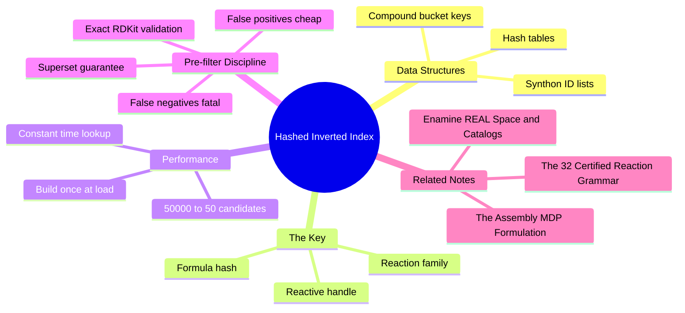

---
tags:
  - domain/cheminformatics
  - depth/supporting
  - 3dsyntree
  - topic/fast-retrieval
  - topic/hash-indexes
module: "06. Cheminformatics and Algorithms"
chapter: "Chapter 2. High Dimensional Descriptors and Retrieval"
type: concept
---

# 3. Hashed Inverted Indices for Synthon Retrieval

> [!abstract] Core Idea
> Instead of scanning all 50,000 catalog synthons every time a molecule needs a reaction partner, precompute a **hash table** that maps each (reaction family, reactive handle, formula hash) combination directly to the handful of synthons that satisfy it — a $50{,}000 \to \sim50$ candidate reduction. The index is a **pre-filter**: every candidate it returns still has to survive exact chemical validation.

Navigation: [[0. Cheminformatics and Algorithms MOC]] · [[0. Master Vault Index]]

## 1. What It Is

A **hash table** is the classic key-to-slot data structure: a **hash function** converts a key into an array index in constant time, and each slot (a **bucket**) stores the values filed under that key. An **inverted index** is the same idea with information-retrieval semantics: instead of asking every record "do you match?", you look up the matching records' identifiers directly — like a book's index page, which lists the pages containing a term instead of making you read every page.

Here the records are the 50,000 purchasable synthons of [[3. Enamine REAL Space and Catalogs]], and the key is a **compound (tuple) key**:

$$
\text{key} = \big(\text{Reaction\_Family},\ \text{Reactive\_Handle},\ \text{Molecular\_Formula\_Hash}\big)
$$

Each bucket holds the IDs of the catalog synthons that share that reaction family, that reactive handle class, and that exact molecular formula. One lookup replaces a full catalog scan.

## 2. Why It Exists

Trajectory extraction — replaying molecular assembly histories to build the training dataset — asks, at every step of every trajectory: "given the molecule so far and the reaction chosen, which catalog synthons are viable partners?" The blunt answer is to test all 50,000 synthons, one by one, with genuine RDKit reaction execution (substructure matching, graph edits, sanitization). Each such test is cheap in isolation but punishing in aggregate: tens of thousands of queries, each multiplied by 50,000 candidates, makes dataset construction a computational bottleneck — days of CPU time spent re-discovering that most synthons were never compatible in the first place.

The fix is to notice that *compatibility is mostly knowable in advance*. Whether a synthon can serve a given reaction family is determined by its reactive handle (an amine, a boronic acid, a carboxylic acid — the handle classes of [[1. Building Blocks and Synthons]]); and the exact molecular formula cuts the remaining pool to a few dozen. That information never changes for a fixed catalog, so it can be computed **once, at catalog load**, and turned into a lookup table — a hashed inverted index, introduced by the project's data-pipeline work (Issue #41, `[DATA-06]`).

## 3. How It Works

### 3.1 Building the index — one pass over the catalog

When the catalog loads, every synthon is processed once:

1. **Handle detection.** SMARTS patterns (the `HANDLE_SMARTS` set covering the ten handle classes, as introduced in [[3. Reaction SMARTS and Isotope Provenance]]) are matched against the synthon's graph; every reactive handle it carries is recorded.
2. **Family membership.** The certified reaction templates (`REACTION_TEMPLATES` with `REACTION_FAMILY_MEMBERS`) determine which of the ~9 reaction families each handle can serve.
3. **Formula hashing.** The molecular formula string (the element-and-count summary, e.g. $\text{C}_8\text{H}_{11}\text{N}\text{O}_2$) is hashed to a fixed-size integer.
4. **Filing.** For every (family, handle, formula-hash) combination the synthon satisfies, its ID is appended to that bucket. A bifunctional synthon (one end an amine, the other a boronic acid) lands in several buckets.

The build is a single linear pass — 50,000 SMARTS-match operations — after which every query for the catalog's lifetime is nearly free.

### 3.2 Querying — the compound key in action

> [!example] One query, start to finish
> During trajectory extraction, the replay reaches a state whose molecule exposes a primary amine handle, and the recorded action chose **amide coupling** as the family. The extractor needs synthons that can play the *acid partner* in that family, of a specific required composition.
>
> - Naive scan: run exact reaction chemistry against all 50,000 catalog entries.
> - Indexed: assemble the key (amide-coupling family, carboxylic-acid handle class, formula hash), hash it, jump straight to the bucket. It contains $\sim50$ synthon IDs — the only catalog entries with that handle class and that exact formula, in that family.
>
> Work done: one hash computation plus 50 validations instead of 50,000. That is the $50{,}000 \to \sim50$ reduction — three orders of magnitude, per query, multiplied across every step of every trajectory.

### 3.3 Pre-filter versus exact validation — the division of labor

The index and the chemistry engine answer different questions:

| Stage | Question answered | Cost | Error tolerance |
| --- | --- | --- | --- |
| Hashed inverted index | *Could* this synthon match? (necessary conditions: family, handle, formula) | microseconds per query | must over-include |
| Exact RDKit validation | *Does* it actually react, producing a valid product? | milliseconds per candidate | the sole judge |

The index is a **pre-filter, never a replacement for validation**. Every candidate returned by the index must still pass exact chemical reaction execution — the certified `apply_reaction()` machinery running the true reaction template in RDKit, with product sanitization. The design asymmetry matters:

- A **false positive** (an index candidate that fails real chemistry) is harmless — validation rejects it, costing only a few wasted milliseconds.
- A **false negative** (a genuinely viable synthon that the index never surfaces) is silent data loss — a real synthesis route that the extracted trajectories will never contain, biasing the training set without any error message.

Therefore bucket keys are deliberately built from *coarse, conservative, purely necessary* conditions. Anything stricter — pre-filtering on predicted reactivity, for instance — would trade unnoticeable speed for invisible bias.

### 3.4 The cost model

Let $N = 50{,}000$ and let $b \approx 50$ be the typical bucket size. Naive scanning costs $O(N)$ full chemistry checks per query; the index costs $O(1)$ to locate the bucket plus $O(b)$ exact validations — with the hash lookup independent of catalog size entirely. Amortized over thousands of queries, the index build cost vanishes and total work shrinks by roughly $N/b \approx 1000\times$. This is what makes large-scale trajectory extraction (`scripts/build_trajectories.py`) tractable on ordinary hardware instead of a cluster.

## 4. What It Consists Of

- **Hash function** — converts the compound key tuple into a bucket index in constant time.
- **Hash table** — the array of buckets backing the index.
- **Compound key** — (reaction family, reactive handle, molecular formula hash), the three-part lookup key.
- **Buckets** — lists of synthon IDs sharing a key; one synthon may occupy several.
- **Candidate pre-filtering** — the index's only job: produce a small *superset* of viable synthons.
- **Exact validation checks** — the RDKit reaction execution stage that alone decides real viability.
- **Catalog-load build step** — the one-time pass that populates the table.

## 5. What You Must Understand

> [!warning] The index is a pre-filter, not an oracle
> Retrieval success is not reaction success. Any pipeline change that trusts index hits without running `apply_reaction()`-style exact validation will admit nonexistent chemistry into the training data.

> [!warning] Index and catalog must age together
> The buckets are frozen facts about one catalog version. Swap in a new or filtered catalog (different synthon set, different handle definitions) without rebuilding the index, and buckets will point at missing or wrong synthons — false negatives by construction.

> [!tip] Memory hooks
> Book index, not book reading: jump to the page list, then actually read the pages. Key = family + handle + formula hash = "who *could* dance, wearing *this* badge, weighing *exactly* this." False positives cost time; false negatives cost truth — so over-include.

## 6. Prerequisites

- [[2. The 32 Certified Reaction Grammar]] — the reaction families and templates that define the first key component.
- [[3. Enamine REAL Space and Catalogs]] — what the 50,000-synthon catalog is and why it is scanned so often.

## 7. Project Connection

The index is specified by Issue #41 `[DATA-06]` and exists to accelerate trajectory extraction in `scripts/build_trajectories.py`, which replays assembly histories step by step and, at every step, must enumerate viable synthon partners. Key components come straight from the chemistry layer: `REACTION_TEMPLATES` and `REACTION_FAMILY_MEMBERS` supply the family axis, `HANDLE_SMARTS` the handle axis, and the catalog's stored formula the hash axis; final judgment always returns to exact reaction execution via `apply_reaction()`. The same catalog is separately embedded into 256-dimensional vectors by the `pharm3d` pipeline of [[2. Pharm3D Pharmacophore Descriptors]] — the index answers "what can react," the embeddings answer "what fits the pocket," and the retrieval stack needs both.

## 8. Required Depth

**Supporting** — the data-structure idea (compound keys, buckets, superset pre-filtering) must be understood; the engineering details of the hash function are incidental.

## 9. Further Dependencies

- [[1. The Assembly MDP Formulation]] — the step-by-step assembly process whose trajectory dataset this index makes affordable to build.

## Concept Mind Map

