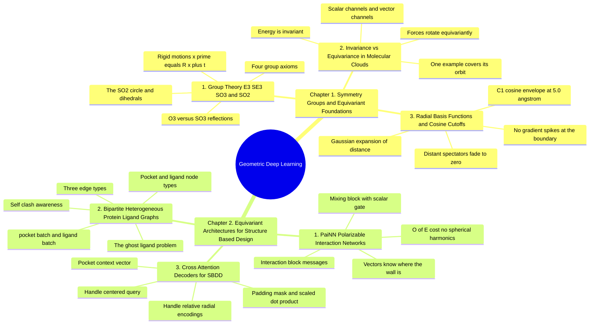

---
tags:
  - moc
  - domain/geometric-deep-learning
  - 3dsyntree
module: "07. Geometric Deep Learning and Equivariance"
type: moc
---

# 0. Geometric Deep Learning and Equivariance MOC

> [!abstract] Module Mission
> This module builds the geometric encoder at the heart of 3D-SynTree: first the mathematics of symmetry groups and the invariance/equivariance contracts that a physically honest network must satisfy, then the two architectural pillars that fulfill them — PaiNN-style scalar/vector message passing and the bipartite protein-ligand graph — and finally the cross-attention decoder that compresses a variable-sized 3D pocket into the single context vector that conditions every policy head.

Navigation: [[0. Master Vault Index]] · [[2. Prerequisite Knowledge Graph]] · [[3. Study Tracks and Curriculum]]

## Module Mind Map

## Chapter 1. Symmetry Groups and Equivariant Foundations

| Note | Focus | Required Depth | Key Prerequisites |
| --- | --- | --- | --- |
| [[1. Group Theory E3 SE3 SO3 and SO2]] | The four group axioms; the ladder O(3) → SO(3) → E(3) → SE(3) and the circle SO(2); why a protein-ligand complex is orientation-independent and why conventional networks break that symmetry | Essential | Linear algebra — self-contained; see [[4. The Kabsch Algorithm and Rigid Alignment]] for rotation matrices in action |
| [[2. Invariance vs Equivariance in Molecular Clouds]] | The two contracts $f(g\cdot\mathbf{x}) = f(\mathbf{x})$ and $f(g\cdot\mathbf{x}) = g\cdot f(\mathbf{x})$; scalar vs vector channels ($\mathbf{v}' = \mathbf{R}\mathbf{v}$); the sample-efficiency argument | Essential | [[1. Group Theory E3 SE3 SO3 and SO2]] |
| [[3. Radial Basis Functions and Cosine Cutoffs]] | The Gaussian expansion $\phi_k(d)$, the $C^1$-continuous cosine cutoff with $r_{\text{cut}} = 5.0\text{ Å}$, and why smooth cutoffs prevent gradient spikes at the interaction boundary | Essential | Calculus — self-contained; shapes come from [[1. Lennard Jones and Soft Core Potentials]] |

## Chapter 2. Equivariant Architectures for Structure Based Design

| Note | Focus | Required Depth | Key Prerequisites |
| --- | --- | --- | --- |
| [[1. PaiNN Polarizable Interaction Networks]] | Per-atom scalar and vector channels; the interaction block (including the unit-displacement message) and the scalar-gated mixing block; $O(E)$ cost versus spherical-harmonics networks | Essential | [[2. Invariance vs Equivariance in Molecular Clouds]] · [[3. Radial Basis Functions and Cosine Cutoffs]] |
| [[2. Bipartite Heterogeneous Protein Ligand Graphs]] | The ghost ligand problem and its fix: the unified node set $\mathcal{V}_{\text{pocket}} \cup \mathcal{V}_{\text{ligand}}$, node-type embeddings, three edge types, and sub-graph batching | Essential | [[1. Binding Pockets and Cavity Extraction]] · [[1. PaiNN Polarizable Interaction Networks]] |
| [[3. Cross Attention Decoders for SBDD]] | Multi-head cross-attention with a handle query, handle-relative radial key encodings, the masked scaled dot-product formula, pre-LayerNorm residual blocks, and the pocket context vector | Essential | [[2. Pharm3D Pharmacophore Descriptors]] · [[2. Bipartite Heterogeneous Protein Ligand Graphs]] |

## Learning Path Through This Module

1. [[1. Group Theory E3 SE3 SO3 and SO2]] — learn the vocabulary: what a group is, which family each symbol names, and the hard physical fact (orientation-independence) that everything downstream enforces.
2. [[2. Invariance vs Equivariance in Molecular Clouds]] — turn the groups into contracts on functions: scalars stay fixed, vectors co-rotate; meet the scalar/vector channel split used by every architecture that follows.
3. [[3. Radial Basis Functions and Cosine Cutoffs]] — the two small numeric tools (Gaussian ruler + smooth fade) that every message-passing layer uses to consume distances safely.
4. [[1. PaiNN Polarizable Interaction Networks]] — the equivariant engine itself: interaction and mixing blocks over scalar/vector channels, at $O(E)$ cost.
5. [[2. Bipartite Heterogeneous Protein Ligand Graphs]] — specialize the engine to structure-based design: protein plus growing ligand in one typed graph, fixing the ghost ligand problem.
6. [[3. Cross Attention Decoders for SBDD]] — compress the encoded environment into the handle-conditioned pocket context vector that all policy heads consume.

## Why This Module Matters for 3D-SynTree

Between the pocket (Module 04) and the decision-making policy (Modules 08–09) sits a single question: *how should a neural network look at a 3D protein-ligand environment?* This module is the answer. The system's encoder, `BipartitePaiNN`, is a heterogeneous protein-plus-ligand graph network with invariant scalar and equivariant vector features, built from PaiNN interaction and mixing blocks with a 5.0 Å radial basis cutoff; the decoder then uses cross-attention from the active handle to distill that variable-sized graph into one pocket context vector that conditions the reaction, synthon, chirality, and torsion heads. Equivariance is not an aesthetic choice here: with roughly 20,000 training complexes, the model cannot afford to spend data learning that rotating a pocket changes nothing — the symmetry is built into the algebra so every example covers its entire orbit of orientations. And because a GFlowNet calls the encoder at every assembly step, the $O(E)$ cost of the scalar/vector design over higher-order tensor networks is what makes training the full loop feasible at all. For the system-level placement of this pipeline, see [[1. 3D-SynTree System Overview]].

## Gate Check

> [!question] Before moving on, can you...
> - State the four group axioms, and explain why $\mathrm{SE}(3)$ excludes reflections while $\mathrm{E}(3)$ includes them — and why that distinction matters for chiral molecules?
> - Give the defining equations of invariance and equivariance, with one molecular example of each (energy vs forces), and say why a network that gets energy right but forces wrong cannot be self-consistent?
> - Explain what $C^1$-continuity buys at the $5.0\text{ Å}$ cutoff boundary, and what specifically goes wrong with a hard cutoff when an atom drifts across it?
> - Walk through PaiNN's interaction block: the three message types, why the unit displacement vector is the only legitimate source of new directions, and what the mixing block's scalar gate does?
> - Describe the ghost ligand problem, and how the unified node set, node-type embeddings, and three edge types let the network see self-clashes and total ligand volume?
> - Decompose the cross-attention formula term by term — the role of $\sqrt{d_k}$, the padding mask, and the handle-relative radial encodings that focus attention on the local sub-cavity?

## Primary Reading

Schütt, K. T., Unke, O. T., & Gastegger, M. (2021). *Equivariant Message Passing for the Prediction of Tensorial Properties and Molecular Spectra*. **ICML 2021**, PMLR 139:9377–9388.
