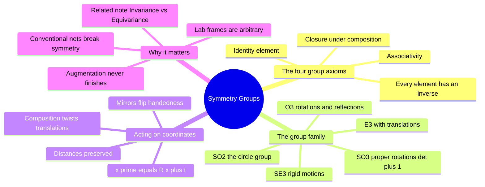

---
tags:
  - domain/geometric-deep-learning
  - depth/essential
  - 3dsyntree
  - topic/symmetry
  - topic/linear-algebra
module: "07. Geometric Deep Learning and Equivariance"
chapter: "Chapter 1. Symmetry Groups and Equivariant Foundations"
type: concept
---

# 1. Group Theory E3 SE3 SO3 and SO2

> [!abstract] Core Idea
> A **group** is a family of transformations that can be chained, undone, and combined without ever leaving the family. The groups $\mathrm{O}(3)$, $\mathrm{SO}(3)$, $\mathrm{E}(3)$, $\mathrm{SE}(3)$, and $\mathrm{SO}(2)$ catalog every legal way a 3D object can be rotated, reflected, and moved. They give us the exact language for stating a physical fact that a drug-design model must respect: a protein-ligand complex is the *same system* no matter where it sits or how it is oriented in space.

Navigation: [[0. Geometric Deep Learning and Equivariance MOC]] · [[0. Master Vault Index]]

## 1. What It Is

A **group** is a set $G$ of objects together with a composition operation $\circ$ that combines two of them into a third, satisfying four axioms:

1. **Closure**: combining two elements stays in the family — if $g, h \in G$ then $g \circ h \in G$.
2. **Associativity**: the grouping of a chain does not matter — $(g \circ h) \circ k = g \circ (h \circ k)$.
3. **Identity**: there is a do-nothing element $e$ with $e \circ g = g \circ e = g$.
4. **Inverse**: every element can be undone — for each $g$ there is a $g^{-1}$ with $g \circ g^{-1} = e$.

This module's cast of characters, from largest idea to smallest:

| Group | Name | What its elements are |
| --- | --- | --- |
| $\mathrm{O}(3)$ | Orthogonal group | All $3\times 3$ matrices $\mathbf{R}$ with $\mathbf{R}^T\mathbf{R} = \mathbf{I}$ — rotations **and** reflections about the origin |
| $\mathrm{SO}(3)$ | Special orthogonal group | The $\mathrm{O}(3)$ matrices with $\det(\mathbf{R}) = +1$ — **proper rotations only** |
| $\mathrm{E}(3)$ | Euclidean group | Rotations, reflections, **and translations** — $\mathbf{x}' = \mathbf{R}\mathbf{x} + \mathbf{t}$ |
| $\mathrm{SE}(3)$ | Special Euclidean group | Rigid motions: proper rotations **plus** translations — distances and handedness preserved |
| $\mathrm{SO}(2)$ | Planar rotation group | Rotations within a single plane — topologically the circle $S^1$ |

A matrix is **orthogonal** when its columns are unit vectors at right angles to each other; such matrices preserve all lengths and angles. The **determinant** measures the signed volume change a matrix causes: orthogonal matrices only ever give $\det = \pm 1$, with $-1$ flagging a mirror flip. A **Lie group** is a group whose elements additionally form a smooth continuous space — rotations are parameterized by continuous angles, not a discrete list, which is what lets us differentiate through them.

## 2. Why It Exists

When crystallographers solve a protein structure (see [[3. X-Ray Crystallography and PDB Artifacts]]), the atom coordinates they report are written in an arbitrary **laboratory frame**: an origin and axis direction chosen by the diffractometer and the crystal's accidental orientation in the beam. Physics, however, does not know about the lab. Hydrogen bonds, steric clashes, and binding free energies depend only on *relative* geometry — distances and angles *between* atoms — never on where the whole complex happens to float.

So there is a strict logical hierarchy for any model of a complex:

- If it is a valid physical predictor, its answers must be **unchanged by any rigid motion** of the input coordinates — any element of $\mathrm{SE}(3)$.
- A model whose output *does* change when you rotate the input is not modeling the complex; it is modeling an accident of the coordinate system.

Conventional neural networks fail this test by construction (Section 3.5). Group theory exists here as the diagnostic tool: it names the symmetries precisely so we can build architectures that provably respect them.

## 3. How It Works

### 3.1 The four axioms, checked on rotations

Take $G = \mathrm{SO}(3)$ with $\circ$ = matrix multiplication.

- **Closure**: two rotations compose to a rotation — $\mathbf{R}_2\mathbf{R}_1$ is still orthogonal with $\det = +1$ (determinants multiply: $1 \times 1 = 1$).
- **Associativity**: matrix multiplication is associative, so chains of rotations need no parentheses.
- **Identity**: the do-nothing element is $\mathbf{I}$, the identity matrix.
- **Inverse**: the inverse of a rotation is its transpose, $\mathbf{R}^{-1} = \mathbf{R}^T$, because $\mathbf{R}^T\mathbf{R} = \mathbf{I}$. Rotating by $-30^\circ$ undoes rotating by $+30^\circ$.

> [!example] A tiny rotation, worked out
> Rotate the point $\mathbf{x} = (1, 0, 0)$ by $90^\circ$ about the $z$-axis. The rotation matrix is
> $$\mathbf{R} = \begin{pmatrix} 0 & -1 & 0 \\ 1 & 0 & 0 \\ 0 & 0 & 1 \end{pmatrix}, \qquad \mathbf{R}\mathbf{x} = \begin{pmatrix} 0 \\ 1 \\ 0 \end{pmatrix}.$$
> The point lands on the $y$-axis. Check the axioms live: $\det(\mathbf{R}) = +1$ (proper rotation), and $\mathbf{R}^T\mathbf{R} = \mathbf{I}$ (undoing is just the transpose).

### 3.2 O(3) versus SO(3): the reflection line

$\mathrm{O}(3)$ contains both $\det = +1$ rotations and $\det = -1$ **improper** transformations such as
$$\mathbf{M} = \begin{pmatrix} 1 & 0 & 0 \\ 0 & 1 & 0 \\ 0 & 0 & -1 \end{pmatrix},$$
which mirrors the world through the $xy$-plane. A mirror preserves distances but flips **handedness** — a right hand becomes a left hand, and in chemistry a molecule becomes its enantiomer, a genuinely *different* substance (the disaster story of [[1. Stereochemistry Chirality and CIP Rules]]). $\mathrm{SO}(3)$ is the subgroup with $\det = +1$ exactly: the "S" stands for *special*, the standing convention for det $= +1$. Since a chiral drug and its mirror image bind differently, equivariant molecular models are built for $\mathrm{SE}(3)$ — proper rigid motions — not the full $\mathrm{E}(3)$ that includes mirrors.

### 3.3 E(3) and SE(3): adding translations

Rotations about the origin are not enough, because nothing pins a molecule to the origin. An element of the **Euclidean group** is a pair $(\mathbf{R}, \mathbf{t})$ acting on a coordinate vector by
$$\mathbf{x}' = \mathbf{R}\mathbf{x} + \mathbf{t}, \qquad \mathbf{R} \in \mathrm{O}(3),\ \mathbf{t} \in \mathbb{R}^3.$$
Restricting to $\mathbf{R} \in \mathrm{SO}(3)$ gives the **special Euclidean group** $\mathrm{SE}(3)$ — the **rigid motions**. Composing two of them shows why closure is a real property and not a formality:
$$(\mathbf{R}_2, \mathbf{t}_2) \circ (\mathbf{R}_1, \mathbf{t}_1) \;=\; \big(\mathbf{R}_2\mathbf{R}_1,\ \mathbf{R}_2\mathbf{t}_1 + \mathbf{t}_2\big),$$
a rotation-translation pair again. Note the asymmetry: the *second* rotation reaches inside and twists the first translation, but translations never touch rotations. Rigid motions preserve every pairwise distance:
$$\|\mathbf{x}' - \mathbf{y}'\| = \|\mathbf{R}(\mathbf{x} - \mathbf{y})\| = \|\mathbf{x} - \mathbf{y}\|,$$
because orthogonal matrices never stretch space. This is exactly the class of motions used to superimpose two conformers — see [[4. The Kabsch Algorithm and Rigid Alignment]].

### 3.4 SO(2): the circle group

$\mathrm{SO}(2)$ is the group of rotations **within one plane**, each element a $2\times 2$ matrix
$$\mathbf{R}(\theta) = \begin{pmatrix} \cos\theta & -\sin\theta \\ \sin\theta & \cos\theta \end{pmatrix},$$
with a single parameter $\theta$. As a *space*, the set of these rotations is a circle: $\theta = 0^\circ$ and $\theta = 360^\circ$ are the same element, and walking far enough in either direction brings you home. This wrapping is the defining headache of **dihedral angles** — the torsion variable of [[2. Rotatable Bonds and Dihedral Angles]] lives on this circle, which is why averaging torsions naively fails ($-175^\circ$ and $+175^\circ$ are neighbors, not opposites) and why a whole module of this vault (Module 08) is spent on statistics that respect the circle.

### 3.5 Why conventional networks break the symmetry

A standard neural network's first hidden unit computes $\mathbf{w}\cdot\mathbf{x} + b$ — a weighted sum of the raw coordinate entries. Rotate the input cloud by $\mathbf{R}$ and the same unit computes $\mathbf{w}\cdot(\mathbf{R}\mathbf{x}) + b$, a *different number*, which propagates through every later layer and (generally) changes the output. Nothing in the training procedure forbids this; the network happily spends capacity learning the orientation of each training example instead of the chemistry.

The brute-force patch is **data augmentation**: duplicate every complex under random rotations and translations. But $\mathrm{SE}(3)$ is a three-parameter continuous family — there are infinitely many orientations — so augmentation only ever samples it, and the network's equivariance remains approximate and paid for in data. **Geometric deep learning** instead constructs each layer so its outputs transform *by design* in a controlled way under these groups. That is the subject of [[2. Invariance vs Equivariance in Molecular Clouds]].

## 4. What It Consists Of

- **Rotation matrix** $\mathbf{R} \in \mathrm{SO}(3)$ — an orthogonal, determinant-$+1$ $3\times 3$ matrix; three continuous parameters (e.g., three angles) describe it.
- **Translation vector** $\mathbf{t} \in \mathbb{R}^3$ — an offset added after rotating; three more parameters.
- **Determinant** — the $+1$/$-1$ signature separating rotations from reflections.
- **Composition law** — how two group elements chain into one; for $\mathrm{SE}(3)$, $(\mathbf{R}_2\mathbf{R}_1,\ \mathbf{R}_2\mathbf{t}_1 + \mathbf{t}_2)$.
- **Lie group** — a group whose elements form a smooth continuous space, so calculus (gradients!) applies to its parameters.
- **Group action** — a group element applied to data: here $\mathbf{x} \mapsto \mathbf{R}\mathbf{x} + \mathbf{t}$ on each atom coordinate.

## 5. What You Must Understand

> [!warning] SO(3) is not O(3)
> The most common slip: treating "rotation" and "orthogonal transformation" as synonyms. $\mathrm{O}(3)$ and $\mathrm{E}(3)$ contain mirror reflections; $\mathrm{SO}(3)$ and $\mathrm{SE}(3)$ do not. A network equivariant to $\mathrm{SE}(3)$ will still *distinguish* a molecule from its mirror image — which is correct, because enantiomers are different molecules.

> [!tip] Decoding the names
> Read them right to left: **O** = orthogonal matrices, **S** = special ($\det = +1$), **E** = Euclidean (translations admitted), and the trailing number is the dimension. So $\mathrm{SE}(3)$ = "the special (det $+1$), Euclidean (with translations) group in 3D."

> [!note] Order matters
> Group composition is associative but not commutative: rotating then translating differs from translating then rotating. $\mathrm{SO}(2)$ happens to be commutative ($\mathbf{R}(\theta)\mathbf{R}(\phi) = \mathbf{R}(\phi)\mathbf{R}(\theta)$); $\mathrm{SO}(3)$ is not. This matters whenever you compose a pipeline of transforms on coordinates.

> [!warning] The circle has no edge
> On $\mathrm{SO}(2)$, values such as $355^\circ$ and $-5^\circ$ are the same point. Any loss or average that treats angles as ordinary numbers on the line ($-5 < 355$) is geometrically wrong.

## 6. Prerequisites

- Linear algebra — matrix multiplication, matrix inversion, determinants, and orthogonal matrices. This note is otherwise self-contained; the closest vault treatment of rotation matrices in action is [[4. The Kabsch Algorithm and Rigid Alignment]].

## 7. Project Connection

3D-SynTree's geometric encoder, `BipartitePaiNN` in `syntree/models/bipartite.py`, is built so that its outputs transform correctly under $\mathrm{SE}(3)$: rotate and translate the whole protein-ligand complex and the scalar outputs stay fixed while the vector outputs rotate identically. The torsion prediction problem lives on $\mathrm{SO}(2)$: the junction dihedral is a single circular angle, and the policy's torsion action space discretizes that circle into 36 bins of $10^\circ$ each, with a continuous refinement head whose circular statistics are handled in Module 08.

## 8. Required Depth

**Essential** — every later note in this module (equivariance, radial bases, PaiNN, the bipartite graph, the cross-attention decoder) is phrased in the vocabulary this note establishes.

## 9. Further Dependencies

- [[2. Invariance vs Equivariance in Molecular Clouds]] — defines precisely how functions and neural layers should behave under these groups.
- [[1. Statistics on Riemannian Manifolds SO2]] — the statistics built on the $\mathrm{SO}(2)$ circle when the torsion head must average and regularize angles.

## Concept Mind Map

## Cross-Domain Links

- [[AI/05. Geometric Deep Learning and Lie Groups/Chapter 1. Continuous Symmetry Groups/1. Group Theory Axioms and Matrix Lie Groups|1. Group Theory Axioms and Matrix Lie Groups]] (AI vault) — the symmetry groups of physical space, here formalized axiomatically as matrix Lie groups.
