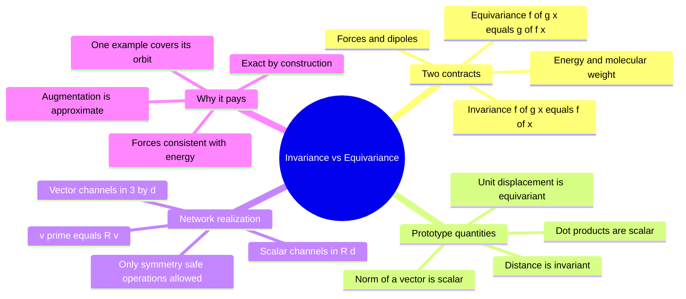

---
tags:
  - domain/geometric-deep-learning
  - depth/essential
  - 3dsyntree
  - topic/equivariance
  - topic/representations
module: "07. Geometric Deep Learning and Equivariance"
chapter: "Chapter 1. Symmetry Groups and Equivariant Foundations"
type: concept
---

# 2. Invariance vs Equivariance in Molecular Clouds

> [!abstract] Core Idea
> When you rotate a molecule, some quantities must stay **fixed** (invariance — the energy, the molecular weight) and others must **rotate along with it** (equivariance — forces, dipole moments, "which way to grow" vectors). A symmetry-aware network splits every atom's representation into **scalar channels** that are invariant and **vector channels** that are equivariant, getting physical consistency and sample efficiency for free instead of learning them from mountains of rotated training data.

Navigation: [[0. Geometric Deep Learning and Equivariance MOC]] · [[0. Master Vault Index]]

## 1. What It Is

A **molecular point cloud** is the set of atom positions $\mathbf{X} = \{\mathbf{x}_1, \dots, \mathbf{x}_N\}$ with each $\mathbf{x}_i \in \mathbb{R}^3$ (plus, usually, atom identities). A **group action** applies a transformation $g$ from a group like $\mathrm{SE}(3)$ to every point: for $g = (\mathbf{R}, \mathbf{t})$,
$$g \cdot \mathbf{X} = \{\mathbf{R}\mathbf{x}_1 + \mathbf{t},\ \dots,\ \mathbf{R}\mathbf{x}_N + \mathbf{t}\}.$$

A function $f$ is **invariant** under the group if transforming the input does not change the output at all:
$$f(g \cdot \mathbf{x}) = f(\mathbf{x}) \qquad \text{for every } g \in G.$$
Invariance is the right contract for *scalar physical quantities*: binding energy, molecular weight, clash count, docking score, or the probability that a reaction succeeds. None of these should notice a rotation of the whole complex — a hydrogen bond of given length and geometry contributes the same stabilization whether the complex sits "upright" or "upside down" in the coordinate system (see [[1. Protein Ligand Binding Thermodynamics]]).

A function $f$ is **equivariant** under the group if transforming the input transforms the output *by the same group element*:
$$f(g \cdot \mathbf{x}) = g \cdot f(\mathbf{x}) \qquad \text{for every } g \in G.$$
Equivariance is the right contract for *directional quantities*: atomic forces, electric dipoles, or the vector pointing from a growing ligand toward the nearest pocket wall. Rotate the protein pocket by $\mathbf{R}$ and the predicted directional attachment vectors must rotate by *exactly* $\mathbf{R}$ — same length, same relative direction, no exceptions.

Invariance is the special case of equivariance where the group acts trivially on the output ($g \cdot f = f$).

## 2. Why It Exists

Two forces drive the design.

**Physical consistency.** Consider a network that predicts both an energy $E(\mathbf{X})$ and per-atom forces $\mathbf{F}_i(\mathbf{X})$. Physics demands $\mathbf{F}_i = -\nabla_{\mathbf{x}_i} E$ — forces are the gradient of the energy (the same relation underlying [[1. Lennard Jones and Soft Core Potentials]]). Now rotate the cloud: if $E$ is invariant, then differentiating $E(\mathbf{R}\mathbf{X}) = E(\mathbf{X})$ by the chain rule forces $\mathbf{F}_i(\mathbf{R}\mathbf{X}) = \mathbf{R}\,\mathbf{F}_i(\mathbf{X})$ — the forces *must* be equivariant. A network that treats energy and forces with mismatched symmetry cannot even be self-consistent: it will predict energies that imply one set of forces while outputting another.

**Sample efficiency.** A conventional network trained on raw coordinates learns orientation-dependence as *noise to be memorized*. The standard patch — data augmentation, duplicating each example under random rotations — is expensive and never exact, because $\mathrm{SE}(3)$ is a six-parameter continuous family (three rotation angles, three translation components): there are infinitely many transformed versions of every complex, and augmentation can only sample a handful. An equivariant architecture has the symmetry **baked into its algebra**, so every single training example automatically covers its entire **orbit** — the set $\{g \cdot \mathbf{x} : g \in G\}$ of all rigid-motion copies of it. The same effective dataset, multiplied by infinity, for free. This is the same sample-efficiency logic that made convolution weight sharing transformative for images: translation equivariance means one cat photograph teaches the detector cats in every position.

## 3. How It Works

### 3.1 The prototype invariant: interatomic distance

For two atoms at $\mathbf{x}_i, \mathbf{x}_j$, the distance is
$$d_{ij} = \|\mathbf{x}_i - \mathbf{x}_j\| = \sqrt{(\mathbf{x}_i - \mathbf{x}_j)\cdot(\mathbf{x}_i - \mathbf{x}_j)}.$$
Apply $g = (\mathbf{R}, \mathbf{t})$: the translations cancel in the difference, and orthogonal matrices preserve norms,
$$\|\mathbf{R}(\mathbf{x}_i - \mathbf{x}_j)\|^2 = (\mathbf{x}_i - \mathbf{x}_j)^T \mathbf{R}^T\mathbf{R}(\mathbf{x}_i - \mathbf{x}_j) = \|\mathbf{x}_i - \mathbf{x}_j\|^2.$$
So $d_{ij}$ is a provable $\mathrm{SE}(3)$-invariant: distances survive every rigid motion. So do angles between bonds, dihedral values, and any formula built only from distances and angles.

### 3.2 The prototype equivariant: the unit displacement vector

$$\hat{\mathbf{r}}_{ij} = \frac{\mathbf{x}_i - \mathbf{x}_j}{\|\mathbf{x}_i - \mathbf{x}_j\|}.$$
The numerator rotates with the cloud, the denominator (a distance) does not change, hence
$$\hat{\mathbf{r}}_{ij}(g \cdot \mathbf{X}) = \mathbf{R}\,\hat{\mathbf{r}}_{ij}(\mathbf{X})$$
— the textbook equivariant map. It carries the *direction* from $j$ to $i$, which is meaningless without a frame yet transforms perfectly when the frame moves.

> [!example] One cloud, one rotation, both behaviors
> Take two atoms: $\mathbf{x}_1 = (0, 0, 0)$ and $\mathbf{x}_2 = (3, 0, 0)$ (a 3 Å bond along $x$). Rotate $90^\circ$ about $z$ (the matrix in [[1. Group Theory E3 SE3 SO3 and SO2]]): $\mathbf{x}_1' = (0,0,0)$, $\mathbf{x}_2' = (0, 3, 0)$.
> - Distance: $\|\mathbf{x}_1 - \mathbf{x}_2\| = 3\text{ Å}$ before and $\|\mathbf{x}_1' - \mathbf{x}_2'\| = 3\text{ Å}$ after — **invariant**.
> - Unit displacement $\hat{\mathbf{r}}_{12} = (1, 0, 0)$ before, $(0, 1, 0)$ after — **equivariant**: the number triple changed, but it changed *by exactly the rotation applied to the input*.

### 3.3 Scalar and vector channels

Equivariant networks carry each atom's features as **two parallel banks**:

- **Scalar channels** $s_i \in \mathbb{R}^d$: $d$ plain numbers per atom (element type embedding, partial charge character, accumulated chemical context). They transform invariantly: $s_i(g\cdot\mathbf{X}) = s_i(\mathbf{X})$.
- **Vector channels** $\mathbf{v}_i \in \mathbb{R}^{3\times d}$: $d$ three-dimensional vectors per atom. Under a rotation the whole bank rotates as rigid geometry:
$$\mathbf{v}_i \;\mapsto\; \mathbf{v}_i' = \mathbf{R}\,\mathbf{v}_i,$$
i.e., each of the $d$ vectors is multiplied on the left by the *same* rotation matrix.

Any layer that only ever (a) adds scalars to scalars, (b) multiplies vectors by scalar coefficients, (c) rotates all vectors by the shared $\mathbf{R}$, and (d) feeds vector–vector dot products and vector norms into scalar functions, preserves this split forever. That is the entire secret of the architecture family in Chapter 2 — no spherical-harmonic machinery is needed for this scalar/vector ("order 0 / order 1") representation class.

### 3.4 The sample-efficiency ledger

| | Augmentation on a plain network | Built-in equivariance |
| --- | --- | --- |
| Symmetry exactness | Approximate, improves with more copies | Exact by construction, to float precision |
| Data cost | $k$ rotated copies per example, still a finite sample of a 6-parameter group | One example covers its whole orbit |
| Failure mode | Silent gaps between sampled orientations | None from symmetry; only chemistry errors remain |
| Extra cost | Bigger epoch, slower convergence | Constrained layers (cheaper, slightly less expressive per layer) |

### 3.5 Testing equivariance in practice

Because equivariance is an architectural guarantee, it is *testable*: rotate the input coordinates by a random rigid motion, run the network, and assert that (1) all scalar outputs are unchanged (within floating-point tolerance) and (2) every vector output equals $\mathbf{R}$ times the original. A regression in layer design — accidentally feeding raw coordinates into an MLP, or normalizing a vector with the wrong axis — shows up immediately as a failed assertion instead of as a mysterious performance drop.

## 4. What It Consists Of

- **Transformation operator** — the concrete matrix/offset pair $(\mathbf{R}, \mathbf{t})$ acting on the cloud.
- **Group action** — the map $g \cdot \mathbf{x}$, the grammar in which the two contracts below are written.
- **Scalar invariants** — functions like $d_{ij}$, angles, and norms $\|\mathbf{v}_i\|$ that all groups elements leave fixed.
- **Directional vector representations** — geometric quantities like $\hat{\mathbf{r}}_{ij}$, forces, dipoles, and vector feature channels that co-rotate with the input.
- **Orbit** — all transformed copies of one input; what one training example "covers" when symmetry is built in.

## 5. What You Must Understand

> [!warning] Invariance is always relative to a group
> "Invariant" is meaningless without saying *under which group*. A quantity invariant to $\mathrm{SO}(3)$ rotations but not translations is not $\mathrm{SE}(3)$-invariant. Always ask: invariance to what?

> [!tip] The norm trick
> The length of a vector channel, $\|\mathbf{v}_i\|$, is a *scalar*: rotations never change lengths. Equivariant networks exploit this constantly — they read "how much" of a directional feature exists from its norm while keeping "which way" in the equivariant vector itself. You will meet this again in the PaiNN mixing block.

> [!warning] Equivariance is not trained — it is designed
> Weight updates never "improve" equivariance. It either holds exactly by the layer algebra or is already broken. That is why the project keeps a dedicated test (Section 7) rather than trusting training curves.

> [!note] Forces, dipoles, and attachment directions all share one contract
> Whether the output is a physical force, a dipole moment, or the direction a newly grown substituent should avoid, the requirement is identical: same rotation in, same rotation out. One mechanism — vector channels — serves all of them.

## 6. Prerequisites

- [[1. Group Theory E3 SE3 SO3 and SO2]] — the groups $\mathrm{SE}(3)$ and $\mathrm{SO}(3)$, the action $\mathbf{x}' = \mathbf{R}\mathbf{x} + \mathbf{t}$, and why orthogonal matrices preserve lengths.

## 7. Project Connection

`BipartitePaiNN` (in `syntree/models/bipartite.py`) maintains exactly this two-bank representation for every pocket and ligand atom: invariant scalars plus equivariant vectors, updated only through symmetry-preserving operations. The guarantee is verified by dedicated tests — `tests/suite_b/test_se3_equivariance.py` and `tests/test_gpu_stability_fixes.py` — which rotate the input coordinates (`pocket_pos`, `ligand_pos`) by random rigid motions and confirm that scalar outputs stay constant while vector outputs rotate identically. Downstream, the equivariant memory is consumed by the cross-attention decoder of [[3. Cross Attention Decoders for SBDD]].

## 8. Required Depth

**Essential** — this note defines the contract that every architecture in Chapter 2 is engineered to satisfy; without it, PaiNN's equations look arbitrary.

## 9. Further Dependencies

- [[1. PaiNN Polarizable Interaction Networks]] — the concrete interaction and mixing blocks that manipulate the scalar and vector channels this note introduces.

## Concept Mind Map

