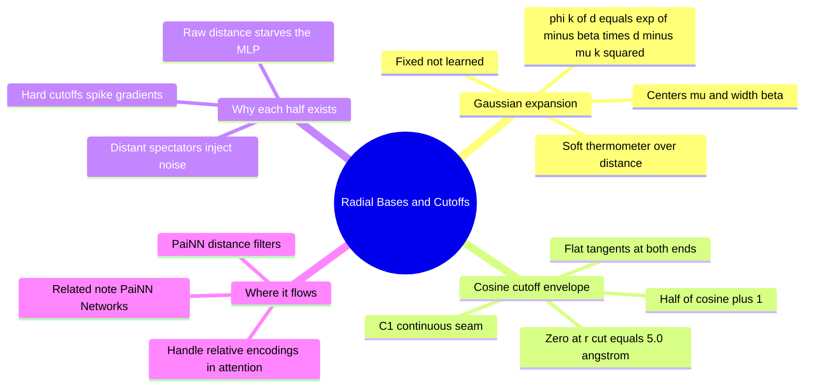

---
tags:
  - domain/geometric-deep-learning
  - depth/essential
  - 3dsyntree
  - topic/radial-basis
  - topic/features
module: "07. Geometric Deep Learning and Equivariance"
chapter: "Chapter 1. Symmetry Groups and Equivariant Foundations"
type: concept
---

# 3. Radial Basis Functions and Cosine Cutoffs

> [!abstract] Core Idea
> A neural network cannot do much with a single raw number like "this atom is 2.7 Å away." A **radial basis function (RBF) expansion** turns that one distance into a bank of smooth Gaussian responses — a soft, learnable ruler — and a **cosine cutoff envelope** fades every response gently to exactly zero at the interaction boundary ($r_{\text{cut}} = 5.0\text{ Å}$), so atoms drifting in and out of range never jolt the gradients.

Navigation: [[0. Geometric Deep Learning and Equivariance MOC]] · [[0. Master Vault Index]]

## 1. What It Is

The **radial basis function expansion** is a fixed, non-learned mapping that converts one scalar distance $d$ (an interatomic distance, measured in Å) into a $K$-dimensional feature vector. It places $K$ Gaussian "bells" at evenly spaced centers $\mu_1, \dots, \mu_K$ across the distance range of interest, and channel $k$ of the output simply measures how close $d$ is to $\mu_k$:
$$\phi_k(d) = \exp\!\left(-\beta\,(d - \mu_k)^2\right), \qquad k = 1, \dots, K,$$
with $\beta > 0$ a fixed width parameter (larger $\beta$ = narrower bells) and the centers typically spaced from $0$ or a small minimum out to the cutoff distance.

The **cosine cutoff envelope** is a multiplier applied on top, equal to 1 at the origin and gliding to exactly 0 at the cutoff distance $r_{\text{cut}}$:
$$f_{\text{cut}}(d) = \begin{cases} \dfrac{1}{2}\left[\cos\!\left(\dfrac{\pi d}{r_{\text{cut}}}\right) + 1\right] & d \le r_{\text{cut}} \\[2mm] 0 & d > r_{\text{cut}} \end{cases}$$
In 3D-SynTree the cutoff is $r_{\text{cut}} = 5.0\text{ Å}$, the message-passing interaction radius. The final radial feature vector given to the network is the elementwise product $\phi_k(d)\, f_{\text{cut}}(d)$ for every channel $k$.

## 2. Why It Exists

Two distinct pathologies motivate the two halves of the construction.

**Raw distances are information-poor and hard to learn from.** Physical potentials as a function of distance are sharply structured — steep repulsive walls, a narrow well, a slow decay (the shape of [[1. Lennard Jones and Soft Core Potentials]]). If you feed one raw number $d$ into a multilayer perceptron, the network must *synthesize* those sharp local features out of globally smooth nonlinearities — possible in principle, miserably slow in practice, because gradients from one scalar input carry very little signal. The Gaussian bank instead hands the network pre-localized "receptors": channel $k$ fires when the distance is near $\mu_k$, and the network merely learns *what to do* when a receptor fires — a much easier job, exactly analogous to how one-hot embeddings outperform raw integer indices for categorical inputs.

**Hard interaction boundaries destabilize gradients.** Suppose we simply said "interact if $d \le 5.0\text{ Å}$, ignore otherwise." A spectator atom sitting at $d = 5.001\text{ Å}$ contributes nothing; one thermal wiggle later it sits at $4.999\text{ Å}$ and suddenly contributes a *full-strength* message. The model's output jumps discontinuously, and the loss with it — and a discontinuous function has, at the seam, an effectively infinite derivative. Every atom crossing the boundary fires a gradient spike into the weights. Unbounded distance calculations (no cutoff at all) have the mirrored problem: hundreds of distant, chemically irrelevant atoms each contribute small noisy messages, drowning the few interactions that matter. The smooth cutoff solves both: neighbors fade in and out with zero slope at the seam, and truly distant atoms are exactly zero, not approximately small.

## 3. How It Works

### 3.1 The Gaussian bank as a soft ruler

Pick, say, $K$ centers spaced every $0.5\text{ Å}$ from $\mu_1 = 0.5\text{ Å}$ to $\mu_K = 5.0\text{ Å}$, and a width $\beta$ around $25\ \text{Å}^{-2}$ (bells roughly $0.4\text{ Å}$ wide at half response). Feeding a distance returns a vector that is essentially a *soft thermometer*: big entries at centers near $d$, near-zero entries elsewhere.

> [!example] Expanding d = 2.7 Å
> With $\beta = 25\ \text{Å}^{-2}$:
> - $\phi(2.5) = \exp(-25 \times (0.2)^2) = e^{-1.0} \approx 0.368$ — the strongest response.
> - $\phi(3.0) = \exp(-25 \times (0.3)^2) = e^{-2.25} \approx 0.105$ — a shoulder.
> - $\phi(2.0) = \exp(-25 \times (0.7)^2) = e^{-12.25} \approx 5 \times 10^{-6}$ — effectively silent.
>
> The vector peaks around $2.5\text{ Å}$ and decays smoothly on both sides: the network reads "bonding-ish contact" from the *pattern* of activations, without ever seeing the bare number 2.7.

### 3.2 Why the envelope is C¹-continuous, and why that word matters

A function is $C^0$-continuous when its value has no jumps; it is $C^1$-continuous when its *derivative* is also jump-free. The cosine envelope is $C^1$ at the seam $d = r_{\text{cut}}$:

- **Value**: $f_{\text{cut}}(r_{\text{cut}}) = \tfrac{1}{2}[\cos\pi + 1] = \tfrac{1}{2}[-1 + 1] = 0$ — matches the constant 0 outside exactly.
- **Slope**: $f_{\text{cut}}'(d) = -\dfrac{\pi}{2 r_{\text{cut}}}\sin\!\left(\dfrac{\pi d}{r_{\text{cut}}}\right)$, and at $d = r_{\text{cut}}$ the sine factor is $\sin \pi = 0$, so the slope is $0$ — again matching the outside.

The same holds at $d = 0$ (slope $\sin 0 = 0$): the envelope leaves 1 and arrives at 0 with flat tangents at both ends. First derivatives are what backpropagation consumes, so a $C^1$ seam means the gradient field is smooth exactly where atoms cross the boundary.

> [!example] A boundary crossing, hard versus soft
> An atom drifts from $d = 5.02\text{ Å}$ to $d = 4.98\text{ Å}$.
> - **Hard cutoff**: contribution goes from $0$ to full strength $\phi_k(4.98)$ instantly — a step function in the loss landscape. The finite-difference gradient along that path is $\Delta\text{contribution} / 0.04\text{ Å}$, which blows up as the step shrinks.
> - **Cosine cutoff**: $f_{\text{cut}}(4.98) = \tfrac12[\cos(0.996\pi) + 1] \approx \tfrac12 \times 8 \times 10^{-5} \approx 4 \times 10^{-5}$ — the contribution just past the boundary is *already essentially zero*, and it grows with zero initial slope. Nothing spikes; training sees a smooth landscape.

### 3.3 Product features and where they flow

The final radial feature for a pair of atoms $i, j$ is the vector with components
$$\Phi_{ij,k} = \phi_k(d_{ij})\, f_{\text{cut}}(d_{ij}), \qquad k = 1, \dots, K.$$
Because $d_{ij}$ is an $\mathrm{SE}(3)$-invariant (Section 3.1 of [[2. Invariance vs Equivariance in Molecular Clouds]]), the entire vector is invariant — safe to feed into any plain MLP without breaking rotational symmetry. These vectors are exactly the "distance filters" $\phi_s, \phi_v, \phi_{vv}$ that weight messages in the PaiNN interaction block (next note), and they reappear enriched with handle-relative distances in the cross-attention decoder of [[3. Cross Attention Decoders for SBDD]].

### 3.4 The 5 Å sphere in context

In a pocket extracted as a 10 Å-radius cavity holding 200–800 atoms (see [[1. Binding Pockets and Cavity Extraction]]), a 5.0 Å interaction radius is a deliberate middle ground: wide enough to capture each residue's immediate packing shell and the salt-bridge/H-bond geometry (contact distances of $3.5$–$4.0\text{ Å}$ land mid-bank, where the Gaussians have the best resolution), narrow enough to keep each atom's neighborhood small and the message-passing cost proportional to the number of edges rather than atoms squared.

### 3.5 Distant-spectator noise: the cross-attention application

The same cutoff mechanism is applied a second time in the policy: when the decoder enriches memory keys with distances measured *relative to the active handle's position*, atoms far from the handle are smoothly zeroed out. This is the fix recorded as `Issue #9: [MATH-03]` — without it, distant spectator residues (a wall on the far side of the pocket) injected noise into the attention logits, diluting the signal from the sub-cavity that actually matters.

## 4. What It Consists Of

- **Gaussian kernels** — the bell-shaped basis functions $\exp(-\beta(d-\mu_k)^2)$, one per channel.
- **Center spacing** ($\mu_k$) — where the bells sit on the distance axis; controls the resolution of the soft ruler.
- **Width parameter** ($\beta$) — how narrow each bell is; trades off locality of response against smoothness of the encoding.
- **Cutoff distance** ($r_{\text{cut}} = 5.0\text{ Å}$) — the hard physical boundary of interaction; the envelope's job is to make it feel soft.
- **Cosine envelope** — the $C^1$ fade-to-zero multiplier applied to every channel.

## 5. What You Must Understand

> [!warning] The cutoff kills the gradient spike only because of the zero slope
> A cutoff that reaches zero but with non-zero slope (any linear taper) is $C^0$ but not $C^1$: values match at the seam, derivatives do not, and gradient discontinuities survive. The cosine shape is chosen specifically for its flat tangents at both ends.

> [!tip] RBF before MLP, always
> Whenever a symmetry-safe model must consume a distance, expand it first. The rule of thumb: distances enter networks through Gaussian banks, never raw — the same way category indices enter through embeddings, never bare.

> [!note] The expansion is fixed, not learned
> $\mu_k$ and $\beta$ are hyperparameters set before training. The network learns what the activations *mean downstream*; the ruler itself is a constant preprocessing step. This keeps the expansion provably invariant — nothing in it can drift toward coordinate-frame dependence during training.

## 6. Prerequisites

- Calculus — derivatives and the chain rule, used to check the $C^1$ seam. The note is otherwise self-contained; the shapes it encodes come from [[1. Lennard Jones and Soft Core Potentials]] and [[3. Van der Waals Radii and Steric Clash]].

## 7. Project Connection

`RadialBasis` and `CosineCutoff` are implemented in `syntree/models/equivariant.py`, with `r_cut = 5.0\text{ Å}` as the interaction radius. Their product forms the distance filter bank consumed by `PaiNNInteraction` for every message-passing layer, and the same machinery is reused to build handle-relative radial encodings inside the policy's cross-attention — the fix of `Issue #9: [MATH-03]`, which stops distant spectator atoms from polluting the attention layer with noise.

## 8. Required Depth

**Essential** — the PaiNN interaction equations in the next note are written in terms of these filter functions; they cannot be read without this note.

## 9. Further Dependencies

- [[1. PaiNN Polarizable Interaction Networks]] — the interaction and mixing blocks that consume $\Phi_{ij}$ as their distance-dependent message weights.

## Concept Mind Map

