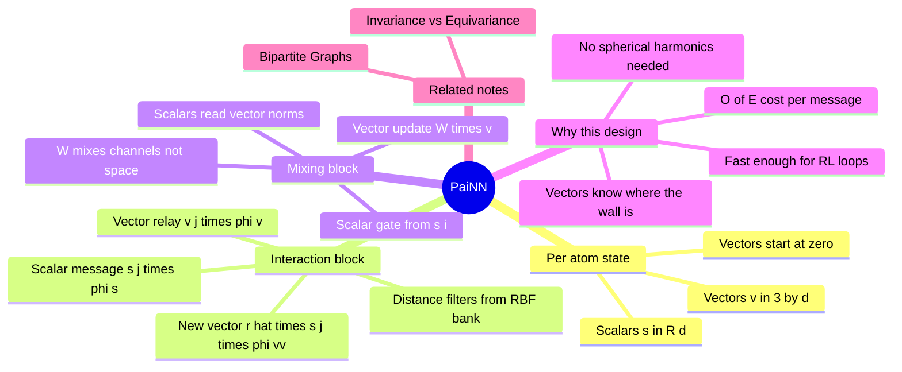

---
tags:
  - domain/geometric-deep-learning
  - depth/essential
  - 3dsyntree
  - topic/equivariance
  - topic/message-passing
module: "07. Geometric Deep Learning and Equivariance"
chapter: "Chapter 2. Equivariant Architectures for Structure Based Design"
type: concept
---

# 1. PaiNN Polarizable Interaction Networks

> [!abstract] Core Idea
> PaiNN is a message-passing graph neural network for 3D point clouds that keeps each atom's features split into **invariant scalars** and **equivariant vectors** (no higher-order tensors), so it can reason about *directions* — which way a pocket wall lies, where a bond wants to point — while remaining provably rotation-safe, at a computational cost that grows only linearly with the number of interacting atom pairs.

Navigation: [[0. Geometric Deep Learning and Equivariance MOC]] · [[0. Master Vault Index]]

## 1. What It Is

The **Polarizable Atom Interaction Network** (Schütt, Unke & Gastegger, ICML 2021) is an $\mathrm{SE}(3)$-equivariant **message-passing graph neural network** operating on 3D point clouds — sets of atoms with positions. Unpacking the terms:

- **Message passing**: atoms are nodes of a graph; an edge connects any two atoms within the interaction radius ($r_{\text{cut}} = 5.0\text{ Å}$). In one *message-passing round*, every atom collects information ("messages") from its edge-neighbors, updates its own state, and this repeats for a few rounds so that information diffuses across the structure.
- **Equivariant**: rotate/translate the input cloud and the outputs transform exactly as the geometry does — scalars stay fixed, vectors rotate — by construction (the contract of [[2. Invariance vs Equivariance in Molecular Clouds]]).
- **Polarizable**: the architecture was introduced to predict *tensorial* properties — dipoles, polarizabilities, molecular spectra — quantities that are not single numbers but directional objects. Handling polarizability demands exactly the scalar/vector machinery this note describes.

Each atom $i$ carries a two-bank state: scalar channels $s_i \in \mathbb{R}^d$ and vector channels $\mathbf{v}_i \in \mathbb{R}^{3 \times d}$ — $d$ ordinary numbers plus $d$ 3D vectors.

## 2. Why It Exists

Physics around an atom is not isotropic. A carbonyl oxygen "feels" the H-bond donor above it differently from the greasy wall beside it; a growing ligand handle cares *which direction* is blocked by protein and which direction is open solvent. A model with only scalar features can know that *something* is nearby but not *where* — it is color-blind to direction. So we need vector information.

The obvious ways to get it are expensive. **Spherical-tensor networks** (Tensor Field Networks, NequIP, Allegro) expand directional information in **spherical harmonics** — the sphere's analog of a Fourier basis — and combine features of order $\ell = 0, 1, 2, \dots$ with tensor products and Clebsch–Gordan coefficients. They are powerful and exact, but each message costs a series of angular-basis contractions, and the cost per edge grows steeply with the maximum order used.

PaiNN's bet: keep only the two lowest orders — $\ell = 0$ (scalars) and $\ell = 1$ (vectors) — and couple them with nothing more exotic than scalar multiplication, matrix products, and the geometric unit vectors $\hat{\mathbf{r}}_{ij}$ already present in the data. The result is $\mathrm{SE}(3)$-equivariance at $O(E)$ cost, $E$ being the number of edges (atom pairs within the cutoff): each message costs one small matrix multiply per edge, no angular basis at all. For 3D-SynTree this is not a luxury: a GFlowNet (see [[1. Trajectory Balance GFlowNets Theory]]) needs thousands of environment steps per training batch, and *every* assembly step re-encodes the joint protein-ligand graph — the encoder must be fast enough to be called inside the RL loop, across 20,000 training complexes.

## 3. How It Works

### 3.1 The per-atom state

At layer input, atom $i$ holds:
$$s_i \in \mathbb{R}^d \quad (\text{invariant scalars}), \qquad \mathbf{v}_i \in \mathbb{R}^{3\times d} \quad (\text{equivariant vectors, one 3D vector per channel}).$$
Initialization: $s_i$ comes from the atomic-number embedding (element identity); $\mathbf{v}_i$ starts at zero — directionality is *earned* from geometry in the first interaction, never guessed.

### 3.2 The interaction block — messages between atoms

Within radius $r_{\text{cut}}$, atom $i$ receives from each neighbor $j$ (with $d_{ij} = \|\mathbf{x}_i - \mathbf{x}_j\|$ and $\hat{\mathbf{r}}_{ij} = (\mathbf{x}_i - \mathbf{x}_j)/d_{ij}$) the updates
$$\Delta s_i = \sum_{j} s_j\, \phi_s(d_{ij}), \qquad \Delta \mathbf{v}_i = \sum_{j} \mathbf{v}_j\, \phi_v(d_{ij}) \; + \; \sum_{j} \hat{\mathbf{r}}_{ij}\, s_j\, \phi_{vv}(d_{ij}).$$

Read the three message types:

1. **Scalar message** $s_j\,\phi_s(d_{ij})$: the neighbor's chemical identity, *gated* (weighted channel-by-channel) by a distance filter — an MLP applied to the radial basis expansion of $d_{ij}$ from [[3. Radial Basis Functions and Cosine Cutoffs]]. "A carbon-ish message, strong because it's 1.4 Å away."
2. **Vector relay** $\mathbf{v}_j\,\phi_v(d_{ij})$: the neighbor's *own* directional state, passed along and distance-weighted. This is how directionality propagates two, three hops beyond the geometry that created it.
3. **New vectors from geometry** $\hat{\mathbf{r}}_{ij}\, s_j\, \phi_{vv}(d_{ij})$: the only way to *create* a fresh direction equivariantly — take a scalar (chemistry × distance weight) and attach it to the unit displacement vector. Note there is no other source of arrows: equivariance forbids "inventing" directions from nothing.

In the full PaiNN formulation the distance filters additionally receive invariant scalar projections of the neighbors' vector states (e.g., $\mathbf{v}_j \cdot \hat{\mathbf{r}}_{ij}$) as inputs — all dot products are scalars, so they may safely enter MLPs.

> [!example] A handle learns where the wall is
> A ligand handle atom $i$ sits near a leucine side chain: two carbons at 3.5 Å in the $+x$ direction. Their messages give $\Delta\mathbf{v}_i \approx \hat{\mathbf{r}}\cdot(\text{scalar})$ — vectors pointing along the handle-to-carbon directions with magnitudes set by the scalar filters. After one mixing round, $\|\mathbf{v}_i\|$ (a scalar!) tells the policy "there is substantial stuff blocking that side," and the vector part tells it the side. Rotate the entire complex $90^\circ$ about $z$: the same messages produce the rotated vectors, $\mathbf{v}_i' = \mathbf{R}\mathbf{v}_i$. Direction known, symmetry intact.

### 3.3 The mixing block — coupling within one atom

The interaction block moves information *between* atoms; the mixing block lets an atom's scalars and vectors talk to *each other*:
$$s_i \leftarrow s_i + \text{MLP}\big([\,s_i,\ \|\mathbf{v}_i\|\,]\big), \qquad \mathbf{v}_i \leftarrow \mathbf{v}_i + \mathbf{W}\,\mathbf{v}_i \cdot \text{scalar\_gate}.$$

- The **scalar update** concatenates $s_i$ with the *norms* of the vector channels — lengths are rotation-invariant (the norm trick from [[2. Invariance vs Equivariance in Molecular Clouds]]) — and passes them through a plain MLP. Scalars learn "how much directional stuff I've accumulated" without ever touching a coordinate.
- The **vector update** applies $\mathbf{W}$, a learned $d \times d$ matrix acting *across feature channels, identically on each of the 3 spatial rows*, then multiplies elementwise by a **scalar gate** — a learned sigmoid-activated function of $s_i$. The gate decides per-channel how much of the vector information survives.
- Why is $\mathbf{W}$ legal? Because it mixes *feature channels* while leaving the 3D vector structure alone: if every channel $c$ transforms as $\mathbf{v}_{i,c} \mapsto \mathbf{R}\mathbf{v}_{i,c}$, then any fixed linear combination $\sum_{c'} W_{cc'}\mathbf{v}_{i,c'}$ transforms by the same $\mathbf{R}$ — linearity carries the rotation through. A learned $3\times 3$ spatial matrix would *not* be legal (it would fight the input rotation), and that one distinction is the whole trick.

### 3.4 Message aggregation and stacking

Aggregation over neighbors is a **sum** (permutation-invariant, and additive residuals keep gradients healthy): each block computes a $\Delta$ that is *added* to the running state — $s_i \leftarrow s_i + \Delta s_i$ — so the network starts each layer from what it already knew. Interaction and mixing alternate for a small number of rounds (each round costs $O(E)$), giving every atom a receptive field of a few times $5.0\text{ Å}$ — roughly one shell of residues around any ligand atom, with the pocket extracted as described in [[1. Binding Pockets and Cavity Extraction]].

### 3.5 The equivariance checklist

Every operation above appears on exactly one of two white-lists: **scalar-safe** (MLPs on scalars, norms, dot products, scalar×scalar) or **vector-safe** (scalar×vector, shared-$\mathbf{W}$ channel mixing, sums of vectors, rotation by the input $\mathbf{R}$). Nothing else is allowed — no raw coordinates into MLPs, no learned spatial matrices. Provable equivariance is the sum of these small prohibitions.

## 4. What It Consists Of

- **Invariant scalar channels** ($s_i \in \mathbb{R}^d$) — per-atom feature vectors untouched by rotation/translation.
- **Equivariant vector channels** ($\mathbf{v}_i \in \mathbb{R}^{3\times d}$) — per-atom 3D vectors that co-rotate with the cloud.
- **Interaction blocks** — cross-atom message passing: the three message types, distance-gated by radial filters.
- **Mixing blocks** — within-atom scalar/vector coupling through the norm readout and the scalar-gated channel mixing.
- **Message aggregation** — the summed, residual-style accumulation of messages over each atom's cutoff neighbors.

## 5. What You Must Understand

> [!warning] Direction cannot be invented
> The only equivariant source of a new vector is a scalar times an existing equivariant vector (like $\hat{\mathbf{r}}_{ij}$) or a transformed old vector. Any layer that outputs a vector from scalars alone (an MLP on $s_i$ producing 3 numbers) breaks equivariance instantly — those 3 numbers would *not* rotate with the input.

> [!tip] Scalars say how much, vectors say which way
> Keep the division of labor in mind: magnitudes, energies, counts — scalars; orientations, forces, "toward the wall" — vectors. When PaiNN must report direction to a scalar consumer, it hands over invariants of the vectors (norms, dot products), never the vectors themselves.

> [!note] Speed is a design decision
> Restricting to $\ell \le 1$ makes PaiNN slightly less expressive per layer than higher-order spherical-tensor networks, and it compensates with cheap depth and the mixing block's nonlinear coupling. For an encoder called thousands of times inside an RL loop, that trade is exactly right.

## 6. Prerequisites

- [[2. Invariance vs Equivariance in Molecular Clouds]] — the scalar/vector channel contract and the norm trick that the mixing block exploits.
- [[3. Radial Basis Functions and Cosine Cutoffs]] — the Gaussian expansion and cosine cutoff that define the distance filters $\phi_s, \phi_v, \phi_{vv}$.

## 7. Project Connection

The three PaiNN building blocks are implemented in `syntree/models/equivariant.py` as `PaiNNInteraction` (the cross-atom message block), `PaiNNMixing` (the within-atom coupling block), and `BatchedPaiNNLayer` (the stacked, batched layer that runs them over whole graphs on GPU). They form the engine of `BipartitePaiNN` (next note), which applies them to the joint protein-ligand graph; the resulting scalar and vector memory is what the decoder of [[3. Cross Attention Decoders for SBDD]] reads out. Their $O(E)$ cost is what makes encoder-in-the-loop reinforcement learning tractable.

## 8. Required Depth

**Essential** — this is the architectural core the rest of Chapter 2 wraps around: the bipartite graph changes *what* PaiNN runs on, and cross-attention changes *how* its output is consumed.

## 9. Further Dependencies

- [[2. Bipartite Heterogeneous Protein Ligand Graphs]] — extends PaiNN's homogeneous single-molecule cloud into a heterogeneous protein-plus-ligand graph with node and edge types.

## Concept Mind Map

## Cross-Domain Links

- [[AI/06. Equivariant Architectures: PaiNN and Bipartite Graphs/Chapter 1. Polarizable Atom Interaction Networks/1. PaiNN Interaction Block and Directional Message Passing|1. PaiNN Interaction Block and Directional Message Passing]] (AI vault) — the scientific rationale and the implemented interaction block of the same architecture.
