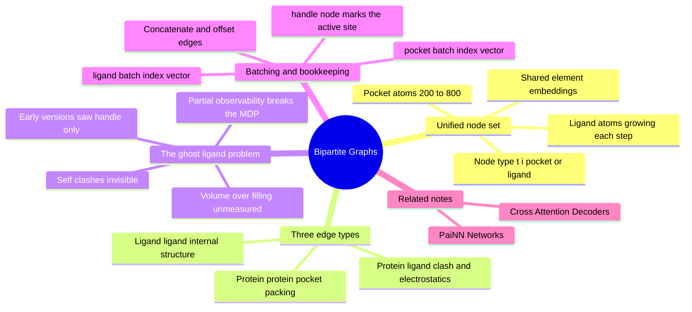

---
tags:
  - domain/geometric-deep-learning
  - depth/essential
  - 3dsyntree
  - topic/graph-neural-networks
  - topic/protein-ligand
module: "07. Geometric Deep Learning and Equivariance"
chapter: "Chapter 2. Equivariant Architectures for Structure Based Design"
type: concept
---

# 2. Bipartite Heterogeneous Protein Ligand Graphs

> [!abstract] Core Idea
> To design a ligand *inside* a pocket, the network must see both at once: a single equivariant graph whose nodes are **all pocket atoms plus every atom of the partially-built ligand**, tagged by origin (pocket vs ligand) and connected by radius edges carrying three distinct physical meanings — protein packing, ligand internal structure, and the protein-ligand interactions that decide clashes and contacts.

Navigation: [[0. Geometric Deep Learning and Equivariance MOC]] · [[0. Master Vault Index]]

## 1. What It Is

A **heterogeneous graph** is a graph whose nodes and edges carry *types*: not just "a node" but "a pocket node" or "a ligand node"; not just "an edge" but "a protein-protein edge." The BipartitePaiNN graph is exactly this:

- **Node set**: the union of the two populations,
$$\mathcal{V} = \mathcal{V}_{\text{pocket}} \cup \mathcal{V}_{\text{ligand}},$$
where $\mathcal{V}_{\text{pocket}}$ are the protein pocket atoms (the 10 Å-radius cavity, typically 200–800 atoms, capped at 700) and $\mathcal{V}_{\text{ligand}}$ are the atoms of the *current, partially assembled* ligand — which changes at every step of molecular growth.
- **Edges**: drawn by geometry — every atom pair within the $5.0\text{ Å}$ message-passing radius, regardless of population, so protein and ligand atoms message each other directly.
- **Node types**: a learned type embedding $t_i \in \{0: \text{pocket},\ 1: \text{ligand}\}$ added to each node's features so the network can tell "a carbon of the pocket wall" from "a carbon of my own growing molecule."
- **Edge types**: three kinds — protein-protein, ligand-ligand, protein-ligand — each with its own learned treatment.

All of it is processed by the PaiNN machinery of [[1. PaiNN Polarizable Interaction Networks]]: the union cloud simply *is* a 3D point cloud, and scalar/vector equivariant message passing runs over it unchanged.

## 2. Why It Exists

The design is a direct response to a failure mode of earlier versions: the **ghost ligand problem**.

Suppose the encoder sees only the protein pocket plus the *single* reactive handle atom where the next synthon will attach — the ligand built so far is invisible. The policy then chooses a torsion angle for the new bond while blind to everything it has already constructed. Three things go wrong, all at once:

1. **Self-clashes**: the new synthon can be swung directly into a fragment built three steps ago — a steric clash the network literally cannot see, because those atoms are ghosts. (Clash physics itself: [[3. Van der Waals Radii and Steric Clash]].)
2. **Volume blindness**: a pocket is a container of finite size. Good design fills it efficiently — neither leaving a sub-cavity empty nor over-filling it. A policy that cannot see its own ligand cannot evaluate "am I getting too bulky?" as growth progresses.
3. **Inconsistent context**: the *same* pocket looks different depending on how much ligand is already there (an open sub-cavity becomes blocked, a buried charge becomes paired). The correct conditioning for step $t$ includes the ligand-so-far; removing it makes the state partially observable — the policy would be asked to act in a Markov decision process (see [[1. The Assembly MDP Formulation]]) while seeing only part of the state.

The fix is minimal and clean: put every ligand atom into the graph. Hence "heterogeneous" — two node populations with different roles — and hence the unified node set.

> [!note] Why the graph is called bipartite
> Strict graph theory calls a graph bipartite when edges run *only between* the two parts, never within one. This graph is not that — ligand-ligand and protein-protein edges exist and matter. The name emphasizes the **two separate node tables** (two populations concatenated into one network) rather than the strict edge pattern; keep both usages in mind when reading literature.

## 3. How It Works

### 3.1 Node tables and shared atomic embeddings

Each node's base identity is its element, given as an atomic number $Z$ (6 for carbon, 7 for nitrogen, ...). The two populations arrive as separate tensors — `pocket_z` and `ligand_z` — and are embedded through a **single shared embedding table** (`atomic_embedding(Z)`): a carbon is a carbon, whether it belongs to a phenylalanine side chain or to the ligand being built. Sharing lets knowledge about elements (electronegativity-ish behavior, typical bonding) transfer across the protein-ligand boundary instead of being learned twice.

The disambiguation comes from the **node-type embedding**: a learned vector indexed by $t_i \in \{0, 1\}$ (pocket, ligand) added on top. Two carbons thus share their element embedding but differ by role — exactly the same trick as a part-of-speech tag in language models.

### 3.2 The three edge types

Edges are built by distance ($d \le 5.0\text{ Å}$) and then classified by their endpoints:

| Edge type | Connects | Physical meaning the network must learn |
| --- | --- | --- |
| protein-protein | two pocket atoms | Pocket packing: which residues form rigid walls, where side chains pack tightly, where the cavity has give |
| ligand-ligand | two ligand atoms | The ligand's own 3D structure: its shape, its internal contacts, and — critically — *potential self-clash* between a newly attached synthon and earlier-built fragments |
| protein-ligand | pocket to ligand | The interactions that decide binding: steric clash and contact, electrostatics, salt bridges and H-bond geometry (see [[2. Pharmacophores and Interaction Hotspots]]) |

Treating the three types distinctly (via type embeddings or separate parameters) encodes the prior that *an atom pair 3.2 Å apart means different things* depending on whether it is two residues packing, two ligand fragments crowding, or a ligand atom pressing against a wall.

### 3.3 One cloud, one equivariant pass

After node assembly, the union is just a point cloud with $|\mathcal{V}_{\text{pocket}}| + |\mathcal{V}_{\text{ligand}}|$ atoms. PaiNN interaction and mixing blocks run over it unchanged: scalar and vector messages flow across *all* edges, so a handle atom's vector channels can point toward a nearby wall (protein-ligand edge) or toward its own bulky earlier fragment (ligand-ligand edge) with equal ease. Equivariance is inherited for free — the group acts on the union cloud the same way it acts on any cloud.

### 3.4 Sub-graph batching: pocket_batch and ligand_batch

Training processes many complexes per GPU step. Graphs are batched by **concatenation**: all pockets and ligands are stacked along the node dimension, with edge indices offset so no edge accidentally bridges two complexes. To keep bookkeeping straight, two parallel **index vectors** record which complex each atom belongs to:

- `pocket_batch`: length $N_{\text{pocket}}^{\text{total}}$, entry $= $ complex index of each pocket atom.
- `ligand_batch`: length $N_{\text{ligand}}^{\text{total}}$, entry $= $ complex index of each ligand atom.

> [!example] A batch of two complexes
> Complex A: 300 pocket atoms, 20 ligand atoms. Complex B: 250 pocket atoms, 35 ligand atoms. Then
> - `pocket_batch` $= (0,0,\dots,0,\ 1,1,\dots,1)$ with 300 zeros then 250 ones;
> - `ligand_batch` $= (0,\dots,0,\ 1,\dots,1)$ with 20 zeros then 35 ones.
> Per-complex readout ("pool all atom features of complex $k$ into one vector") is then a segmented sum over whichever index vector equals $k$ — pooled over the *union* of that complex's pocket and ligand atoms.

Separate (rather than one merged) index vectors matter because the two node tables have independent lifecycles: the ligand table grows step by step during assembly while the pocket table is fixed, and downstream components (the decoder, next note) need to know which memory rows belong to which population.

### 3.5 The handle node

One ligand node is special at every step: the **active attachment handle** — the reactive atom where the next synthon will bond. `handle_node` marks its index (plus its precomputed `handle_features` descriptors) so the network and the downstream decoder can adopt "the handle's perspective": queries are built from it in [[3. Cross Attention Decoders for SBDD]].

## 4. What It Consists Of

- **Heterogeneous node tables** — separate pocket and ligand node sets (positions, atomic numbers, charges) concatenated into one network.
- **Shared atomic embeddings** — one element-embedding table for both populations, so chemical knowledge transfers across the boundary.
- **Node-type embeddings** — the learned pocket/ligand tag $t_i$ separating role from element.
- **Edge indices** — the distance-built adjacency ($5.0\text{ Å}$), classified into three edge types.
- **Sub-graph batch tracking** — `pocket_batch` and `ligand_batch` index vectors mapping every atom to its complex, for pooling and alignment.
- **Handle marker** — the `handle_node` pointer identifying the active attachment site.

## 5. What You Must Understand

> [!warning] The ghost ligand is a partial-observability bug, not a small detail
> A policy choosing a torsion without seeing its own ligand is not "slightly less informed" — it is acting on a *different state* than the true one. Expect self-clashes, over-built volume, and context-dependent errors that no amount of training fixes, because the information is simply absent from the input.

> [!tip] Watch the sizes
> Pockets run 200–800 atoms (capped at 700, minimum 100) while ligands grow from a single handle to tens of atoms. The ligand table's size *changes every step* — the architecture must handle variable node counts gracefully, which is exactly what concatenation-style batching and index vectors provide.

> [!note] Charges are part of the node features
> Pocket formal charges are assigned by residue rules (Asp/Glu $-1$, Arg/Lys $+1$) and ligand charges by its ionization state; both are projected into feature space so electrostatic interaction learning has raw material on both sides.

## 6. Prerequisites

- [[1. Binding Pockets and Cavity Extraction]] — what the pocket node set *is*: the 10 Å cavity around the co-crystallized ligand centroid, centered and capped.
- [[1. PaiNN Polarizable Interaction Networks]] — the interaction and mixing blocks that run over this graph.

## 7. Project Connection

`BipartitePaiNN` in `syntree/models/bipartite.py` implements this design: it receives `pocket_pos`, `ligand_pos`, `pocket_z`, `ligand_z`, and `handle_node` tensors, builds the typed radius graph, and runs PaiNN-style equivariant message passing over the union. Upstream, `MolecularFeaturizer.featurize_pocket()` in `syntree/data/featurizer.py` produces the pocket tensors (with `assign_pocket_formal_charges()` setting Asp/Glu $-1$ and Arg/Lys $+1$, exposed as `pocket_charge` and `ligand_charge` through `charge_proj()`), and `handle_features` supplies the active handle's descriptors. The output memory is consumed by the cross-attention decoder of the policy.

## 8. Required Depth

**Essential** — this graph is the interface between geometry and policy: every downstream decision (reaction, synthon, torsion) is conditioned on the encoding it produces.

## 9. Further Dependencies

- [[3. Cross Attention Decoders for SBDD]] — reads the bipartite memory and compresses it into the pocket context vector that conditions all policy heads.

## Concept Mind Map

## Cross-Domain Links

- [[AI/06. Equivariant Architectures: PaiNN and Bipartite Graphs/Chapter 2. Heterogeneous Molecular Modeling/2. Bipartite Protein-Ligand Graph Construction|2. Bipartite Protein-Ligand Graph Construction]] (AI vault) — the heterogeneous graph design and its tensor-level construction.
- [[AI/06. Equivariant Architectures: PaiNN and Bipartite Graphs/Chapter 2. Heterogeneous Molecular Modeling/1. The Ghost Ligand Problem in Molecular Design|1. The Ghost Ligand Problem in Molecular Design]] (AI vault) — unified heterogeneous protein-ligand graphs eliminate the ghost-ligand failure mode.
