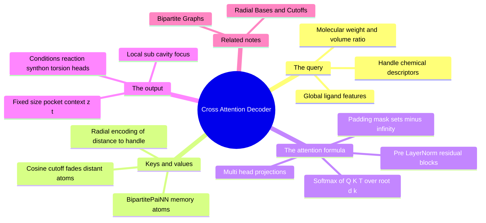

---
tags:
  - domain/geometric-deep-learning
  - depth/essential
  - 3dsyntree
  - topic/attention
  - topic/decoders
module: "07. Geometric Deep Learning and Equivariance"
chapter: "Chapter 2. Equivariant Architectures for Structure Based Design"
type: concept
---

# 3. Cross Attention Decoders for SBDD

> [!abstract] Core Idea
> A cross-attention decoder asks a single question — "what does the pocket look like *from the active handle's point of view*?" — and answers it with a soft, learned database lookup: the handle's query is matched against keys derived from every protein and ligand atom, and the weighted sum of values that comes back is a fixed-size pocket context vector that conditions every downstream decision.

Navigation: [[0. Geometric Deep Learning and Equivariance MOC]] · [[0. Master Vault Index]]

## 1. What It Is

**Attention**, in its barest form, is a soft dictionary lookup. You have a **query** $\mathbf{q}$ (what you are looking for), a set of **keys** $\mathbf{k}_1, \dots, \mathbf{k}_n$ (the labels on offer) and matching **values** $\mathbf{v}_1, \dots, \mathbf{v}_n$ (the contents). A hard dictionary returns the one value whose key equals the query; attention instead scores every key against the query, turns the scores into a probability distribution with a **softmax** (which exponentiates and normalizes), and returns the *weighted average* of the values:

$$\text{Attention}(\mathbf{Q}, \mathbf{K}, \mathbf{V}) = \text{Softmax}\!\left(\frac{\mathbf{Q}\mathbf{K}^T}{\sqrt{d_k}} + \mathbf{M}_{\text{pad}}\right)\mathbf{V}.$$

**Cross-attention** means the queries come from a *different set* than the keys and values (in self-attention, a sequence attends to itself; here, the handle attends to the atoms). A **cross-attention decoder for SBDD** (structure-based drug design) is this mechanism applied to molecular assembly: the query is built from the active attachment handle, the keys and values come from the `BipartitePaiNN` joint protein-ligand memory, and the output is a fixed-size **pocket context vector** $\mathbf{z}_t \in \mathbb{R}^d$ that summarizes the 3D environment from the handle's perspective.

## 2. Why It Exists

The encoder produces one embedding per atom — 200–800 pocket atoms plus a growing ligand, a *variable-length* set. But the policy heads that consume it (reaction family, synthon, torsion) need a *fixed-size* conditioning vector, and it must be the right fixed-size vector for this step, this handle, this ligand.

Two naive solutions fail in instructive ways:

- **Flatten / global pooling (mean or sum over all atoms)**: one vector, but it averages the entire cavity indiscriminately. A residue on the far side of the pocket — chemically irrelevant to this handle — contributes exactly as much as the wall 3 Å away. Focus is diluted exactly where precision matters most.
- **Handcrafted local crops** (e.g., "take atoms within $x$ Å of the handle"): sharp focus, but the crop rule is a fixed hyperparameter that ignores *which* chemistry the handle cares about — a basic amine handle and an aryl-boron handle need to look at different things.

Cross-attention solves both at once: the output size is fixed by construction (a weighted sum of values has the value dimension $d$, whatever the number of atoms), and *where it looks* is learned and query-dependent — the network can sharpen or widen its focus per handle, per step. The mechanism also gets an explicit geometric assist: keys are enriched with radial encodings of each atom's distance to the handle, so "attend to the local sub-cavity" is built into the score function rather than hoped for.

## 3. How It Works

### 3.1 Building the query

The query vector represents *the asker*: the active attachment handle at step $t$. It is assembled from:

- **Handle chemical descriptors** — what the handle *is*: its element and functional-group character, its reactivity tier context, and pharmacophore-style descriptors of its local environment (the descriptor machinery of [[2. Pharm3D Pharmacophore Descriptors]]).
- **Global ligand features** — the state of what has been built so far: molecular weight, and the volume ratio (how much of the pocket's capacity the current ligand occupies). These let the query express "I am a small amine on a bulky, half-built molecule."

A linear projection $\mathbf{W}_Q$ maps this concatenation into the query space $\mathbb{R}^{d_k}$.

### 3.2 Building keys and values — the geometric memory

Every atom of the joint graph (pocket plus ligand; built in [[2. Bipartite Heterogeneous Protein Ligand Graphs]]) contributes one key and one value. Each is:

- the atom's `BipartitePaiNN` output embedding (its post-message-passing scalar features — and invariant summaries of its vector channels, e.g., their norms, per the conventions of [[1. PaiNN Polarizable Interaction Networks]]), plus
- a **radial basis encoding of that atom's distance to the handle's 3D position** — the Gaussian expansion of [[3. Radial Basis Functions and Cosine Cutoffs]], applied to $d(\text{atom}, \text{handle})$ rather than to pair distances.

The radial enrichment is the secret ingredient: it hands the score function each atom's *distance to the handle* as a rich, smooth feature, so attention can learn "nearby atoms are worth listening to; far ones are not" directly in the logits. Distant spectator atoms are smoothly faded by the cosine cutoff — the fix of `Issue #9: [MATH-03]`, which exists precisely because un-enriched attention let far-side residues inject noise into these scores. Separate projections $\mathbf{W}_K$ and $\mathbf{W}_V$ map memory rows to keys and values.

### 3.3 The scaled dot-product, term by term

$$\text{score}(\mathbf{q}, \mathbf{k}_j) = \frac{\mathbf{q}\cdot\mathbf{k}_j}{\sqrt{d_k}} + M_{\text{pad},j}$$

- **Dot product** $\mathbf{q}\cdot\mathbf{k}_j$: similarity of the ask to the label — the whole match happens here.
- **Scaling by $\sqrt{d_k}$**: if components of $\mathbf{q}$ and $\mathbf{k}$ are roughly unit-scale and independent, the dot product has variance $\approx d_k$, so raw scores grow with dimension and the softmax saturates into a near one-hot — gradients vanish. Dividing by $\sqrt{d_k}$ keeps the logits $O(1)$ and the softmax well-tempered.
- **Padding mask** $\mathbf{M}_{\text{pad}}$: complexes in a batch have different atom counts, so shorter ones are padded to a common length. Padded rows are not real atoms; their logits are set to $-\infty$ (in practice, a large negative number) so the softmax assigns them exactly zero weight. Forgetting this mask makes the model average in garbage.
- **Softmax over $j$**: turns scores into weights $\alpha_j \in [0,1]$ summing to 1; the output is $\sum_j \alpha_j \mathbf{v}_j$.

### 3.4 Multi-head attention

The projections $\mathbf{W}_Q, \mathbf{W}_K, \mathbf{W}_V$ are applied not once but $h$ times in parallel, each *head* working in its own $d_k = d/h$-dimensional subspace. Head outputs are concatenated and mixed back to $\mathbb{R}^d$. Different heads then specialize — one may key on the radial encoding ("distance to the handle"), another on element/charge character ("is there a donor nearby"), another on ligand-internal structure — without any of them being forced to trade off.

### 3.5 Pre-LayerNorm residual blocks

The attention layer is wrapped in a **residual block**: output $= x + \text{Attention}(\text{LN}(x))$, followed by a small feed-forward block with the same pattern. **Pre-LayerNorm** means the normalization is applied *inside* the branch, before the attention or feed-forward computation, rather than after the addition (post-LN, the original Transformer placement). Pre-LN keeps the residual path clean of normalization, which yields stabler gradients and removes the need for aggressive warmup — the standard modern choice, and the one used here.

### 3.6 The output — pocket context

After the (multi-head attention + feed-forward) block(s), the attended representation is combined with the query-side features into the final **pocket context vector** $\mathbf{z}_t \in \mathbb{R}^d$: fixed size regardless of pocket size, handle-specific by construction. This single vector is what the policy heads condition on.

> [!example] Focus in action
> Picture an amine handle pointing into a narrow sub-cavity: two aromatic wall carbons at 3.4 Å, a backbone carbonyl at 3.8 Å, and 400 other atoms farther away. The radial encodings put the two carbons and the carbonyl firmly "on" and fade everything past $5.0\text{ Å}$ to zero. Softmax weights concentrate on those few neighbors; $\mathbf{z}_t$ becomes, in effect, a summary of "small hydrophobic slot with one H-bond acceptor" — exactly the information a reaction or torsion choice needs, undiluted by the far side of the protein.

## 4. What It Consists Of

- **Multi-head attention projections** ($\mathbf{W}_Q, \mathbf{W}_K, \mathbf{W}_V$) — learned linear maps taking query-side and memory-side features into the shared attention space, in parallel heads.
- **Key padding masks** ($\mathbf{M}_{\text{pad}}$) — the $-\infty$ logit trick that removes padded (non-atom) rows from the softmax.
- **Pre-LayerNorm residual blocks** — the LN-inside-the-branch wrapping that stabilizes stacked attention training.
- **Handle-relative radial encodings** — Gaussian-cutoff distance features of each atom to the handle, injected into keys and values.
- **Pocket context vector** ($\mathbf{z}_t \in \mathbb{R}^d$) — the fixed-size, handle-conditioned summary consumed by all heads.

## 5. What You Must Understand

> [!warning] Attention without the mask is silently wrong
> With padded rows unmasked, the softmax happily spreads weight over padding vectors. Nothing crashes; the context vector is simply contaminated. Always mask *before* the softmax, never after.

> [!tip] Why this is "local" without any hard crop
> The locality is *soft and learned*: the radial enrichment biases scores toward nearby atoms, the cutoff removes the truly distant, but the network retains the right to attend to a remote charged residue if the query makes it relevant. A hard crop cannot do that.

> [!note] Variable in, fixed out
> The whole point of the decoder is the shape change: $N_t$ atoms in (different every step, every complex) → one vector $\mathbf{z}_t \in \mathbb{R}^d$ out. Attention is the pooling operator that makes the *content* of that vector depend on the query, which plain averaging cannot do.

## 6. Prerequisites

- [[2. Pharm3D Pharmacophore Descriptors]] — the descriptor machinery behind the handle-side query features.
- [[2. Bipartite Heterogeneous Protein Ligand Graphs]] — the joint memory (keys and values) this decoder reads.

## 7. Project Connection

The decoder lives as `self.cross_attention` inside `SynTreePolicy.forward()` (`syntree/models/policy.py`): it takes the handle query and the `BipartitePaiNN` memory (enriched with handle-relative radial encodings, masked to valid atoms) and emits `pocket_context`. That vector conditions every policy head — the reaction family head in `syntree/models/reaction_head.py`, the synthon selection scoring, and the torsion head in `syntree/models/torsion_head.py`. This is the last pure-geometry stage of the pipeline: everything downstream is decision-making on top of $\mathbf{z}_t$.

## 8. Required Depth

**Essential** — this note completes the encoder-to-policy handoff; the torsion and MDP notes that follow are unreadable without knowing what $\mathbf{z}_t$ is and where it comes from.

## 9. Further Dependencies

- [[1. Categorical Binned vs Continuous Torsion Space]] — the first head to consume `pocket_context`: predicting the junction dihedral from the pocket context.
- [[1. The Assembly MDP Formulation]] — how the context-conditioned heads define the action space of the assembly environment.

## Concept Mind Map

## Cross-Domain Links

- [[AI/03. Attention Mechanisms and Transformer Decoders/Chapter 2. Modern Decoder Architectures/2. Cross-Attention over Heterogeneous Spatial Memory|2. Cross-Attention over Heterogeneous Spatial Memory]] (AI vault) — the decoder design and its cross-attention implementation over spatial memory.
- [[AI/03. Attention Mechanisms and Transformer Decoders/Chapter 2. Modern Decoder Architectures/1. Pre-LayerNorm vs Post-LayerNorm Dynamics|1. Pre-LayerNorm vs Post-LayerNorm Dynamics]] (AI vault) — why the decoder uses pre-LayerNorm for stable deep decoding.
