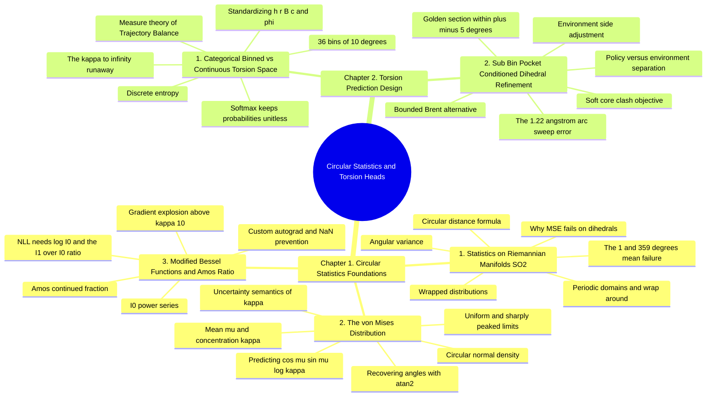

---
tags:
  - moc
  - domain/circular-statistics
  - 3dsyntree
module: "08. Circular Statistics and Torsion Heads"
type: moc
---

# 0. Circular Statistics and Torsion Heads MOC

> [!abstract] Module Mission
> This module covers the statistics of angles: why dihedral values live on a circle where $-\pi$ and $+\pi$ are the same point, why ordinary means and squared-error losses break there, and how the von Mises distribution — the circle's normal distribution — models a torsion angle together with its uncertainty. It then follows the design history of the torsion action head itself: the continuous von Mises head, the numerical (Bessel/Amos) machinery it demanded, the categorical 36-bin redesign that made GFlowNet Trajectory Balance mathematically rigorous, and the sub-bin geometric refinement that recovered the lost precision. For 3D-SynTree this is the module that explains *how the system decides and refines the one geometric variable it predicts at every assembly step*.

Navigation: [[0. Master Vault Index]] · [[2. Prerequisite Knowledge Graph]] · [[3. Study Tracks and Curriculum]]

## Module Mind Map

## Chapter 1. Circular Statistics Foundations

| Note | Focus | Required Depth | Key Prerequisites |
| --- | --- | --- | --- |
| [[1. Statistics on Riemannian Manifolds SO2]] | Periodic domains and $\mathrm{SO}(2)$, the $1^\circ$/$359^\circ$ mean failure, the circular distance $d_{\text{circ}} = \arccos(\cos(\theta_1 - \theta_2)) = \min(|d|, 2\pi - |d|)$, wrapped distributions, angular variance, why MSE fails on dihedrals, and the $-\pi/+\pi$ boundary | Essential | [[2. Rotatable Bonds and Dihedral Angles]] · [[1. Group Theory E3 SE3 SO3 and SO2]] |
| [[2. The von Mises Distribution]] | The circular normal density $p(\phi \mid \mu, \kappa) = e^{\kappa\cos(\phi - \mu)}/(2\pi I_0(\kappa))$, the mean angle $\mu$ and concentration $\kappa$ as inverse-variance analog, the uniform and sharply peaked limits, the $[\cos\mu, \sin\mu, \log\kappa]$ parametrization with `torch.atan2` recovery, and uncertainty semantics — flexible solvent links vs steric channels | Essential | [[1. Statistics on Riemannian Manifolds SO2]] |
| [[3. Modified Bessel Functions and Amos Ratio]] | The $I_0$ power series, why the von Mises NLL needs $\log I_0$ and $d\log I_0/d\kappa = I_1/I_0$, the $\kappa > 10$ gradient explosion of naive series unrolling, Amos' continued-fraction ratio $\kappa/(0.5 + \sqrt{\kappa^2 + 2.25}) \in [0, 1)$, custom autograd, and NaN-crash prevention | Supporting | [[2. The von Mises Distribution]] |

## Chapter 2. Torsion Prediction Design

| Note | Focus | Required Depth | Key Prerequisites |
| --- | --- | --- | --- |
| [[1. Categorical Binned vs Continuous Torsion Space]] | The 36 bins × 10° design, the measure-theory problem of mixing $\text{rad}^{-1}$ densities with dimensionless discrete probabilities in the Trajectory Balance loss, the $\kappa \to \infty$ instability, Softmax over bins keeping all action probabilities unitless, and the standardization of the $h$, $r$, $B$, $c$, $\phi$ actions | Essential | [[1. Statistics on Riemannian Manifolds SO2]] · [[2. The von Mises Distribution]] |
| [[2. Sub Bin Pocket Conditioned Dihedral Refinement]] | The $1.22\text{ Å}$ arc-sweep error of 10° at $7\text{ Å}$ chain distance, golden-section and bounded Brent search within $\pm 5^\circ$ of the selected bin, the soft-core clash potential as objective, and the separation of the discrete policy decision from environment-side continuous refinement | Supporting | [[1. Lennard Jones and Soft Core Potentials]] · [[1. Categorical Binned vs Continuous Torsion Space]] |

## Learning Path Through This Module

1. [[1. Statistics on Riemannian Manifolds SO2]] — the ground rules: angles are points on a circle, not numbers on a line, and every mean, distance, and loss must be rebuilt to respect the wrap-around.
2. [[2. The von Mises Distribution]] — the circle's normal distribution: two parameters ($\mu$ the preferred angle, $\kappa$ the concentration), its limiting behaviors, and how a network predicts it seam-safely as $[\cos\mu, \sin\mu, \log\kappa]$.
3. [[3. Modified Bessel Functions and Amos Ratio]] — the numerical price of that distribution: stable $\log I_0$ and the Amos ratio for its gradient, without which training NaN-crashes once $\kappa$ passes 10.
4. [[1. Categorical Binned vs Continuous Torsion Space]] — the verdict: why a GFlowNet's Trajectory Balance loss cannot mix densities with probabilities, and how 36 Softmax bins standardized all five action heads.
5. [[2. Sub Bin Pocket Conditioned Dihedral Refinement]] — the repair: a bounded golden-section polish inside the chosen bin that recovers sub-degree geometry without touching policy probabilities.

## Why This Module Matters for 3D-SynTree

3D-SynTree deliberately avoids predicting raw 3D coordinates; each assembly step poses exactly one geometric question — the dihedral of the newly formed bond — and this module is the complete theory of that one question. Chapter 1 supplies the mathematics angles obey (circular distances, the von Mises family, and the numerics of its Bessel normalizer), and Chapter 2 is the design history that turned that mathematics into a trainable action head: a continuous von Mises head predicting $[\cos\mu, \sin\mu, \log\kappa]$ gave way to a categorical head over 36 bins of $10^\circ$ once measure-theoretic incompatibilities with the Trajectory Balance GFlowNet loss surfaced, and the sub-bin $\pm 5^\circ$ refinement restored the geometric precision the binning sacrificed. The result is a torsion decision that is simultaneously statistically honest (unitless discrete probabilities), numerically stable (no $\kappa$ runaway, no NaN cascades), and physically accurate (clash-free refined geometry handed to MMFF94 relaxation). For how this single circular choice slots into the full pocket-conditioned assembly loop, see [[1. 3D-SynTree System Overview]].

## Gate Check

> [!question] Before moving on, can you...
> - Compute the circular mean of $1^\circ$ and $359^\circ$ via the mean resultant vector, and explain why the arithmetic mean of $180^\circ$ is maximally wrong rather than approximately right?
> - Write down $d_{\text{circ}}(\theta_1, \theta_2)$ in both the $\arccos(\cos(\cdot))$ and shorter-arc forms, and evaluate it for $170^\circ$ and $-170^\circ$?
> - State the two limiting behaviors of the von Mises density as $\kappa \to 0$ and $\kappa \to \infty$, and the Gaussian-limit relation $\sigma \approx 1/\sqrt{\kappa}$?
> - Explain why a network should predict $[\cos\mu, \sin\mu, \log\kappa]$ instead of raw $\mu$ and $\kappa$, and what role `torch.atan2` plays in recovering the angle?
> - Say why the Trajectory Balance loss cannot mix $\text{rad}^{-1}$ densities with dimensionless discrete probabilities, what the $\kappa \to \infty$ exploit is, and how 36 Softmax bins close it?
> - Compute the arc swept by a $10^\circ$ error at $7\text{ Å}$, and describe what the sub-bin refinement optimizes, within which bounds, and why it leaves the policy's probabilities untouched?

## Primary Reading

Amos, D. E. (1974). *Computation of Modified Bessel Functions and Their Ratios*. **Mathematics of Computation**, 28(125), 239–251.
