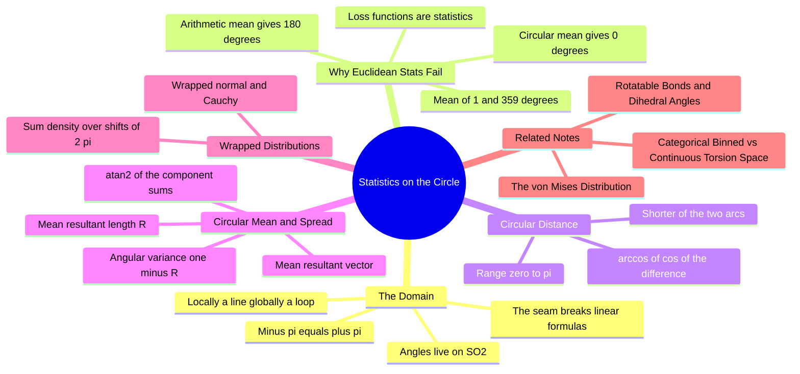

---
tags:
  - domain/circular-statistics
  - depth/essential
  - 3dsyntree
  - topic/torsion
  - topic/probability
module: "08. Circular Statistics and Torsion Heads"
chapter: "Chapter 1. Circular Statistics Foundations"
type: concept
---

# 1. Statistics on Riemannian Manifolds SO2

> [!abstract] Core Idea
> An angle does not live on the infinite number line — it lives on a circle, where $-180^\circ$ and $+180^\circ$ are the *same* point. Every statistical tool invented for the line (means, variances, squared-error losses) silently assumes that "far apart in value" means "far apart in meaning", and that assumption is false on a circle. Circular statistics rebuilds distance, averaging, spread, distributions, and loss functions so they respect the wrap-around.

Navigation: [[0. Circular Statistics and Torsion Heads MOC]] · [[0. Master Vault Index]]

## 1. What It Is

**Circular (directional) statistics** is the branch of probability theory for data that live on a **periodic domain** — a set of values that wraps around on itself, so that $-\pi \equiv +\pi$ (equivalently $0^\circ \equiv 360^\circ$), where "$\equiv$" means "differs by an integer multiple of $2\pi$ and therefore denotes the same direction."

The formal home of an angle is the circle $S^1$ (the set of all unit vectors in the plane) or, equivalently, the **rotation group $\mathrm{SO}(2)$** — the set of all rotations of a plane about a fixed point, where combining a rotation by $\theta_1$ with a rotation by $\theta_2$ yields a rotation by $\theta_1 + \theta_2 \pmod{2\pi}$ (the group-theoretic background is in [[1. Group Theory E3 SE3 SO3 and SO2]]). $\mathrm{SO}(2)$ is a **manifold**: a space that looks like a straight line when you zoom into any small patch, but whose global shape is different — a closed loop with no start, no end, and no boundary. A **Riemannian manifold** is a manifold that additionally carries a notion of distance (on the circle: the shorter arc between two points); doing statistics *on* a Riemannian manifold means every formula must be built from those arc distances instead of plain coordinate differences.

Dihedral angles — the torsion variable the 3D-SynTree policy predicts at every assembly step ([[2. Rotatable Bonds and Dihedral Angles]]) — are exactly such circular data, so every average, variance, and loss computed on them must be circular.

## 2. Why It Exists

Euclidean statistics is built for the real line $\mathbb{R}$, where "the difference of two values" is a meaningful displacement. On a circle, raw value differences are meaningless because the mapping from circle to interval requires an arbitrary **cut point** — a place where neighboring angles are assigned numbers $2\pi$ apart. The standard interval $[-\pi, \pi)$ cuts at $\pm\pi$; a naive formula that ignores the cut produces catastrophically wrong answers near it.

> [!example] The canonical failure: mean of $1^\circ$ and $359^\circ$
> Two torsion measurements of essentially the same conformation: $1^\circ$ and $359^\circ$ (they are only $2^\circ$ apart on the circle). The **arithmetic mean** is $(1 + 359)/2 = 180^\circ$ — the direction *opposite* to both data points. The **circular mean** (Section 3.3) correctly returns $0^\circ$. Euclidean averaging is not "approximately right" here; it is maximally wrong.

This is not an academic corner case for machine learning, because a **loss function is a statistic**: Mean Squared Error (MSE) is the squared Euclidean distance between prediction and target, and gradient descent follows whatever geometry the loss encodes. If the loss geometry is wrong, the network is punished for correct predictions near the seam ($-\pi \approx +\pi$) and trained toward physically wrong answers. Every dihedral the system predicts can land near the seam, so the correction is load-bearing, not cosmetic.

## 3. How It Works

### 3.1 The circle as a manifold: why $-\pi$ equals $+\pi$

Take the real line and declare two numbers identical whenever they differ by $2\pi$: this quotient, written $\mathbb{R}/2\pi\mathbb{Z}$, *is* the circle. Consequences that distinguish it from an interval:

- There is no natural origin and no natural "smaller/larger" ordering — clockwise vs counterclockwise is a convention.
- Every point has infinitely many numeric names: $-\pi$, $+\pi$, $3\pi$, $-3\pi$ are all the same point.
- A function on the circle (a density, an energy, a loss) must be **periodic**: $f(\theta + 2\pi) = f(\theta)$, with no jump at the cut.

The $-\pi/+\pi$ **boundary** (the seam) is where naive code breaks: the value $-179.999^\circ$ and $+179.999^\circ$ are neighbors in space but are stored as numbers differing by $359.998$; floating-point noise near the seam can flip the sign of a stored angle, which a linear formula then interprets as a $2\pi \approx 6.28$ jump.

### 3.2 Circular distance

The distance between two angles $\theta_1, \theta_2$ is the length of the **shorter arc** between them:

$$d_{\text{circ}}(\theta_1, \theta_2) = \arccos\!\big(\cos(\theta_1 - \theta_2)\big) = \min\big(|\theta_1 - \theta_2|,\; 2\pi - |\theta_1 - \theta_2|\big)$$

Both expressions are equal. The $\arccos(\cos(\cdot))$ form automatically folds any raw difference into $[0, \pi]$ because cosine is $2\pi$-periodic and even. The $\min$ form has a geometric reading: two points on a circle are connected by two arcs (going clockwise or counterclockwise), and the distance is the shorter one. The range is $[0, \pi]$: identical angles give $0$; opposite directions (e.g. $0^\circ$ vs $180^\circ$) give the maximum $\pi$.

Worked checks: $d_{\text{circ}}(1^\circ, 359^\circ) = \min(358^\circ, 2^\circ) = 2^\circ$. $d_{\text{circ}}(170^\circ, -170^\circ) = \min(340^\circ, 20^\circ) = 20^\circ$. Both would look enormous through a linear lens.

### 3.3 The circular mean and the mean resultant vector

You cannot average angles, but you *can* average their **unit vectors**. Map each angle $\theta_i$ to the point $(\cos\theta_i, \sin\theta_i)$ on the unit circle and average component-wise:

$$\bar{C} = \frac{1}{n}\sum_i \cos\theta_i, \qquad \bar{S} = \frac{1}{n}\sum_i \sin\theta_i$$

The **mean resultant vector** $(\bar{C}, \bar{S})$ carries two statistics at once:

- Its **direction** is the **circular mean**: $\hat{\mu} = \operatorname{atan2}(\bar{S}, \bar{C})$, recovered with the two-argument arctangent (see [[2. The von Mises Distribution]] for why networks should predict this quantity via $\cos$ and $\sin$ rather than a raw angle).
- Its **length** $\bar{R} = \sqrt{\bar{C}^2 + \bar{S}^2} \in [0, 1]$ is the **mean resultant length**: $\bar{R} = 1$ means every angle was identical; $\bar{R} \approx 0$ means the angles are so spread out that no direction is preferred (a perfectly uniform sample gives $\bar{R} = 0$ and makes the mean direction meaningless).

For the $1^\circ$/$359^\circ$ pair: $\bar{C} = (\cos 1^\circ + \cos 359^\circ)/2 = 0.9998$, $\bar{S} = (\sin 1^\circ + \sin 359^\circ)/2 = 0$, so $\hat{\mu} = 0^\circ$ and $\bar{R} = 0.9998$ — two nearly identical measurements, as they should be.

> [!example] Circular mean of three angles
> Data: $350^\circ$, $10^\circ$, $20^\circ$ (all "roughly pointing up", clustered around $0^\circ$ across the seam). Arithmetic mean: $126.7^\circ$ — nonsense. Circular: $\bar{C} = (0.9848 + 0.9848 + 0.9397)/3 = 0.9698$, $\bar{S} = (-0.1736 + 0.1736 + 0.3420)/3 = 0.1140$, so $\hat{\mu} = \operatorname{atan2}(0.1140, 0.9698) = 6.7^\circ$ and $\bar{R} = 0.976$ — tightly clustered near $0^\circ$, exactly as the raw data looks to a human eye.

### 3.4 Wrapped distributions

A probability density on the circle must integrate to 1 over $[-\pi, \pi)$ and be periodic. The standard construction takes a familiar linear density $p$ (e.g. a Gaussian) and **wraps** it: every unit of probability mass at position $x$ on the line is transported to the point $x \bmod 2\pi$ on the circle. Formally,

$$p_{\text{wrapped}}(\phi) = \sum_{k=-\infty}^{\infty} p(\phi + 2\pi k), \qquad \phi \in [-\pi, \pi).$$

The infinite sum simply adds up all the copies of the linear density that overlap once the line is rolled onto the circle. Wrapping fixes both defects of a naively truncated Gaussian: mass that "leaks" past $+\pi$ re-enters at $-\pi$ (nothing is lost), and the resulting density is continuous across the seam. The **wrapped normal** and **wrapped Cauchy** are the two classic examples. Their awkwardness (no closed-form normalizer for the wrapped normal) is one reason the von Mises family — a distribution *born* on the circle — is preferred, as developed in [[2. The von Mises Distribution]].

### 3.5 Angular variance

The circular analog of variance is read off the mean resultant length:

$$V = 1 - \bar{R} \in [0, 1]$$

with the (equivalent, doubled) convention $2(1 - \bar{R})$ also common, and an angular standard deviation $s = \sqrt{-2\ln\bar{R}}$ (radians) that agrees with the linear standard deviation for tightly clustered data. Interpretation guide:

| Data pattern | $\bar{R}$ | $V = 1 - \bar{R}$ |
| --- | --- | --- |
| All angles identical | $1$ | $0$ |
| Tightly clustered | $\approx 0.95$ | $\approx 0.05$ |
| Broadly spread | $\approx 0.5$ | $\approx 0.5$ |
| Uniform / no preferred direction | $0$ | $1$ |

For the three-angle example above, $V = 1 - 0.976 = 0.024$ — a tight cluster. Note the warning built into the formula: when $\bar{R} \approx 0$, the *direction* $\hat{\mu}$ is pure noise; report the spread, not the mean.

### 3.6 Why MSE fails on dihedrals, and what replaces it

Suppose the policy predicts $\hat{\phi} = 178^\circ$ and the supervision target is $\phi = -178^\circ$. The physical error is $4^\circ$. The MSE loss $\ell = (\hat{\phi} - \phi)^2$ sees a raw difference of $356^\circ$ and charges $(356)^2 \approx 126{,}000$ (in degree units) versus the correct $(4)^2 = 16$ — a penalty inflated by a factor of $\sim 7{,}900$, and a gradient pointing the *wrong way*. Three principled replacements exist:

1. **Circular squared error**: $\ell = d_{\text{circ}}(\hat{\phi}, \phi)^2 = \min(|\Delta|, 2\pi - |\Delta|)^2$. Correct metric, but has a kink exactly at $\Delta = \pm\pi$ (where the "shorter arc" switches) — non-smooth at one point.
2. **Chord / cosine loss**: $\ell = 1 - \cos(\Delta)$, bounded in $[0, 2]$, smooth *everywhere*, and its gradient $\sin(\Delta)$ vanishes precisely at $\Delta = 0$. This is the workhorse periodic regression loss.
3. **Probabilistic losses**: treat the prediction as a distribution on the circle (e.g. von Mises) and minimize its negative log-likelihood — smooth, periodic, and it additionally expresses uncertainty. This is the design of [[2. The von Mises Distribution]].

All three depend only on the *difference* $\Delta = \hat{\phi} - \phi$ through periodic functions, which is exactly what makes the $-\pi/+\pi$ seam harmless.

## 4. What It Consists Of

- **Periodic domain** — a value space with wrap-around equivalence, $\theta \equiv \theta + 2\pi$.
- **$\mathrm{SO}(2)$ / $S^1$** — the circle group of planar rotations; the manifold where dihedrals live.
- **Manifold / Riemannian manifold** — a space locally like $\mathbb{R}$ but globally curved, equipped with arc-length distance.
- **Seam (boundary) at $-\pi \equiv +\pi$** — the arbitrary cut point where linear formulas break.
- **Circular distance** $d_{\text{circ}}$ — the shorter-arc metric, range $[0, \pi]$.
- **Mean resultant vector** $(\bar{C}, \bar{S})$ — the average of unit-vector representations.
- **Circular mean** $\hat{\mu} = \operatorname{atan2}(\bar{S}, \bar{C})$ — the direction of the resultant.
- **Mean resultant length** $\bar{R}$ — the concentration of the data, in $[0, 1]$.
- **Angular variance** $V = 1 - \bar{R}$ — the circular spread.
- **Wrapped distribution** — a linear density rolled onto the circle by summing shifted copies.
- **Periodic loss** — any loss built from $\cos(\Delta)$ or $d_{\text{circ}}$ rather than raw differences.

## 5. What You Must Understand

- Angles are points on a circle, never numbers on a line. Convert to $(\cos\theta, \sin\theta)$ at the first opportunity and stay there as long as possible.
- The arithmetic mean of angles is undefined-at-the-seam and wrong everywhere else near it; the circular mean via the mean resultant vector is the only safe default.

> [!warning] Students often miss this
> MSE on raw angles fails *silently*: most training pairs are far from the seam, so the loss looks healthy — then a single prediction near $\pm 180^\circ$ contributes an enormous wrong-signed gradient. If you see occasional loss spikes on angle regression, suspect the seam before blaming the learning rate.

> [!tip] Memory hooks
> "Average the arrows, not the numbers." $\bar{R}$ is *concentration*, not spread — variance is $1 - \bar{R}$. And $d_{\text{circ}}$ is the shorter arc: if the raw difference exceeds $180^\circ$, you walked the wrong way around the circle.

> [!note]
> The circular **median** (the direction minimizing the sum of circular distances to all data points) also exists and is more robust to outliers than the circular mean — useful when a few wild torsion measurements would drag the resultant vector around.

## 6. Prerequisites

- [[2. Rotatable Bonds and Dihedral Angles]] — defines the dihedral angle $\phi$ over a four-atom chain and why it, and only it, is the geometric variable the policy predicts.
- [[1. Group Theory E3 SE3 SO3 and SO2]] — defines $\mathrm{SO}(2)$ as a group of rotations and explains the invariant/equivariant vocabulary used around it.

## 7. Project Connection

- The continuous torsion head evaluates dihedral accuracy inside `ContinuousTorsionHead.loss_fn()` (`syntree/models/torsion_head.py`); the loss is built from the periodic angular difference, never from raw coordinate differences, which is precisely what prevents boundary errors where $-\pi$ meets $+\pi$.
- Ground-truth angles come from `ConformerEngine.get_dihedral()` (`syntree/chemistry/conformer.py`), and supervision targets are carried by `target_dihedral` in `syntree/data/fragmenter.py`; angles recovered from network outputs use `torch.atan2` so the result is always a clean angle in $(-\pi, \pi]$.
- The same periodic-distance logic is what later allowed the circle to be carved into 36 discrete bins ([[1. Categorical Binned vs Continuous Torsion Space]]) with the seam placed safely *between* bins rather than inside one.

## 8. Required Depth

**Essential** — every torsion prediction, loss, and evaluation metric in the system is computed on circular data; getting this geometry wrong poisons the entire training signal.

## 9. Further Dependencies

- [[2. The von Mises Distribution]] — builds the circular normal distribution whose negative log-likelihood is the principled periodic loss introduced here.
- [[1. Categorical Binned vs Continuous Torsion Space]] — uses the circular-distance insight to discretize the circle into 36 bins with the seam on a bin edge.

## Concept Mind Map

