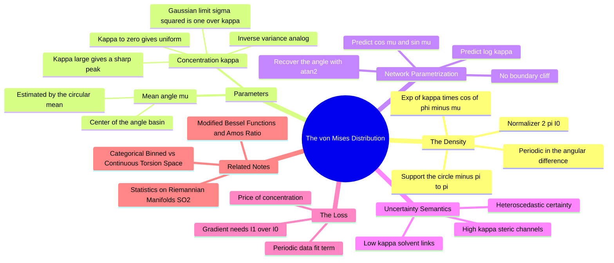

---
tags:
  - domain/circular-statistics
  - depth/essential
  - 3dsyntree
  - topic/torsion
  - topic/distributions
module: "08. Circular Statistics and Torsion Heads"
chapter: "Chapter 1. Circular Statistics Foundations"
type: concept
---

# 2. The von Mises Distribution

> [!abstract] Core Idea
> The von Mises distribution is the "normal distribution of the circle": a smooth, periodic probability density over angles with two knobs — a mean direction $\mu$ (which angle is preferred) and a concentration $\kappa$ (how tightly the preference is held, the circular analogue of $1/\sigma^2$). A network that outputs a von Mises distribution over a dihedral angle states both its best guess *and* its geometric certainty in one shot.

Navigation: [[0. Circular Statistics and Torsion Heads MOC]] · [[0. Master Vault Index]]

## 1. What It Is

The **von Mises distribution** (also called the *circular normal distribution*) is a probability density on the circle $[-\pi, \pi)$:

$$p(\phi \mid \mu, \kappa) = \frac{\exp\!\big(\kappa \cos(\phi - \mu)\big)}{2\pi\, I_0(\kappa)}$$

Every symbol has a precise job:

- $\phi \in [-\pi, \pi)$ — the angle (a dihedral/torsion value), a point on the circle of [[1. Statistics on Riemannian Manifolds SO2]].
- $\mu \in [-\pi, \pi)$ — the **mean direction**: the angle at which the density peaks.
- $\kappa > 0$ — the **concentration parameter**: how sharply mass concentrates around $\mu$; it behaves like an inverse variance (a *precision*).
- $I_0(\kappa)$ — the **modified Bessel function of the first kind, order zero**, evaluated at $\kappa$; it is the normalization constant that makes the density integrate to $1$ over the circle. Its numerical care and feeding is the whole subject of [[3. Modified Bessel Functions and Amos Ratio]].

## 2. Why It Exists

A probabilistic head that predicts a continuous angle needs a *density on the circle* — smooth everywhere (no jump at the $-\pi/+\pi$ seam), periodic, differentiable, and trainable by maximum likelihood. The candidates all fail except this one:

- A plain Gaussian on $[-\pi, \pi)$ is not periodic: it assigns near-zero density just across the seam from its own peak, and its normalization leaks mass across the boundary.
- Wrapped distributions (wrapping a Gaussian around the circle) fix the seam but hide the normalizer inside an infinite sum of Gaussian tails — awkward for exact negative log-likelihoods.
- The von Mises family is *born* on the circle: the density depends on $\phi$ only through the periodic quantity $\cos(\phi - \mu)$, its normalizer $2\pi I_0(\kappa)$ is a single special function, and it belongs to the exponential family, so maximum likelihood behaves exactly like Gaussian regression does on the line.

## 3. How It Works

### 3.1 Anatomy of the density

Write the density as $\text{peak} \times \text{normalizer}^{-1}$:

- **Numerator** $\exp(\kappa\cos(\phi - \mu))$: cosine equals $1$ at $\phi = \mu$ (maximum) and $-1$ at $\phi = \mu \pm \pi$ (minimum), so the density is automatically periodic in the *difference* $\phi - \mu$ — the seam is structurally harmless. The exponential rescales the gentle cosine swing $[-1, 1]$ into a controllable peak-to-trough ratio of $e^{2\kappa}$ (a factor of $\approx 490$ already at $\kappa = 3.1$, and $\approx 5\times10^8$ at $\kappa = 10$).
- **Denominator** $2\pi I_0(\kappa)$: the exact integral $\int_{-\pi}^{\pi} e^{\kappa\cos\phi}\,d\phi = 2\pi I_0(\kappa)$ is the defining property of $I_0$. Dividing by it guarantees $\int p\, d\phi = 1$ for every $(\mu, \kappa)$.

### 3.2 The mean angle $\mu$

$\mu$ is both the density's mode and its circular mean (for $\kappa$ not too small the distribution is nearly symmetric about $\mu$). Given data angles $\phi_1, \dots, \phi_n$, the maximum-likelihood estimate of $\mu$ is exactly the circular mean $\operatorname{atan2}(\sum_i \sin\phi_i, \sum_i \cos\phi_i)$ from [[1. Statistics on Riemannian Manifolds SO2]] — a reassuring consistency: the estimator you would compute by hand is the one maximum likelihood endorses.

### 3.3 The concentration $\kappa$ and its two limits

$\kappa$ is the circular twin of $1/\sigma^2$ (not of $\sigma$): **large $\kappa$ = tight = confident; small $\kappa$ = spread = uncertain.**

- **Limit $\kappa \to 0$:** the numerator becomes $e^0 = 1$ and $I_0(0) = 1$, so $p \to 1/2\pi$ — the **uniform distribution** on the circle. Every angle equally likely; maximal ignorance.
- **Limit $\kappa \to \infty$:** the density sharpens into a narrow peak around $\mu$ — in the limit, a point mass (a Dirac delta at $\mu$).

There is a calculus bridge between the two: for small deviations $\Delta = \phi - \mu$, use $\cos\Delta \approx 1 - \Delta^2/2$ and $I_0(\kappa) \approx e^{\kappa}/\sqrt{2\pi\kappa}$, and the von Mises collapses to an ordinary Gaussian:

$$p(\phi \mid \mu, \kappa) \approx \sqrt{\frac{\kappa}{2\pi}} \exp\!\left(-\frac{\kappa\,\Delta^2}{2}\right) \qquad \Rightarrow \qquad \sigma \approx \frac{1}{\sqrt{\kappa}} \text{ radians.}$$

| $\kappa$ | Behavior | Approx. spread ($\sigma \approx 1/\sqrt{\kappa}$) |
| --- | --- | --- |
| $0$ | Uniform over the full circle | $360^\circ$ coverage |
| $1$ | Broad, gently favored direction | $\approx 57^\circ$ |
| $10$ | Clearly peaked | $\approx 18^\circ$ |
| $100$ | Sharp spike | $\approx 6^\circ$ |

> [!example] Reading $\kappa$ off a molecule
> A freely rotating solvent-exposed linker (nothing within van der Waals contact of the rotating fragment) has a nearly flat torsion profile: the correct $\kappa$ is close to $0$. A fragment threaded through a narrow hydrophobic channel can only adopt one angle without slamming into the walls: the correct $\kappa$ is large. Same head, same two parameters — the pocket decides which regime the data are in.

### 3.4 Predicting $[\cos\mu, \sin\mu, \log\kappa]$ — and recovering the angle

A neural network cannot safely output a raw angle: $\mu$ lives on a circle, but network outputs are unbounded reals, and any raw-angle output line creates an artificial cliff at $\pm\pi$ (values just below $\pi$ and just above $-\pi$ are neighbors physically, but the outputs "jump" by $2\pi$). The fix mirrors the circular mean:

1. Output **two unbounded reals** for the direction, interpreted as $(\cos\mu, \sin\mu)$, then normalize them to unit length (the density only needs the *direction*, and normalization keeps the pair on the circle).
2. Recover the actual angle with the two-argument arctangent: $\mu = \operatorname{atan2}(\sin\mu, \cos\mu)$ — in code, `torch.atan2`, which returns a clean angle in $(-\pi, \pi]$ with no boundary discontinuity anywhere except the harmless origin.
3. Output **one unbounded real for $\log\kappa$**, then set $\kappa = \exp(\log\kappa)$. This guarantees $\kappa > 0$ (a hard requirement — $\kappa \leq 0$ is not a valid concentration) *and* compresses the dynamic range: $\kappa \in [0.01, 100]$ maps to $\log\kappa \in [-4.6, 4.6]$, a scale networks handle far better than three orders of magnitude of raw outputs.

So the torsion head's full output is the triple $[\cos\mu, \sin\mu, \log\kappa]$ — three numbers, no constraints to violate, no seam to cross.

### 3.5 Uncertainty semantics: $\kappa$ is a *signal*, not noise to minimize

In an ML framing, this is **heteroscedastic regression**: the network predicts its own aleatoric uncertainty. The physically meaningful reading for torsions:

- **Low $\kappa$** — a flexible, solvent-exposed link: many rotamers are acceptable, the reward landscape is flat in $\phi$, and a confident (high-$\kappa$) prediction would be *overconfident* and would receive large losses whenever data disagree.
- **High $\kappa$** — a sterically confined junction, e.g. a fragment lying along a pocket channel: geometry forces one angle; a low-$\kappa$ (wishy-washy) prediction wastes the information the pocket provides.

The pocket context vector produced by the cross-attention decoder ([[3. Cross Attention Decoders for SBDD]], feeding `SynTreePolicy` in `syntree/models/policy.py`) is what lets the head *see* which regime it is in — the same junction chemistry can be rigid in one pocket and floppy in another. Junctions that are planarity-locked by resonance (amides, esters — see [[2. Resonance Conjugation and the Amide Planarity Lock]]) never reach the torsion head at all: their angle is fixed at $0^\circ$/$180^\circ$ by chemistry.

### 3.6 The negative log-likelihood loss

Training by maximum likelihood means minimizing

$$\text{NLL}(\phi; \mu, \kappa) = -\log p = \kappa\big(1 - \cos(\phi - \mu)\big) + \log 2\pi + \log I_0(\kappa).$$

Structure of the loss: the first term is a periodic data-fit term (zero at $\phi = \mu$, growing to $2\kappa$ at the opposite angle); the remaining terms are the price of the parameters — a constant plus $\log I_0(\kappa)$, which grows with $\kappa$ and *penalizes overconfidence*.

> [!example] NLL numbers, $\mu = 60^\circ$, $\kappa = 10$
> Observe $\phi = 60^\circ$ (perfect hit): data term $= 0$; $\text{NLL} = \log(2\pi I_0(10)) = \log(2\pi \times 2815.7) = 9.78$.
> Observe $\phi = 45^\circ$ (off by $15^\circ$): data term $= 10\,(1 - \cos 15^\circ) = 0.34$; $\text{NLL} = 10.12$ — barely worse.
> Observe $\phi = 240^\circ$ (exactly opposite): data term $= 20$; $\text{NLL} = 29.78$ — catastrophic, as a sharp prediction should be when reality points the other way.
> Contrast a timid $\kappa = 0$ (uniform): $\text{NLL} = \log 2\pi = 1.84$ for *any* $\phi$. The loss quietly prices confidence: sharpening is worth it only when the data really do cluster near $\mu$.

The gradients are where the engineering lives: $\partial\,\text{NLL}/\partial\mu = -\kappa\sin(\phi - \mu)$ (fine), but

$$\frac{\partial\,\text{NLL}}{\partial\kappa} = 1 - \cos(\phi - \mu) + \frac{d}{d\kappa}\log I_0(\kappa) = 1 - \cos(\phi - \mu) + \frac{I_1(\kappa)}{I_0(\kappa)},$$

so every training step needs not just $\log I_0(\kappa)$ but also the Bessel *ratio* $I_1/I_0$ — and computing both naively is a numerically treacherous affair, treated in full in [[3. Modified Bessel Functions and Amos Ratio]].

## 4. What It Consists Of

- **Mean direction $\mu$** — the peak angle; estimated from data by the circular mean.
- **Concentration $\kappa$** — the inverse-variance analog; $\kappa \to 0$ uniform, $\kappa \to \infty$ point mass.
- **Bessel normalization $2\pi I_0(\kappa)$** — the exact circle integral of the unnormalized density.
- **$[\cos\mu, \sin\mu, \log\kappa]$ parametrization** — the seam-safe network output convention.
- **`torch.atan2` recovery** — two-argument arctangent converting the direction pair back to an angle in $(-\pi, \pi]$.
- **von Mises NLL** — the periodic maximum-likelihood loss; requires $\log I_0$ and $I_1/I_0$.
- **Sampling** — drawing an angle from the density (rejection or tabulated-CDF methods), used when the policy must *act*, not just score.

## 5. What You Must Understand

> [!warning] Students often miss this
> $\kappa$ is the analog of $1/\sigma^2$, not of $\sigma$. Doubling $\kappa$ *halves* the (squared, Gaussian-limit) spread. Confusing the direction of this arrow is the single most common error when reading von Mises outputs.

> [!warning]
> Predicting a raw $\mu$ with an MSE-style head reintroduces the $-\pi/+\pi$ cliff that the whole circular framework exists to remove. The $(\cos\mu, \sin\mu)$ parametrization is not cosmetic polish; it is the only representation in which every network output is a legal angle encoding.

> [!tip] Memory hooks
> "Cosine is the potential, exponential the temperature": $e^{\kappa\cos}$ is literally a Boltzmann factor of the torsional energy $\kappa(1 - \cos)$, so the von Mises is the equilibrium distribution of a rotor with a single cosine barrier. And the Gaussian-limit mantra: $\sigma^2 \approx 1/\kappa$ (radians squared).

> [!note]
> $\log\kappa$ (not $\kappa$) is the network output for two independent reasons: positivity by construction, and dynamic-range compression. Both matter; the second is what keeps gradient scales sane across the $\kappa \in [10^{-2}, 10^{2}]$ span a real pocket data set exercises.

## 6. Prerequisites

- [[1. Statistics on Riemannian Manifolds SO2]] — periodic domains, circular distance, and the circular mean; the von Mises is the distribution-native continuation of that machinery.

## 7. Project Connection

- `ContinuousTorsionHead` in `syntree/models/torsion_head.py` is the von Mises head: it predicts $[\cos\mu, \sin\mu, \log\kappa]$ from the pocket-conditioned representation, recovers the angle with `torch.atan2`, and trains through `loss_fn()` on the periodic NLL with the stable normalizer `log_bessel_i0()`.
- The chosen angle is written into the 3D geometry with `rdMolTransforms.SetDihedralDeg`, and conjugated (amide/ester) junctions are detected by `is_conjugated_junction()` so their planarity-locked angles bypass the distributional head entirely.
- The uncertainty semantics are functional, not decorative: low-$\kappa$ predictions mark solvent-flexible links, high-$\kappa$ predictions mark sterically channeled ones — information that later shaped the categorical redesign discussed in [[1. Categorical Binned vs Continuous Torsion Space]].

## 8. Required Depth

**Essential** — this distribution is the mathematical core of the continuous torsion head; every later design decision (numerical stabilization, then the categorical switch) is an argument about this density's properties.

## 9. Further Dependencies

- [[3. Modified Bessel Functions and Amos Ratio]] — computes $\log I_0(\kappa)$ and the ratio $I_1/I_0$ that the NLL and its gradient require, stably.
- [[1. Categorical Binned vs Continuous Torsion Space]] — the design discussion in which the continuous von Mises head is weighed against, and ultimately superseded by, a 36-bin categorical head.

## Concept Mind Map

## Cross-Domain Links

- [[AI/07. Directional Statistics and Torsion Manifolds/Chapter 1. Riemannian Geometry of the Circle/2. The von Mises Distribution on S1|2. The von Mises Distribution on S1]] (AI vault) — the circular normal distribution and its $[\cos\mu, \sin\mu, \log\kappa]$ parameterization.
