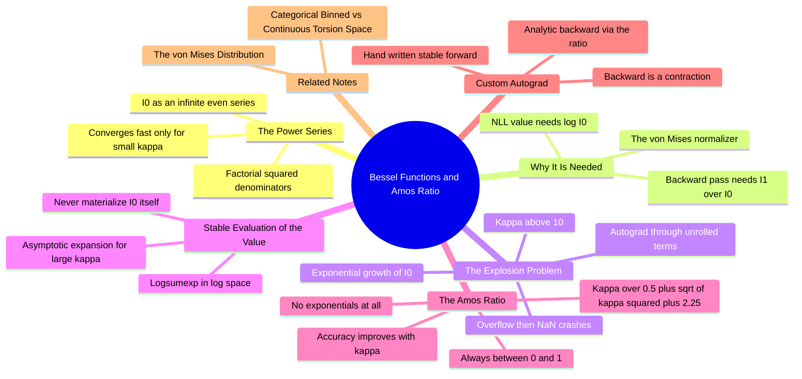

---
tags:
  - domain/circular-statistics
  - depth/supporting
  - 3dsyntree
  - topic/numerical-methods
  - topic/torsion
module: "08. Circular Statistics and Torsion Heads"
chapter: "Chapter 1. Circular Statistics Foundations"
type: concept
---

# 3. Modified Bessel Functions and Amos Ratio

> [!abstract] Core Idea
> The von Mises density is normalized by a modified Bessel function $I_0(\kappa)$, and training against that density requires $\log I_0(\kappa)$ *and* its derivative $I_1(\kappa)/I_0(\kappa)$ at every step. Computing these by naively unrolling the defining power series explodes once $\kappa$ passes roughly $10$ — overflowing intermediates, exploding gradients, NaN losses. A 1974 continued-fraction approximation due to Amos, wrapped in a custom autograd function, makes both quantities cheap, smooth, and provably bounded.

Navigation: [[0. Circular Statistics and Torsion Heads MOC]] · [[0. Master Vault Index]]

## 1. What It Is

The **modified Bessel function of the first kind, order zero**, is the infinite even power series

$$I_0(\kappa) = \sum_{m=0}^{\infty} \frac{1}{(m!)^2} \left( \frac{\kappa}{2} \right)^{2m} = 1 + \frac{\kappa^2}{4} + \frac{\kappa^4}{64} + \frac{\kappa^6}{2304} + \cdots$$

(only even powers appear, so $I_0 \geq 1$ for $\kappa \geq 0$, with $I_0(0) = 1$). Its first-order sibling $I_1(\kappa)$ is the analogous series with odd powers, and the two are linked by the derivative identity

$$\frac{d}{d\kappa} I_0(\kappa) = I_1(\kappa) \qquad\Longrightarrow\qquad \frac{d}{d\kappa} \log I_0(\kappa) = \frac{I_1(\kappa)}{I_0(\kappa)},$$

the **Bessel ratio** (sometimes called $A(\kappa)$). This note is about evaluating $I_0$, $I_1$, and especially the ratio $I_1/I_0$ — the quantity that, per [[2. The von Mises Distribution]], appears in the $\kappa$-gradient of the von Mises negative log-likelihood — in a way that survives a training run.

## 2. Why It Exists

The von Mises NLL is $\kappa(1 - \cos(\phi - \mu)) + \log 2\pi + \log I_0(\kappa)$. Its value needs $\log I_0(\kappa)$; its gradient with respect to $\kappa$ needs $I_1(\kappa)/I_0(\kappa)$. This happens **for every torsion prediction, in every batch, at every training step** — millions of times per run. So the evaluation must be simultaneously fast, exact enough for gradients, and numerically stable over the entire reachable range of $\kappa$. The naive route — unroll the power series as a differentiable polynomial in $\kappa$ and let the autograd engine differentiate through the unrolling — fails on all three counts as soon as $\kappa$ grows, and an unconstrained network head *will* push $\kappa$ high (that pressure is analyzed in [[1. Categorical Binned vs Continuous Torsion Space]]).

## 3. How It Works

### 3.1 The power series in its comfort zone

For small $\kappa$ the series is a pleasure: terms decay super-fast because of the $(m!)^2$ denominator.

> [!example] Evaluating $I_0(2)$ by hand
> Terms: $m=0$: $1$; $m=1$: $(1)^2/1 = 1$; $m=2$: $1/4 = 0.25$; $m=3$: $1/36 = 0.0278$; $m=4$: $1/576 = 0.00174$; $m=5$: $1/14400 = 0.000069$. Partial sums: $1, 2, 2.25, 2.2778, 2.2795, 2.2796$. Six terms converge to $I_0(2) = 2.2796$ — textbook behavior.

As a rule of thumb the meaningful terms extend to $m \approx \kappa/2$, so the series is short precisely where $\kappa$ is small — and hopeless exactly where the von Mises head wants to live.

### 3.2 Why unrolling explodes for $\kappa > 10$

Three compounding failure modes:

1. **Runaway term growth.** $I_0$ grows like $e^{\kappa}/\sqrt{2\pi\kappa}$ — exponential in $\kappa$. $I_0(10) \approx 2815.7$; $I_0(50) \approx 2.9\times10^{20}$; $I_0(100) \approx 1.1\times10^{42}$, which already **overflows float32** (maximum $\approx 3.4\times10^{38}$). An unrolled series computes those monsters as intermediates even if you only wanted the logarithm.
2. **Autograd through the unrolling.** The backward pass multiplies and sums the derivatives of every term. Each term's derivative carries a factor $2m/\kappa$ (from differentiating the power), and there are $\sim\kappa/2$ non-negligible terms each of size comparable to the (already huge) function value. The result is a gradient magnitude proportional to $I_0$-scale numbers — an **explosion**, not an overflow of the loss value itself. Empirically the project's threshold: anything past $\kappa \approx 10$ destabilizes training.
3. **NaN propagation.** One overflow produces `inf`; a subsequent subtraction of two `inf`s (or `inf × 0` from a ReLU gate) produces `NaN`; and a single NaN in the loss poisons *every* gradient in the batch and every parameter in the network within one optimizer step. Training does not degrade gracefully — it crashes.

The bitter irony: the *exact* derivative the series is trying to compute, $d\log I_0/d\kappa = I_1/I_0 < 1$, is mathematically bounded — $\log I_0$ is an increasing, concave function whose slope rises from $0$ (at $\kappa = 0$) toward $1$ (as $\kappa \to \infty$) but never exceeds $1$. The explosion is purely an artifact of *how* the quantity is computed, not of the quantity itself.

### 3.3 Stable evaluation of the value: compute $\log I_0$, never $I_0$

The cure for the value is to work entirely in log space:

- **Moderate $\kappa$ (series region):** evaluate $\log I_0(\kappa) = \operatorname{logsumexp}_m \big( 2m\log(\kappa/2) - 2\log m! \big)$. Each series term is computed directly as a logarithm (never exponentiated to its raw size), and the log-sum-exp trick subtracts the running maximum before exponentiating — so no intermediate ever overflows, at any $\kappa$ where the series is used.
- **Large $\kappa$ (asymptotic region):** switch to the asymptotic expansion $\log I_0(\kappa) \approx \kappa - \tfrac{1}{2}\log(2\pi\kappa) + \tfrac{1}{8\kappa} - \cdots$, which is how $e^{\kappa}$-scale values are handled everywhere in scientific computing (this is the same family of expansions Amos organized for machine use).

### 3.4 Amos' continued-fraction approximation for the ratio

For the gradient, what is needed is not $I_0$ or $I_1$ separately but their ratio. Donald Amos' 1974 classic on computing Bessel functions and their ratios shows that ratios are best evaluated directly — via continued fractions, never by dividing two huge numbers. The project uses the resulting compact approximation (Issue #8 [MATH-02]):

$$\boxed{\; \frac{I_1(\kappa)}{I_0(\kappa)} \;\approx\; \frac{\kappa}{0.5 + \sqrt{\kappa^2 + 2.25}} \;\in\; [0.0,\, 1.0) \;}$$

Why this formula is a gem:

- **Bounded by construction:** at $\kappa = 0$ it gives $0$; as $\kappa \to \infty$ it approaches $1$ from below but never reaches it. The gradient it supplies can never amplify — it is a *contraction* on the upstream signal.
- **Overflow-proof at any $\kappa$:** it contains one multiplication, one addition, one square root — no exponentials, no factorials, no series. $\kappa = 10^6$ is as boring as $\kappa = 1$.
- **Monotone and smooth:** it rises smoothly from $0$ to $1$, mirroring the true ratio's behavior, so optimization landscapes are not polluted by spurious wiggles.

> [!example] Accuracy check of the Amos ratio
> $\kappa = 1$: approximation $1/(0.5 + \sqrt{3.25}) = 0.434$; true $I_1(1)/I_0(1) = 0.5652/1.2661 = 0.446$ — about $2.7\%$ low.
> $\kappa = 10$: approximation $10/(0.5 + \sqrt{102.25}) = 0.942$; true $2671.0/2815.7 = 0.949$ — $0.7\%$ low.
> $\kappa = 100$: approximation $100/(0.5 + \sqrt{10002.25}) = 0.9949$; true $\approx 0.995$ — sub-$0.1\%$ error.
> Accuracy *improves* with $\kappa$ — exactly where the naive series is worst — and a couple percent of error in a gradient direction is negligible for SGD.

### 3.5 Custom autograd: hand-written forward, analytic backward

The final architectural move is to stop asking the autograd engine to differentiate through the computation at all. Implement $\log I_0$ as a **custom autograd function**: the forward pass computes the value stably (log-sum-exp series, asymptotic switch, per Section 3.3); the backward pass *skips the forward graph entirely* and applies the analytic derivative by multiplying the incoming upstream gradient by the Amos ratio:

- forward: $\kappa \mapsto \log I_0(\kappa)$ — stable, no overflow at any $\kappa$;
- backward: $\text{grad}_\kappa \mathrel{+}= \text{grad}_{\text{upstream}} \times I_1(\kappa)/I_0(\kappa)$, with the ratio from the Amos formula.

Everything the naive path stored — the unrolled powers, the factorial-scale intermediates — is simply never created. Since the ratio is $< 1$, the backward pass is a contraction: no explosion is *possible*, and the NaN-crash mode of Section 3.2 is eliminated at the root. This is the same engineering pattern PyTorch itself uses for log-softmax, `gammaln`, and every other special function: stable forward, analytic backward, autograd as a dispatcher rather than a differentiator-through-chaos.

### 3.6 The general lesson

When a special function enters a loss, ask three questions: (1) In what *reduced* form does the loss actually need it (here: $\log I_0$ and $I_1/I_0$, never $I_0$ or $I_1$ raw)? (2) Does the exact derivative have a *bounded* closed form? (3) Can forward and backward be *separately* engineered for stability? A "yes" to all three means a custom autograd function is the correct tool — and a naive `torch`-ops transcription of the textbook series formula is a NaN factory.

## 4. What It Consists Of

- **$I_0(\kappa)$ power series** — the defining even series with $(m!)^2$ denominators; converges fast only for small $\kappa$.
- **$I_1(\kappa)$** — the order-one sibling; appears only inside the ratio.
- **Bessel ratio $A(\kappa) = I_1/I_0 = d\log I_0/d\kappa$** — the exact $\kappa$-gradient of the von Mises normalizer, bounded in $[0, 1)$.
- **Asymptotic expansion** — $\log I_0(\kappa) \approx \kappa - \tfrac12\log(2\pi\kappa)$ for large $\kappa$; the exponential-growth antidote.
- **Log-sum-exp evaluation** — computing $\log$ of a sum of positive terms without ever materializing the terms.
- **Amos continued fraction** — the bounded, overflow-free ratio approximation $\kappa/(0.5 + \sqrt{\kappa^2 + 2.25})$.
- **Custom autograd function** — forward and backward implemented by hand; autograd routes gradients through the analytic formula.

## 5. What You Must Understand

> [!warning] Students often miss this
> The instability is not a property of the von Mises distribution — it is a property of *one way of computing* its normalizer. The exact derivative is a number in $[0,1)$; only the series-unrolled computation of it explodes. Blaming the math instead of the implementation leads to abandoning a perfectly good distribution for no reason.

> [!warning]
> Never compute $I_0$ and then take its log. For $\kappa \gtrsim 90$ the intermediate overflows float32 and the log arrives as `inf`, and even before overflow you lose most of the significant digits. Compute $\log I_0$ directly in log space.

> [!tip] Memory hooks
> Sanity invariant: $0 \leq I_1(\kappa)/I_0(\kappa) < 1$ for every $\kappa > 0$ — if a backward pass reports a larger gradient magnitude than the upstream one, the ratio implementation is wrong, no debugging of the loss needed. And the two limits: ratio $\to 0$ as $\kappa \to 0$ (uniform, flat in $\kappa$), ratio $\to 1$ as $\kappa \to \infty$ (normalizer grows exactly like $e^{\kappa}$).

> [!note]
> Float precision matters here: float32 tolerates $\approx 3.4\times10^{38}$, and $I_0$ crosses that near $\kappa \approx 94$; a float64 fallback delays but does not remove the cliff, and costs bandwidth on GPU. The log-space/custom-autograd design is precision-agnostic — it works identically in both.

## 6. Prerequisites

- [[2. The von Mises Distribution]] — defines the density whose normalizer and NLL gradient are being computed here.

## 7. Project Connection

- `log_bessel_i0()` in `syntree/models/torsion_head.py` is the stable $\log I_0$ implementation (log-space forward, Amos-ratio backward) consumed by `ContinuousTorsionHead.loss_fn()` during von Mises training.
- Issue #8 [MATH-02] is the tracked fix that introduced Amos' continued-fraction approximation, replacing the series-unrolled evaluation whose gradients exploded for $\kappa > 10$ and crashed runs with NaN losses.
- The fix is regression-tested by the GPU stability suite (`tests/test_gpu_stability_fixes.py`), which exercises large-$\kappa$ forward and backward passes specifically to prove the NaN-crash mode is dead.

## 8. Required Depth

**Supporting** — this is pure numerical plumbing: no new chemistry or policy theory, but without it the von Mises head of [[2. The von Mises Distribution]] cannot be trained at all, and the failure mode it fixes (silent NaN collapse) is worth recognizing anywhere special functions meet autograd.

## 9. Further Dependencies

- [[1. Categorical Binned vs Continuous Torsion Space]] — even with numerically stable Bessel code, the continuous head's unbounded $\kappa$ keeps pressuring the GFlowNet loss; this note's fix is a necessary but not sufficient condition for the design change made there.

## Concept Mind Map

## Cross-Domain Links

- [[AI/07. Directional Statistics and Torsion Manifolds/Chapter 2. Torsion Prediction and Optimization/1. The Amos Ratio Approximation and Gradient Stabilization|1. The Amos Ratio Approximation and Gradient Stabilization]] (AI vault) — the Amos continued-fraction ratio yields a closed-form backward pass that avoids $\kappa > 10$ series overflow.
