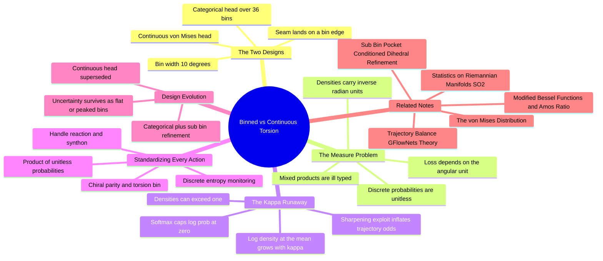

---
tags:
  - domain/circular-statistics
  - depth/essential
  - 3dsyntree
  - topic/gflownets
  - topic/torsion
module: "08. Circular Statistics and Torsion Heads"
chapter: "Chapter 2. Torsion Prediction Design"
type: concept
---

# 1. Categorical Binned vs Continuous Torsion Space

> [!abstract] Core Idea
> When the policy must choose a dihedral angle, there are two ways to structure the choice: predict continuous von Mises parameters, or carve the circle into 36 discrete bins of $10^\circ$ and pick one categorically. The continuous design is elegant, but inside a GFlowNet's Trajectory Balance loss it mixes units — probability *densities* measured per radian alongside dimensionless discrete *probabilities* — which breaks measure theory and lets the concentration $\kappa$ run to infinity. Making every action categorical keeps every probability a clean, unitless number, which is why the binned design won.

Navigation: [[0. Circular Statistics and Torsion Heads MOC]] · [[0. Master Vault Index]]

## 1. What It Is

This note is the design study for the **torsion component $\phi_t$ of the hierarchical action** $a_t = (\text{handle}_t, r_t, B_t, c_t, \phi_t)$ — which reactive handle to extend, which reaction family to use, which catalog synthon to attach, which chiral parity to set, and which dihedral the new junction should take. Two candidate action-space designs were considered:

- **Continuous design** — the head outputs von Mises parameters $[\cos\mu, \sin\mu, \log\kappa]$ (per [[2. The von Mises Distribution]]); the *action* is an angle sampled from that density on the circle of [[1. Statistics on Riemannian Manifolds SO2]].
- **Categorical design** — the circle is partitioned into $N_\phi = 36$ equal bins of $10^\circ$:

$$\text{Bin}_k = \big[-180^\circ + 10^\circ\, k,\; -180^\circ + 10^\circ (k+1)\big), \qquad k = 0, 1, \dots, 35,$$

  and the head emits a discrete distribution over the 36 bins via a Softmax over 36 logits. The *action* is a bin index $k$.

The deployed system uses the categorical design — but only after the continuous head had taught the team exactly where the cliffs were.

## 2. Why It Exists

The policy is a **GFlowNet trained with the Trajectory Balance (TB) objective** ([[1. Trajectory Balance GFlowNets Theory]]): loosely,

$$\mathcal{L}_{\text{TB}} = \left( \log Z + \sum_{t} \log \pi_F(a_t \mid s_t) - \log R(x) - \sum_{t} \log P_B(a_t \mid s_t) \right)^{2},$$

matching a learnable normalizer $\log Z$ plus the forward trajectory log-probability against the log-reward and the backward log-probability. Every $\log \pi_F$ term must be the logarithm of a *probability of a trajectory* — a dimensionless number computed under a single consistent probability measure. If the five action components are sampled from different kinds of objects — four discrete heads emitting unitless probabilities and one continuous head emitting a **density with units of $\text{rad}^{-1}$** — then the "product of action probabilities" along a trajectory is not a probability at all. The loss still runs; the mathematics underneath it has quietly stopped being true.

## 3. How It Works

### 3.1 The measure-theory problem: mass versus density

A **discrete probability** (a *mass*) is a dimensionless number: Softmax outputs between 0 and 1 summing to 1 over the option set. A **continuous density** is a *rate*: probability per unit of the reference measure — for angles, per radian. The distinction is not pedantic:

- **Densities can exceed 1.** A density of $2.4\ \text{rad}^{-1}$ is perfectly legal; it means $2.4$ units of probability mass per radian locally. A probability of $2.4$ is nonsense.
- **Density values depend on the units of the measure.** Express the same distribution per degree instead of per radian and every density value is multiplied by $\pi/180$; every log-density shifts by the constant $\log(\pi/180)$. A loss that mixes densities with masses is therefore **not invariant to the choice of angular unit** — the "objective" changes when a human converts radians to degrees in a config file.
- **Products across mixed spaces are ill-defined.** The probability of a joint action is a product of its components' probabilities only when they share a measure structure; multiplying a mass by a density yields a quantity that is neither, with units of $\text{rad}^{-1}$ per torsion step — and the TB sum then adds apples to per-radian oranges, with the *relative weighting of the torsion term versus the synthon term* arbitrary and unit-dependent.

> [!example] A legal density that breaks the loss
> A von Mises with $\kappa = 10$ evaluated at its own mean: $p(\mu) = e^{10}/(2\pi I_0(10)) = 1.24\ \text{rad}^{-1}$ — the log "probability" of that action is $+0.22$, *above zero*. True probabilities cap at $\log 1 = 0$; densities do not cap at anything.

### 3.2 The $\kappa \to \infty$ instability

The unboundedness above is not just unaesthetic — it is an **exploitable**. Using the Gaussian limit from [[2. The von Mises Distribution]], the density at the mean scales as

$$p(\mu \mid \mu, \kappa) \approx \sqrt{\frac{\kappa}{2\pi}} \quad\Rightarrow\quad \log p(\mu) \approx \tfrac{1}{2}\log\kappa - \tfrac{1}{2}\log 2\pi,$$

which grows without bound as $\kappa$ increases. A GFlowNet policy is rewarded for assigning high probability to the trajectories it takes; with a continuous torsion head, the cheapest way to pump $\sum_t \log \pi_F$ upward is to **sharpen $\kappa$ after the fact** — concentrate the von Mises tightly around whatever angle was sampled, inflating the trajectory's log-probability without making the molecule one bit better. The optimizer discovers this immediately: $\kappa$ climbs, the Bessel machinery of [[3. Modified Bessel Functions and Amos Ratio]] (which at least kept the gradients bounded) runs at its limits, and the TB loss degenerates — training instability with $\kappa \to \infty$ as the visible symptom and broken measure theory as the root cause. A categorical head cannot perform this exploit **in principle**: a Softmax probability is at most $1$, so every per-step log-probability is at most $0$ — the reward for sharpening saturates exactly where honest probability theory says it should.

### 3.3 The categorical design: 36 bins, one Softmax

The binned circle:

- **Grid:** $\text{Bin}_k = [-180^\circ + 10^\circ k,\; -180^\circ + 10^\circ(k+1))$ for $k = 0, \dots, 35$; bin $k$ has center $-175^\circ + 10^\circ k$. Thirty-six bins times $10^\circ$ covers the full $360^\circ$ circle, so every legal angle maps to exactly one bin.
- **Head:** 36 logits $\to$ Softmax $\to$ $\pi(\phi = k \mid s)$, a set of dimensionless numbers in $(0,1)$ summing to $1$. Sampling is a categorical draw; the uniform baseline is $1/36 \approx 0.028$.
- **Seam placement:** the wrap point $\pm 180^\circ$ lands exactly *on* a bin edge (between the last and first bins) — never inside a bin — so no single action straddles the $-\pi/+\pi$ seam that plagued raw-angle regression in [[1. Statistics on Riemannian Manifolds SO2]]. Adjacency is simply not the Softmax's concern: bin 35 and bin 0 are unrelated labels, whatever their geometric nearness.

### 3.4 Standardizing the whole action: $h_t, r_t, B_t, c_t, \phi_t$

The decisive move was to apply the same treatment to *every* action component (Issue #24 [MODEL-04] discrete action standardization, alongside Issue #38 [FLOW-04]): the handle choice, the reaction family, the synthon from the 50,000-entry catalog, the chiral parity, and the torsion bin are **all categorical heads**. The joint action probability is then a clean product of five dimensionless probabilities,

$$\pi_F(a_t \mid s_t) = \pi(h_t)\,\pi(r_t)\,\pi(B_t)\,\pi(c_t)\,\pi(\phi_t),$$

and its logarithm is a sum of honest log-probabilities under a purely discrete measure. The TB loss becomes **mathematically rigorous and unit-free** — nothing in it knows angles are measured in radians — and every head can be monitored with the same tool, the **discrete entropy** $-\sum_k \pi_k \log \pi_k$: near $\log 36 \approx 3.58$ nats means an undecided torsion head; near $0$ means a locked-in rotamer.

### 3.5 The design evolution, honestly told

| Era | Torsion head | Action type | Fate |
| --- | --- | --- | --- |
| Continuous | von Mises $[\cos\mu, \sin\mu, \log\kappa]$ | Angle from density ($\text{rad}^{-1}$) | Elegant, uncertainty-aware — but TB-incompatible: mixed measures, $\kappa \to \infty$ exploit |
| Categorical (deployed) | Softmax over 36 bins of $10^\circ$ | Bin index (unitless) | Rigorous, stable — but quantized to $10^\circ$ |
| Categorical + refinement | Same Softmax | Bin index, then $\pm 5^\circ$ geometric polish | Recovers sub-bin precision without touching probabilities ([[2. Sub Bin Pocket Conditioned Dihedral Refinement]]) |

Two honest costs of binning: (1) **quantization** — any angle inside a bin is the same action, so up to $5^\circ$ of error is baked in at the bin edges (cured by the sub-bin refinement); (2) **lost topology** — one-hot labels do not know that neighboring bins are neighbors, so the head must *learn* local smoothness from data rather than inherit it. And the uncertainty semantics of $\kappa$ survive in translated form: a flat 36-way distribution *is* the low-$\kappa$ statement ("this junction is flexible, many bins fine"), a single peaked bin *is* the high-$\kappa$ statement ("this channel forces one geometry") — the pocket still decides which, exactly as in [[2. The von Mises Distribution]].

## 4. What It Consists Of

- **Angular binning grid** — the 36 intervals $\text{Bin}_k$, width $10^\circ$, half-open, tiling the circle.
- **Bin centers** — $-175^\circ + 10^\circ k$, the nominal angle written into the molecule when bin $k$ is chosen.
- **Categorical distribution** — Softmax over 36 logits; unitless probabilities summing to 1.
- **Discrete entropy** — $-\sum_k \pi_k \log \pi_k$; the exploration/commitment meter for the torsion head.
- **Measure consistency** — the requirement that every action log-probability in the TB loss be dimensionless.
- **Action standardization** — making $h_t, r_t, B_t, c_t, \phi_t$ all categorical so the joint probability is well-typed.
- **Trajectory Balance compatibility** — the property that $\log Z + \sum \log\pi_F$ and $\log R + \sum\log P_B$ are comparable, same-measure quantities.

## 5. What You Must Understand

> [!warning] Students often miss this
> The problem with the continuous head is *not* that von Mises sampling or its NLL are wrong — per-note 08.02 they are excellent. The problem is *context*: a GFlowNet multiplies action probabilities across heterogeneous heads and inside a squared log-ratio. Density-based actions are fine for plain supervised regression and poison for TB. The same head can be right in one training regime and wrong in another.

> [!warning]
> If you ever see a "log-probability" above zero in a loss, you are holding a density, not a probability — and any ratio-of-probabilities objective containing it is measuring nothing well-defined. This is the fastest diagnostic for mixed-measure bugs.

> [!tip] Memory hooks
> "Mass is a number, density is a rate." "Softmax caps you at zero" (log-probability). "36 bins, 10 degrees, seam on the edge." The $\kappa$-runaway and the density-unboundedness are the same fact seen from the loss side and the math side.

> [!note]
> Discretizing one variable does not weaken the GFlowNet guarantee: GFlowNets are defined over whatever the action space is, discrete or continuous; the requirement is *consistency* of the measure. All-categorical is simply the most abuse-proof way to be consistent.

## 6. Prerequisites

- [[1. Statistics on Riemannian Manifolds SO2]] — the circular geometry being discretized, and why the seam must land on a bin edge.
- [[2. The von Mises Distribution]] — the continuous head being compared: its parameters, its NLL, its uncertainty semantics.

## 7. Project Connection

- Issue #24 [MODEL-04] and Issue #38 [FLOW-04] drove the standardization of all action outputs ($h_t, r_t, B_t, c_t, \phi_t$) into discrete categorical probabilities.
- The policy heads live in `syntree/models/policy.py` — `SynTreePolicy` with `forward()` and `act()` emitting categorical distributions from the pocket context built by `self.cross_attention`; the earlier continuous era is preserved in `ContinuousTorsionHead` (`syntree/models/torsion_head.py`) predicting $[\cos\mu, \sin\mu, \log\kappa]$.
- The consumer of these unitless log-probabilities is `trajectory_balance_loss()` in `syntree/engine/gflownet.py`, together with the learnable $\log Z$; its well-posedness is exactly what this design decision purchased.

## 8. Required Depth

**Essential** — this is the note that explains *why the deployed torsion action space looks the way it does*; it is the hinge between the circular-statistics theory of Chapter 1 and the policy architecture actually trained.

## 9. Further Dependencies

- [[2. Sub Bin Pocket Conditioned Dihedral Refinement]] — recovers the sub-$10^\circ$ precision that binning gave up, without reintroducing continuous probabilities into the policy.
- [[1. Trajectory Balance GFlowNets Theory]] — the loss whose measure-theoretic strictures motivated the entire categorical standardization.

## Concept Mind Map

## Cross-Domain Links

- [[AI/07. Directional Statistics and Torsion Manifolds/Chapter 2. Torsion Prediction and Optimization/3. Categorical Dihedral Discretization vs Continuous Heads|3. Categorical Dihedral Discretization vs Continuous Heads]] (AI vault) — 36 bins eliminate the infinite-density $\kappa \to \infty$ exploit of continuous torsion heads.
- [[AI/07. Directional Statistics and Torsion Manifolds/Chapter 2. Torsion Prediction and Optimization/2. Measure-Theoretic Collapse of Continuous-Discrete TB|2. Measure-Theoretic Collapse of Continuous-Discrete TB]] (AI vault) — the measure-theoretic argument for why binned torsions stabilize trajectory balance.
