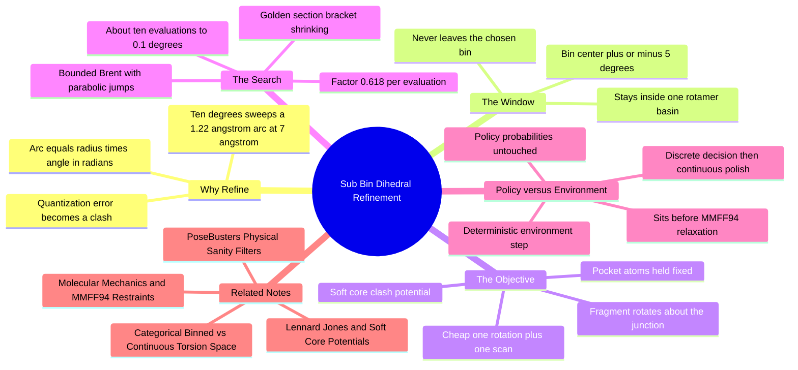

---
tags:
  - domain/circular-statistics
  - depth/supporting
  - 3dsyntree
  - topic/optimization
  - topic/torsion
module: "08. Circular Statistics and Torsion Heads"
chapter: "Chapter 2. Torsion Prediction Design"
type: concept
---

# 2. Sub Bin Pocket Conditioned Dihedral Refinement

> [!abstract] Core Idea
> A 10° torsion bin is coarse: at the far end of a growing molecule, 10° of rotation sweeps an atom through an arc of $1.22\text{ Å}$ — more than enough to bury it in a protein wall. The sub-bin refinement fixes this with a cheap local search (golden-section or bounded Brent) that nudges the dihedral *within the selected bin*, $\pm 5^\circ$, to minimize a soft-core clash potential against the pocket. Crucially, this is an environment-side geometric adjustment: it never touches the policy's probabilities.

Navigation: [[0. Circular Statistics and Torsion Heads MOC]] · [[0. Master Vault Index]]

## 1. What It Is

The **sub-bin refinement** is a deterministic geometric post-processing step in the assembly loop. After the policy samples a torsion bin $k$ (per [[1. Categorical Binned vs Continuous Torsion Space]]) and the bin's center angle is written into the molecule, the environment fine-tunes the dihedral inside the interval

$$\big[\phi_{\text{bin}} - 5^\circ,\; \phi_{\text{bin}} + 5^\circ\big],$$

where $\phi_{\text{bin}} = -175^\circ + 10^\circ k$ is the bin center. The search — golden-section or bounded Brent — minimizes the **soft-core clash potential** between the newly placed fragment atoms and the surrounding pocket residues. It executes between the categorical policy sampling and the MMFF94 force-field relaxation (Issue #42 [CHEM-07]).

## 2. Why It Exists

Binning bought mathematical rigor at the price of **quantization**: every angle inside a bin is the same action. The physical price of that coarseness scales with *distance from the rotation axis*. Rotating a dihedral by $\Delta\phi$ moves an atom at chain-distance $r$ from the junction along an arc of length

$$s = r\,\Delta\phi \qquad (\Delta\phi \text{ in radians}).$$

> [!example] The 1.22 Å arc-sweep error
> At $r = 7\text{ Å}$ from the junction — an entirely ordinary reach for a synthon at the end of a growing chain — a $10^\circ$ bin-width error moves the terminal atom through
> $$s = 7\text{ Å} \times \frac{10^\circ\,\pi}{180^\circ} = 7 \times 0.1745 = 1.22\text{ Å}.$$
> For scale: two bonded carbons sit $1.5\text{ Å}$ apart, and two non-bonded carbons need $\approx 3.4\text{ Å}$ between centers for comfortable van der Waals contact ([[3. Van der Waals Radii and Steric Clash]]). A $1.22\text{ Å}$ displacement is the difference between "resting near the pocket wall" and "driven into it" — a severe steric clash and a destroyed pose. Even the best possible bin choice can be $5^\circ$ off (half the bin), sweeping $0.61\text{ Å}$ — still clash-grade.

The refinement exists to pay back exactly this quantization debt, and no more.

## 3. How It Works

### 3.1 The window: one bin, one rotamer basin

The search is *strictly bounded* to $[\phi_{\text{bin}} - 5^\circ, \phi_{\text{bin}} + 5^\circ]$ — the full extent of the selected bin, centered on its nominal angle. Two reasons this is the right window:

- **It never contradicts the policy.** Moving outside the bin would silently replace the policy's decision ("rotamer basin $k$") with a different one ("basin $k+1$"), smuggling geometry into the trajectory that the policy never chose.
- **It stays within one energy regime.** A $10^\circ$ slice sits inside a single rotamer basin of the torsional energy profile (see [[2. Rotatable Bonds and Dihedral Angles]]), so the local objective is smooth — no barrier-crossing surprises.

### 3.2 The objective: soft-core clash energy against the pocket

Each candidate angle $\phi$ is evaluated by rotating the newly attached fragment about the junction bond (the rest of the molecule and all pocket atoms held fixed) and computing the **soft-core clash potential** — the repulsive non-bonded energy between fragment atoms and environment atoms, softened so that it stays finite and smooth even at very short distances. Why soft-core and not the raw Lennard-Jones 6-12 form: the true LJ potential diverges to $+\infty$ as $r \to 0$ ([[1. Lennard Jones and Soft Core Potentials]]), which makes any line search near an existing overlap ill-conditioned — enormous gradients, meaningless comparisons. The soft-core variant replaces the singular core with a finite, gentle repulsion, turning the objective into a well-behaved function that a derivative-free optimizer can descend. Evaluations are cheap by construction: the fragment's internal geometry is locked (embedded once by ETKDG), so a candidate costs one dihedral rotation plus one pairwise distance scan — no re-embedding, no network forward pass.

### 3.3 Golden-section search

**Golden-section search** is the classic derivative-free minimizer for a *unimodal* function on a fixed interval (unimodal = one valley, no local minima elsewhere):

1. Start with the bracket $[a, b] = [\phi_{\text{bin}} - 5^\circ, \phi_{\text{bin}} + 5^\circ]$.
2. Place two probe points inside, at the golden-ratio positions: a fraction $\varphi_G = (\sqrt{5} - 1)/2 \approx 0.618$ of the way from each end.
3. Evaluate the clash energy at both probes; the higher probe lies on the "worse" side of the valley, so discard that entire outer segment — the minimum is now bracketed in an interval $0.618$ times as long.
4. One probe from the previous step is still inside the new bracket and its value is already known, so each additional step costs **one** new evaluation while the bracket shrinks by another factor of $0.618$.

> [!example] Ten evaluations, one hundredfold precision
> The bracket starts at $10^\circ$ wide. After $n$ evaluations it is $10 \times 0.618^n$ degrees. To reach $0.1^\circ$ resolution: $0.618^n = 0.01$, so $n = \log(100)/\log(1/0.618) \approx 9.6$ — about **ten clash evaluations** in total. At microseconds each, the refinement is essentially free compared with the encoder forward pass that produced the bin choice.

### 3.4 Bounded Brent search

**Brent's method** accelerates the same idea: whenever the last three points look like a parabola, it fits one and jumps to the predicted minimum — typically converging in far fewer evaluations than pure golden-section. The **bounded** variant keeps hard interval limits: if the parabolic suggestion falls outside $[\phi_{\text{bin}} - 5^\circ, \phi_{\text{bin}} + 5^\circ]$ (or misbehaves), the method falls back to a golden-section step. This "propose fast, verify safe" pattern makes bounded Brent the preferred implementation when the objective is trusted to be smooth; pure golden-section is the no-assumptions fallback. Either way the search cannot leave the bin.

### 3.5 Why unimodality is a safe bet here — and what if it isn't

Within one $10^\circ$ slice of one rotamer basin, the clash energy is typically dominated by one or two nearest wall contacts and varies smoothly as the fragment swings toward or away from them — a single valley. Even in the rare multimodal case, the search still returns a *valid, clash-reduced* angle inside the window; the only loss is that it might find the second-best valley. The refinement is a polish, not a decision-maker, so mild non-unimodality degrades optimality by a hair, never correctness.

### 3.6 Environment-side: why probabilities are untouched

The refinement is a **deterministic function of (state, chosen bin)**: same inputs, same refined angle, every time. That has a precise consequence for GFlowNet bookkeeping — the trajectory probability remains the pure product of the five categorical choices ($\pi(h)\pi(r)\pi(B)\pi(c)\pi(\phi)$) from [[1. Categorical Binned vs Continuous Torsion Space]]. A deterministic environment transformation adds no stochastic action, contributes no density term, and leaves the Trajectory Balance equation exactly as the categorical redesign wrote it. Conceptually, the division of labor is:

- **The policy owns the discrete decision** — *which rotamer basin* — and receives all credit and blame for it through the terminal reward.
- **The environment owns continuous physics** — the sub-degree placement inside the basin, then the MMFF94 tethered relaxation (with $50\text{ kcal/mol/Å}^2$ flat-bottom restraints holding the anchored scaffold in place, per [[3. Molecular Mechanics and MMFF94 Restraints]]). The policy learns about clashes only indirectly: bins that reliably polish into clashes earn less reward, so the policy drifts away from them.

This separation keeps both properties at once: **mathematical stability** (unitless discrete probabilities, bounded log-probs) and **physical accuracy** (sub-degree, clash-aware geometry).

## 4. What It Consists Of

- **Refinement window** — the $\pm 5^\circ$ interval around the selected bin's center; the hard boundary of the search.
- **Soft-core clash potential** — the finite, smooth repulsive objective evaluated against pocket (and anchored-scaffold) atoms.
- **Golden-section search** — derivative-free bracket shrinking by $0.618$ per evaluation; robust, assumption-light.
- **Bounded Brent search** — parabolic-interpolation acceleration with golden-section fallback and strict interval bounds.
- **Deterministic environment step** — a fixed function of state and action; adds no probability term to the trajectory.
- **Pipeline position** — between categorical policy sampling and MMFF94 restrained relaxation.
- **Arc-sweep error** — $s = r\,\Delta\phi$, the reason a $10^\circ$ bin needs $1.22\text{ Å}$ of cleanup at $7\text{ Å}$ reach.

## 5. What You Must Understand

> [!warning] Students often miss this
> The window is a correctness constraint, not a tuning knob. Widen it "just a little" past $\pm 5^\circ$ and the refinement can cross into a neighboring bin — undoing the policy's discrete decision, decoupling the sampled probability from the geometry actually scored, and quietly corrupting the GFlowNet's credit assignment. The bound must match the bin half-width, exactly.

> [!warning]
> Never run the search on a raw Lennard-Jones objective. A single overlapping contact makes the $r^{-12}$ term astronomically larger than everything else combined; the "minimizer" then just runs from the singularity instead of finding the physically sensible compromise the soft-core form offers.

> [!tip] Memory hooks
> Arc $=$ radius $\times$ angle-in-radians — memorize the headline number: $10^\circ$ at $7\text{ Å}$ sweeps $1.22\text{ Å}$. Golden ratio $0.618$ shrinks the bracket once per evaluation; ten evaluations buy $10^\circ \to 0.1^\circ$. "Policy picks the basin, physics picks the degree."

> [!note]
> Deterministic $\neq$ learned. No gradient flows from the refinement back into the network; it is pure geometry, more akin to a force-field minimization than to a policy head. That is precisely why it can be added to the loop without touching the training math at all.

## 6. Prerequisites

- [[1. Lennard Jones and Soft Core Potentials]] — the shape of the repulsive interaction and the reason the singular $r^{-12}$ core must be softened before it can serve as a search objective.
- [[1. Categorical Binned vs Continuous Torsion Space]] — the 36-bin design whose quantization error this step exists to repair.

## 7. Project Connection

- Implemented as Issue #42 [CHEM-07]; it executes directly between categorical policy sampling and MMFF94 force-field relaxation.
- The machinery it runs on lives in `ConformerEngine` (`syntree/chemistry/conformer.py`): `apply_junction_torsion()` rotates the fragment to a candidate angle (ultimately via `rdMolTransforms.SetDihedralDeg`), `get_dihedral()` reads angles back, and `compute_steric_clash_loss()` / `compute_lennard_jones_energy()` evaluate the objective (with the soft-core switching convention `LJ_REPULSIVE_SWITCH = 0.8`).
- It runs inside the assembly environment (`MolecularAssemblyEnv`, `syntree/engine/environment.py`) right after the policy acts (`SynTreePolicy.act()` in `syntree/models/policy.py`), and hands its refined geometry to the tethered relaxation `_relax_with_harmonic_restraints()` ($50\text{ kcal/mol/Å}^2$) that precedes reward scoring.

## 8. Required Depth

**Supporting** — a compact piece of numerical housekeeping, not a pillar of the theory; but it is the step that makes the $10^\circ$ categorical design physically safe, and it crisply illustrates the policy-versus-environment separation that the whole module builds toward.

## 9. Further Dependencies

- [[1. PoseBusters Physical Sanity Filters]] — the clash-free, refined geometry is what later faces the physical-sanity filters; sub-bin polishing is one of the reasons generated structures can pass them.

## Concept Mind Map

## Cross-Domain Links

- [[AI/07. Directional Statistics and Torsion Manifolds/Chapter 2. Torsion Prediction and Optimization/3. Categorical Dihedral Discretization vs Continuous Heads|3. Categorical Dihedral Discretization vs Continuous Heads]] (AI vault) — $\pm 5^\circ$ local search over bins recovers sub-degree torsion accuracy.
