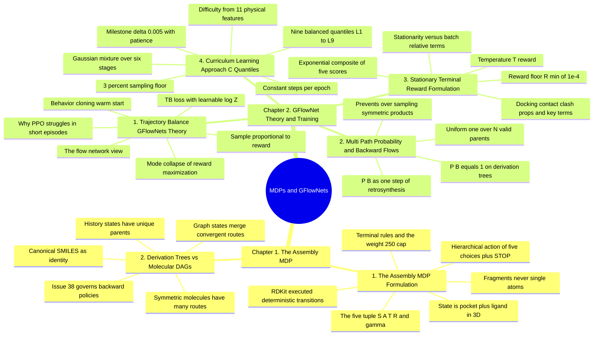

---
tags:
  - moc
  - domain/reinforcement-learning
  - 3dsyntree
module: "09. Markov Decision Processes and GFlowNets"
type: moc
---

# 0. Markov Decision Processes and GFlowNets MOC

> [!abstract] Module Mission
> This module is the engine room of 3D-SynTree: it covers the two formalisms that turn "design a molecule in a pocket" into a learnable problem. Chapter 1 builds the **assembly Markov Decision Process** — states that are pockets plus half-built 3D molecules, actions that are certified reactions on purchasable fragments, deterministic cheminformatics transitions, and the subtle question of what counts as a state once different assembly orders converge on the same molecule. Chapter 2 covers the **GFlowNet** trained on that MDP: the Trajectory Balance objective with its learnable $\log Z$, the backward flows that correctly apportion probability across multi-route molecules, the stationary multi-objective reward that defines the target distribution, and the Approach C quantile curriculum that stabilizes training. Together they explain why this system outputs a *diverse portfolio* of synthesizable candidates rather than one fragile answer.

Navigation: [[0. Master Vault Index]] · [[2. Prerequisite Knowledge Graph]] · [[3. Study Tracks and Curriculum]]

## Module Mind Map

## Chapter 1. The Assembly MDP

| Note | Focus | Required Depth | Key Prerequisites |
| --- | --- | --- | --- |
| [[1. The Assembly MDP Formulation]] | The five-tuple $\mathcal{M} = (\mathcal{S}, \mathcal{A}, \mathcal{T}, \mathcal{R}, \gamma)$ instantiated for pocket-based design: states of pocket plus intermediate 3D ligand, the hierarchical action $a_t = \text{STOP} \lor (\text{handle}, r_t, B_t, c_t, \phi_t)$, deterministic RDKit-executed transitions, terminal conditions, and the policy factorization $P(B_t \mid r_t, \mathcal{P}, \mathcal{M}_t)$ — why every action is a whole chemically valid fragment, never atoms or floating coordinates | Essential | [[2. The 32 Certified Reaction Grammar]] · [[3. Cross Attention Decoders for SBDD]] |
| [[2. Derivation Trees vs Molecular DAGs]] | Construction histories (derivation trees, unique parents) versus canonicalized molecular graphs (DAGs, multiple convergent parents), equivalence classes, and the consequences for backward policies — why assuming $P_B = 1$ is valid only where states are histories | Advanced | [[1. SMILES and Canonical Molecular Graphs]] · [[1. The Assembly MDP Formulation]] |

## Chapter 2. GFlowNet Theory and Training

| Note | Focus | Required Depth | Key Prerequisites |
| --- | --- | --- | --- |
| [[1. Trajectory Balance GFlowNets Theory]] | Sampling $P(x) \propto R(x)$ instead of maximizing reward; the flow-network view; the Trajectory Balance objective with learnable $\log Z$; behavior-cloning warm start; worked TB loss computation; why PPO-style maximization mode-collapses in 3-to-4-step assembly | Essential | [[1. The Assembly MDP Formulation]] |
| [[2. Multi Path Probability and Backward Flows]] | The backward policy $P_B(s_t \mid s_{t+1})$: equal to 1 on derivation trees, uniform $1/N_{\text{valid parents}}$ over legal disconnections on molecular graphs; parent enumeration as one-step retrosynthesis; why correct backward flow prevents over-sampling symmetric multi-route molecules | Advanced | [[2. Derivation Trees vs Molecular DAGs]] · [[1. Trajectory Balance GFlowNets Theory]] |
| [[3. Stationary Terminal Reward Formulation]] | The strictly positive reward $R(x) = \exp\left(\frac{S_{\text{dock}} + S_{\text{contact}} + S_{\text{clash}} + S_{\text{props}} + S_{\text{key}}}{T_{\text{reward}}}\right)$, each scoring term explained, the $R_{\min} = 10^{-4}$ floor, and why batch-relative diversity terms break Trajectory Balance (Issue #30) | Essential | [[1. Lennard Jones and Soft Core Potentials]] · [[2. Pharmacophores and Interaction Hotspots]] · [[1. Lipinski Rules QED and Drug Likeness]] |
| [[4. Curriculum Learning Approach C Quantiles]] | Difficulty scoring from 11 physical features, 9 balanced quantiles $L_1$–$L_9$, a Gaussian mixture sampler shifting across 6 stages with a 3% floor, milestone advancement on $\Delta \mathcal{L}_{\text{val}} \ge 0.005$ with patience fallback, and constant steps per epoch | Supporting | [[1. Binding Pockets and Cavity Extraction]] · [[1. The Assembly MDP Formulation]] |

## Learning Path Through This Module

1. [[1. The Assembly MDP Formulation]] — the foundation: what the states, actions, transitions, and rewards of pocket-based molecular assembly actually are, and why every action is a certified reaction on a whole fragment.
2. [[2. Derivation Trees vs Molecular DAGs]] — the first subtlety: once different assembly orders can produce the same molecule, "what is a state?" becomes a real decision with mathematical consequences for everything in Chapter 2.
3. [[1. Trajectory Balance GFlowNets Theory]] — the training algorithm: why sampling proportional to reward beats reward maximization, and how the Trajectory Balance identity with learnable $\log Z$ makes that trainable.
4. [[2. Multi Path Probability and Backward Flows]] — the fine print of that identity: the backward factors $P_B$ that apportion reward flow across multiple assembly routes, and the over-sampling bug they prevent.
5. [[3. Stationary Terminal Reward Formulation]] — the other fixed ingredient: the five-term exponential composite, its temperature and floor, and the stationarity requirement that banished batch-relative diversity bonuses.
6. [[4. Curriculum Learning Approach C Quantiles]] — the training schedule: how difficulty-scored quantiles and a sliding mixture sampler stabilize learning over the 20,000-complex dataset without changing the objective or the step budget.

## Why This Module Matters for 3D-SynTree

Everything else in the vault — the chemistry, the 3D geometry, the equivariant encoders — exists to feed this module's two formalisms. The assembly MDP is the contract between chemistry and learning: it guarantees that whatever the policy does is a purchasable-fragment attachment via a certified reaction, which is how 3D-SynTree scales the synthesizability wall that defeats unconstrained 3D diffusion models. The GFlowNet trained with Trajectory Balance is the reason the system's deliverable is a *diverse portfolio* of high-reward, pocket-fitting candidates rather than a single brittle molecule: the reward (kept stationary) defines the target distribution, the backward flows (kept normalized) keep its bookkeeping exact across convergent assembly routes, and the Approach C curriculum schedules the 20,000 training pockets so that the whole machinery converges within a compact compute budget. When you read that 3D-SynTree proposes shortlists for synthesis rather than one answer, this module is the explanation. For how the loop fits together end to end, see [[1. 3D-SynTree System Overview]].

## Gate Check

> [!question] Before moving on, can you...
> - Write out the five-tuple $\mathcal{M} = (\mathcal{S}, \mathcal{A}, \mathcal{T}, \mathcal{R}, \gamma)$ instantiated for pocket-based assembly, explain each element from zero, and say why the action space contains no atoms and no floating coordinates?
> - Explain the two ways an episode can terminate, why the STOP action is gated by a minimum molecular weight, and why $\gamma$ effectively sits at 1 in this system?
> - Given two assembly orders of the same two synthons on a di-functional core, describe exactly what merges in the derivation-tree view versus the molecular-DAG view, and what that implies for the parents of the product node?
> - State the Trajectory Balance identity, compute the TB loss on a short trajectory from given numbers, and explain what the learnable $\log Z$ converges to and what the sign of the residual tells the gradient?
> - Say when $P_B = 1$ is correct, when $P_B = 1/N_{\text{valid parents}}$ is required, and demonstrate with numbers how assuming a unique parent on a two-parent graph over-samples the product by a factor of two?
> - Recite the five reward terms with their signs and purposes, explain the role of $T_{\text{reward}}$ and the $R_{\min}$ floor, and prove to yourself why any batch-relative term makes the Trajectory Balance target non-stationary?
> - Describe the six moving parts of Approach C — features, quantiles, mixture sampler, floor, milestone, patience — and why the per-epoch step count stays constant?

## Primary Reading

Malkin, N., et al. (2022). *Trajectory Balance: Improved Credit Assignment in GFlowNets*. **NeurIPS 2022**, 35, 5914–5926.
