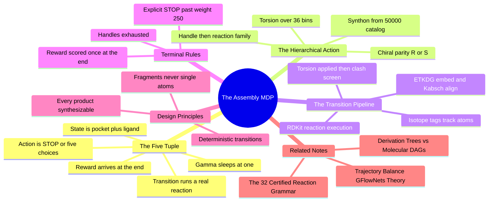

---
tags:
  - domain/reinforcement-learning
  - depth/essential
  - 3dsyntree
  - topic/mdp
  - topic/molecular-design
module: "09. Markov Decision Processes and GFlowNets"
chapter: "Chapter 1. The Assembly MDP"
type: concept
---

# 1. The Assembly MDP Formulation

> [!abstract] Core Idea
> 3D-SynTree does not paint a finished molecule into a protein pocket in one shot — it grows one, step by step, inside the formal machinery of reinforcement learning: a **Markov Decision Process (MDP)**. The *state* is "this pocket, plus the half-built molecule floating in it, in full 3D"; the *action* is either a deliberate stop or a five-part choice (which reactive handle, which reaction, which catalog synthon, which chiral parity, which torsion bin); the *transition* is an actual laboratory reaction executed by cheminformatics software; and the *reward* arrives only when the molecule is finished. Because every legal action is a certified reaction applied to a purchasable building block, every molecule this process can ever produce is synthesizable by construction.

Navigation: [[0. Markov Decision Processes and GFlowNets MOC]] · [[0. Master Vault Index]]

## 1. What It Is

A **Markov Decision Process** is the standard mathematical container for sequential decision making. An agent interacts with an environment over discrete time steps: at each step it observes a *state*, chooses an *action*, the environment applies a *transition* to produce the next state, and occasionally hands back a *reward*. The "Markov" property is the simplifying assumption that makes the whole framework tractable: the current state alone contains everything needed to predict the consequences of the next action — the history of how you arrived there is irrelevant. The full definition is a five-tuple:

$$\mathcal{M} = (\mathcal{S}, \mathcal{A}, \mathcal{T}, \mathcal{R}, \gamma)$$

- $\mathcal{S}$ — the **state space**: every situation the agent can be in.
- $\mathcal{A}$ — the **action space**: every move the agent can make (which actions are legal depends on the state).
- $\mathcal{T}$ — the **transition function**: $\mathcal{T}(s_t, a_t) = s_{t+1}$, the rule that maps a state and an action to the next state.
- $\mathcal{R}$ — the **reward function**: the scalar feedback signal that scores outcomes.
- $\gamma$ — the **discount factor**: a number in $[0,1]$ that shrinks the value of rewards that arrive far in the future.

3D-SynTree instantiates this generic container for **structure-based, synthesis-constrained molecular design**: the agent is the policy network, the environment is a cheminformatics engine wrapped around one protein binding pocket, and one episode (one run from start to finish) produces one complete candidate drug molecule, atom coordinate by atom coordinate — but never atom by atom in the decision sense, as the next section makes clear.

## 2. Why It Exists

Molecular design has an unforgiving requirement: the output must be *makeable*. A 3D diffusion model can paint a beautiful molecule into a cavity, but a chemist cannot order "a molecule" — they must build it with real reactions from real, purchasable chemicals. This is the **synthesizability wall** that defeats most 3D generative approaches.

Formulating design as an MDP dissolves the wall by construction rather than by after-the-fact filtering:

- **Each step is verifiable.** Instead of one giant, unverifiable leap (generate the whole molecule at once), the task decomposes into an *autoregressive* sequence — meaning each piece is produced conditioned on everything built so far — of small steps, each of which is a single, well-understood chemical transformation.
- **Each step is legal by construction.** The action space does not contain "place a carbon atom at coordinates $(x, y, z)$". It contains "attach this purchasable fragment via this certified reaction". Anything the agent can *do*, a chemist can *make*.
- **3D awareness is built in, not bolted on.** Because the pocket is part of the state at every step, the geometry of the growing molecule is shaped by the cavity while it grows — not squeezed in afterwards.

## 3. How It Works

### 3.1 The state: a pocket and a molecule, jointly in 3D

The state at step $t$ is the pair

$$s_t = (\mathcal{P}, \mathcal{M}_t),$$

where $\mathcal{P}$ is the **protein binding pocket** — the three-dimensional cloud of protein atoms lining the cavity where a drug must bind (extracted as a 10 Å region around the reference ligand's centroid, centered at the origin, capped at 700 protein atoms with a minimum of 100) — and $\mathcal{M}_t$ is the **intermediate ligand**: the molecule built so far, carrying not just its atoms and bonds but their full 3D coordinates. The pocket is fixed for the entire episode; the ligand is what grows.

Two details of $\mathcal{M}_t$ matter enormously downstream:

- **Atom provenance is preserved.** Core atoms carry isotope labels offset by 1000 and synthon atoms labels offset by 2000, so every atom keeps a stable identity across chemical transformations even when bonds rearrange (see [[3. Reaction SMARTS and Isotope Provenance]]). This is what allows 3D coordinates to survive from step to step.
- **Exposed handles are part of the state.** A *reactive handle* is a small functional group (an amine, a carboxylic acid, a halogen, and so on — ten classes in total) that can participate in a certified reaction. Which handles are currently exposed on $\mathcal{M}_t$ determines which actions are legal next.

### 3.2 The action: one decision, five sub-decisions

At every step the policy chooses either to stop or to attach one more fragment:

$$a_t = (\text{STOP}) \;\lor\; (\text{handle}_t,\; r_t,\; B_t,\; c_t,\; \phi_t)$$

The symbol $\lor$ means "or" — the action is either the STOP action *or* the five-part tuple. Each component, from zero:

| Component | Meaning | Choosing among |
| --- | --- | --- |
| $\text{handle}_t$ | Which exposed reactive group on $\mathcal{M}_t$ to extend | The handles currently present (10 possible classes) |
| $r_t$ | Which reaction family to run | 32 certified medicinal-chemistry reactions in ~9 families (amide coupling, Suzuki coupling, reductive amination, ...) — see [[2. The 32 Certified Reaction Grammar]] |
| $B_t$ | Which **synthon** (purchasable building block, drawn from the 50,000-entry catalog; see [[1. Building Blocks and Synthons]]) to attach | Catalog entries compatible with $r_t$ |
| $c_t$ | Which **chiral parity** (R or S mirror-image arrangement; see [[1. Stereochemistry Chirality and CIP Rules]]) to assign if the reaction creates a new stereocenter | The two parities, when applicable |
| $\phi_t$ | Which **torsion bin** — the dihedral angle (the twist around the newly formed single bond) discretized into 36 bins of $10^\circ$ | 36 categorical bins (see [[1. Categorical Binned vs Continuous Torsion Space]]) |

A single flat categorical head over all combinations would be astronomically large (handles × 32 reactions × 50,000 synthons × 2 parities × 36 bins). The factorization is what makes the problem learnable: each component gets its own head, each head sees only its *legally filtered* candidate set, and the enormous product space is never enumerated.

### 3.3 The transition: a chemical reaction, not a rendering

The transition function is **deterministic**: the same state and the same action always produce the same next state. Given $a_t$, the environment executes a real chemical pipeline:

1. **Reaction execution.** RDKit (the open-source cheminformatics toolkit) matches the reaction's pattern against the chosen handle and applies it, forming the new bond and emitting a chemically valid product — an entire fragment is joined to the scaffold in one move.
2. **Atom bookkeeping.** Isotope tags track every atom across the transformation, so the 3D coordinates of the pre-existing scaffold carry over untouched.
3. **Conformer embedding.** The incoming synthon is embedded in 3D with its internal geometry locked (ETKDG distance-geometry embedding with coordinate constraints — see [[2. Distance Geometry and ETKDG]]).
4. **Rigid alignment.** The new fragment is rotated into place against the anchored scaffold using the Kabsch algorithm, the optimal rigid superposition (see [[4. The Kabsch Algorithm and Rigid Alignment]]).
5. **Torsion application.** The dihedral around the newly formed single bond is set to the chosen bin's angle; amide and ester junctions are instead planarity-locked to $0^\circ$ or $180^\circ$ because conjugation makes them rigid (an 18–22 kcal/mol rotation barrier).
6. **Validity screening.** Steric clash with the pocket is measured; the resulting state must be chemically valid.

Because $\mathcal{T}$ is deterministic, the *only* randomness in an episode is the policy's own sampling. There is no noisy physics to model, which is precisely what the GFlowNet training objective ([[1. Trajectory Balance GFlowNets Theory]]) prefers.

### 3.4 Terminal conditions and the stopping rules

An episode ends in one of two ways:

- **Explicit STOP.** The policy chooses the termination action. This is only legal once the intermediate ligand exceeds a minimum molecular weight cap of 250 Da — a guard preventing the lazy strategy of stopping immediately with a trivially small fragment, since a real drug candidate must be substantial enough to bind specifically.
- **Handle exhaustion.** No exposed reactive handle remains that any certified reaction can use; the molecule is structurally saturated and no further attachment is legal.

When the episode terminates at final molecule $x$, the reward function evaluates the completed design *in the pocket*; intermediate steps carry no reward. Episodes are short — typically three to four assembly steps — because each step installs a sizable fragment, not a single atom.

> [!example] One assembly step, concretely
> Suppose $\mathcal{M}_t$ is a scaffold carrying a **ketone** handle (a carbon double-bonded to oxygen, flanked by two carbons). The policy picks: handle = that ketone; reaction $r_t$ = reductive amination (ketone + primary amine → secondary amine, converting the flat carbonyl carbon into a tetrahedral one); synthon $B_t$ = a catalog amine with a high-$Fsp^3$ side chain; parity $c_t$ = R, because the former carbonyl carbon becomes a new stereocenter; torsion bin $\phi_t$ = bin 14, center $-35^\circ$, for the new C–N single bond. The environment forms the bond, tags the new atoms, embeds the amine fragment with locked geometry, Kabsch-aligns it onto the scaffold, twists the junction to $-35^\circ$ (then geometrically polishes within $\pm 5^\circ$ — see [[2. Sub Bin Pocket Conditioned Dihedral Refinement]]), and screens for clashes. One action, one real reaction, one valid state advance.

### 3.5 The discount factor γ, and why it sleeps

The discount factor $\gamma$ expresses how much future rewards matter relative to immediate ones: a reward $k$ steps ahead is worth $\gamma^k$ as much. It exists to keep infinite-horizon problems well-behaved. Here, episodes are finite and short, the reward arrives exactly once at the end, and the training objective (a GFlowNet, not a value-based RL agent) does not optimize discounted returns at all. So $\gamma$ sits in the tuple for formal completeness and effectively sleeps at $\gamma = 1$: no discounting is applied, and nothing about the learned behavior depends on it.

### 3.6 The factorized policy: five categorical heads on one pocket context

The policy network encodes the joint 3D environment — protein atoms and ligand atoms together, with their coordinates — using a geometric graph neural network, then compresses it through a cross-attention decoder into a single **pocket context vector** that conditions every decision head (see [[3. Cross Attention Decoders for SBDD]]). The joint probability of an action factorizes autoregressively, each head conditioned on the pocket, the current molecule, and the previously sampled components:

$$\pi_F(a_t \mid s_t) \;=\; \pi(\text{handle}_t)\,\cdot\,\pi(r_t \mid \text{handle}_t)\,\cdot\,P(B_t \mid r_t, \mathcal{P}, \mathcal{M}_t)\,\cdot\,\pi(c_t)\,\cdot\,\pi(\phi_t)$$

The synthon factor $P(B_t \mid r_t, \mathcal{P}, \mathcal{M}_t)$ deserves emphasis: the synthon head is conditioned on the *reaction* because the reaction determines which synthon handle classes are chemically compatible, shrinking the 50,000-entry catalog to a tractable, legality-filtered candidate set. Every head is categorical — STOP included — so every action probability is a clean, unitless number between 0 and 1, a standardization (Issue #24 [MODEL-04]) that the Trajectory Balance loss mathematically requires.

## 4. What It Consists Of

- **State representation** — the pair $(\mathcal{P}, \mathcal{M}_t)$: fixed 3D pocket plus growing 3D ligand with isotope-tracked atoms and exposed-handle inventory.
- **Factorized action space** — STOP plus the five categorical components (handle, reaction, synthon, chiral parity, torsion bin).
- **Deterministic transition function** — RDKit reaction execution, ETKDG embedding, Kabsch alignment, torsion application, clash screening; no environmental noise.
- **Stopping conditions** — legality-gated STOP (minimum molecular weight 250 Da) and handle exhaustion.
- **Terminal reward slot** — the score $R(x)$ computed only for completed molecules (specified in [[3. Stationary Terminal Reward Formulation]]).
- **Discount factor** — carried in the tuple, effectively $\gamma = 1$ in the GFlowNet regime.
- **Policy factorization** — five categorical heads sharing one pocket-context conditioning vector.

## 5. What You Must Understand

> [!warning] The policy never touches atoms or floating coordinates
> This is the single most important sentence of the note. There is no action "place a carbon at $(3.1, -0.7, 2.2)$". The action space contains only *whole chemically valid fragments* joined by *real reactions*. Unconstrained atom-level generators are exactly the models that produce pentavalent carbons and impossible geometries — the synthesizability wall. Here, illegality is unrepresentable, not merely penalized.

> [!warning] The action space is state-dependent and dynamic
> The handle head's candidate list changes every step (handles get consumed by reactions and new ones appear on attached synthons); STOP appears and disappears with the molecular-weight cap; the synthon head's candidates depend on the chosen reaction. Never imagine a fixed action vocabulary — legality is computed per state.

> [!note] Determinism is a design choice with consequences
> A deterministic $\mathcal{T}$ means the GFlowNet needs no model of environment dynamics, replayed trajectories are exactly reproducible, and all probability mass lives in the policy itself — which is what the flow-based training objective measures.

> [!tip] Memory hooks
> "State = pocket + patient": the pocket never changes; the ligand grows. "Action = five questions": where (handle), how (reaction), what (synthon), which mirror (parity), which twist (torsion). "Stop is a choice, not an accident" — and only past 250 Da.

## 6. Prerequisites

- [[2. The 32 Certified Reaction Grammar]] — the action space *is* this reaction vocabulary; without it the tuple's $r_t$ component is opaque.
- [[3. Cross Attention Decoders for SBDD]] — how the joint pocket–ligand geometry becomes the conditioning vector that every policy head reads.

## 7. Project Connection

The environment is `MolecularAssemblyEnv` in `syntree/engine/environment.py`, which owns the state, the legality rules, the deterministic transitions, and the stopping conditions, including `terminal_cap_min_mw = 250.0` gating the STOP action. Reactions are executed through `apply_reaction()` with handle ranking via `rank_handles()` and templates from `REACTION_TEMPLATES` in `syntree/chemistry/reactions.py`; conformer embedding, junction-torsion application, and planarity locking live in `ConformerEngine` (`embed_product()`, `apply_junction_torsion()`, `is_conjugated_junction()`) in `syntree/chemistry/conformer.py`. On the learning side, `SynTreePolicy` with `forward()` and `act()` in `syntree/models/policy.py` implements the five categorical heads, each conditioned on `pocket_context` produced by `self.cross_attention`; Issue #24 [MODEL-04] standardized these heads to discrete categorical outputs.

## 8. Required Depth

**Essential** — this note is the formal container in which every other Module 09 concept (backward flows, Trajectory Balance, reward design, curriculum) lives; nothing later in the module can be stated precisely without this five-tuple.

## 9. Further Dependencies

- [[2. Derivation Trees vs Molecular DAGs]] — the question "what exactly *is* a state" becomes subtle the moment two different construction histories build the same molecule.
- [[1. Trajectory Balance GFlowNets Theory]] — the MDP defined here is trained not by value-based RL but by a GFlowNet, which changes what the policy is *for*.

## Concept Mind Map

