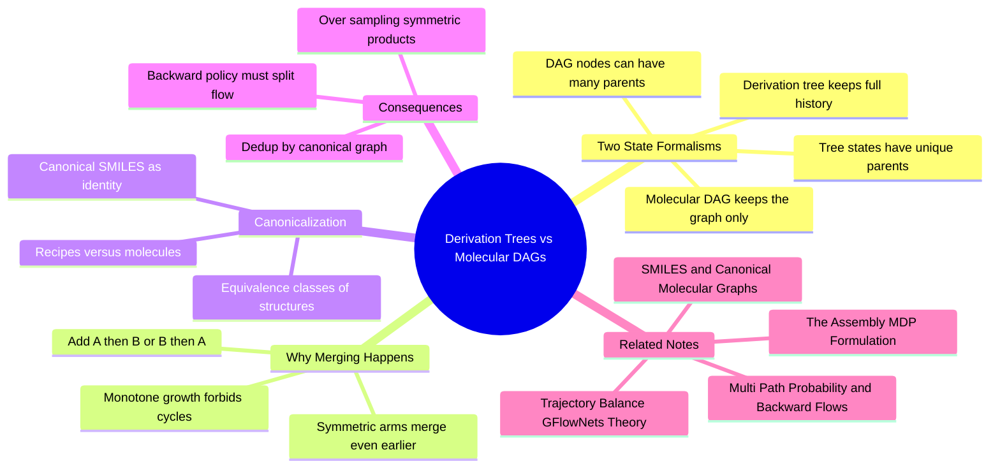

---
tags:
  - domain/reinforcement-learning
  - depth/advanced
  - 3dsyntree
  - topic/gflownets
  - topic/molecular-graphs
module: "09. Markov Decision Processes and GFlowNets"
chapter: "Chapter 1. The Assembly MDP"
type: concept
---

# 2. Derivation Trees vs Molecular DAGs

> [!abstract] Core Idea
> The same molecule can be built in more than one way — attach arm A then arm B, or arm B then arm A, and you land on the identical product. This innocent fact forces a decision about what a "state" even *is* in the assembly MDP. If a state is the full construction history, the states form a **derivation tree** in which every state has exactly one parent. If a state is just the current molecular graph (the molecule, canonically identified, with the history forgotten), the states form a **molecular DAG** — a directed acyclic graph — in which one molecule can have *many* valid parents. Which formalism you choose silently rewrites the mathematics of GFlowNet training, and confusing the two is exactly the bug catalogued as Issue #38 [FLOW-04].

Navigation: [[0. Markov Decision Processes and GFlowNets MOC]] · [[0. Master Vault Index]]

## 1. What It Is

A **derivation tree** is the record of *how* a molecule was built. Its root is the initial state of an episode (the pocket, before anything has been attached); each node is a complete construction history up to that point — the ordered sequence of actions taken — and each edge is one action. Because a history extends in exactly one way at each step (you did what you did), every node in a derivation tree has **exactly one parent**: the history with the last action removed. A derivation tree is exactly the object a language model sees: a sequence of tokens with unique prefixes.

A **molecular DAG** (Directed Acyclic Graph — a graph with one-way edges and no cycles) is the structure you get when a state is defined as *the molecule itself*, identified by its canonical molecular graph and with the construction history deliberately forgotten. Nodes are molecules (intermediates and products); an edge runs from molecule $u$ to molecule $v$ whenever some single certified reaction transforms $u$ into $v$ by attaching one synthon. The moment two different assembly orders produce the same intermediate or product, their tree branches **merge** into one DAG node — and that node then has several parents. Chemists call such multi-route construction **convergent assembly**: branches built in either order converge on the same product.

The canonical identity test that makes merging possible is graph canonicalization — the same technology that decides whether two drawn structures are the same molecule (see [[1. SMILES and Canonical Molecular Graphs]]).

## 2. Why It Exists

The distinction is not academic bookkeeping; it exists because of a physical fact about synthesis: **chemical identity forgets order**. A reaction vessel does not remember whether you coupled the left amide first or the right amide first — the product is the product. Any learning system that builds molecules step by step must therefore answer: when the policy takes two different action sequences that end in the same molecule, did it "visit two states" or "one state twice"?

The answer has real consequences:

- **Counting and deduplication.** A generator that counts derivation trees will report the same molecule many times (one per recipe). A drug discovery campaign wants *distinct molecules*, not distinct recipes.
- **Probability accounting.** The total probability of producing molecule $x$ is the sum over every route that reaches it. Ignoring multiplicity underestimates $x$'s probability when *evaluating*; mis-training on it over-samples $x$ when *generating* (the precise mechanics are the subject of [[2. Multi Path Probability and Backward Flows]]).
- **Backward policies.** The GFlowNet training objective contains a backward factor $P_B$ that redistributes reward flow from a molecule back to its precursors. On a tree, that factor is trivially 1. On a DAG, it must be *shared* among all valid parents — a fundamentally different object.

## 3. How It Works

### 3.1 Two definitions of "state", side by side

| Property | Derivation tree states | Molecular DAG states |
| --- | --- | --- |
| A state is... | a full construction history | the canonical molecular graph of the current intermediate |
| Parents of a node | exactly one (drop the last action) | zero, one, or many (all single-reaction precursors) |
| Two orders of adding A and B | two distinct state chains | two chains that **merge** at the product |
| Memory | grows with episode length; histories of the same molecule are stored separately | one node per distinct molecule |
| What "the probability of x" means | probability of the one history that ends in x | sum of probabilities over **all** routes reaching x |
| Backward factor $P_B$ | 1 everywhere, by construction | must distribute over parents |

### 3.2 The anatomy of a merge: a worked example

Take a di-functional core — a small scaffold exposing **two** reactive handles, say two carboxylic acids, call them positions 1 and 2 — and two different amine synthons, $A$ and $B$, each attached by an amide coupling.

- **History view.** Episode 1: couple $A$ at position 1, then $B$ at position 2. Episode 2: couple $B$ at position 2, then $A$ at position 1. These are two different action sequences — two different derivation paths — and in the derivation-tree formalism they traverse entirely distinct states, ending in two distinct terminal nodes that happen to describe the same physical molecule.
- **Graph view.** After one step, episode 1 sits on the molecule core + $A$; episode 2 sits on core + $B$. These intermediates are genuinely different molecules, so they are different DAG nodes. But after the second step, both episodes hold the *identical* product — core + $A$ + $B$ — which canonicalization maps to one and the same node. The product node has **two parents** (core + $A$ and core + $B$): convergent assembly, made visible.

- **The symmetric limit.** Now make the two synthons identical ($A = B$). The two histories still differ (which position was coupled first), but after step 1 both episodes already hold the *same* intermediate graph (core + one amide arm), so even the intermediate node merges. The product is then reachable by multiple action sequences that pass through a single chain of graph states — the multiplicity now hides in *action choice* (two equivalent handles to pick) rather than in *distinct intermediate molecules*. Both flavors of multiplicity — distinct-parent merges and equivalent-action merges — inflate the number of routes to a molecule.

### 3.3 Canonicalization and molecular equivalence classes

A **molecular equivalence class** is the set of all structures (and all construction histories) that amount to the same molecule: same atoms, same bonds, same stereochemistry. Two 3D builds land in the same class even if their coordinates differ slightly, because chemical identity is a property of the *graph*, not of a particular pose. The tool that decides class membership is canonicalization: a deterministic algorithm (RDKit's canonical SMILES) that maps every representation of a molecule to one standard string. In the DAG formalism, that canonical form *is* the state's name; `canonical_smiles()` in `syntree/data/fragmenter.py` is the function that produces it. When the environment needs to know "have we seen this molecule before?" — for parent enumeration, deduplication, or counting — it asks the canonical form, not the history.

### 3.4 Why a DAG and not a tree of graphs: monotone growth

Could the graph-state space contain cycles — a molecule reachable from itself? No: every certified reaction in the grammar **adds** a synthon to the growing structure (strictly more atoms, higher molecular weight). State size therefore increases monotonically along every edge, and nothing can loop back to an earlier molecule. Growth gives acyclicity for free; only *merging* remains, and merging is what makes the structure a DAG rather than a tree.

### 3.5 Consequences for backward policies

The GFlowNet objective (see [[1. Trajectory Balance GFlowNets Theory]]) contains, for every step, a backward factor $P_B(s_t \mid s_{t+1})$ — "given this molecule, which precursor did it come from, with what probability?"

- **On the derivation tree** this question is degenerate: the parent *is* the previous history, so $P_B = 1$ exactly, everywhere, always.
- **On the molecular DAG** the question is real: the product core + $A$ + $B$ could have come from core + $A$ (adding $B$ last) or from core + $B$ (adding $A$ last). $P_B$ must split its probability across these valid parents — and how it splits determines how the molecule's reward flow is apportioned over the routes that reach it.

Issue #38 [FLOW-04] exists because these two situations are alarmingly easy to conflate. The dangerous mixed assumption — *graph* states (where merging happens) trained with a *tree-style* backward factor ($P_B = 1$ everywhere) — silently over-samples every molecule in proportion to its number of assembly routes. Symmetric molecules, with their many equivalent handles and interchangeable arms, are the pathological case: they accumulate inflated probability mass not because they are better molecules but because they are *reachable in more ways*. The correct treatment of each formalism, and the exact arithmetic of the fix, is the whole subject of [[2. Multi Path Probability and Backward Flows]].

> [!note] Both formalisms can be made correct — mixing them is what breaks
> Tree states with $P_B = 1$ are internally consistent (each history is its own object); graph states with a properly normalized $P_B$ are internally consistent (each *molecule* is the object, and routes share it). The bug is always a hybrid: graph states plus tree accounting, which double-counts multi-route molecules, or tree states plus graph counting, which misapportions reward. Decide what an object is, then make every probability statement about that object.

## 4. What It Consists Of

- **Derivation tree** — the state space of construction histories; every node has a unique parent; the natural view for sequence models and behavior cloning.
- **Derivation (action sequence)** — one root-to-node path in the tree; a complete recipe for one molecule.
- **Molecular DAG** — the state space of canonical molecular graphs; single-reaction edges; convergent merges create multi-parent nodes.
- **Molecular equivalence class** — all structures and histories that canonicalization maps to the same molecule.
- **Graph canonicalization** — the deterministic identity test (canonical SMILES) that decides when two builds are the same state.
- **Convergent assembly** — building in any order and merging at the product; the chemical source of multi-parent nodes.
- **State aliasing** — the many-histories-to-one-graph phenomenon that the two formalisms treat differently.

## 5. What You Must Understand

> [!warning] Tree vs DAG is a choice about *mathematics*, not data structures
> It looks like an implementation detail (how do I store states?). It is not: it changes what a trajectory probability means, what $P_B$ must be, and what the learned distribution promises. Issue #38 [FLOW-04] was a *training-mathematics* bug, not a memory-layout bug.

> [!warning] Assuming a unique parent is only valid where it is true
> $P_B = 1$ is a theorem on derivation trees and a falsehood on molecular graphs. On graphs, a product with $N$ valid precursors needs a backward factor that sums to 1 across them — otherwise every route is counted as if it were the only one.

> [!warning] Symmetric molecules are the trap
> Interchangeable arms and equivalent handles multiply the number of assembly routes. A molecule with many routes is "easy to reach" — and an incorrectly accounted sampler will flood the batch with it, mistaking reachability for quality.

> [!tip] Memory hooks
> "Histories remember; graphs are." — the tree stores the recipe, the DAG stores the dish. "Convergence is the chemistry, merging is the math, and $P_B$ is the price of admission to graph space."

## 6. Prerequisites

- [[1. SMILES and Canonical Molecular Graphs]] — canonicalization is the identity test that decides when two construction paths built the same molecule.
- [[1. The Assembly MDP Formulation]] — supplies the states, actions, and transitions whose organization into tree versus DAG is being compared.

## 7. Project Connection

The distinction is catalogued and resolved as Issue #38 [FLOW-04], and it governs the formulation of the backward policy $P_B$ used by `GFlowNetTrainer` in `syntree/engine/gflownet.py`: training states are identified on the molecular-graph side, with parent structure handled by explicit parent enumeration rather than assumed uniqueness. The identity test that makes graph states well defined is `canonical_smiles()` in `syntree/data/fragmenter.py`, and the reversible junctions that define DAG edges are produced by the certified reaction templates (`REACTION_TEMPLATES`, `apply_reaction()`) in `syntree/chemistry/reactions.py`. Expert demonstration routes — full construction histories, i.e. derivation trees — are recorded by `scripts/build_trajectories.py` for the behavior-cloning warm start, which is precisely where the two views meet in practice: histories are cloned, graphs are counted.

## 8. Required Depth

**Advanced** — the distinction is invisible at the level of "what does the code output" and decisive at the level of "what does the training loss actually compute"; it only becomes legible once you care about exact probability bookkeeping in GFlowNets.

## 9. Further Dependencies

- [[2. Multi Path Probability and Backward Flows]] — takes this note's diagnosis and supplies the cure: the uniform-over-parents backward flow with the $1/N_{\text{valid}}$ formula.

## Concept Mind Map

## Cross-Domain Links

- [[AI/08. Generative Modeling, MDPs, and GFlowNets/Chapter 1. Discrete Markov Decision Processes/2. Derivation Trees vs Molecular Graph DAGs|2. Derivation Trees vs Molecular Graph DAGs]] (AI vault) — the same synthesis object viewed from chemistry and from flow-graph theory.
