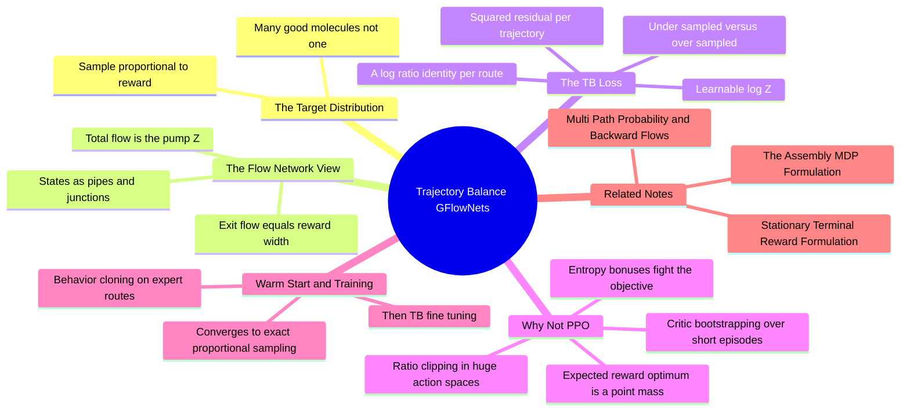

---
tags:
  - domain/reinforcement-learning
  - depth/essential
  - 3dsyntree
  - topic/gflownets
  - topic/generative-models
module: "09. Markov Decision Processes and GFlowNets"
chapter: "Chapter 2. GFlowNet Theory and Training"
type: concept
---

# 1. Trajectory Balance GFlowNets Theory

> [!abstract] Core Idea
> A **GFlowNet** (Generative Flow Network) is a generative framework, introduced by Yoshua Bengio and colleagues in 2021, that trains a step-by-step policy to sample finished objects — here, completed molecules — with probability **proportional to a positive reward**: $P(x) \propto R(x)$. Instead of hammering on the single best molecule (what reward-*maximizing* reinforcement learning like PPO converges toward — mode collapse), a GFlowNet learns to spread its sampling across *every* region of chemistry space that scores well, in proportion to how well it scores. The **Trajectory Balance (TB)** objective of Malkin et al. (2022) makes this trainable with one clean, per-trajectory equation containing a single learnable scalar $\log Z$ — no critic, no importance-ratio clipping, no bootstrapping.

Navigation: [[0. Markov Decision Processes and GFlowNets MOC]] · [[0. Master Vault Index]]

## 1. What It Is

Formally, a GFlowNet is a policy $\pi_F$ over the assembly MDP of [[1. The Assembly MDP Formulation]] trained so that the probability of *terminating* at terminal state $x$ (a completed molecule in the pocket) satisfies

$$P(x) \;=\; \frac{R(x)}{Z}, \qquad \text{where } Z = \sum_{x'} R(x')$$

$Z$ is the **partition function** — the total reward mass over all possible terminal molecules — and it plays exactly the role of the normalizing constant in a Boltzmann distribution: the reward gives each molecule a *relative* weight, and $Z$ converts those weights into probabilities. The word **mode** means a region of the design space with high reward (a "family" of good molecules). The promise of the GFlowNet is: sample each mode with strength proportional to its reward, so the output is a *diverse portfolio* of candidates, not one answer.

Trajectory Balance is the specific training objective — the equation that turns that promise into a loss function — and it is what 3D-SynTree trains with.

## 2. Why It Exists

### 2.1 The mode-collapse problem with reward maximization

Standard RL algorithms such as PPO (Proximal Policy Optimization) maximize the *expected* return $\mathbb{E}[R]$. For a deterministic environment with terminal-only reward, the expectation is maximized by putting **all** probability on the single highest-reward molecule. That is not a failure of implementation; it is the optimum of the very objective being optimized. In practice the collapse is even worse: with sparse terminal rewards, the policy latches onto the first decent molecule it stumbles into (a locally discovered mode) and never explores the rest of chemistry space.

Drug discovery cannot use one molecule. A candidate must survive synthesis, ADMET profiling, and assays — a funnel that kills most entries — so the deliverable is a **diverse shortlist** spanning many distinct scaffolds (see [[3. Tanimoto Similarity and Diversity]] for why structural diversity is the currency). Entropy bonuses and noising tricks can slow collapse, but they fight the objective instead of fixing it.

### 2.2 The distributional fix

GFlowNets change the target: not $\max \mathbb{E}[R]$, but "sample from the distribution proportional to $R$". High-reward regions get sampled most; every other rewarding region gets *some* share; unrewarding chemistry gets almost none. Diversity stops being a patch and becomes the literal definition of success.

## 3. How It Works

### 3.1 The flow network view

Picture the state DAG of the assembly MDP (the molecular DAG of [[2. Derivation Trees vs Molecular DAGs]]) as a plumbing network. A pump at the initial state pushes a total volume of water $Z$ through the pipes. At each intermediate molecule (a junction), the incoming water splits among the outgoing actions. At each terminal molecule $x$, water exits the network through a drain whose **width is the reward** $R(x)$.

At equilibrium — when nothing accumulates anywhere — two facts hold:

1. **Flow conservation:** flow in = flow out at every junction. The flow along an edge $s \to s'$ is $F(s \to s')$, and $F(s) = \sum_{s'} F(s \to s') + F(s \to \text{terminal drain at } s)$.
2. **Reward = exit flow:** the terminal flow out of $x$ equals $R(x)$.

If the policy samples actions in proportion to edge flows, $\pi_F(s' \mid s) = F(s \to s')/F(s)$, then the total flow arriving at $x$ — which is exactly the probability of terminating at $x$ — is $R(x)/Z$. The distributional promise is a plumbing equilibrium.

### 3.2 The Trajectory Balance objective

Directly parameterizing all edge flows is intractable (there are astronomically many states). The TB trick is a single identity that must hold for **every complete trajectory** $\tau = (s_0, s_1, \dots, s_T = x)$:

$$Z \cdot \prod_{t=0}^{T-1} \pi_F(s_{t+1} \mid s_t) \;=\; R(x) \cdot \prod_{t=0}^{T-1} P_B(s_t \mid s_{t+1})$$

Left side: total flow $Z$ times the probability of following this exact route forward. Right side: the reward at the destination times the probability of *un-building* $x$ back down this same route via the backward policy $P_B$ (the probability of having come this way — see [[2. Multi Path Probability and Backward Flows]]). Taking logs and squaring the mismatch gives the loss:

$$\mathcal{L}_{\text{TB}}(\tau) = \left( \log Z + \sum_{t=0}^{T-1} \log \pi_F(s_{t+1} \mid s_t) - \log R(x) - \sum_{t=0}^{T-1} \log P_B(s_t \mid s_{t+1}) \right)^{2}$$

Three structural facts make this beautiful:

- **$Z$ is learnable, not computed.** The true partition function is an unimaginable sum over all molecules; TB instead carries $\log Z$ as a single trainable parameter updated by gradient descent alongside the policy. It self-organizes toward the log of the total reward mass the current policy can see.
- **Per-trajectory credit.** Each sampled trajectory gives one complete, end-to-end constraint. Define the residual $\Delta = \log Z + \sum \log \pi_F - \log R - \sum \log P_B$. If $\Delta > 0$, this route carries too much flow — push its probability down. If $\Delta < 0$, it is under-sampled — push it up. The sign of the gradient is a correct training signal for every trajectory, from step one.
- **No auxiliary machinery.** No value network to bootstrap, no advantage estimation, no importance-ratio clipping, no reward discounting.

> [!example] Computing a TB loss on a short trajectory
> Take a toy two-step route: $s_0 \to s_1 \to x$ (fold the final STOP decision into the last step's probability for simplicity). Suppose the current parameters are:
>
> | Term | Value | Log |
> | --- | --- | --- |
> | $\log Z$ | $Z = e^{0.5} \approx 1.65$ | $+0.500$ |
> | $\pi_F(s_1 \mid s_0)$ | $0.25$ | $-1.386$ |
> | $\pi_F(x \mid s_1)$ | $0.10$ | $-2.303$ |
> | $P_B$ both steps (tree-like states, unique parents) | $1$ each | $0$ |
> | $R(x)$ | $e^{-2} \approx 0.135$ | $-2.000$ |
>
> Residual: $\Delta = 0.500 + (-1.386) + (-2.303) - (-2.000) - 0 = -1.189$, so $\mathcal{L}_{\text{TB}} = \Delta^2 \approx 1.41$.
>
> Reading the sign: the flow this route currently carries is $Z \cdot \pi_F(\tau) = 1.65 \times 0.025 = 0.041$, but the reward flow it *should* carry is $R(x) \cdot P_B(\tau) = 0.135$. The route is under-sampled by roughly $3.3\times$ — the gradient raises $\sum \log \pi_F$ along this trajectory (sample it more) and nudges $\log Z$ toward the globally correct scale. Had the residual been positive, the same math would say "you are over-fond of this route; shrink it." The target share, for reference, is $\pi_F(\tau) = R(x) P_B(\tau)/Z = 0.082$.

### 3.3 Why not PPO for this problem

The reader knows PPO's machinery; run it against this environment's specifics:

| PPO ingredient | What goes wrong in 3-to-4-step molecular assembly |
| --- | --- |
| Critic / value baseline $V(s)$ | Rewards are terminal-only; the critic must bootstrap through steps with zero reward, producing noisy advantages over trajectories just 3–4 decisions long |
| Importance ratio clipping | Clipping assumes per-action probabilities move slowly; with a 50,000-way synthon head, individual action probabilities swing wildly between updates, so the clip is either toothless or constantly active |
| Objective itself | Even perfectly implemented, expected-reward maximization converges to a point mass — mode collapse is the *solution*, not a bug, of $\max \mathbb{E}[R]$ |
| Entropy bonus | A patch that fights the objective; needs hand-tuned coefficients and still yields one dominant mode in practice |

TB removes every row of that table: the learnable $Z$ absorbs the scale that a baseline would estimate, there is no ratio to clip (each trajectory is used once, on-policy), and the objective is the distribution itself. This is an honest engineering comparison, not a universal verdict — PPO excels with dense rewards, long horizons, and tasks where an *optimum* rather than a *distribution* is wanted. Molecular assembly is the opposite case on all three counts.

### 3.4 Behavior cloning warm start

TB training from a random policy wastes its early exploration budget on chemically absurd proposals. The fix is a **warm start by behavior cloning**: collect expert trajectories — demonstration episodes that assemble known reference ligands step by step through the certified reaction grammar — and pretrain the policy by plain supervised likelihood maximization on the expert's actions ($\arg\max \sum \log \pi_F(a^{\text{expert}}_t \mid s_t)$). Behavior cloning alone would merely reproduce the expert distribution and never improve on it, so it is strictly a *starting point*: TB fine-tuning then redistributes probability from "what experts do" toward "what the reward loves", while $\log Z$ calibrates against a policy that already proposes plausible molecules. The warm start also keeps the early $\log R$ terms finite and informative, because the docked poses of sane molecules carry signal while those of junk do not.

### 3.5 What convergence buys

If the TB loss is driven to (approximately) zero on all reachable trajectories — with a correct, fixed backward policy (next note) and a *stationary* reward ([[3. Stationary Terminal Reward Formulation]]) — then sampling from $\pi_F$ terminates at $x$ with probability exactly $R(x)/Z$. The sampler becomes a Boltzmann-like sampler over molecular quality: run it a thousand times, get a shortlist whose composition mirrors the reward landscape, mode by mode.

## 4. What It Consists Of

- **Forward policy $\pi_F$** — the five-head categorical policy of the assembly MDP, supplying every $\log \pi_F(s_{t+1} \mid s_t)$ term.
- **Backward policy $P_B$** — the fixed distribution over "where did this come from", supplying the $\log P_B$ terms (specified in the next note).
- **Flow consistency** — the equilibrium idea: flow in equals flow out plus terminal exit, with reward as the exit width.
- **Learnable $\log Z$** — a single scalar parameter estimating the log partition function $\log \sum_x R(x)$.
- **Trajectory Balance loss** — the squared log-ratio residual evaluated per trajectory.
- **Behavior cloning warm start** — supervised pretraining on expert assembly demonstrations before TB fine-tuning.
- **On-policy trajectories** — every training example is a fresh episode sampled from the current policy.

## 5. What You Must Understand

> [!warning] A GFlowNet is not a reward maximizer
> If you find yourself describing it as "RL that finds the best molecule", you have already lost the plot. The output is a *distribution over molecules*, shaped like the reward. Feed it a reward with one giant spike and it will (correctly) collapse; the diversity comes from rewarding every genuinely good mode.

> [!warning] $R(x)$ must be strictly positive
> $\log R(x)$ appears in the loss; $R = 0$ is $-\infty$. Every reachable molecule needs a positive (possibly tiny) reward — this is why the reward design note installs a floor at $R_{\min} = 10^{-4}$.

> [!warning] TB is only as correct as its fixed ingredients
> The identity assumes a *known, fixed* $P_B$ and a *stationary* $R$. Corrupt either one and the loss can still go to zero while the sampled distribution is wrong — silently. The next two notes are precisely about protecting those two ingredients.

> [!tip] Memory hooks
> "Reward is the width of the exit pipe, $Z$ is the pump." "One trajectory, one constraint, one scalar $Z$." "PPO asks *what is the best*; TB asks *what does the landscape look like*."

## 6. Prerequisites

- [[1. The Assembly MDP Formulation]] — supplies the states, actions, transitions, and trajectories that TB's products and sums range over.

## 7. Project Connection

Training is implemented by `GFlowNetTrainer` in `syntree/engine/gflownet.py`, whose `trajectory_balance_loss()` evaluates the squared log-ratio residual on every sampled episode and updates the learnable $\log Z$ jointly with the policy. The forward probabilities come from `SynTreePolicy.act()` in `syntree/models/policy.py` (five categorical heads on the cross-attention pocket context — the standardization to all-discrete heads, Issue #24 [MODEL-04], is what keeps every $\log \pi_F$ term a well-typed log-probability, per [[1. Categorical Binned vs Continuous Torsion Space]]). The reward terms come from `ThreeDReward` in `syntree/engine/rl.py`, and expert demonstrations for the behavior-cloning warm start are produced by `scripts/build_trajectories.py`. Training distribution and schedule over pockets are managed by the curriculum controller described in [[4. Curriculum Learning Approach C Quantiles]].

## 8. Required Depth

**Essential** — this is the training algorithm of the entire system; every other Module 09 note either feeds an ingredient into this loss ($P_B$, $R$) or schedules the data it trains on.

## 9. Further Dependencies

- [[2. Multi Path Probability and Backward Flows]] — specifies the $P_B$ factor inside this loss and why its normalization over parents is load-bearing.
- [[3. Stationary Terminal Reward Formulation]] — specifies the $R(x)$ factor inside this loss and why batch-relative reward terms would break the identity.

## Concept Mind Map

## Cross-Domain Links

- [[AI/08. Generative Modeling, MDPs, and GFlowNets/Chapter 2. Generative Flow Networks/2. The Trajectory Balance Objective|2. The Trajectory Balance Objective]] (AI vault) — $Z \prod P_F = R \prod P_B$ with learnable $\log Z$ - theory and implementation.
