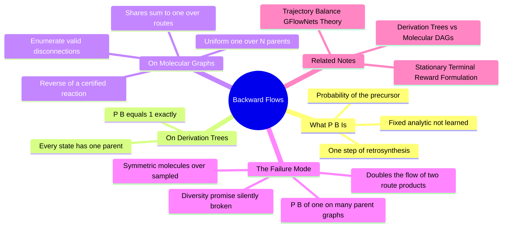

---
tags:
  - domain/reinforcement-learning
  - depth/advanced
  - 3dsyntree
  - topic/gflownets
  - topic/retrosynthesis
module: "09. Markov Decision Processes and GFlowNets"
chapter: "Chapter 2. GFlowNet Theory and Training"
type: concept
---

# 2. Multi Path Probability and Backward Flows

> [!abstract] Core Idea
> The Trajectory Balance loss needs, for every step of every trajectory, a **backward probability** $P_B(s_t \mid s_{t+1})$: "given the molecule I have now, what is the probability my previous state was this particular precursor?" On derivation-tree states the answer is trivially 1 — every history has a unique parent. On molecular-graph states the answer is a *share*: when a molecule could have been assembled along several routes, $P_B$ must split its probability across all valid single-step disconnections, uniformly: $P_B(s_t \mid s_{t+1}) = 1/N_{\text{valid parents}}$. Get this normalization right and the GFlowNet samples each molecule with probability exactly proportional to its reward; get it wrong — for example by assuming a single parent on a graph with many — and every multi-route molecule is over-sampled in direct proportion to its number of assembly routes.

Navigation: [[0. Markov Decision Processes and GFlowNets MOC]] · [[0. Master Vault Index]]

## 1. What It Is

$P_B(s_t \mid s_{t+1})$ is a **backward policy**: a probability distribution over the *precursors* of the current state — the states from which one certified reaction could have produced it. Where the forward policy $\pi_F$ of [[1. Trajectory Balance GFlowNets Theory]] assembles, $P_B$ disassembles: it is the mathematical form of one step of **retrosynthesis** (working backwards from a target molecule to simpler pieces — the standard planning direction of synthetic chemistry; see [[2. The 32 Certified Reaction Grammar]] for the forward reactions being reversed).

In 3D-SynTree, $P_B$ is a **fixed, analytic distribution, not a learned one**: it is computed on demand by enumerating the valid disconnections of the current molecular graph. Its only job is to appear, step by step, as the backward factors inside the Trajectory Balance identity:

$$Z \cdot \underbrace{\prod_t \pi_F(s_{t+1} \mid s_t)}_{\text{forward route probability}} \;=\; R(x) \cdot \underbrace{\prod_t P_B(s_t \mid s_{t+1})}_{\text{backward route probability}}$$

## 2. Why It Exists

Suppose several assembly routes terminate in the same molecule $x$ — the convergent-assembly situation of [[2. Derivation Trees vs Molecular DAGs]]. The reward flow at $x$ (think of the exit-pipe width $R(x)$ from the flow-network picture) has to be **apportioned backwards across those routes**: each route carries a share of the credit for reaching $x$, and $P_B$ is the apportioning rule. Trajectory Balance constrains each route separately, so the shares must sum to exactly 1 over all routes into $x$ — otherwise the total probability the policy assigns to $x$ will not telescope to $R(x)/Z$, and the distributional promise of the GFlowNet silently fails.

Concretely, without a correct backward flow:

- Molecules with many assembly routes (especially **symmetric** ones — several equivalent handles, interchangeable arms) receive inflated probability mass, because each route is trained as if it were the only path to the reward.
- The generator floods batches with near-duplicate, highly reachable molecules — mistaking *reachability* for *quality*.
- The measured diversity of the output portfolio degrades, defeating the entire reason a GFlowNet was chosen over a reward maximizer.

## 3. How It Works

### 3.1 The normalization requirement

$P_B$ must form a proper probability distribution over *trajectories conditioned on the terminal molecule* $x$. Write $P_B(\tau \mid x)$ for the product of the per-step backward choices along a route $\tau$ that ends at $x$; the requirement is

$$\sum_{\tau \,:\, \tau \text{ ends at } x} P_B(\tau \mid x) = 1.$$

Summing the TB identity over all routes into $x$ then gives the telescoping result:

$$Z \cdot P(x) \;=\; R(x) \cdot \sum_{\tau} P_B(\tau \mid x) \;=\; R(x) \;\;\Rightarrow\;\; P(x) = \frac{R(x)}{Z},$$

where $P(x) = \sum_\tau \pi_F(\tau)$ is exactly what we want the sampler to output. Every note in this chapter is, in one way or another, about protecting that telescoping sum.

### 3.2 Case one: derivation-tree states, $P_B = 1$

If states are construction histories, each state's parent is unique: the same history minus its last action. Enumerating predecessors returns exactly one candidate, so the only legal distribution puts all mass on it:

$$P_B(s_t \mid s_{t+1}) = 1 \quad \text{everywhere on a derivation tree}.$$

There is then a single route for each history, and TB reduces to matching $Z \cdot \pi_F(\tau) = R(\text{end of } \tau)$ per history. The subtlety (from the previous note): on trees, "the molecule $x$" corresponds to *many* terminal history-nodes. If each of those terminal histories is assigned the full reward $R(x)$, the molecule-level probability becomes (number of histories) $\times R(x)/Z$ — over-counting unless someone manually splits the reward across histories. The tree formalism is internally consistent, but it pushes the multi-route bookkeeping onto the reward designer.

### 3.3 Case two: molecular-graph states, uniform over valid disconnections

If states are canonical molecular graphs (the deployed choice, per Issue #38 [FLOW-04]), the backward step is: **enumerate every legal single disconnection** of the current molecule. A disconnection is legal when:

1. It is the exact reverse of one of the 32 certified reactions — i.e., it cleaves a junction bond that this grammar could have *formed* (an amide C–N bond formed by amide coupling can be un-formed; an aromatic ring bond inside a benzene cannot, because no single certified action ever created it).
2. Both resulting fragments are chemically valid molecules — the retained intermediate and the departed synthon.

Let $N_{\text{valid parents}}(s_{t+1})$ be the number of precursors that pass this test. The deployed backward policy is the **uniform** distribution over them:

$$P_B(s_t \mid s_{t+1}) = \frac{1}{N_{\text{valid parents}}(s_{t+1})}.$$

Uniformity is the uninformative choice — "any of my legal precursors is equally likely a priori" — and it keeps the backward flow fixed, cheap, and exactly computable by retrosynthetic enumeration. (Learned backward policies exist in the GFlowNet literature; they add an extra moving model for marginal gains in sparse-reward settings, and 3D-SynTree deliberately avoids that moving part.) Two implementation facts make the enumeration unambiguous: the isotope labels introduced in [[3. Reaction SMARTS and Isotope Provenance]] identify precisely which atoms belong to which synthon after a reaction, and competing-handle filters (Issue #40 [CHEM-06], see [[1. Chemoselectivity and Reactivity Tiers]]) exclude chemically ambiguous handles so that a reverse mapping never has to guess.

### 3.4 Worked example: a two-route molecule, done right and done wrong

Take the convergent product from the previous note: a di-functional core with two different amide arms, $A$ and $B$. The product $x$ has exactly two valid parents: $s_A = \text{core}+A$ (disconnect the $B$ junction) and $s_B = \text{core}+B$ (disconnect the $A$ junction). Each parent, in turn, has the bare core as its unique parent.

**Correct backward flow.** $P_B(s_A \mid x) = P_B(s_B \mid x) = \tfrac{1}{2}$, and $P_B(\text{core} \mid s_A) = P_B(\text{core} \mid s_B) = 1$. Suppose $R(x) = 0.6$ and the current estimate is $Z = 10$. TB is satisfied on both routes when

$$\pi_F(\tau_A) = \pi_F(\tau_B) = \frac{R(x)\, P_B(\tau \mid x)}{Z} = \frac{0.6 \times 0.5}{10} = 0.03,$$

and then the molecule's total probability telescopes correctly: $P(x) = 0.03 + 0.03 = 0.06 = R(x)/Z$. The promise holds.

**The bug: assuming $P_B = 1$ on a graph with two parents.** Now the backward factors are (illegally) set to 1 on both routes. Driving the TB loss to zero under that wrong bookkeeping forces $\pi_F(\tau) = R(x) \times 1 / Z = 0.06$ *per route*, so the sampled probability becomes $P(x) = 0.12 = 2 \cdot R(x)/Z$ — the molecule is over-sampled by exactly a factor of 2, its number of assembly routes. Generalize: a molecule reachable by $k$ routes is inflated $k$-fold, and symmetric molecules (interchangeable arms, several equivalent handles — the $A = B$ case of the previous note) sit at the extreme, with multiplicities from both distinct-parent merges and equivalent-action merges stacking up.

> [!note] The two failure modes are one coin
> Viewed from *evaluation*, assuming a single canonical route underestimates a multi-route molecule's true probability ($P(x)$ is a sum over routes, and you counted one term). Viewed from *training*, the wrong $P_B = 1$ over-samples the same molecule. Both are the same mistake — forgetting that probability mass accrues per route — seen from opposite ends.

### 3.5 Why uniform-over-parents prevents the symmetric-molecule flood

With the correct $1/N_{\text{valid}}$ factors, each additional route into $x$ carries a *smaller backward share* ($1/N$ shrinks as $N$ grows), and the shares sum to 1 no matter how symmetric the molecule is. The reward flow $R(x)$ is thereby divided across routes rather than duplicated per route. Molecules compete on reward alone, not on the number of ways they can be bolted together — which is what "accurate backward flow accounting prevents over-sampling symmetric multi-route molecules" means operationally.

## 4. What It Consists Of

- **Backward policy $P_B$** — the per-step distribution over valid precursors; fixed and analytic in 3D-SynTree.
- **Parent enumeration** — listing all single-reaction precursors of a molecular-graph state.
- **Single-step retrosynthesis** — the chemical reasoning direction (target → simpler pieces) that parent enumeration automates.
- **Valid disconnection test** — reverse-of-a-certified-reaction plus both-fragments-valid; the gatekeeper for what counts as a parent.
- **Uniform apportionment** — the $1/N_{\text{valid parents}}$ rule splitting backward probability equally over legal precursors.
- **Trajectory-level normalization** — the constraint $\sum_{\tau \to x} P_B(\tau \mid x) = 1$ that makes the TB sum telescope to $R(x)/Z$.
- **Reversibility** — the property of the reaction grammar that every forward step has a well-defined, unambiguous reverse.

## 5. What You Must Understand

> [!warning] $P_B$ is not a free parameter of the loss — its normalization is load-bearing
> You can drive the TB residual to zero with a *wrong* $P_B$; the loss does not know. What breaks is the *interpretation*: the converged sampler no longer draws $P(x) \propto R(x)$. A silent, numerically healthy training run can still be distributionally wrong — this is why the tree/graph state-formalism decision (Issue #38 [FLOW-04]) had to be settled explicitly.

> [!warning] $P_B = 1$ is a theorem only on trees
> Unique parent ⇒ single backward option ⇒ probability 1. The moment states are molecular graphs, parents must be enumerated and shared. Write the sentence "every state has a unique parent" on a graph and you have asserted the bug.

> [!warning] Over-sampling symmetric molecules is a diversity failure, not a chemical one
> The molecules are real and valid; the *portfolio* is corrupted — near-duplicates of easily-reached scaffolds crowd out genuinely distinct high-reward modes, which is precisely the failure GFlowNets were adopted to prevent.

> [!tip] Memory hooks
> "Forward multiplies, backward divides": each extra route into $x$ adds a forward term but shrinks every backward share. "Trees get ones, graphs get shares." "Retrosynthesis is $P_B$ wearing a lab coat."

## 6. Prerequisites

- [[2. Derivation Trees vs Molecular DAGs]] — the state-formalism distinction that determines whether $P_B$ is trivially 1 or a shared distribution.
- [[1. Trajectory Balance GFlowNets Theory]] — the loss in which the backward factors appear, and the flow-conservation picture that explains why they must normalize.

## 7. Project Connection

The tree-versus-graph decision and its backward-flow consequences are catalogued as Issue #38 [FLOW-04] and implemented in `syntree/engine/gflownet.py`, where parent enumeration feeds the backward factors consumed by `trajectory_balance_loss()` inside `GFlowNetTrainer`. The disconnection test leans directly on the reaction grammar — `REACTION_TEMPLATES` and `apply_reaction()` in `syntree/chemistry/reactions.py` define which junctions the grammar could have formed and hence which can be reversed — while state identity during enumeration uses `canonical_smiles()` in `syntree/data/fragmenter.py`. The competing-handle filters of Issue #40 [CHEM-06] keep each reverse mapping unambiguous.

## 8. Required Depth

**Advanced** — the formulas are elementary, but their necessity only becomes visible when you track exactly how probability mass accumulates over multiple routes; the note is the mathematical fine print of the training guarantee.

## 9. Further Dependencies

- [[3. Stationary Terminal Reward Formulation]] — supplies the other factor on the TB right-hand side; with both $P_B$ and $R$ correct and stationary, the proportional-sampling guarantee holds.

## Concept Mind Map

## Cross-Domain Links

- [[AI/08. Generative Modeling, MDPs, and GFlowNets/Chapter 2. Generative Flow Networks/3. Multi-Path Convergent Assembly and Backward Policies|3. Multi-Path Convergent Assembly and Backward Policies]] (AI vault) — $P_B = 1/N_{\text{valid}}$ over retrosynthetic parents of convergent assemblies.
