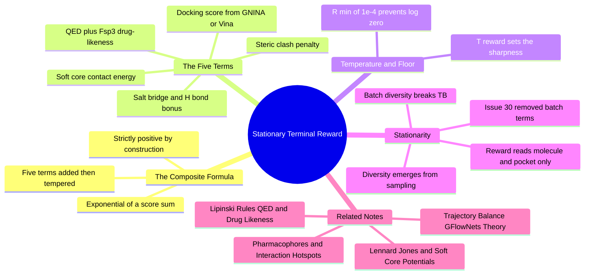

---
tags:
  - domain/reinforcement-learning
  - depth/essential
  - 3dsyntree
  - topic/reward-design
  - topic/multi-objective-optimization
module: "09. Markov Decision Processes and GFlowNets"
chapter: "Chapter 2. GFlowNet Theory and Training"
type: concept
---

# 3. Stationary Terminal Reward Formulation

> [!abstract] Core Idea
> The GFlowNet of [[1. Trajectory Balance GFlowNets Theory]] samples molecules with probability proportional to a reward $R(x)$ — so the reward function is not a "score at the end"; it is literally **the shape of the distribution you will sample from**. 3D-SynTree's reward maps a completed 3D design inside its pocket to a strictly positive scalar via an exponential composite of five scoring terms — docking affinity, shape-complementarity contact energy, steric clash penalty, drug-likeness, and key-interaction bonuses — tempered by a temperature $T_{\text{reward}}$ and floored at $R_{\min} = 10^{-4}$. And it must be **stationary**: a pure function of the molecule and the pocket alone. One batch-relative term (a diversity bonus computed against the current batch) was enough to make the target distribution chase its own tail, and Issue #30 [FLOW-02] removed it to keep Trajectory Balance mathematically valid.

Navigation: [[0. Markov Decision Processes and GFlowNets MOC]] · [[0. Master Vault Index]]

## 1. What It Is

The reward is a function

$$R: \mathcal{M} \to \mathbb{R}^{+}, \qquad x \mapsto R(x) > 0$$

defined on $\mathcal{M}$, the space of *completed* molecular designs — a molecule plus its 3D pose inside a specific protein binding pocket. Three properties are part of the definition itself:

- **Terminal-only.** Rewards are computed when an episode of the assembly MDP ([[1. The Assembly MDP Formulation]]) finishes; intermediate states carry no reward. The GFlowNet's reward is the width of the exit pipe, and exits exist only at finished molecules.
- **Strictly positive.** $P(x) \propto R(x)$ requires $R(x) > 0$ for every reachable $x$; moreover $\log R(x)$ sits inside the Trajectory Balance loss, so $R = 0$ is not merely "unrewarded" — it is $-\infty$ and a NaN gradient.
- **Stationary.** $R(x)$ depends on the molecule and the pocket — on nothing else. Not on the training step, not on the optimizer state, and not on which other molecules happen to be in the same batch.

## 2. Why It Exists

A drug candidate must satisfy many masters simultaneously: it must bind tightly, fill the pocket's shape without colliding with it, look like an orally available drug, and ideally pin down the specific interactions the pocket cares about. The reward scalarizes this multi-objective wish-list into the single number a training objective can climb. Because a GFlowNet copies the reward into its sampling distribution, a well-shaped $R$ is simultaneously: (a) the *definition of success* for a molecule, and (b) the *definition of the output portfolio* — reward a single chemical family and your generator will only ever produce that family. Every design choice in this note is therefore a statement about both chemistry and statistics at once.

## 3. How It Works

### 3.1 The exponential composite

$$R(x) \;=\; \exp\!\left( \frac{S_{\text{dock}}(x) + S_{\text{contact}}(x) + S_{\text{clash}}(x) + S_{\text{props}}(x) + S_{\text{key}}(x)}{T_{\text{reward}}} \right)$$

The five $S$-terms are additive scores (mixed signs, energy-like units); the exponential converts their sum into a strictly positive, multiplicative weight — the same move a Boltzmann distribution makes when it turns an energy into a probability. Dividing by the temperature $T_{\text{reward}}$ before exponentiating controls how *sharply* reward differences translate into probability differences, as detailed in section 3.3. The floor of section 3.4 then guarantees strict positivity at the bottom.

### 3.2 The five scoring terms, each from zero

| Term | What it measures | How it is computed | Guards against |
| --- | --- | --- | --- |
| $S_{\text{dock}}$ | Binding affinity — how strongly the molecule prefers the pocket over solvent | A docking engine (GNINA or Vina) searches for the best pose of the molecule in the cavity and returns an energy-like score, more negative = better binding (see [[1. Protein Ligand Binding Thermodynamics]]) | Molecules that ignore the pocket entirely |
| $S_{\text{contact}}$ | Shape complementarity — how well the molecule's surface nests into the cavity's surface | A soft-core Lennard-Jones potential summed over ligand–protein atom pairs: attraction at favorable contact distances, gently switched repulsion (see [[1. Lennard Jones and Soft Core Potentials]]) | Loose, rattling fits that score well by luck |
| $S_{\text{clash}}$ | Steric clash — hard overlap of atoms with pocket residues | A penalty computed when atoms interpenetrate each other's van der Waals spheres (see [[3. Van der Waals Radii and Steric Clash]]) | Physically impossible poses that game the docker |
| $S_{\text{props}}$ | Drug-likeness and saturation | The QED score (Quantitative Estimate of Drug-likeness, a 0–1 composite of oral-drug property ranges; see [[1. Lipinski Rules QED and Drug Likeness]]) plus an $Fsp^3$ term described below | Flat, greasy, pharmacokinetically hopeless chemistry |
| $S_{\text{key}}$ | Key-interaction bonus — formation of the interactions the pocket actually rewards | Counting salt bridges (charged pairs within $4.0\text{ Å}$) and hydrogen bonds (donor–acceptor pairs within $3.5\text{ Å}$) to key catalytic or hotspot residues (see [[2. Pharmacophores and Interaction Hotspots]]) | Molecules that bind anywhere and anyhow |

The $Fsp^3$ term deserves its own sentence, because it encodes a whole design philosophy. $Fsp^3$ is the fraction of carbon atoms that are tetrahedral ($sp^3$ hybridized — three-dimensional, "saturated") rather than flat ($sp^2$). The term is $w_{\text{fsp3}} \cdot \tanh(\max(0, Fsp^3 - 0.42))$: zero below 0.42, then a smooth, saturating ramp above it. In other words, saturation is a *thresholded desideratum* — flat aromatic grease earns nothing until it crosses 0.42, after which each extra notch of saturation earns a bit less (the $\tanh$ ramp). This is the reward-side enforcement of the flat-grease-trap problem (see [[2. Fsp3 Saturation and the Flat Grease Trap]]).

### 3.3 The temperature $T_{\text{reward}}$

Temperature is the exploration–exploitation dial of the *target distribution*. With small $T_{\text{reward}}$, score differences are amplified: the best modes tower over the rest, and the trained sampler concentrates on near-optimal chemistry. With large $T_{\text{reward}}$, the exponential flattens: mediocre molecules keep meaningful probability, and the portfolio spreads wide. It plays exactly the role of temperature in a softmax or a Boltzmann distribution — the same reward landscape, sampled more or less greedily. Choosing it is a strategic decision about the shortlist you want out of the generator.

### 3.4 The floor $R_{\min} = 10^{-4}$

A catastrophically bad design — clashes everywhere, dock score deeply negative — drives the exponent so far down that the exponential underflows toward zero, and $\log R(x)$ explodes toward $-\infty$: NaN gradients and a crashed training run. The floor clamps the reward,

$$R(x) \leftarrow \max\!\big(R(x),\; 10^{-4}\big),$$

which guarantees every reachable molecule a strictly positive, log-safe reward. The floor also has a sampling interpretation: even the worst design retains a tiny probability of being drawn, so the sampler never entirely loses contact with the low-reward regions of the space (useful for calibration and for evaluating what the model *dislikes*).

### 3.5 Stationarity: the requirement that broke a reward

**Stationarity** means $R(x)$ is a pure function of the design and its pocket: same molecule, same pose, same pocket ⇒ same reward, at every training step, forever, regardless of what else is happening in training. The Trajectory Balance identity treats $R(x)$ as a *constant of the target distribution* — the fixed exit-pipe width that the forward flow must learn to match. That is what allows $\log Z$ to converge to $\log \sum_x R(x)$: the thing being summed must not move.

Now consider the seductive idea that was originally in the reward: a **batch-relative diversity bonus** — reward each molecule for being structurally different from the other molecules in its training batch (e.g., via Tanimoto distances). The intention is good (diverse shortlists!), but the mathematics is fatal:

- The reward of molecule $x$ now depends on **which other molecules the policy happened to sample in the same batch**.
- Those other molecules are drawn from the policy itself — so when the policy updates, the *entire reward landscape shifts underneath it*.
- TB's target distribution becomes self-referential: the flow is being trained to match a reward function that is itself a function of the flow. The equality can never settle; $\log Z$ chases a moving quantity; gradients are systematically biased toward whatever the current batch looks like.

Issue #30 [FLOW-02] removed batch-relative metrics from the reward path for exactly this reason. Diversity is not lost — it is *relocated*: it emerges from the proportional-sampling objective itself (every high-reward mode gets sampled), is tuned through $T_{\text{reward}}$, and is *measured* post hoc on generated batches rather than baked into the training signal. The `batch_diversity()` function survives as exactly that — a measurement — not as a reward term.

> [!example] Stationary versus batch-relative, in one picture
> Stationary: pocket P rewards molecule $x$ at $0.7$ today, at $0.7$ next week, whether $x$ arrives alone or in a crowd. Batch-relative: $x$ scores $0.7$ when its batch-mates are twins, and $0.1$ when a batch-mate happens to be a novel scaffold. The GFlowNet is being asked to learn "produce molecules like the second case" — but the second case is defined by its own output. A dog chasing its own tail, with gradients.

### 3.6 Reward hacking, and why the terms team up

A GFlowNet will faithfully exploit whatever the reward actually pays for, so each term exists partly to close another term's loopholes: $S_{\text{clash}}$ stops the docker from being fooled by impossible poses; $S_{\text{props}}$ stops "clash-free but greasy" filler molecules; $S_{\text{contact}}$ and $S_{\text{key}}$ reward genuine shape and interaction fit rather than raw size. Even so, learned scorers can be gamed, which is why physical-sanity screening of *outputs* (see [[1. PoseBusters Physical Sanity Filters]]) remains a required checkpoint downstream of generation, and why the final scientific verdict comes from the benchmarking cascade of [[3. Baseline Comparisons TargetDiff SyntheMol]].

## 4. What It Consists Of

- **Composite scoring terms** — the five additive components $S_{\text{dock}}$, $S_{\text{contact}}$, $S_{\text{clash}}$, $S_{\text{props}}$, $S_{\text{key}}$.
- **Docking oracle** — GNINA/Vina, the external scoring engine supplying $S_{\text{dock}}$ (an *oracle*: an expensive black-box scorer consulted at terminal states).
- **Temperature scaling** — $T_{\text{reward}}$, the sharpness dial of the target distribution.
- **Minimum reward floor** — $R_{\min} = 10^{-4}$, clamping the exponential to keep $\log R$ finite.
- **Stationarity** — the constraint that $R$ be a pure function of (molecule, pocket), with all batch-relative terms excluded from the reward path.
- **Terminal-only evaluation** — rewards exist only for completed designs, matching the GFlowNet's exit-flow semantics.

## 5. What You Must Understand

> [!warning] In a GFlowNet, the reward IS the distribution
> Every temptation to "just add a term" to the reward is a decision about the shape of your generator's output. The exponential composite means terms interact multiplicatively after exponentiation: a molecule zeroed by one term is zeroed overall (modulo the floor). Design rewards like you would design a prior — because that is what you are doing.

> [!warning] Any batch-relative term breaks Trajectory Balance
> Diversity-vs-batch, novelty-vs-current-samples, adversarial critics over the batch — all of them make $R(x)$ a function of the policy's own output, which makes the TB target non-stationary. This is not a subtle instability; it voids the guarantee the algorithm was chosen for. Issue #30 [FLOW-02] is the canonical cautionary tale.

> [!warning] Strict positivity is a hard requirement, not a nicety
> $\log R(x)$ appears in the loss; $R(x) = 0$ for any reachable molecule is a NaN waiting to happen. The floor at $10^{-4}$ is the seatbelt.

> [!tip] Memory hooks
> "Five terms, one exponent, one temperature, one floor." "The reward is the exit pipe's width — don't let the pipe watch the other pipes." "Diversity by construction, not by bonus."

## 6. Prerequisites

- [[1. Lennard Jones and Soft Core Potentials]] — the shape of the $S_{\text{contact}}$ potential and of soft-core repulsion generally.
- [[2. Pharmacophores and Interaction Hotspots]] — what a "key interaction" is and why some residues are special.
- [[1. Lipinski Rules QED and Drug Likeness]] — the QED score and the property ranges behind $S_{\text{props}}$.

## 7. Project Connection

The reward is implemented as `ThreeDReward` in `syntree/engine/rl.py`: $S_{\text{dock}}$ from GNINA/Vina docking, $S_{\text{contact}}$ from the soft-core Lennard-Jones contact energy, $S_{\text{clash}}$ from the steric clash penalty, $S_{\text{props}}$ from `QED.qed(mol)` plus the $Fsp^3$ term `fsp3_weight · tanh(max(0, fsp3 − 0.42))`, and $S_{\text{key}}$ from `count_key_interactions()` counting salt bridges and hydrogen bonds to key residues — all combined under the temperature `T_reward` and floored at `R_min = 1e-4`. `batch_diversity()` remains in the module but was removed from the reward path by Issue #30 [FLOW-02] to preserve stationarity. The consumer of these rewards is `trajectory_balance_loss()` in `syntree/engine/gflownet.py`, whose validity is exactly what this note protects; training-distribution scheduling over pockets is handled separately by the curriculum of [[4. Curriculum Learning Approach C Quantiles]].

## 8. Required Depth

**Essential** — the reward is one of the two fixed ingredients of the Trajectory Balance identity (the other being $P_B$), and it defines both the chemical objective and the statistical shape of the generator's output.

## 9. Further Dependencies

- [[3. Baseline Comparisons TargetDiff SyntheMol]] — the reward terms define the metrics on which 3D-SynTree's generated portfolios are compared against diffusion and synthesis-tree baselines.

## Concept Mind Map

## Cross-Domain Links

- [[AI/08. Generative Modeling, MDPs, and GFlowNets/Chapter 2. Generative Flow Networks/4. Stationary Terminal Rewards vs Batch-Relative Drift|4. Stationary Terminal Rewards vs Batch-Relative Drift]] (AI vault) — the chemistry-side formulation of the reward that the AI side implements without batch-relative drift.
