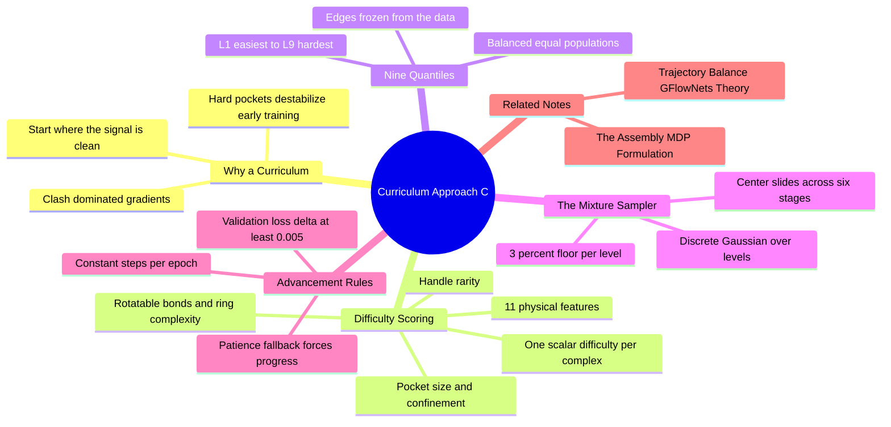

---
tags:
  - domain/reinforcement-learning
  - depth/supporting
  - 3dsyntree
  - topic/curriculum
  - topic/training-strategy
module: "09. Markov Decision Processes and GFlowNets"
chapter: "Chapter 2. GFlowNet Theory and Training"
type: concept
---

# 4. Curriculum Learning Approach C Quantiles

> [!abstract] Core Idea
> Training a GFlowNet uniformly across all 20,000 protein–ligand training complexes wastes the early phase of learning: the policy's first gradients come disproportionately from hard pockets — small cavities, bulky fragments, clash-riddled geometry — where the reward signal is chaotic, and convergence stalls. **Approach C** is an automated curriculum: score every complex for difficulty with 11 physical features, bin the dataset into 9 balanced quantiles ($L_1$ easiest to $L_9$ hardest), and sample training pockets from a discrete Gaussian mixture whose center slides from the easy band to the hard band across 6 stages. A 3% per-level floor keeps no level excluded, stages advance on a validation-loss milestone ($\Delta \mathcal{L}_{\text{val}} \ge 0.005$) with a patience fallback, and the number of training steps per epoch never changes — the curriculum changes *which* examples are seen, not how many.

Navigation: [[0. Markov Decision Processes and GFlowNets MOC]] · [[0. Master Vault Index]]

## 1. What It Is

**Curriculum learning** is the training strategy of ordering examples from easy to hard instead of presenting them uniformly at random — the machine-learning echo of how humans are taught arithmetic before calculus. This note describes 3D-SynTree's automated version, called **Approach C**: *automated* because no human labels anything "easy" or "hard"; difficulty is *measured* from physical features of each example; and *quantile-based* because the difficulty scores are converted into nine equally populated difficulty classes rather than arbitrary thresholds.

The unit of curriculum is the **training complex** — a protein pocket together with its reference ligand, drawn from the 20,000-complex training dataset. Each episode of the assembly MDP ([[1. The Assembly MDP Formulation]]) unfolds inside one pocket, so choosing which pockets to train on, and in what order, is choosing the difficulty of the school day.

## 2. Why It Exists

With uniform sampling over all 20,000 complexes, early training is dominated by the hardest examples in exactly the way that matters least. A hard complex — a tight, awkwardly shaped cavity that only admits bulky, many-rotatable-bond fragments — produces episodes whose rewards are dominated by steric clash penalties and docking noise. For an untrained policy, the gradient signal from such episodes is not "learn chemistry"; it is "avoid everything", which is uninformative and destabilizing. The result is slow or unstable convergence, or a policy that learns cautious mediocrity.

The situation is the training-time twin of the exploration problem: just as the behavior-cloning warm start of [[1. Trajectory Balance GFlowNets Theory]] prevents the *policy's actions* from starting at random, the curriculum prevents the *training data* from starting at its most hostile. Early steps are spent where the reward landscape is clean and learnable — open pockets, modest fragments, clear interactions — and only then does the sampler shift weight toward the pockets that genuinely stress the machinery.

## 3. How It Works

### 3.1 Difficulty scoring from 11 physical features

Each complex is described by **11 physical features** — measurable quantities of the pocket and its reference ligand that jointly predict how hard the complex is to design in. Four representative ones:

- **Pocket size** — how much volume the cavity offers; tiny pockets force bulky fragments into intimate, clash-prone contact with the protein.
- **Rotatable bonds** — the flexibility of the ligand's structure (see [[2. Rotatable Bonds and Dihedral Angles]]); every rotatable bond multiplies the geometric choices the policy must reason about.
- **Ring complexity** — how many fused and embedded ring systems the reference chemistry contains; complex ring topologies are harder to assemble and to fit.
- **Handle rarity** — how unusual the reactive handles are that the pocket's chemistry demands (see [[1. Chemoselectivity and Reactivity Tiers]]); rare handles have thin support in the catalog and in the policy's early experience.

The remaining seven features cover the same physical axes from other angles — additional pocket-geometry, ligand-flexibility, and chemical-complexity descriptors of the reference complex. The 11 features are combined into a single scalar **difficulty score** per complex: a fixed function of the feature vector whose only job is to produce a consistent ranking.

### 3.2 Nine balanced quantiles, L1 to L9

Sort all 20,000 complexes by difficulty score and cut the sorted list into **nine equal-population bins** — quantiles. A quantile cut at position $k/9$ of the sorted list guarantees each level $L_1, \dots, L_9$ holds the *same number* of complexes; this is what "balanced" means, and it prevents any difficulty class from being starved of data. $L_1$ contains the easiest ninth of the dataset, $L_9$ the hardest. The cut points (**quantile edges**) are computed once from the data distribution and then frozen — they are properties of the dataset, not of the training run.

### 3.3 The Gaussian mixture sampler across 6 stages

At any moment, training samples pockets from a distribution over the nine levels: a **mixture distribution** whose dominant component is a discrete Gaussian over level indices — a bell-shaped weighting centered on some level, with smoothly decaying weight on neighboring levels. The curriculum's engine is the **center of that bell**:

- **Stage 1:** the bell sits on the easy band ($L_1$–$L_3$).
- **Stages 2–5:** the center slides, stage by stage, through the middle levels.
- **Stage 6:** the bell sits on the hard band ($L_7$–$L_9$).

Two design properties are worth noticing. First, the *Gaussian shape* means adjacent levels always share probability mass — when the center moves from $L_3$ to $L_4$, level $L_3$ fades out gradually rather than being switched off; there is no difficulty cliff between stages. Second, the *mixture* framing means the overall sampling distribution is always an explicit, inspectable object — one can read off exactly what fraction of the next epoch's episodes will come from each level.

### 3.4 The 3% floor

Every level retains a sampling probability of **at least 3% at every stage**. The floor is applied to the mixture weights and the result renormalized. Its two jobs:

- **No level is ever abandoned.** Even at stage 6, easy pockets keep appearing — anchoring the policy on the fundamentals and preventing catastrophic forgetting of the easy regime.
- **No level is ever unreachable early.** Even at stage 1, the hardest pockets appear occasionally, so the policy is never blind-sided when the center arrives, and the validation signal (next section) always contains information about all regimes.

### 3.5 Milestone advancement with a patience fallback

When does the curriculum move to the next stage? Not on a fixed clock, but on measured progress: after each validation round, the **validation loss** — the Trajectory Balance loss evaluated on held-out pockets — is compared against the milestone baseline. If the improvement is at least the milestone threshold,

$$\Delta \mathcal{L}_{\text{val}} \ge 0.005,$$

the curriculum advances to the next stage: the current distribution has been learned well enough that harder data is the better use of the next steps. But plateaus happen — a distribution can be learned to the noise floor without producing a 0.005 delta. The **patience fallback** handles this: if a fixed number of validation checks pass without a qualifying improvement, the stage advances anyway. The two rules together mean the curriculum always moves forward — promptly when learning is real, eventually when it stalls — and never waits forever on a distribution the policy has exhausted.

### 3.6 Constant steps per epoch

The budget contract: **the number of environment steps (and gradient updates) per epoch is exactly the same as in standard, non-curriculum training.** The curriculum changes *which* complexes those steps consume; it does not add steps, drop data, or alter the objective, the loss, or the model. This is what makes Approach C a pure *data-scheduling* intervention: any benefit is attributable to the order of presentation, not to extra compute, and any comparison against uniform training is apples-to-apples. It also distinguishes the approach from cruder alternatives — training longer on easy data, or permanently discarding hard complexes, both of which change the effective objective or the coverage of the data.

> [!example] A curriculum in motion, abstractly
> Early training: the sampler's bell sits near $L_2$ — open pockets, flexible-looking ligands, common handles — so most episodes produce informative gradients; hard levels still trickle in at 3% each. After several validation rounds, the TB validation loss improves by more than 0.005 over the milestone: advance. The bell slides toward the middle levels. Weeks later, near stage 6, the bell sits on $L_8$ — tight, complex, clash-prone pockets — and the easy regime survives only through the floor. Had a plateau instead been detected for the patience window, the stage would have advanced anyway. Step count per epoch: unchanged throughout.

## 4. What It Consists Of

- **Difficulty scoring model** — the fixed function mapping each complex's 11 physical features to a scalar difficulty.
- **Quantile edges** — the eight frozen cut points dividing the sorted dataset into the nine balanced levels.
- **Difficulty levels** — the quantiles $L_1$ (easiest) through $L_9$ (hardest), equal population each.
- **Gaussian mixture sampler** — the level-index distribution whose bell-shaped center defines the current training diet.
- **Sampling floor** — the 3% per-level minimum probability, renormalized into the mixture.
- **Milestone rule** — advance on validation-loss improvement $\Delta \mathcal{L}_{\text{val}} \ge 0.005$.
- **Patience fallback** — advance anyway after a fixed number of validation checks without a qualifying delta.
- **Constant epoch budget** — identical steps per epoch as uniform training.

## 5. What You Must Understand

> [!warning] The curriculum is not a change to the objective
> Nothing about the Trajectory Balance loss, the reward, or the policy architecture changes. If you find yourself explaining Approach C as "a different training objective", stop: it is a *sampling schedule* over training pockets. The objective is untouched, which is exactly why it is safe to layer on top of the GFlowNet machinery.

> [!warning] The floor is not optional decoration
> Without the 3% floor, a stage's non-central levels would asymptote to zero weight; the policy would forget the easy regime by stage 6 and be blind-sided by hard pockets at stage 1. The floor keeps the sampling distribution's support full at all times.

> [!note] Milestones watch validation loss, not training loss
> Advancing on *training* loss would reward overfitting the current distribution — the policy could look "done" by memorizing the easy levels. The validation TB loss on held-out pockets measures genuine generalization before the curriculum dares to move on.

> [!tip] Memory hooks
> "11 features, 9 quantiles, 6 stages, 3% floor, 0.005 milestone." "The bell slides, the floor holds, the budget never changes."

## 6. Prerequisites

- [[1. Binding Pockets and Cavity Extraction]] — what a pocket *is* physically, and therefore what "pocket size" and cavity difficulty can even mean.
- [[1. The Assembly MDP Formulation]] — episodes, steps, and epochs are the units the curriculum schedules over.

## 7. Project Connection

The curriculum lives in `CurriculumController` and `CurriculumSampler` in `syntree/engine/curriculum.py`: the controller owns the milestone logic (validation-loss tracking, the $\Delta \mathcal{L}_{\text{val}} \ge 0.005$ threshold, patience counting), while the sampler owns the level distribution (quantile edges, the sliding Gaussian mixture, the 3% floor, renormalization). It is configured through `configs/train_colab_12h.json` — binding the curriculum design to the compact training budget it was built to stabilize — and its behavior is independently checked by `scripts/verify_curriculum.py`. The consumers are `GFlowNetTrainer` in `syntree/engine/gflownet.py` (which evaluates the TB loss the milestones watch) and `MolecularAssemblyEnv` in `syntree/engine/environment.py` (whose episodes consume the sampled pockets from the 20,000-complex training dataset).

## 8. Required Depth

**Supporting** — Approach C is an engineering stabilizer that makes training converge reliably within the planned compute budget; it is not a scientific contribution of the system, but misreading it (as an objective change, or as extra compute) will confuse every training-curve discussion later.

## 9. Further Dependencies

- [[3. Baseline Comparisons TargetDiff SyntheMol]] — benchmark comparisons must be interpreted with the training schedule in mind: the curriculum shapes *how* the reported performance was reached, on the same data and the same step budget as the baselines' regimes allow.

## Concept Mind Map

## Cross-Domain Links

- [[AI/09. Training Dynamics, Optimization, and Curriculum Learning/Chapter 2. Curriculum Strategies/2. Approach C Quantile-Balanced Curriculum Architecture|2. Approach C Quantile-Balanced Curriculum Architecture]] (AI vault) — 9 difficulty quantiles, 6 stages, a 3% mixture floor, and milestones $\Delta\mathcal{L} \ge 0.005$.
