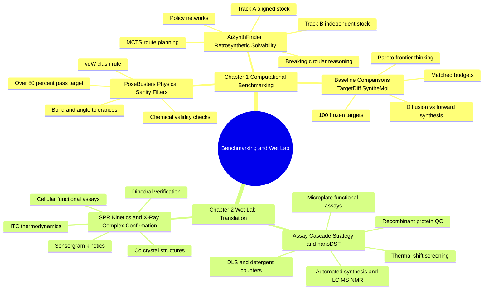

---
tags:
  - moc
  - domain/benchmarking
  - 3dsyntree
module: "10. Benchmarking and Wet Lab Translation"
type: moc
---

# 0. Benchmarking and Wet Lab Translation MOC

> [!abstract] Module Mission
> This module is where 3D-SynTree's claims meet their judges. Chapter 1 builds the computational benchmarking stack — PoseBusters physical-sanity filters, AiZynthFinder independent retrosynthetic verification, and the head-to-head comparative protocol against diffusion, forward-synthesis, and autoregressive baselines on 100 frozen targets. Chapter 2 follows the survivors into the real world: the wet-lab assay cascade from automated synthesis and nanoDSF/DLS triage through SPR kinetics, ITC thermodynamics, X-ray co-crystallography with dihedral verification, and cellular functional assays. Together they answer the only question that finally matters: does the system actually design real, makeable, working molecules?

Navigation: [[0. Master Vault Index]] · [[2. Prerequisite Knowledge Graph]] · [[3. Study Tracks and Curriculum]]

## Module Mind Map

## Chapter 1. Computational Benchmarking

| Note | Focus | Required Depth | Key Prerequisites |
| --- | --- | --- | --- |
| [[1. PoseBusters Physical Sanity Filters]] | The standardized physical-plausibility test battery — chemical validity, intramolecular geometry tolerances, intermolecular clash rules — that exposes generative models cheating docking scores with unphysical poses | Essential | [[3. Molecular Geometry and Hybridization]], [[3. Van der Waals Radii and Steric Clash]], [[3. Molecular Mechanics and MMFF94 Restraints]] |
| [[2. AiZynthFinder Retrosynthetic Solvability]] | Independent retrosynthetic route verification via MCTS and policy networks, in a stock-aligned Track A and an independent external-stock Track B, as the cure for circular synthesizability claims | Supporting | [[2. The 32 Certified Reaction Grammar]], [[3. Enamine REAL Space and Catalogs]] |
| [[3. Baseline Comparisons TargetDiff SyntheMol]] | The head-to-head protocol against TargetDiff/DiffSBDD diffusion, SyntheMol/SynNet forward-synthesis trees, and Pocket2Mol autoregressive growth — 100 frozen targets, matched budgets, identical pipelines, Pareto frontier reading | Essential | [[3. Homology MMseqs2 Clustering and Data Leakage]], [[1. PoseBusters Physical Sanity Filters]], [[2. AiZynthFinder Retrosynthetic Solvability]] |

## Chapter 2. Wet Lab Translation

| Note | Focus | Required Depth | Key Prerequisites |
| --- | --- | --- | --- |
| [[1. Assay Cascade Strategy and nanoDSF]] | The cascade front half: recombinant protein production and QC, microplate assays, nanoDSF thermal-shift triage, DLS aggregation detection, Triton X-100 detergent re-assays, off-target counter-screens, and automated parallel synthesis with LC-MS, NMR, and chiral SFC confirmation | Supporting | [[2. Kinetic and Affinity Metrics IC50 Kd Ki]], [[1. Amino Acids and Peptide Backbones]], [[1. Protein Ligand Binding Thermodynamics]] |
| [[2. SPR Kinetics and X-Ray Complex Confirmation]] | The deep-confirmation back half: SPR sensorgrams and multi/single-cycle kinetics ($k_{\text{on}}$, $k_{\text{off}}$, $K_D$), ITC thermodynamic deconvolution ($n$, $\Delta H$, $\Delta S$), X-ray co-crystallography with pose RMSD and dihedral verification ($\phi_{\text{obs}}$ vs $\phi_{\text{pred}}$), and cellular functional assays | Advanced | [[2. Rotatable Bonds and Dihedral Angles]], [[3. X-Ray Crystallography and PDB Artifacts]], [[2. Kinetic and Affinity Metrics IC50 Kd Ki]] |

## Learning Path Through This Module

1. [[1. PoseBusters Physical Sanity Filters]] — start with the first judge: why a great docking score on an unphysical pose is worthless, and what the three check groups actually test.
2. [[2. AiZynthFinder Retrosynthetic Solvability]] — meet the second judge: an independent backwards planner that audits synthesizability claims in two stock conditions.
3. [[3. Baseline Comparisons TargetDiff SyntheMol]] — combine both judges into a rigorous head-to-head against the competing generative paradigms, and learn to read results as Pareto frontiers rather than single scores.
4. [[1. Assay Cascade Strategy and nanoDSF]] — cross from bits to bench: how surviving molecules are synthesized, purified, identity-confirmed, and triaged through cheap biophysical gates that catch artifacts.
5. [[2. SPR Kinetics and X-Ray Complex Confirmation]] — finish at the deepest evidence: binding kinetics and thermodynamics, atomic co-crystal structures with pose and dihedral verification, and nanomolar cellular potency.

## Why This Module Matters for 3D-SynTree

3D-SynTree's three founding claims — escaping the Synthesizability Wall, matching the 3D cavity, and avoiding flat grease — are all, by themselves, just assertions. This module is the proof machinery that converts them into evidence. The PoseBusters battery targets a $>80\%$ physical-sanity pass rate where unconstrained diffusion models sit below $20\%$; the AiZynthFinder dual tracks verify that an independent planner can actually route to the generated molecules; and the comparative benchmark of `scripts/run_comparative_benchmark.py` runs all of it on 100 held-out targets clustered below 30% sequence identity, under matched budgets, with identical evaluation pipelines flowing through the `EvaluationPipeline`. The wet-lab chapter then closes the loop the reward function opened: the GNINA/Vina docking term that trains the policy is a surrogate, and the assay cascade — from automated synthesis of recipe-carrying designs to the junction-dihedral audit of $\phi_{\text{obs}}$ against $\phi_{\text{pred}}$ — is where the surrogate is finally graded by reality. For the architecture overview that these evaluations grade, see [[1. 3D-SynTree System Overview]].

## Gate Check

> [!question] Before moving on, can you...
> - Name the three PoseBusters check groups with their numeric tolerances, and explain why a $-10\text{ kcal/mol}$ docking score can be worthless?
> - Explain why "synthesizable because my own forward grammar built it" is circular reasoning, and what the two AiZynthFinder tracks each verify?
> - Describe the three competing generative paradigms in the comparative benchmark and what each one fundamentally ignores?
> - Explain why the benchmark freezes 100 targets at $<30\%$ sequence identity with matched budgets, and why results must be read as a Pareto frontier rather than a single score?
> - Walk a molecule through the full wet-lab cascade from automated synthesis to cellular assays, naming the artifact that detergent re-assay and DLS are designed to catch?
> - State what the dihedral audit $\phi_{\text{obs}}$ versus $\phi_{\text{pred}}$ measures and why it is the most direct experimental test of 3D-SynTree's torsion policy?

## Primary Reading

Buttenschoen, M., et al. (2024). *PoseBusters: AI-based Docking Methods Fail to Generate Physically Valid Poses*. **Chemical Science**, 15(8), 3130–3139.
