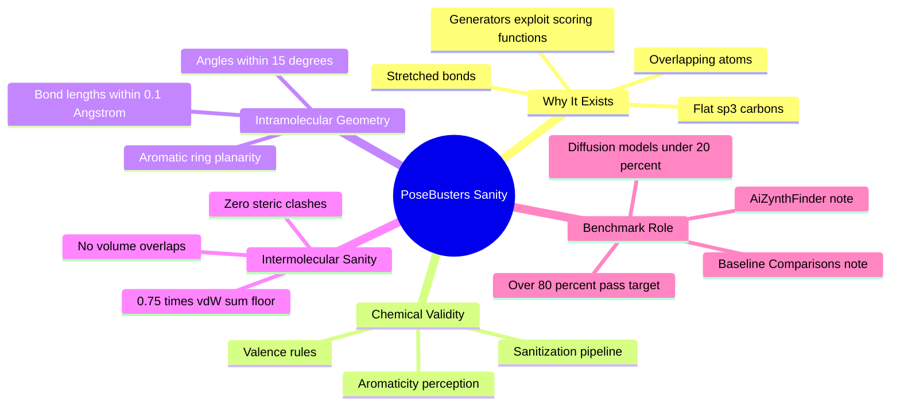

---
tags:
  - domain/benchmarking
  - depth/essential
  - 3dsyntree
  - topic/pose-validation
module: "10. Benchmarking and Wet Lab Translation"
chapter: "Chapter 1. Computational Benchmarking"
type: concept
---

# 1. PoseBusters Physical Sanity Filters

> [!abstract] Core Idea
> PoseBusters is a standardized, automated battery of chemical and physical plausibility checks that asks a question docking scores never ask: *is this generated molecular pose even physically possible?* A great docking score from a molecule with overlapping atoms, stretched bonds, or a flat $sp^3$ carbon is not a discovery — it is a bug being rewarded. 3D-SynTree targets $>80\%$ PoseBusters pass rates, against $<20\%$ for unconstrained 3D diffusion generators.

Navigation: [[0. Benchmarking and Wet Lab Translation MOC]] · [[0. Master Vault Index]]

## 1. What It Is

A **pose** is a proposed 3D placement of a small molecule inside a protein binding pocket — the molecule's atoms assigned specific coordinates relative to the protein's atoms. A **validation test battery** is a fixed, versioned collection of automated checks, each returning pass or fail. **PoseBusters** (Buttenschoen et al., 2024, *Chemical Science*) is exactly such a battery: an open-source suite of tests that verifies whether a computer-generated pose is **physically and chemically plausible** — whether the molecule could actually exist and actually sit in the pocket the way the model claims.

The battery is organized in three escalating groups:

1. **Chemical validity** — is the molecule a legal chemical object at all?
2. **Intramolecular geometry** — are the molecule's internal bond lengths, bond angles, and ring shapes physically sane?
3. **Intermolecular physical sanity** — does the molecule's placement collide with the protein?

Each check has a numeric tolerance, and the output is a per-check and per-molecule **pass/fail rate** across a whole set of generated poses.

## 2. Why It Exists

Docking and generative scoring functions are cheap approximations of binding free energy (see [[1. Lennard Jones and Soft Core Potentials]] for their physical core). They reward close, extensive contact between ligand and protein — but most of them never verify that the *chemistry of the resulting geometry is possible*. A generator optimizing such a score will find, with mechanical reliability, configurations that exploit every weakness of the scorer: **overlapping atoms** (atoms parked on top of protein atoms count as "contact"), **flat $sp^3$ carbons** (a tetrahedral carbon's four substituents squeezed into one plane to press against more of the pocket at once), and **extreme bond extensions** (a bond stretched far beyond its natural length to reach an extra hydrogen bond). Every one of these is physically impossible or wildly strained, yet every one *raises the score*.

This is textbook reward hacking. PoseBusters exists to close the loophole: before any affinity claim is believed, the pose must survive checks that a scoring function simply does not perform. The 2024 finding that gave the tool its name was sobering — when state-of-the-art 3D generative models' outputs were run through these checks, a large majority failed at least one physical or chemical test.

## 3. How It Works

### 3.1 Group 1: Chemical Validity

The first group checks that the molecule is a well-formed chemical graph and 3D structure:

- **Sanitization** — the molecule must survive the cheminformatics toolkit's full sanity pipeline (as implemented in RDKit, the standard cheminformatics library): graph consistency, ring perception, kekulization (assigning explicit single/double bonds to aromatic systems), and hybridization assignment must all succeed without error.
- **Valid valences** — every atom must respect its allowed bonding capacity. A carbon carries at most four bonds; a neutral nitrogen at most three (four when positively charged, five only in specific charged states). The classic failure of unconstrained generators — the **pentavalent carbon** — fails here.
- **Correct aromaticity** — rings flagged as aromatic must genuinely satisfy the electronic conditions for aromaticity (planar, cyclic, delocalized $\pi$ systems following the $4n+2$ electron counting rule), and the geometry must match the flag: an "aromatic" ring drawn as a puckered boat is a contradiction.

### 3.2 Group 2: Intramolecular Geometry

The second group compares the molecule's internal shape against equilibrium reference values (the same kind of equilibrium bond and angle parameters that force fields encode, as covered in [[3. Molecular Mechanics and MMFF94 Restraints]]):

- **Bond lengths within $0.1\text{ Å}$ of equilibrium.** A carbon–carbon single bond "wants" to be about $1.54\text{ Å}$; an aromatic C–C bond about $1.39\text{ Å}$; a C–H bond about $1.09\text{ Å}$. The generated pose's bonds must fall within $0.1\text{ Å}$ of these references — stretching a bond to $1.9\text{ Å}$ to reach a distant residue fails.
- **Bond angles within $15^\circ$ of equilibrium.** A tetrahedral carbon's angles want $109.5^\circ$; a trigonal planar carbon's want $120^\circ$. Flattening a tetrahedral center toward planarity to gain pocket contact fails this check — the "flat $sp^3$ carbon" cheat.
- **Planarity of aromatic rings.** Benzene-like rings must be genuinely flat: the out-of-plane deviation of ring atoms is measured, and a buckled "aromatic" ring fails. Planarity here is the geometric signature of a delocalized $\pi$ electron system.

### 3.3 Group 3: Intermolecular Physical Sanity

The third group checks the molecule *against the protein*:

- **Zero steric clashes** — no ligand atom may approach a protein atom closer than $0.75 \times$ the sum of their **van der Waals radii** (the nominal atomic sizes introduced in [[3. Van der Waals Radii and Steric Clash]]). Two non-bonded atoms repel each other ferociously once their electron clouds overlap; a generous factor of 0.75 on the radius sum is the tolerated floor, and *any* pair below it is a clash.

> [!example] The clash arithmetic
> Carbon's van der Waals radius is about $1.70\text{ Å}$, so two non-bonded carbons normally keep $\ge 3.40\text{ Å}$ apart. The PoseBusters floor is $0.75 \times 3.40 = 2.55\text{ Å}$. A generated pose with a ligand carbon $2.1\text{ Å}$ from a protein carbon — physically impossible, yet scored as favorable "contact" by naive scorers — fails outright.

- **No volume overlaps** — beyond pairwise distances, no ligand atom may sit inside occupied protein volume; this catches molecules whose atoms are literally embedded inside protein atoms.

### 3.4 Scoring and Aggregation

PoseBusters reports **structural validation tests, distance tolerances, and pass/fail rates**: each pose passes or fails each check, and a molecule "passes PoseBusters" only if it passes *all* checks. The tolerances (the $0.1\text{ Å}$, $15^\circ$, and $0.75 \times$ vdW-sum thresholds) act as the battery's numeric "energy thresholds" — they define how far a structure may deviate from reference equilibrium geometry (encoded in molecular-mechanics parameter sets) before it is declared unphysical.

### 3.5 The Benchmark Numbers That Motivate Everything

For 3D-SynTree the target is a **$>80\%$ PoseBusters pass rate** across generated molecules, compared with **$<20\%$ for unconstrained diffusion models**. The reason 3D-SynTree can even aim there is architectural: its molecules are assembled from real purchasable synthons whose internal geometry is embedded with RDKit ETKDG distance geometry (see [[2. Distance Geometry and ETKDG]]) and kept intact — the engine never predicts coordinates atom-by-atom, so it never invents impossible ones. The comparative evidence is assembled in [[3. Baseline Comparisons TargetDiff SyntheMol]].

## 4. What It Consists Of

- **Chemical validity group** — sanitization, valence, and aromaticity checks on the molecular graph and its 3D annotation.
- **Intramolecular geometry group** — bond-length ($0.1\text{ Å}$), bond-angle ($15^\circ$), and aromatic-ring-planarity tests against equilibrium references.
- **Intermolecular sanity group** — ligand–protein clash detection at the $0.75 \times$ vdW-sum floor and volume-overlap checks.
- **Distance tolerances** — the numeric thresholds that separate "strained but real" from "impossible".
- **Equilibrium reference geometry** — the molecular-mechanics-derived yardsticks bonds and angles are compared against.
- **Pass/fail rate outputs** — per-check and aggregate pass statistics over a generated set.

## 5. What You Must Understand

> [!warning] A low docking score is meaningless if PoseBusters fails
> The docking score answers "how favorable is the interaction *if* this geometry were real". PoseBusters answers "is this geometry real at all?" A $-12\text{ kcal/mol}$ pose with a pentavalent carbon is not a strong binder; it is a fantasy that the scorer cannot tell apart from a molecule.

> [!warning] Passes are conjunctive, not averageable
> A molecule passes only if *every* check passes. Ten perfect properties do not compensate for one impossible bond. Never average pass rates across checks and call the molecule valid.

> [!tip] Memory hook: chemistry, inside, outside
> The three groups sweep outward: is the molecule legal chemistry? Is its own geometry sane? Is its placement in the pocket sane? Any "no" anywhere kills the pose.

> [!note] Necessary but not sufficient
> PoseBusters says nothing about *synthesizability* (that is the job of [[2. AiZynthFinder Retrosynthetic Solvability]]) and nothing about true affinity — a physically perfect pose can still be a weak binder. It is the first gate, not the finish line.

## 6. Prerequisites

- [[3. Molecular Geometry and Hybridization]] — you need $sp^2$ versus $sp^3$ geometry and the equilibrium angles ($120^\circ$, $109.5^\circ$) the angle checks enforce.
- [[3. Van der Waals Radii and Steric Clash]] — the clash floor is defined directly in terms of vdW radius sums.
- [[3. Molecular Mechanics and MMFF94 Restraints]] — the equilibrium bond lengths and angles used as reference yardsticks come from this parameterization tradition.

## 7. Project Connection

Two code sites realize this note. `ChemicalValidator` in `syntree/chemistry/validator.py` is the per-molecule gate that enforces chemical legality during generation, so obviously invalid structures never reach scoring in the first place. The full benchmark evaluation — running the PoseBusters-style battery over every generated pose and aggregating pass rates — lives in the `EvaluationPipeline` in `syntree/engine/evaluator.py`. Architecturally, 3D-SynTree never *predicts* raw atom coordinates: synthons enter with ETKDG-embedded internal geometry that is locked and preserved across reaction steps, junction planarity is enforced where chemistry demands it, and only the newly formed bond's dihedral is chosen. Physical sanity is inherited by construction rather than filtered after the fact — which is why an $>80\%$ pass rate is an achievable target while freely diffusing coordinates is not.

## 8. Required Depth

**Essential** — this is the first gate of the entire benchmarking stack; every generated molecule passes or fails here before any affinity or synthesizability comparison is meaningful.

## 9. Further Dependencies

- [[3. Baseline Comparisons TargetDiff SyntheMol]] — the comparative benchmark consumes PoseBusters pass rates as one of its headline metrics when 3D-SynTree is scored against diffusion and forward-synthesis baselines.

## Concept Mind Map

## Cross-Domain Links

- [[AI/10. Numerical Analysis and High-Performance GPU Engineering/Chapter 1. Precision Dynamics and Numerics/3. Saturation Clamps and Numerical Boundary Engineering|3. Saturation Clamps and Numerical Boundary Engineering]] (AI vault) — clamped activations and bounded soft-core potentials prevent unphysical geometries from passing sanity filters.
